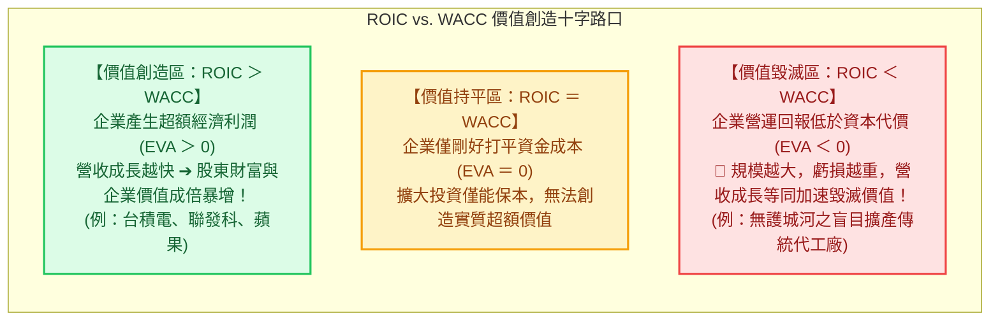
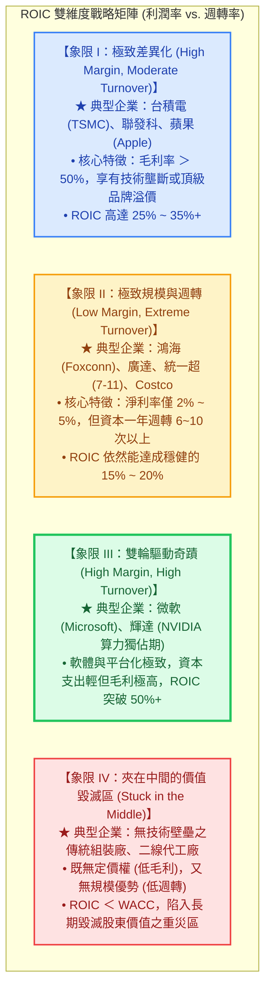

---
{"dg-publish":true,"permalink":"/98/roic-return-on-invested-capital/","tags":["商業概念","財務管理","價值評估","策略管理","公司理財","PMBA"],"dg-note-properties":{"aliases":["投入資本報酬率","資本回報率","Return on Invested Capital","ROIC","資本投入報酬率","return-on-invested-capital","經濟增加值","EVA"],"tags":["商業概念","財務管理","價值評估","策略管理","公司理財","PMBA"]}}
---


# 投入資本報酬率 (Return on Invested Capital, ROIC)

> 💡 **導航與索引**：本篇為衡量企業經營「真實資本運用效率」與檢驗經濟護城河（Economic Moat）之最核心財務指標。探討企業每投入 1 塊錢營運資本能創造多少稅後核心營業利潤，以及價值創造利差（ROIC vs. WACC）。亦可參閱折現資本成本 [[98_商業概念庫/wacc_加權平均資本成本\|加權平均資本成本 (WACC)]]、股東回報拆解工具 [[98_商業概念庫/dupont-analysis_杜邦分析法\|杜邦分析法 (DuPont)]]、淨營運資金工具 [[98_商業概念庫/NWC_淨營運資本 Net Working Capital\|淨營運資本 (NWC)]]、總體資本結構 [[98_商業概念庫/capital-structure_資本結構\|資本結構 (Capital Structure)]]，以及企業內在價值評估 [[98_商業概念庫/company-value_公司內在價值\|公司內在價值 (Company Value)]]。

---

## 一、 核心定義與「超額價值創造」本質

### 1. 核心定義
- **投入資本報酬率（Return on Invested Capital，簡稱 ROIC，亦稱資本回報率）** 衡量企業**不論資金來源是債權人借貸還是股東出資**，其投入本業實體營運的「真實資本（Invested Capital）」所創造的**稅後營業淨利（NOPAT）之百分比回報**。
- **商管與價值投資的終極試金石**：
  華倫·巴菲特（Warren Buffett）與麥肯錫（McKinsey）估值體系一致強調：**ROIC 是檢驗一家企業是否具備可持續競爭優勢（護城河）的最客觀標準**。純粹靠營收擴張或盲目借債推升每股盈餘（EPS）的公司比比皆是，但唯有能長期維持高 ROIC 的企業，才是真正的價值創造者。

### 2. 經濟價值增加值（EVA）與超額利潤準則
企業的營運是否真正為股東創造財富，取決於 **ROIC 與加權平均資本成本（WACC）之間的「價值創造利差（Spread）」**：

$$\text{經濟價值增加值 (EVA)} = (\text{ROIC} - \text{WACC}) \times \text{投入資本 (Invested Capital)}$$



- **價值創造鐵律**：
  當 $\text{ROIC} > \text{WACC}$ 時，企業進行新的資本支出與擴產能放大企業價值；**若 $\text{ROIC} < \text{WACC}$，企業「成長」反而是災難——營收規模越大，實質上替股東毀滅越多的現金價值**！

---

## 二、 計算公式與資產/融資雙軌拆解

### 1. 標準計算公式
$$\text{ROIC} = \frac{\text{稅後營業淨利 (NOPAT)}}{\text{投入資本 (Invested Capital, IC)}}$$

- **分子：稅後營業淨利（NOPAT, Net Operating Profit After Tax）**
  $$\text{NOPAT} = \text{息稅前利潤 (EBIT)} \times (1 - T_C)$$
  - *剔除融資結構干擾*：使用息稅前利潤（EBIT）而非稅後淨利（Net Income），目的在於**完全排除利息費用與財務槓桿結構的影響**，純粹衡量「本業資產」的營運賺錢能力。
- **分母：投入資本（Invested Capital, IC）之雙軌測算法**：
  - **資產端構建法（Operating Approach，最常採用）**：
    $$\text{IC} = \text{營業用流動資產} - \text{無息流動負債} + \text{固定資產淨額 (PPE)} + \text{無形資產與商譽}$$
    $$\text{IC} = \text{淨營運資本 (NWC)} + \text{固定資產 (PPE)} + \text{其他長期營業資產}$$
    *註：必須扣除「閒置超額現金（Excess Cash）」與非營業性轉投資。*
  - **融資端構建法（Financing Approach）**：
    $$\text{IC} = \text{長短期計息金融負債 (Total Debt)} + \text{股東權益 (Stockholders' Equity)} - \text{超額現金}$$

### 2. ROIC 的策略杜邦式二元拆解
將 ROIC 乘以「營業收入 / 營業收入」，可精準拆解為兩大完全不同的商業策略驅動因子：

$$\text{ROIC} = \underbrace{\frac{\text{NOPAT}}{\text{營業收入}}}_{\text{營業淨利率 (差異化定價權)}} \times \underbrace{\frac{\text{營業收入}}{\text{投入資本}}}_{\text{資本週轉率 (營運效率與產能利用率)}}$$

```text
【ROIC 策略二元拆解模型】

                 ┌────────────────────────────────────────────────────────┐
                 │        投入資本報酬率 (ROIC = NOPAT / IC)              │
                 └───────────────────────────┬────────────────────────────┘
                                             │
                     ┌───────────────────────┴───────────────────────┐
                     ▼                                               ▼
     ┌───────────────────────────────┐               ┌───────────────────────────────┐
     │ 營業利潤率 (NOPAT / Revenue)  │   相乘 (×)    │  資本週轉率 (Revenue / IC)    │
     └───────────────┬───────────────┘               └───────────────┬───────────────┘
                     │                                               │
     • 體現【毛利空間與定價權】                      • 體現【資產流轉與供應鏈營運效率】
     • 護城河：技術專利、品牌溢價、無形資產          • 護城河：規模經濟、精實精實製造、高週轉
```

---

## 三、 課堂白板矩陣：極致差異化 vs. 低成本規模營運

在台大 PMBA 與策略管理課堂中，企業追求高 ROIC 的路徑可劃分為經典的四象限戰略地圖：



| 經營象限 | 代表標竿企業 | 營業淨利率 | 資本週轉率 | ROIC 表現 | 核心競爭優勢與商業模式 |
| :--- | :--- | :---: | :---: | :---: | :--- |
| **極致技術差異化** | **台積電 (2330)** | **高達 40%~45%** | 適中 (約 0.6~0.8x) | **25% ~ 30%** | 先進製程技術護城河、極致良率、客戶無可替代性。 |
| **極致規模效率** | **鴻海 (2317)** | **約 2.5%~3.5%** | **極高 (約 4.0~5.0x)** | **12% ~ 16%** | 全球供應鏈垂直整合、超大型訂單履約能耐、嚴格費用管控。 |
| **負營運資本奇蹟** | **統一超 (2912)** | **約 4.5%~6.0%** | **極高 (零售現金流)** | **20% ~ 28%** | 強大通路議價力，對供應商享有長帳期（負 CCC），以他人資金營運。 |
| **算力生態巨霸** | **NVIDIA** | **高達 50%~60%** | **高 (無晶圓 Fabless)** | **50% ~ 70%+** | CUDA 軟硬整合生態系，AI 晶片供不應求享有絕對定價特權。 |

---

## 四、 企業高階經理人（CEO / CFO）ROIC 實戰三大軍規

### 1. 跨越「營收擴張迷思」，將 ROIC 作為資本配置的最高審查原則
* 經理人最常犯的重大錯誤是**盲目追求「營收百億、千億」的規模名目**。
* CFO 必須在內部資本支出（CapEx）審查會上確立死線：**所有新增專案之預期 ROIC 必須高於門檻收益率（Hurdle Rate $=$ WACC $+ \alpha$）**。若專案回報低於資本成本，寧可把現金透過股票回購或現金股利退還股東，嚴禁盲目資本膨脹。

### 2. 警惕「資產膨脹侵蝕症」：優化淨營運資本 (NWC)
* 推升 ROIC 不僅能靠提高利潤率（分子），**縮減投入資本分母（IC）往往能產生立竿見影的奇效**：
  * 實施精實存貨管理（JIT），降低庫存積壓；
  * 嚴格催收應收帳款，縮短 DSO；
  * 善用供應商商業信用（應付帳款），推動**負現金轉換週期（Negative CCC）**，達成「不花自己的資本也能擴張業務」的極致境界。

### 3. ROIC 衰退是「護城河潰堤」的第一前兆
* 當企業表面上營收與淨利仍在成長，但 **ROIC 連續 2~3 年呈現向下趨勢時**，通常意味著：
  1. 新進入者加入競爭，侵蝕定價權；
  2. 為了維持營收，被迫追加超額資本支出（如高價擴產、買昂貴設備），資產利用率下滑；
* CEO 必須在此訊號出現時立即警戒，啟動策略再聚焦或尋求第二成長曲線。

---

## 五、 關聯主題與模組網絡

- 🧭 **課程核心模組對接**：
  - [[04_主題選修/10_創業與企業財務策略/02_模組筆記/Module_2_產品創新與精實驗證/M2-1_精實產品開發與服務創新驗證\|M2-1 精實產品開發與服務創新驗證]]（ROIC 競爭矩陣、白板推導、NWC 與 CCC 閉環）
  - [[04_主題選修/10_創業與企業財務策略/02_模組筆記/Module_1_創新思維與商業模式/M1-2_白板決策鏈與財務價值三角\|M1-2 白板決策鏈與財務價值三角]]（資本傳導鏈、杜邦分析法拆解、超額報酬率利差）
  - [[04_主題選修/12_產業分析與投資策略/02_模組筆記/Module_1_產業框架與動態競爭/M1-3_產業獲利結構差異與十大經典理論\|M1-3 產業獲利結構差異與十大經典理論]]（跨產業獲利驅動因子：台積電 vs 鴻海 vs 統一超 ROIC 對標）
  - [[04_主題選修/12_產業分析與投資策略/02_模組筆記/Module_1_產業框架與動態競爭/M1-2_三大景氣循環與資本評價邏輯\|M1-2 三大景氣循環與資本評價邏輯]]（資本收益率與門檻收益率 Hurdle Rate 比較）
- 🔗 **核心概念原子卡片雙向互聯**：
  - [[98_商業概念庫/wacc_加權平均資本成本\|加權平均資本成本 (WACC)]]（EVA 價值創造利差之比較基準門檻）
  - [[98_商業概念庫/dupont-analysis_杜邦分析法\|杜邦分析法 (DuPont)]]（權益報酬率 ROE 與 ROIC 之映射互補）
  - [[98_商業概念庫/NWC_淨營運資本 Net Working Capital\|淨營運資本 (NWC)]]（投入資本 IC 之核心流動資產構成要件）
  - [[98_商業概念庫/capital-structure_資本結構\|資本結構 (Capital Structure)]]（融資端 IC 組合與資金成本極小化）
  - [[98_商業概念庫/company-value_公司內在價值\|公司內在價值 (Company Value)]]（高 ROIC 護城河對公司內在價值之乘數效應）
