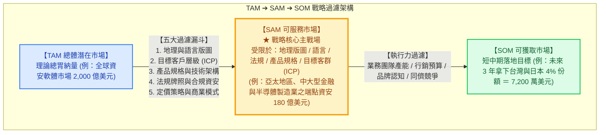
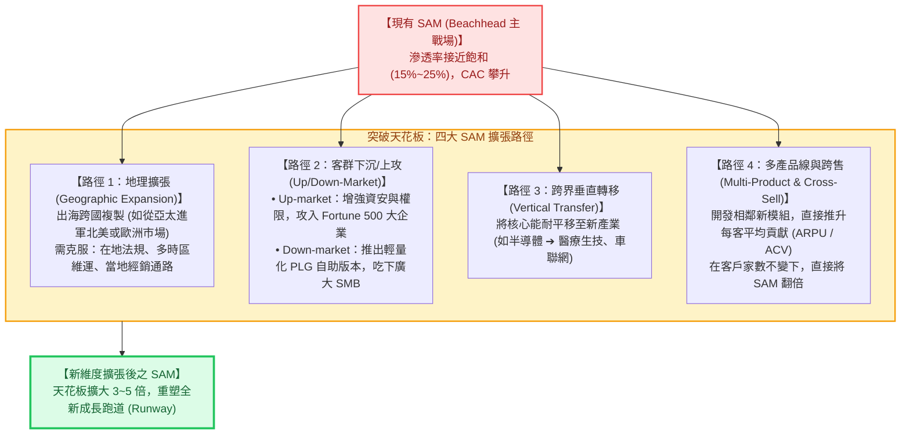

---
{"dg-publish":true,"permalink":"/98/sam/","tags":["商業概念","產業分析","策略管理","創業融資","市場空間","商業模式","PMBA"],"dg-note-properties":{"aliases":["SAM","Serviceable Available Market","Serviceable Addressable Market","可服務市場","服務可達市場","可服務可用市場","服務市場","sam-serviceable-addressable-market"],"tags":["商業概念","產業分析","策略管理","創業融資","市場空間","商業模式","PMBA"]}}
---


# 可服務市場 (Serviceable Available Market, SAM)

> 💡 **導航與索引**：本篇為企業界定目標主戰場、驗證商業模式可行性與規劃產品擴張路線圖之核心概念。探討如何從巨觀天花板 [[98_商業概念庫/TAM\|總體潛在市場 (TAM)]] 中，精準過濾出受限於產品規格、法規、地域與理想客群（ICP）之實際可服務空間，並作為短中期落地目標 [[98_商業概念庫/SOM\|可獲取市場 (SOM)]] 之定錨基準。亦可參閱微觀交易基石 [[98_商業概念庫/unit-economics-model_單位經濟模型\|單位經濟模型 (Unit Economics)]]、策略護城河 [[04_主題選修/10_創業與企業財務策略/02_模組筆記/Module_1_創新思維與商業模式/M1-10_七大市場力量與商業戰略價值公式\|七大市場力量與價值公式 (7 Powers)]]、創投估值契約 [[98_商業概念庫/term-sheet_投資意向書 Term Sheet\|投資意向書 (Term Sheet)]]，以及股權融資架構 [[98_商業概念庫/cap-table_股權結構表 Cap Table\|股權結構表 (Cap Table)]]。

---

## 一、 核心定義與戰略定位

### 1. 核心定義與本質辨析
- **可服務市場（Serviceable Available Market，簡稱 SAM，亦稱 Serviceable Addressable Market）** 係指在企業當前的**商業模式（Business Model）、產品規格能力（Product Capabilities）、地理覆蓋版圖（Geographic Reach）、法規許可（Regulatory Compliance）、通路觸達（Channel Access）與理想客戶畫像（ICP, Ideal Customer Profile）**約束下，企業理論上**真正能夠提供服務並具備交易獲取可能性的市場空間總量**。
- **介於「宏觀想像」與「微觀落地」的關鍵戰略樞紐**：
  - **TAM** 是「全天下人若都買單的宏觀總量（天花板）」；
  - **SAM** 是「我當前產品規格與營運半徑**真正能夠有效觸達的主戰場（Core Battleground）**」；
  - **SOM** 是「在現有資源與銷售部隊下，**短中期（1~3 年）真正能吃下的真實營收份額**」。



### 2. SAM 在企業營運中的三大核心功能
1. **產品研發路線圖（Product Roadmap）的指針**：
   研發團隊每新增一項功能（如支援多雲架構、支援多國語言、通過醫療器材認證），其核心目的均是為了**將 SAM 的邊界向外推展**。
2. **中期（3~5 年）成長藍圖與融資定錨**：
   在 Series A、Series B 輪融資中，機構創投（VC）最核心審查的正是 SAM 的規模與健康度。VC 關注的是：**企業在拿下灘頭堡後，是否有足夠寬廣的 SAM 容納其長成一家年營收數千萬美元的公司**。
3. **行銷 STP 策略的量化具現化**：
   SAM 是策略行銷學中**「市場區隔（Segmentation）」與「目標市場選擇（Targeting）」**的嚴謹量化成果，代表企業決定「有所為、有所不為」的資源聚焦邊界。

---

## 二、 從 TAM 到 SAM 的五大過濾維度 (The Five Filtering Dimensions)

從抽象的 TAM 提煉出精準的 SAM，必須透過五重嚴密的「現實約束漏斗」進行過濾：

$$\text{SAM} = \text{TAM} \times \lambda_{\text{Geo}} \times \lambda_{\text{ICP}} \times \lambda_{\text{Tech}} \times \lambda_{\text{Reg}} \times \lambda_{\text{Price}}$$

```text
【TAM 到 SAM 的五大過濾維度微觀解構】

  TAM (全球理論大盤)
   │
   ├─► 1. 地理與語言維度 (λ_Geo)   ── 扣除無法提供在地支援、無本國語系、無在地資料中心之區域
   │
   ├─► 2. 目標客群與 ICP (λ_ICP)    ── 僅鎖定目標規模 (如 Enterprise vs. SMB)、IT 成熟度相符者
   │
   ├─► 3. 產品規格與架構 (λ_Tech)  ── 排除當前技術不支援者 (如僅支援 Linux/AWS，排除 Windows/Azure)
   │
   ├─► 4. 法規牌照與合規 (λ_Reg)   ── 僅限已取得特許認證者 (如醫療 TFDA/FDA、車規 ISO 26262、SOC 2)
   │
   └─► 5. 定價與商業模式 (λ_Price) ── 排除付費能力或採購預算低於門檻之非目標客戶
   │
   ▼
  SAM (當前可有效服務之精準市場)
```

| 過濾維度 | 實務過濾標準與邊界 | 典型實務案例剖析 |
| :--- | :--- | :--- |
| **1. 地理與語言**<br>*(Geographic & Linguistic)* | • 當前銷售網絡、售後團隊能覆蓋的國家<br>• 系統語言介面、在地法規資料儲存（如歐盟 GDPR / 台灣個資法） | 台灣 B2B 軟體初期僅支援繁中與英文，未部署日本當地機房，日本市場（佔全球 10%）暫時無法計入當前 SAM。 |
| **2. 客戶層級 (ICP)**<br>*(Ideal Customer Profile)* | • 企業員工人數、年營業額門檻<br>• 產業垂直類別（如僅針對半導體、高科技製造，排除傳統餐飲零食） | 某高階排程軟體專為員工人數 1,000 人以上之中大型晶圓廠設計，全球中小微型工廠（數量佔 90%）全數剔除。 |
| **3. 產品規格相符**<br>*(Technical & Feature Fit)* | • 當前產品版本已開發完成之核心功能模組<br>• 部署架構（SaaS 雲端原生 vs. On-Premise 內部部署） | 金融機構因資安法規要求 100% 地端部署，若軟體目前僅支援純公有雲（SaaS），則傳統銀行市場被過濾。 |
| **4. 法規牌照與合規**<br>*(Regulatory & Compliance)* | • 特許行業營運執照（金融執照、醫療器材認證、第三方資安認證）<br>• 進入特定產業之強制門檻（如 ISO 27001、SOC 2 Type II、FDA 510(k)） | 智慧醫療 AI 影像軟體尚未通過美國 FDA 審查前，美國醫院市場（佔全球 45%）絕不可列入當期 SAM。 |
| **5. 商業模式與定價**<br>*(Pricing & Business Model)* | • 客戶年化採購預算與付費意願<br>• 收費模式（高額買斷 License vs. 年訂閱 ARR vs. 使用量抽成 Usage-based） | 企業訂價策略為「年約起跳 10 萬美元」，年 IT 預算低於 30 萬美元之潛在企業即便有需求亦無法成交，予以排除。 |

---

## 三、 SAM 兩大科學測算方法學

### 1. 微觀自下而上聚合建構法 (Bottom-Up ICP Aggregation —— 創投最認可標準)
由下而上法是測算 SAM 最具信服力的方法學。先透過企業內部 CRM 數據、LinkedIn Sales Navigator、政府工商登記或專業產業資料庫，精確清點**符合 ICP 的潛在實體清單總數**：

$$\text{SAM}_{\text{Bottom-Up}} = N_{\text{ICP}} \times \text{ACV}_{\text{Target}}$$

- $N_{\text{ICP}}$：在可觸達之地理區域內，**100% 滿足五大過濾維度之精準潛在客戶總家數**；
- $\text{ACV}_{\text{Target}}$（Annual Contract Value）：針對該目標客群設定之標準化年化契約金額。

### 2. 宏觀由上而下漏斗過濾法 (Top-Down Funnel Filtering)
以第三方權威調研機構發布之 TAM 報告為起點，逐層扣除無法觸達之比例：

$$\text{SAM}_{\text{Top-Down}} = \text{TAM} \times \%_{\text{目標垂直產業}} \times \%_{\text{涵蓋地理區域}} \times \%_{\text{符合規格客群}}$$

> 📌 **兩大方法學交叉驗證（Sanity Check）**：
> 頂級創投與財務長通常要求**「Bottom-Up 與 Top-Down 雙軌並行」**。若由上而下法算出的 SAM 為 10 億美元，但由下而上清點客戶名錄卻只有 1 億美元，代表由上而下法的漏斗過濾過於寬鬆（包含了大量無法成交的虛假客戶）。

---

## 四、 實戰數理推導案例：B2B 企業級 AI 資安系統

假設某台灣 AI 資安新創公司，專門研發防禦勒索軟體與 APT 攻擊之「零信任端點防護系統（EDR）」：

```text
【TAM 到 SAM 之漏斗過濾與數理測算全景】

  【TAM 全球端點資安總市場】
  規模：240 億美元 (全球所有各型企業端點防護理論總需求)
   │
   ▼ 漏斗過濾 1：地理限制 (初期僅覆蓋台灣、日本、新加坡與澳洲，佔全球 15%)
  【地理可達市場】：36 億美元
   │
   ▼ 漏斗過濾 2：產業垂直領域 (聚焦高科技半導體、金融保險與關鍵基礎設施，佔亞太 40%)
  【垂直產業市場】：14.4 億美元
   │
   ▼ 漏斗過濾 3：客戶規模 ICP (僅限員工人數 500 人以上、具備專職 CISO 之企業，佔 60%)
  【SAM 當前可服務市場】：8.64 億美元 ★ (符合當前規格與戰略主戰場)
   │
   ▼ 執行力過濾：銷售團隊產能與通路滲透 (3 年內目標拿下該 SAM 之 5% 份額)
  【SOM 3年可獲取目標】：4,320 萬美元 (約 13.8 億台幣 ARR)
```

| 分析階層 | 定義與過濾參數 | 測算數理邏輯 | 數值成果 |
| :--- | :--- | :--- | :---: |
| **TAM (全球總量)** | 全球所有連網企業之端點資安理論總胃納量 | 第三方權威研調大盤數據 | **240.0 億美元** |
| **過濾步驟 1** | 地理限制：亞太核心四國（台/日/星/澳） | $240 \text{ 億} \times 15\%$ | 36.0 億美元 |
| **過濾步驟 2** | 垂直產業：金融、半導體高科技與能源（對 APT 攻擊極端敏感） | $36 \text{ 億} \times 40\%$ | 14.4 億美元 |
| **過濾步驟 3** | 客戶規模 ICP：員工人數 $\ge 500$ 人、年資安預算 $\ge 15$ 萬美元之企業 | $14.4 \text{ 億} \times 60\%$ | **8.64 億美元★**<br>*(當前核心 SAM)* |
| **Bottom-Up 驗證** | 清查四國名錄：符合條件之中大型企業共計 7,200 家<br>產品標準年約價值（ACV）為 12 萬美元 | $7,200 \text{ 家} \times \$120,000$ | **8.64 億美元★**<br>*(完全吻合！)* |
| **SOM (3年目標)** | 業務部隊產能限制：預計 3 年內累計簽約 360 家企業（滲透率 5%） | $360 \text{ 家} \times \$120,000$ | **4,320 萬美元** |

---

## 五、 SAM 擴張戰略：如何打破可服務市場天花板？

當企業在現有 SAM 中的市佔率達到 **$15\% \sim 25\%$** 時，獲取新客的邊際難度將大幅提高，行銷獲客成本（CAC）呈現非線性飆升。此時企業必須啟動**「SAM 擴張策略（SAM Expansion）」**，主動將天花板向上推升：



1. **地理跨國複製（Geographic Expansion）**：
   在母國市場驗證商業模式與 PMF 後，藉由募集的資金設立海外子公司或簽訂海外 Master Distributor，將未涵蓋之地理板塊轉化為可用 SAM。
2. **客群向上擊穿（Up-Market Strategy）**：
   許多新創從中小企業（SMB）起家，產品逐漸成熟後增加「單一登入（SSO）、審計日誌（Audit Log）、企業級 SLA、專屬客戶經理」等 Enterprise 功能，**直接切入客單價高出 10 倍以上的大企業市場**。
3. **多產品線跨售（Cross-Selling & Platformization）**：
   透過自研或併購（M&A）推出相鄰產品（如 Salesforce 從 CRM 延伸至行銷雲、客服雲；HubSpot 從行銷延伸至銷售與 CMS），使每個現有客戶的年度合約潛力翻倍，**在既有客戶基數不變下，直接成倍放大 SAM**。

---

## 六、 企業高階經理人與創始團隊實戰四大軍規

### 1. 「SAM 才是融資估值與商業審查的真正主錨點」
* 種子輪（Seed Round）創投或許只看創辦人背景與概念（TAM）；
* 但在 **Series A、B 輪機構融資與私募股權（PE）審查中，專業投資人最嚴格拆解的就是 SAM 的真實性**。SAM 太小（如 $< 1$ 億美元），代表公司很快會撞上成長天花板；SAM 定義過大（把無法服務的客群混入），則暴露管理層對產業缺乏深刻理解。

### 2. 嚴防「虛假可服務市場（Phantom SAM）」陷阱
* 經理人最常犯的戰略錯誤，是**把「自身產品根本無法履約的客群」誤當成 SAM**。
* 例如：軟體系統未通過 HIPAA 醫療資安認證，卻在 BP 中把全美醫院計入 SAM；或是公司只有直銷團隊而無跨國經銷網絡，卻宣稱全球所有企業都是可服務對象。**沒有履約與觸達能力的市場，只是幻影，不是 SAM**。

### 3. SAM 飽和度預警與「第二成長曲線」啟動時機
* 監控指標：$\text{SAM 飽和率} = \frac{\text{當前營收}}{\text{SAM}}$。
* 當企業在既有 SAM 的滲透率達到 **$20\%$** 時，通常意味著最容易獲取、最迫切需要產品的「早產客戶（Early Adopters）」已被挖掘殆盡，後續獲客成本將急遽上升。**CEO 必須在飽和率達到 20% 之前，提前 18~24 個月啟動 SAM 擴張計劃**（研發新產品或出海）。

### 4. SAM 必須與 GTM（Go-To-Market）策略深度共振
* 不同的 SAM 特質決定了完全不同的業務與通路模式：
  * **高客單價 Enterprise SAM（ACV $> 10$ 萬美元）**：必須配置高薪資深的直銷團隊（Direct Field Sales）與顧問式銷售流程；
  * **中等客單價 Mid-Market SAM（ACV $1$ 萬~ $5$ 萬美元）**：適合內部電話銷售（Inside Sales）結合精準數位行銷；
  * **低客單價 SMB / 個人 SAM（ACV $< 1,000$ 美元）**：必須仰賴產品驅動成長（PLG, Product-Led Growth）與完全自動化自服務（Self-service）漏斗，否則單位經濟學（Unit Economics）將徹底崩潰。

---

## 七、 關聯主題與模組網絡

- 🧭 **課程核心模組對接**：
  - [[04_主題選修/12_產業分析與投資策略/02_模組筆記/Module_1_產業框架與動態競爭/M1-7_產業市場空間與策略群組\|M1-7 產業市場空間與策略群組]]（TAM/SAM/SOM 三層空間界定、策略群組 SGM、移動障礙分析）
  - [[04_主題選修/10_創業與企業財務策略/02_模組筆記/Module_1_創新思維與商業模式/M1-6_創業觀念模式與商業計畫書審查\|M1-6 創業觀念模式與商業計畫書審查]]（創投 BP 審查六維度、市場空間真實性論證、Timmons 三要素）
  - [[04_主題選修/10_創業與企業財務策略/02_模組筆記/Module_1_創新思維與商業模式/M1-5_創業構想發展與兩階段可行性評估\|M1-5 創業構想發展與兩階段可行性評估]]（初步與深入可行性評估、STP 客群畫像）
  - [[04_主題選修/10_創業與企業財務策略/02_模組筆記/Module_2_產品創新與精實驗證/M2-1_精實產品開發與服務創新驗證\|04_主題選修/10_創業與企業財務策略/02_模組筆記/Module_2_產品創新與精實驗證/M2-1_精實產品開發與服務創新驗證]]（灘頭堡市場 Beachhead Market、PMF 驗證、留存平坦化）
  - [[04_主題選修/10_創業與企業財務策略/02_模組筆記/Module_2_產品創新與精實驗證/M2-2_產品組合策略與品牌權益管理\|M2-2 產品組合策略與品牌權益管理]]（Ansoff 矩陣市場開發、品類擴充與 SAM 延伸）
  - [[04_主題選修/10_創業與企業財務策略/02_模組筆記/Module_1_創新思維與商業模式/M1-10_七大市場力量與商業戰略價值公式\|M1-10 七大市場力量與商業戰略價值公式]]（市場規模與防禦護城河之乘數效應）
- 🔗 **核心概念原子卡片雙向互聯**：
  - [[98_商業概念庫/TAM\|總體潛在市場 (Total Addressable Market, TAM)]]（理論總胃納量母集）
  - [[98_商業概念庫/SOM\|可獲取市場 (Serviceable Obtainable Market, SOM)]]（短中期落地營收指標與執行規劃）
  - [[98_商業概念庫/unit-economics-model_單位經濟模型\|單位經濟模型 (Unit Economics)]]（CAC 與 LTV 驗證 SAM 是否具備獲利可行性）
  - [[98_商業概念庫/term-sheet_投資意向書 Term Sheet\|投資意向書 (Term Sheet)]]（VC 依據 SAM 空間核定融資定價之核心依據）
  - [[98_商業概念庫/cap-table_股權結構表 Cap Table\|股權結構表 (Cap Table)]]（融資擴張以突破 SAM 天花板之資本傳導鏈）
  - [[98_商業概念庫/Porter's Five Forces Analysis_波特五力分析\|波特五力分析 (Porter's Five Forces)]]（檢驗 SAM 內部競爭結構與獲利保留度）
