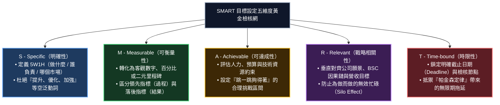
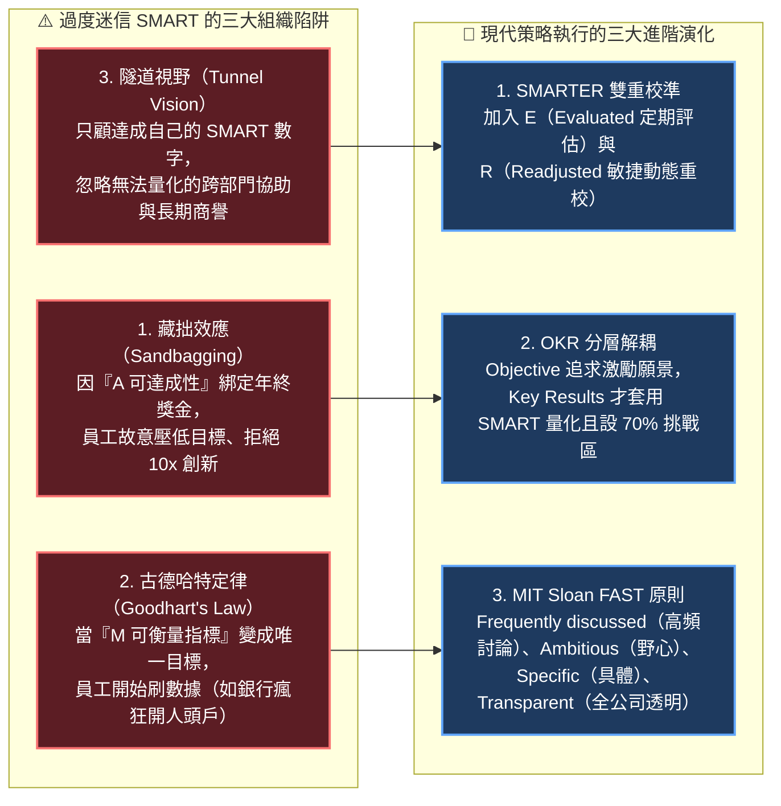

---
{"dg-publish":true,"permalink":"/98/smart/","tags":["商業概念","績效管理","策略執行","目標管理","專案管理","OKR","KPI","平衡計分卡","PMBA"],"dg-note-properties":{"aliases":["SMART 原則","SMART原則","SMART 目標管理","SMART Goals","SMART Criteria","SMARTER 原則"],"tags":["商業概念","績效管理","策略執行","目標管理","專案管理","OKR","KPI","平衡計分卡","PMBA"]}}
---


# SMART 原則 (SMART Criteria / 智慧目標設定法則)

> **商管核心價值**：  
> 「模糊的願景只會產出混亂的執行；沒有時限與衡量標準的目標，本質上只是一廂情願的願望（Wish）。管理者的核心職責之一，就是將宏大的企業戰略拆解為團隊聽得懂、算得出、扛得起且追得到的具體承諾。」——喬治·多蘭（George T. Doran）與彼得·杜拉克（Peter Drucker）  
> 
> 在現代企業策略執行、專案管理與績效考核體系中，**SMART 原則（SMART Criteria）** 是全球最廣泛採用的目標設定檢核框架。它透過 **Specific（明確性）、Measurable（可衡量）、Achievable（可達成）、Relevant（相關性）、Time-bound（時限性）** 五大維度，確保組織上下的溝通零歧義，將抽象戰略無縫轉化為可追蹤、可複盤的營運成果，並作為連結**平衡計分卡（BSC）**、**KPI** 與 **OKR 關鍵成果（Key Results）** 的底層執行標準。

---

## 一、 理論淵源與詞義演變

### 1.1 學術奠基與原版考據
- **思想源頭**：1954 年，現代管理學之父 **彼得·杜拉克（Peter Drucker）** 在《管理實踐》（*The Practice of Management*）中提出**目標管理（MBO, Management by Objectives）**，確立了「以明確目標與自我控制取代高壓監管」的現代管理典範。
- **正式提出**：1981 年 11 月，美國管理顧問 **喬治·多蘭（George T. Doran）** 在《Management Review》發表經典論文 **《There's a S.M.A.R.T. Way to Write Management's Goals and Objectives》**，首次正式提出 S.M.A.R.T. 縮寫模型。
- **原版 vs. 現代演進對照**（高階管理常見考據細節）：

| 字母 | 1981 年多蘭原版定義 | 現代主流商管通用定義 | 關鍵演變意涵 |
| :---: | :--- | :--- | :--- |
| **S** | **Specific**（明確的） | **Specific**（明確具體的） | 聚焦單一特定改善領域，消除模糊語意 |
| **M** | **Measurable**（可衡量的） | **Measurable**（可衡量的） | 量化進度與驗收標準（至少須有明確狀態指標） |
| **A** | **Assignable**（可指派的） | **Achievable / Attainable**（可達成的） | 從單純「指定負責人」演進為「評估資源可行性與合理挑戰高度」 |
| **R** | **Realistic**（務實的） | **Relevant**（相關聯的） | 從「考量資源現實限制」升級為「嚴格對齊上級戰略與商業價值」 |
| **T** | **Time-related**（有時限的） | **Time-bound**（有時限的） | 明確設定交付期限與階段性里程碑（Milestones） |

---

## 二、 SMART 五大維度深度架構與執行準則



### 2.1 各維度核心內涵與高階提問清單

1. **S — Specific（明確具體性）**
   - **核心原則**：目標必須清晰到讓部門內任何一位成員閱讀後，對「要交付什麼」的理解完全一致，毫無詮釋空間。
   - **檢核提問**：這項目標具體要改變哪一個產品線、哪一個客群、或哪一段營運流程？最終責任歸屬者（Owner）是誰？
2. **M — Measurable（可衡量性）**
   - **核心原則**：「無法衡量，就無法管理（If you can't measure it, you can't manage it）」。
   - **指標配對**：優秀的商業目標應同時包含**落後指標（Lagging Indicators，如季度營收、淨利）**與**領先指標（Leading Indicators，如每週有效客戶拜訪數、試用轉換率）**，避免等到期末才發現失控。
3. **A — Achievable（可達成性）**
   - **核心原則**：目標應落在「挑戰與可行」的甜蜜點。目標過低會導致團隊怠惰；目標脫離資源現實則會摧毀團隊自信，引發集體躺平（參見 [[98_商業概念庫/two-factor-theory_雙因素理論\|雙因素理論]] 的成就感激勵機制）。
   - **兼論 Assignable（權責明確）**：在跨部門專案中，必須同時確認具備足夠權限的單一負責人（DRI, Directly Responsible Individual）。
4. **R — Relevant（戰略相關性）**
   - **核心原則**：目標必須回答「為什麼現在做這件事很重要？」它必須直接支撐上級部門或公司的北極星指標（North Star Metric）。
   - **避坑重點**：許多研發或行銷團隊設定了極為精準量化的目標（如「APP 下載量提升 50%」），卻發現用戶隔天就卸載、對營收與留存毫無貢獻——這正是缺乏 **R（相關性）** 的典型「虛榮指標（Vanity Metrics）」陷阱。
5. **T — Time-bound（明確時限性）**
   - **核心原則**：沒有期限的承諾永遠不會被優先排程。明確的 Deadline 能抵禦**帕金森定律（Parkinson's Law）**——即「工作總會自動膨脹到填滿所有可用的時間」。
   - **節奏設計**：大型年度目標必須切分為 Q1~Q4 或雙週衝刺（Sprint）的階段性檢核點。

---

## 三、 實戰改寫：各職能部門 Bad vs. SMART 對照表

| 職能部門 | ❌ 失敗的模糊目標（Non-SMART） | ✅ 實戰級 SMART 目標寫法 | 核心拆解亮點 |
| :--- | :--- | :--- | :--- |
| **B2B 業務團隊** | 「今年要大幅衝刺企業客戶業績，開發更多大客戶。」 | 「業務一部於 **2026 年 Q4 結束前（T）**，針對台灣半導體製造業前 50 大客戶，透過導入企業端試用方案，達成 **新增 12 家付費簽約客戶、貢獻新台幣 3,600 萬元 ARR 年度經常性收入（S, M）**，使公司整體毛利率維持在 45% 以上（R, A）。」 | 鎖定特定客群、明確營收與客戶數、對齊毛利與部門能力 |
| **產品與研發** | 「加速系統效能優化，提升使用者體驗並減少 Bug。」 | 「後端架構組於 **本季末（6 月 30 日）前（T）**，完成核心結帳 API 微服務重構與快取優化，將結帳尖峰時段的 **P99 回應延遲從 1,200ms 降至 300ms 以下、系統當機率低於 0.01%（S, M）**，以支撐雙十一大促期間購物車轉換率提升（R, A）。」 | 以 P99 延遲與可用性取代「提升體驗」，直接服務轉換率 |
| **數位行銷** | 「加強社群行銷與品牌曝光，吸引更多潛在買家。」 | 「成長行銷組於 **未來 90 天內（T）**，透過 LinkedIn 精準產業白皮書廣告投放，在單一獲客成本 **CAC 不超過 1,500 元（A）** 的前提下，獲取 **600 筆符合 MQL 資格的企業潛在名單（S, M）**，並確保至少 15% 轉化為銷售線索（R）。」 | 同時約束數量（MQL）與獲客成本上限（CAC），杜絕燒錢買流量 |
| **人資與組織** | 「降低工程師離職率，打造更好的團隊文化。」 | 「人資部與研發主管協作於 **2026 下半年（T）** 完成核心研發工程師薪酬對標調整與導師制（Mentorship）導入，將 **年度核心關鍵人才自願離職率從 18% 壓低至 10% 以內（S, M, A）**，確保明年次世代 AI 晶片專案研發能量不中斷（R）。」 | 聚焦「關鍵核心人才」而非泛指全員，直接保障專案進度 |

---

## 四、 批判性反思：SMART 的管理陷阱與現代演進（OKR / SMARTER / FAST）

雖然 SMART 是極佳的基礎工具，但當代高階策略管理已明確指出：若機械式死守 SMART，往往會引發嚴重的組織病態。



### 4.1 深度剖析：KPI 與 OKR 中的 SMART 角色分工

| 比較維度 | 傳統 KPI（關鍵績效指標）中的 SMART | 現代 OKR（目標與關鍵成果）中的 SMART |
| :--- | :--- | :--- |
| **適用業務性質** | 穩定、可預測的常規營運（如生產良率、客服 SLA、月度營收） | 高度不確定、追求指數級突破的創新專案或策略轉型 |
| **對 A（Achievable）的詮釋** | **100% 承諾達成（Committed Goal）**：沒達到代表失職，直接扣減獎金。 | **60%～70% 挑戰區（Aspirational / Stretch Goal）**：若達成 100%，反而代表目標設得太保守！ |
| **激勵與風險偏好** | 易誘發員工「保守避險」與跟主管討價還價壓低配額（Sandbagging）。 | 透過與薪酬脫鉤（參考 [[98_商業概念庫/framing-effect_框架效應\|框架效應]] 消除損失恐懼），鼓勵團隊承擔高風險創新。 |

### 4.2 古德哈特定律（Goodhart's Law）警示
> *「When a measure becomes a target, it ceases to be a good measure.」（當一個指標成為目標時，它就不再是一個好指標。）*
- **經典反例（富國銀行 Wells Fargo 幽靈帳戶醜聞）**：銀行高層為分行設定了極為明確量化的 SMART 目標（每位客戶平均持有 8 個金融帳戶），並將其強掛鉤於高壓考核與裁員。結果基層行員為了達成 **M（數字）**，私下偽造客戶簽名開立了超過 350 萬個幽靈帳戶，最終重創百年品牌信譽並面臨數十億美元天價罰款。
- **防範之道**：設定 SMART 目標時，必須同時配置**制衡指標（Counter-metrics / Guardrail Metrics）**——例如追求「業務營收成長」的同時，必須搭配「應收帳款週轉天數 DSO 與毛利率底線」作為煞車機制。

---

## 五、 經理人目標設定實戰檢核表（含制衡護欄）

在每季或年度啟動目標對齊會議前，主管應帶領團隊逐條驗證以下 6 項標準：

```markdown
### 📋 SMART + 制衡護欄目標審核清單

- [ ] 1. 【Specific 零歧義測試】：把這句目標寫在白板上，團隊成員是否都能得出完全一致的執行範圍與 DRI 單一負責人？
- [ ] 2. 【Measurable 領先/落後配對】：除了期末才能結算的「落後結果指標」外，是否設定了每週可追蹤的「領先過程指標」？
- [ ] 3. 【Achievable 資源盤點】：達成此目標所需的預算、跨部門配合與算力/人力是否已獲核准？還是建立在「奇蹟發生」的假設上？
- [ ] 4. 【Relevant 戰略垂直對齊】：若此目標 100% 順利完成，是否真的能推動公司平衡計分卡（BSC）或北極星指標前進？
- [ ] 5. 【Time-bound 節點切分】：除了最終截止日，是否已訂定中途檢核（Mid-point Check-in）日期，避免期末前夕才爆發危機？
- [ ] 6. 【Counter-metric 防作弊煞車】：為了達成這個數字，團隊可能會採取什麼「短視或作弊捷徑」？是否已加上對應的品質／合規／利潤制衡指標？
```

---

## 六、 PMBA 模組講義與知識網絡鏈結

### 6.1 官方課程與模組雙向反向鏈結
- [[04_主題選修/12_產業分析與投資策略/02_模組筆記/Module_1_總論與架構/M1-6_產業分析模式與九大分析工具矩陣\|M1-6 產業分析模式與九大分析工具矩陣]]：
  - **模式八：平衡計分卡（BSC）整合應用**：BSC 將企業願景拆解為財務、顧客、內部流程、學習成長四大構面的因果鏈後，最終必須透過 **SMART 原則** 轉化為可執行的量化行動指標（Step 3）。
- [[04_主題選修/10_創業與企業財務策略/02_模組筆記/Module_1_創新思維與商業模式/M1-9_商業模式畫布架構與價值主張設計\|M1-9 商業模式畫布架構與價值主張設計]]：
  - **單元經濟效益與驗證指標（CLV/CAC）**：新創商業模式畫布落地時，必須將「驗證假設」轉化為帶有明確轉換率門檻與時間期限的 SMART 里程碑。
- [[04_主題選修/10_創業與企業財務策略/02_模組筆記/Module_1_創新思維與商業模式/M1-4_創意思考工具與設計思考方法\|M1-4 創意思考工具與設計思考方法]]：
  - **創新管理中的結構性收斂**：設計思考前期發散階段（Empathize/Ideate）應暫緩約束；進入原型測試（Test）與創業商業化執行階段時，則需導入 SMART 進行嚴謹驗證。

### 6.2 商業概念庫相關卡片
- [[98_商業概念庫/okr-objectives-and-key-results_目標與關鍵成果\|okr-objectives-and-key-results_目標與關鍵成果]]（OKR 關鍵成果 KR 與 SMART 原則的深度融合與差異邊界）
- [[98_商業概念庫/balanced-scorecard-bsc_平衡計分卡\|balanced-scorecard-bsc_平衡計分卡]]（從公司級戰略地圖向下轉譯為部門級 SMART 指標）
- [[98_商業概念庫/two-factor-theory_雙因素理論\|two-factor-theory_雙因素理論]]（合理的目標挑戰性與成就感回饋對員工內在激勵的影響）
- [[98_商業概念庫/framing-effect_框架效應\|framing-effect_框架效應]]（目標設定中「承諾目標 vs. 挑戰目標」對團隊風險承擔心理的框架效應）
- [[98_商業概念庫/efficient-frontier_效率前緣\|efficient-frontier_效率前緣]]（設定雙重指標邊界，防止只衝刺單一維度而偏離效率前緣）
