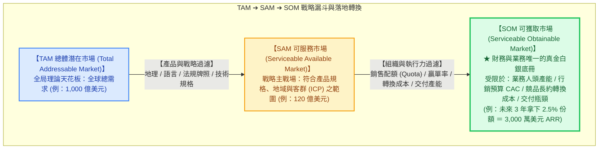
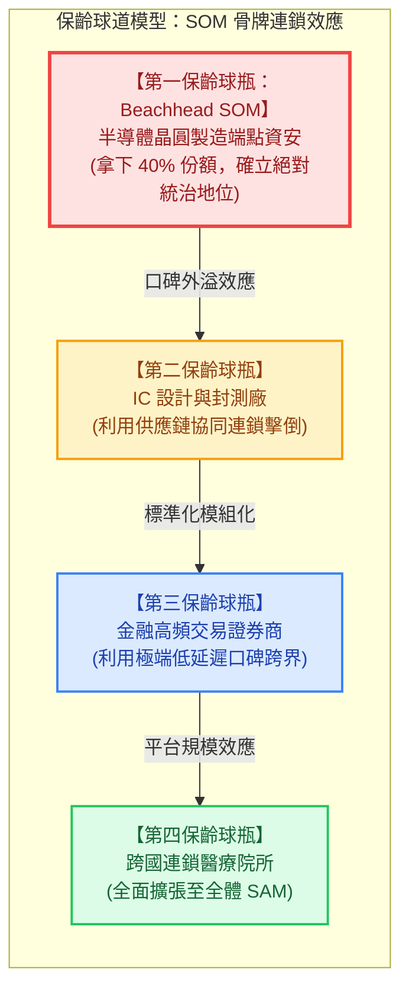

---
{"dg-publish":true,"permalink":"/98/som/","tags":["商業概念","產業分析","策略管理","創業融資","財務預算","銷售管理","PMBA"],"dg-note-properties":{"aliases":["SOM","Serviceable Obtainable Market","Share of Market","可獲取市場","服務可獲取市場","可實現市場","可獲得市場","目標市場份額"],"tags":["商業概念","產業分析","策略管理","創業融資","財務預算","銷售管理","PMBA"]}}
---


# 可獲取市場 (Serviceable Obtainable Market, SOM)

> 💡 **導航與索引**：本篇為企業編列年度財務預算、配置業務部隊產能與創投檢驗短期可執行性之核心概念。探討如何從戰略主戰場 [[98_商業概念庫/SAM\|可服務市場 (SAM)]] 與宏觀大盤 [[98_商業概念庫/TAM\|總體潛在市場 (TAM)]] 中，精準推導出短中期真正能入帳之營收目標。亦可參閱微觀獲客體檢指標 [[98_商業概念庫/unit-economics-model_單位經濟模型\|單位經濟模型 (Unit Economics)]]、融資缺口推算工具 [[98_商業概念庫/AFN_外部融資需求模型 Additional Funds Needed\|外部融資需求模型 (AFN)]]、不融資下的內生增長極限 [[98_商業概念庫/sustainable-growth-rate_永續成長率\|永續成長率 (SGR)]]、股權稀釋底冊 [[98_商業概念庫/cap-table_股權結構表 Cap Table\|股權結構表 (Cap Table)]]，以及投資契約條款 [[98_商業概念庫/term-sheet_投資意向書 Term Sheet\|投資意向書 (Term Sheet)]]。

---

## 一、 核心定義與營運本質

### 1. 核心定義與本質辨析
- **可獲取市場（Serviceable Obtainable Market，簡稱 SOM，亦稱 Share of Market）** 係指企業在**現有銷售團隊編制與通路產能（Sales Capacity）、既定行銷預算限制（Marketing Budget）、品牌認知度（Brand Equity）、交付履約極限（Operational Capacity）以及面對既有同儕強烈競爭防禦（Competitive Resistance）之現實約束下**，在**短中期（通常為 1~3 年內）真正能夠合理解鎖、奪取並轉化為入帳現金流的市場份額（Realistic Market Share）與營收金額**。
- **三層市場空間架構的「終局定音符」**：
  - **TAM** 是「宏觀造夢的天花板（Vision & Potential）」；
  - **SAM** 是「戰略選擇的目標主戰場（Battlefield & Core Segment）」；
  - **SOM 則是「刺刀見紅的真實戰果與入帳營收（Execution & P&L Reality）」**。



### 2. CFO 與 COO 唯一承認的預算基準
- **TAM 與 SAM 屬於「外部市場容量（Capacity）」**：
  它們衡量的是外部環境的空間多大，無法保證企業能賺到任何一毛錢。
- **SOM 屬於「內部執行力契約（Commitment）」**：
  **SOM 是唯一能被寫入企業年度損益表預算（Operating Budget）、現金流缺口預測（AFN Cash Flow Forecast）以及業務主管考核 KPI 獎金底冊的硬指標**。
- 🚨 **管理失控警訊**：
  經理人若誤把 TAM 或 SAM 當作依據來大幅擴編員工、租賃昂貴辦公室或購置固定資產，必然會因「產能過剩、營收未達預期」而引爆致命的流動性危機與現金斷流。

---

## 二、 從 SAM 到 SOM 的五大執行力約束漏斗

從可服務市場（SAM）收斂至可獲取市場（SOM），取決於五大內部組織與外部競爭之剛性約束：

$$\text{SOM} = \text{SAM} \times \text{目標滲透率} (\text{Target Market Share, } \text{MS}\%)$$

$$\text{MS}\% = f(\text{銷售部隊產能}, \text{獲客預算與 CAC}, \text{競品防禦與轉換成本}, \text{交付上線瓶頸}, \text{品牌認知壁壘})$$

```text
【SAM 到 SOM 的五大執行力過濾約束】

  SAM (戰略可服務主戰場)
   │
   ├─► 1. 銷售部隊人頭與產能極限 (Sales Capacity)   ── 業務 AE 數量 × 單人 Quota × 贏單率
   │
   ├─► 2. 行銷獲客預算與 CAC 天花板 (Marketing ROI)  ── 年度預算 ÷ CAC 限制了一年內能獲取之新客上限
   │
   ├─► 3. 既有競品防禦與轉換成本 (Switching Costs)  ── 既有客戶長期合約鎖定、數據遷移與員工學習阻力
   │
   ├─► 4. 交付、部署與客戶成功瓶頸 (Onboarding)     ── 每月技術團隊最高上線家數限制，防範專案爛尾
   │
   └─► 5. 品牌信任門檻與風險規避 (Brand Credibility) ── 大企業採購「買龍頭無過」之保守避險心理
   │
   ▼
  SOM (短中期真正能落地入帳之營收份額)
```

| 執行約束維度 | 核心考量與瓶頸機制 | 實戰策略應對之道 |
| :--- | :--- | :--- |
| **1. 銷售團隊產能**<br>*(Sales Capacity)* | • 企業級業務代表（AE）招聘與培訓週期（Ramp-up Time）<br>• 銷售週期（Sales Cycle）：大型 B2B 採購動輒 6~12 個月 | 建立科學化「銷售管線（Sales Pipeline）」管理，確保有效商機金額為 Quota 的 $3\times \sim 4\times$。 |
| **2. 獲客成本與預算**<br>*(CAC & Budget)* | • 新客獲取成本（CAC）限制了擴張速度<br>• 若行銷預算僅 1,000 萬元、CAC 為 50 萬元，一年至多獲取 20 家新客戶 | 嚴格檢驗 $\text{LTV} / \text{CAC} \ge 3.0\times$，確保每投入一元行銷預算具備可持續回收效益。 |
| **3. 競爭與轉換成本**<br>*(Switching Costs)* | • 目標客戶早已與 SAP / Oracle / Microsoft 等巨頭簽訂 3~5 年長約<br>• 更換系統將引發流程重整與資料外洩焦慮 | 採取「特洛伊木馬策略」：先以非核心模組或免費 PoC（概念驗證）切入，逐步滲透主架構。 |
| **4. 交付與客服產能**<br>*(Onboarding Capacity)* | • 客戶成功（CSM）與技術支援工程師人力上限<br>• 接單速度若超越交付能力，將引發專案延宕、客戶差評與高流失率（Churn） | 標準化導入流程，將上線部署週期（Time-to-Value）壓縮至 30 天以內。 |
| **5. 品牌認知與信任**<br>*(Brand Equity)* | • 企業客戶普遍存在「採購大廠不會被開除（Nobody gets fired for buying IBM）」之避險心態 | 集中資源全力攻克首家「燈塔客戶（Lighthouse Customer）」，藉由同儕背書瓦解信任障礙。 |

---

## 三、 SOM 兩大科學推算方法學

### 1. 微觀銷售產能模型法 (Bottom-Up Sales Capacity Modeling —— 創投最硬核驗證標準)
機構創投與審計師最認可的推算法。不談虛無縹緲的市佔率百分比，而是**直接拆解銷售部隊人頭、配額、漏斗轉化率與客單價**：

$$\text{SOM}_{\text{Bottom-Up}} = N_{\text{AE}} \times \text{Quota} \times \text{Attainment Rate} \times (1 - \text{Churn Rate}) + \text{ARR}_{\text{Beginning}} \times \text{NRR}$$

或依行銷銷售漏斗各階層轉化率推算新客營收：
$$\text{新簽 SOM} = \text{行銷合格線索 (MQL)} \times \text{轉化為業務商機率} \times \text{贏單率 (Win Rate)} \times \text{平均客單價 (ACV)}$$

- $N_{\text{AE}}$：現有具備產能之全職業務代表人數；
- $\text{Quota}$：每位業務代表之年度合約配額（例如每人每年 100 萬美元）；
- $\text{Attainment Rate}$：歷史配額平均達成率（通常抓 $70\% \sim 85\%$）；
- $\text{NRR}$（Net Retention Rate）：既有客戶淨金額留存率（優質 SaaS 通常 $\ge 110\%$）。

### 2. 市場滲透率定錨法 (Market Penetration / S-Curve Benchmark)
依據產品生命週期與同儕歷史擴張節奏，設定務實的市佔率目標：

$$\text{SOM}_t = \text{SAM}_t \times \text{MS}_t\%$$

- **第 1 年（Beachhead 灘頭堡期）**：滲透率設定於 **$1\% \sim 3\%$**（驗證獲客與交付能力）；
- **第 2 年（口碑發酵與複製期）**：滲透率推進至 **$5\% \sim 8\%$**（業務部隊擴編）；
- **第 3 年（主導期）**：在該細分 SAM 中爭取達到 **$15\% \sim 25\%$**，成為該利基領域之領先品牌。

---

## 四、 實戰情境試算：SaaS 企業三年 SOM 動態滾動預測

延續資安軟體之案例（SAM 規模為 **8.64 億美元**，亞太目標企業 7,200 家，產品平均年約價值 $\text{ACV} = \$120,000$ 美元）：

```text
【三年 SOM 滾動推移全景試算】

  【SAM 戰略主戰場】：8.64 億美元 (7,200 家企業 × 12 萬美元 ACV)
   │
   ├─► 第 1 年 (Year 1)：業務 8 人 ── 簽約 80 家 (滲透率 1.11%) ──► SOM = 960 萬美元 (3.0 億台幣)
   │
   ├─► 第 2 年 (Year 2)：業務 18 人 ── 簽約 200 家 (滲透率 2.78%) ──► SOM = 2,400 萬美元 (7.6 億台幣)
   │
   └─► 第 3 年 (Year 3)：業務 30 人 ── 簽約 360 家 (滲透率 5.00%) ──► SOM = 4,320 萬美元 (13.8 億台幣)
```

| 營運指標構面 | 第 1 年 (Year 1) | 第 2 年 (Year 2) | 第 3 年 (Year 3) | 備註與管理意涵 |
| :--- | :---: | :---: | :---: | :--- |
| **全職業務人數 (AE)** | 8 人 | 18 人 | 30 人 | 業務編制依融資到位進度逐步擴增 |
| **單人年配額 (Quota)** | 150 萬美元 | 150 萬美元 | 150 萬美元 | 相當於每人每年需簽約 12.5 家客戶 |
| **預期平均達成率** | 80% (單人完成 120 萬) | 85% (單人完成 128 萬) | 88% (單人完成 132 萬) | 隨品牌知名度提升，成交效率改善 |
| **當年累計付費客戶數** | **80 家** | **200 家** | **360 家** | 排除流失後之淨活躍付費客戶總數 |
| **平均客單價 (ACV)** | 120,000 美元 | 120,000 美元 | 120,000 美元 | 保持定價紀律，避免非理性殺價 |
| **年度可實現營收 (SOM)** | **960 萬美元**<br>*(約 3.07 億台幣)* | **2,400 萬美元**<br>*(約 7.68 億台幣)* | **4,320 萬美元**<br>*(約 13.8 億台幣)* | **寫入公司年度正式財務預算表之硬指標** |
| **佔 SAM 之滲透比例** | **1.11%** | **2.78%** | **5.00%** | 極度符合產業擴張常態，獲 VC 高度認可 |

---

## 五、 SOM 的策略核心：保齡球道灘頭堡作戰 (The Bowling Alley Model)

傑佛瑞·摩爾（Geoffrey Moore）在經典著作《跨越鴻溝》（Crossing the Chasm）中指出，高科技與創新型企業要跨越「早期採用者」邁向「大眾市場」的死亡鴻溝，其關鍵戰略正是**聚焦單一 SOM 擊倒第一顆保齡球瓶（The Lead Pin）**：



1. **集中兵力於第一球瓶（Beachhead SOM）**：
   新創資源有限，切忌將行銷與業務部隊分散給所有潛在行業。**必須集中 100% 的資源打下最脆弱、痛點最劇烈的利基客戶群（如半導體晶圓廠）**。
2. **骨牌效應帶動全盤獲勝**：
   一旦在半導體產業取得 40% 的壓倒性市場份額，供應鏈上下游（封測、IC 設計）會主動跟進採用。企業得以利用這股強大的同儕口碑，順理成章撞倒第二、第三顆保齡球瓶，逐步吃下整個 SAM。

---

## 六、 企業高階經理人與創始團隊實戰四大軍規

### 1. 「SOM 決定生死與現金跑道（Cash Runway）」
* 很多新創創辦人整天將「千億 TAM」掛在嘴邊，最後卻因下個月付不出薪資而倒閉。
* **企業會死掉，從來不是因為 TAM 不夠大，而是因為 SOM 的入帳速度太慢，追不上每個月的資金燃燒率（Burn Rate）**。CFO 必須嚴密監控以 SOM 為基礎計算的現金跑道（至少維持 18 個月以上安全餘裕）。

### 2. 嚴密審視單位經濟學（Unit Economics）的健康度
* 盲目追求衝高 SOM 往往會隱藏致命的毒藥：**如果每做一筆生意都是賠錢的（例如 $\text{LTV} < \text{CAC}$ 或毛利率為負），那麼 SOM 越大，公司死得越快！**
* 經理人必須確保：
  * $\frac{\text{LTV}}{\text{CAC}} \ge 3.0\times$；
  * CAC 回本週期（Payback Period）控制在 **$12 \sim 18$ 個月以內**；
  * 此時透過融資擴大業務部隊推升 SOM，才是健康的良性成長。

### 3. 嚴防「銷售意向書（LOI）充當 SOM」的虛妄自嗨
* 在 B2B 業務實務中，客戶簽署「合作意向書（LOI）」或「口頭表示極感興趣」，**絕對不等於 SOM**！
* 唯有通過技術概念驗證（PoC）、經法務合約審查完畢、**白紙黑字簽訂具備付款約束力的正式合約並支付首期款項**，才能計入當期已實現的 SOM。

### 4. 以 SOM 反推外部融資需求模型（AFN 嚴密對接）
* 實現未來的 SOM 目標，需要提前投入多少營運資金？
  * 招聘 10 名業務與 5 名工程師的薪資開銷；
  * 展會行銷與雲端伺服器算力支出；
  * 應收帳款與存貨積壓的週轉金。
* 將上述開支扣除 SOM 產生的毛利流入後，所產生的淨資金缺口，即為**[[98_商業概念庫/AFN_外部融資需求模型 Additional Funds Needed\|外部融資需求模型 (AFN)]]**所精算出的「本輪募資金額（Round Size）」，杜絕盲目稀釋股權。

---

## 七、 關聯主題與模組網絡

- 🧭 **課程核心模組對接**：
  - [[04_主題選修/12_產業分析與投資策略/02_模組筆記/Module_1_產業框架與動態競爭/M1-7_產業市場空間與策略群組\|M1-7 產業市場空間與策略群組]]（TAM/SAM/SOM 三層空間界定、策略群組 SGM、移動障礙）
  - [[04_主題選修/10_創業與企業財務策略/02_模組筆記/Module_1_創新思維與商業模式/M1-6_創業觀念模式與商業計畫書審查\|M1-6 創業觀念模式與商業計畫書審查]]（創投 BP 審查六維度、財務可行性預測、Timmons 三要素）
  - [[04_主題選修/10_創業與企業財務策略/02_模組筆記/Module_2_產品創新與精實驗證/M2-4_新創財務預測與外部融資需求模型\|M2-4 新創財務預測與外部融資需求模型]]（AFN 外部融資缺口預測、銷貨百分比法）
  - [[04_主題選修/10_創業與企業財務策略/02_模組筆記/Module_2_產品創新與精實驗證/M2-1_精實產品開發與服務創新驗證\|M2-1 精實產品開發與服務創新驗證]]（MVP 驗證、灘頭堡市場、Sean Ellis 40% 檢驗指標）
  - [[04_主題選修/10_創業與企業財務策略/02_模組筆記/Module_1_創新思維與商業模式/M1-2_白板決策鏈與財務價值三角\|M1-2 白板決策鏈與財務價值三角]]（資本傳導鏈、杜邦分析、現金流收斂）
- 🔗 **核心概念原子卡片雙向互聯**：
  - [[98_商業概念庫/TAM\|總體潛在市場 (Total Addressable Market, TAM)]]（理論總胃納量空間天花板）
  - [[98_商業概念庫/SAM\|可服務市場 (Serviceable Available Market, SAM)]]（戰略核心主戰場母集）
  - [[98_商業概念庫/unit-economics-model_單位經濟模型\|單位經濟模型 (Unit Economics)]]（CAC, LTV 與回本週期之微觀體檢指標）
  - [[98_商業概念庫/AFN_外部融資需求模型 Additional Funds Needed\|外部融資需求模型 (AFN)]]（SOM 擴張所需資本投入缺口預測）
  - [[98_商業概念庫/sustainable-growth-rate_永續成長率\|永續成長率 (SGR)]]（不發行新股條件下內生 SOM 之成長上限）
  - [[98_商業概念庫/cap-table_股權結構表 Cap Table\|股權結構表 (Cap Table)]]（為達成 SOM 目標進行多輪股權融資之稀釋底冊）
  - [[98_商業概念庫/term-sheet_投資意向書 Term Sheet\|投資意向書 (Term Sheet)]]（VC 依據 SOM 落地里程碑設定之對賭與估值條款）
