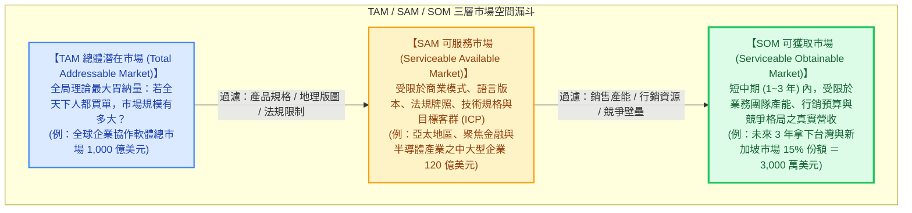
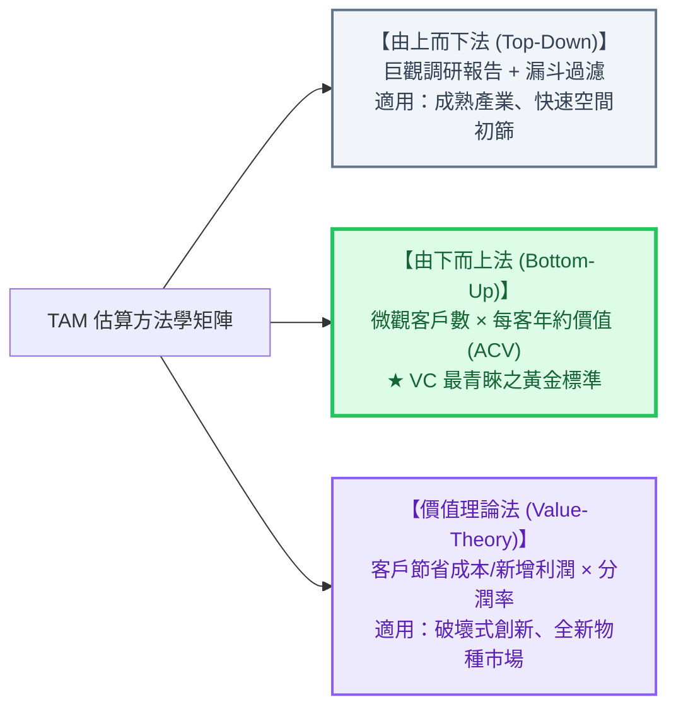
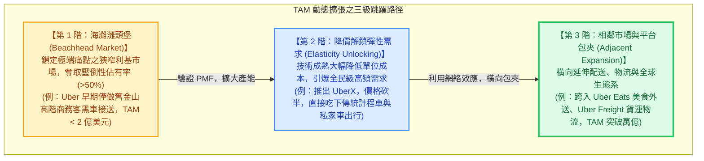

---
{"dg-publish":true,"permalink":"/98/tam/","tags":["商業概念","產業分析","策略管理","創業融資","市場空間","商業計劃書","PMBA"],"dg-note-properties":{"aliases":["TAM","Total Addressable Market","Total Available Market","總體潛在市場","總潛在市場","總市場規模","tam-total-addressable-market","TAM-SAM-SOM"],"tags":["商業概念","產業分析","策略管理","創業融資","市場空間","商業計劃書","PMBA"]}}
---


# 總體潛在市場 (Total Addressable Market, TAM)

> 💡 **導航與索引**：本篇為產業空間界定、新創商業計畫書（BP）審查與創投資本估值之最核心基石，探討企業如何科學測算理論市場天花板。亦可參閱三層漏斗之子集 [[98_商業概念庫/SAM\|可服務市場 (SAM)]]、短中期實收目標 [[98_商業概念庫/SOM\|可獲取市場 (SOM)]]、微觀交易單元 [[98_商業概念庫/unit-economics-model_單位經濟模型\|單位經濟模型 (Unit Economics)]]、商業競爭護城河 [[04_主題選修/10_創業與企業財務策略/02_模組筆記/Module_1_創新思維與商業模式/M1-10_七大市場力量與商業戰略價值公式\|七大市場力量與價值公式 (7 Powers)]]、企業內在價值折現 [[98_商業概念庫/dcf_現金流量折現法\|現金流量折現法 (DCF)]]、新創股權稀釋底冊 [[98_商業概念庫/cap-table_股權結構表 Cap Table\|股權結構表 (Cap Table)]]，以及投資意向協商 [[98_商業概念庫/term-sheet_投資意向書 Term Sheet\|投資意向書 (Term Sheet)]]。

---

## 一、 核心定義與 TAM/SAM/SOM 三層架構

### 1. 核心定義與策略本質
- **總體潛在市場（Total Addressable Market，簡稱 TAM，亦稱 Total Available Market）** 是指在**毫無競爭對手瓜分、無地理通路限制、無產能規模瓶頸與資源約束的極端假設下**，某項產品、服務或創新解決方案所能覆蓋的**理論最大全球需求總量（即佔據 $100\%$ 市場份額時的年化營收天花板）**。
- **資本市場與戰略規劃的天花板**：
  TAM 是企業戰略制定、新創股權融資（VC Pitch Deck）、產業空間評估（Market Sizing）與重大資本支出決策的「空間上限」。TAM 決定了企業未來的**市值天花板（Valuation Ceiling）**與**成長跑道長度（Runway for Growth）**。

### 2. 經典 TAM / SAM / SOM 三層漏斗同心圓模型



| 市場層級 | 英文全稱 | 核心問題與定義構面 | 決策意涵與用途 |
| :--- | :--- | :--- | :--- |
| **TAM** | **Total Addressable Market**<br>(總體潛在市場) | • 該品類或問題在**全球/全產業**的理論總規模<br>• 假定市場佔有率為 $100\%$ 時的總金額 | • 評估產業賽道天花板<br>• VC 檢驗是否具備「獨角獸基金回報潛力」 |
| **SAM** | **Serviceable Available Market**<br>(可服務市場) | • 企業**當前產品規格與商業模式實際能觸及**的市場<br>• 受限於地理區域、產業垂直領域、語言、法規與定價 | • 明確企業核心主戰場與目標客群（ICP）<br>• 中期（3~5 年）產品路線圖與擴張藍圖 |
| **SOM** | **Serviceable Obtainable Market**<br>(可獲取市場) | • 企業在**現有銷售團隊、行銷預算與競爭同儕夾擊下**，短中期（1~3 年）**真正能吃下的真實營收** | • **年度財務預算與現金流預測的唯一基準**<br>• 考核銷售團隊 KPI 與產能配置底稿 |

> 🚨 **高階經理人與創投鐵律**：
> 嚴禁將 TAM 或 SAM 直接乘上隨意比例作為財務預算！新創團隊若在募資 BP 中宣稱：「全球市場（TAM）有 1,000 億美元，我們只要拿下 1%，就有 10 億營收」，通常會被專業機構投資人直接判定為缺乏商業實操經驗與通路概念的**「懶惰數學（Lazy Math / 1% 謬誤）」**。

---

## 二、 TAM 三大估算方法學與數理模型

評估 TAM 絕非憑空捏造，國際投資銀行與頂級創投主要依循三大嚴謹方法學進行交叉比對與壓力測試：



### 1. 由下而上法 (Bottom-Up Approach) —— 創投最青睞的黃金標準
由下而上法是**最可信、邏輯最透明且假設最具檢驗性（Verifiable）**的估算法，完全立足於微觀交易單元與理想客戶畫像（ICP, Ideal Customer Profile）：

$$\text{TAM}_{\text{Bottom-Up}} = N \times P \times Q$$

- $N$（Total Potential Customers）：全球或目標區域內，**符合理想客戶畫像的潛在買方總數**（企業數量或個人用戶數）；
- $P$（Price / ACV）：產品之標準化年化契約價值（Annual Contract Value, ACV）或平均客單價（Average Selling Price, ASP）；
- $Q$（Usage / Frequency）：每位客戶每年之平均採購量或續約頻率。

> **實戰推導範例（B2B 企業級 AI 資安防禦 SaaS）**：
> - 潛在客戶總量（$N$）：全球員工人數 500 人以上之中大型企業共約 200,000 家；
> - 理想定價（$P$）：以每席位年費計算，每家企業平均年約價值（ACV）為 $\$50,000$ 美元；
> - 採購頻率（$Q$）：年訂閱制（$Q = 1$）；
> - **$\text{TAM} = 200,000 \times \$50,000 = \$10,000,000,000$ 美元（100 億美元）**。

### 2. 由上而下法 (Top-Down Approach) —— 宏觀總量漏斗過濾法
由上而下法依賴權威第三方產業研究機構（如 Gartner、IDC、Bloomberg、Frost & Sullivan）發布的宏觀行業總產值，逐層施加漏斗權重過濾：

$$\text{TAM}_{\text{Top-Down}} = \text{宏觀產業大盤規模} \times \alpha_1 \times \alpha_2 \times \alpha_3$$

- $\alpha_1$：目標地理區域佔比（如北美佔全球 40%）；
- $\alpha_2$：目標技術或產品子品類佔比（如雲端原生資安佔整體資安 30%）；
- $\alpha_3$：目標客戶規模分佈佔比（如中大型企業支出佔大盤 60%）。
- **優缺點剖析**：
  - **優點**：估算速度快，具備第三方名牌報告背書，適合撰寫產業概觀引言。
  - **致命缺點**：容易陷入虛胖幻象，因為第三方報告的分類口徑往往過於寬泛，無法精準對應新創企業具體的產品功能與定價策略。

### 3. 價值理論法 (Value-Theory Approach) —— 破壞式創新與全新物種市場
當企業開創前所未有的全新市場（如生成式 AI、自動駕駛出租車 Robotaxi、基因編輯療法），歷史上根本不存在現成的產值報告或既有客戶基數，此時必須運用價值理論法：**估算新技術為客戶帶來的「增量價值創造（Value Creation）」或「成本節省（Cost Savings）」，並按企業之價值擷取率（Take Rate）反推市場規模**：

$$\text{TAM}_{\text{Value-Theory}} = \sum (\text{客戶端創造之總經濟價值}) \times \text{企業價值擷取率 (Take Rate)}$$

- **實戰推導範例（製造業自動化瑕疵檢測 AI）**：
  - 全球電子代工廠每年因人工目檢瑕疵引發之報廢、返工及人工薪資成本共計 1,500 億美元；
  - AI 檢測系統能替製造業客戶節省 40% 的損失（即創造 600 億美元的經濟價值）；
  - 軟體供應商採取價值定價，擷取其中 20% 的價值作為軟體訂閱費（Take Rate = 20%）；
  - **$\text{TAM} = 600 \text{ 億} \times 20\% = 120 \text{ 億美元}$**。

---

## 三、 TAM 的動態演化模型：動態擴張與維度跳躍

靜態看待 TAM 是策略分析中最常見的重大盲點。卓越企業在生命週期中，往往能透過**「價格彈性釋放」**與**「相鄰市場擴張」**，將原本看似狹小的利基市場轉變為超級巨型市場：



1. **價格彈性解鎖新需求（The Elasticity Paradox）**：
   傳統計程車市場在 2009 年全美僅 100 億美元。若依舊有數據計算，Uber 的 TAM 頂多數億美元。但當智慧型手機叫車讓等待時間從 30 分鐘縮減至 3 分鐘、費用降低 40% 時，大量原先搭捷運或自駕的人轉向叫車，**新技術把市場總需求放大了 20 倍以上**。
2. **跨界相鄰市場延伸（Adjacent Markets）**：
   亞馬遜（Amazon）從最初的「線上圖書零售（TAM 約數十億美元）」，逐步向相鄰品類擴張至「全品類電商」，進而躍遷至「企業雲端基礎設施（AWS）」，將自身的 TAM 從數十億美元擴增至數兆美元之天量。

---

## 四、 實戰情境試算：SaaS 企業 TAM / SAM / SOM 完整穿透

假設某台灣軟體新創開發了一套專為半導體與高科技製造業設計之「智慧供應鏈排程 AI 軟體」：

```text
【TAM / SAM / SOM 實戰數理推導架構】

    ┌────────────────────────────────────────────────────────┐
    │  TAM (總體潛在市場)：48 億美元                          │
    │  全球所有製造業企業 (30,000 家) × 每套年費 16 萬美元    │
    │  ┌──────────────────────────────────────────────────┐  │
    │  │  SAM (可服務市場)：7.2 億美元                    │  │
    │  │  聚焦「半導體與高科技製造」且位於「亞太地區」     │  │
    │  │  (4,500 家) × 每套年費 16 萬美元                 │  │
    │  │  ┌────────────────────────────────────────────┐  │  │
    │  │  │  SOM (可獲取市場 - 3 年目標)：2,160 萬美元   │  │  │
    │  │  │  鎖定台灣、日本與新加坡之晶圓代工與封測廠   │  │  │
    │  │  │  業務團隊預計簽約 135 家 (市佔率 3%)         │  │  │
    │  │  └────────────────────────────────────────────┘  │  │
    │  └──────────────────────────────────────────────────┘  │
    └────────────────────────────────────────────────────────┘
```

| 層級分析構面 | 量化標準與篩選邊界 | 計算公式與數據來源 | 測算結果 |
| :--- | :--- | :--- | :---: |
| **TAM (全球總量)** | 全球年營收 1 億美元以上之各類離散製造企業 | $30,000 \text{ 家} \times \$160,000 \text{ (ACV)}$ | **48.0 億美元** |
| **SAM (規格/地域限制)** | 1. 產業剔除：僅限高科技與半導體製造業（佔全球製造業 25%）<br>2. 地域限制：當前僅支援中英日文，聚焦亞太生產聚落（佔 60%） | $30,000 \times 25\% \times 60\% = 4,500 \text{ 家}$<br>$4,500 \text{ 家} \times \$160,000$ | **7.2 億美元** |
| **SOM (3年可落地目標)** | 1. 通路產能：台灣直銷團隊（20名業務）+ 日星代理商<br>2. 銷售週期：企業級採購耗時 9~12 個月<br>3. 預期份額：3 年內滲透 SAM 之 3%（獲取 135 家標竿客戶） | $135 \text{ 家客戶} \times \$160,000 \text{ (ARR)}$ | **2,160 萬美元**<br>*(約 6.9 億台幣)* |

> 📌 **決策評析**：
> 1. **VC 評估視角**：該新創的 TAM 為 48 億美元（超過 10 億美元創投門檻），具備孵化為上市企業（IPO）的賽道天花板。
> 2. **CFO 預算視角**：公司三年後的年經常性營收（ARR）預算應定錨於 **SOM（2,160 萬美元）**，並據此編列研發、業務團隊薪資與伺服器算力支出，絕不可拿 48 億美元進行資源超額配置。

---

## 五、 企業高階經理人與創始團隊實戰四大軍規

### 1. 恪守「海灘灘頭堡原則」（Beachhead Market First）
* **寧為牛首，不為鳳尾**：新創進入市場時，切忌試圖全面迎合廣大 TAM。經理人必須先在一個邊界明確、痛點極度強烈的**利基海灘（Beachhead Market，即狹義 SAM）中全力攻堅，爭取奪下壓倒性份額（$>30\% \sim 50\%$）**。
* 只有在灘頭堡建立絕對口碑與現金流防線後，才能將其品牌信用轉化為槓桿，向相鄰市場橫向推進。

### 2. 徹底摒棄「1% 謬誤」（The 1% Fallacy）
* 融資簡報中凡出現「全中國/全美國有 14 億人口，只要每人給我 1 元...」或「市場規模 1,000 億美元，我們只要拿 1% 就能大賺」之論述，必然會被專業創投視為**「缺乏獲客策略（Go-to-Market Strategy）」**的致命敗筆。
* 機構投資人想看到的是：**你如何逐一拿下前 10 家、前 100 家付費用戶的銷售漏斗轉化率與 CAC（顧客獲取成本）**。

### 3. TAM 規模必須與融資屬性相匹配
* **VC 創投資本模式**：創投基金的經濟學要求單一項目具備帶來數十倍回報的能力。因此 VC 通常要求目標賽道的 **$\text{TAM} \ge 10 \text{ 億美元}$（約 300 億台幣）**，否則即便企業做到市場第一，其絕對獲利也無法滿足基金清算門檻。
* **自有資金/銀行貸款模式**：若 TAM 僅有 5,000 萬至 1 億美元，企業不應盲目稀釋股權引入大型 VC，而應以精實營運、維持高利潤率、賺取穩定現金股利為導向（生活風格型或隱形冠軍企業）。

### 4. 錨定商業戰略價值公式：$\text{Value} = \text{TAM} \times \text{7 Powers}$
* 龐大的 TAM 僅代表「餅很大」，並不保證企業能賺到錢！若產業缺乏進入障礙，巨大的 TAM 反而會引發群雄逐鹿的殺價紅海。
* 經理人必須將 TAM 與**[[04_主題選修/10_創業與企業財務策略/02_模組筆記/Module_1_創新思維與商業模式/M1-10_七大市場力量與商業戰略價值公式\|七大市場力量 (7 Powers)]]**緊密結合：**企業的最終商業價值，等於市場空間（TAM）乘上防禦護城河（市場力量）**。

---

## 六、 關聯主題與模組網絡

- 🧭 **課程核心模組對接**：
  - [[04_主題選修/12_產業分析與投資策略/02_模組筆記/Module_1_產業框架與動態競爭/M1-7_產業市場空間與策略群組\|M1-7 產業市場空間與策略群組]]（TAM/SAM/SOM 三層市場空間界定、策略群組地圖 SGM、移動障礙）
  - [[04_主題選修/10_創業與企業財務策略/02_模組筆記/Module_1_創新思維與商業模式/M1-6_創業觀念模式與商業計畫書審查\|M1-6 創業觀念模式與商業計畫書審查]]（創投 BP 審查六維度、市場空間真實性論證、Timmons 三要素）
  - [[04_主題選修/10_創業與企業財務策略/02_模組筆記/Module_1_創新思維與商業模式/M1-10_七大市場力量與商業戰略價值公式\|M1-10 七大市場力量與商業戰略價值公式]]（價值方程式 $\text{Value} = \text{市場規模} \times \text{市場力量}$）
  - [[04_主題選修/10_創業與企業財務策略/02_模組筆記/Module_2_產品創新與精實驗證/M2-1_精實產品開發與服務創新驗證\|M2-1 精實產品開發與服務創新驗證]]（灘頭堡市場、PMF 驗證、Sean Ellis 40% 檢驗）
  - [[04_主題選修/12_產業分析與投資策略/02_模組筆記/Module_1_產業框架與動態競爭/M1-1_產業分析本質與中層定位\|M1-1 產業分析本質與中層定位]]（產業空間界定、官方分類 NAICS vs. 替代性定義）
- 🔗 **核心概念原子卡片雙向互聯**：
  - [[98_商業概念庫/SAM\|可服務市場 (Serviceable Available Market, SAM)]]（TAM 的第一層規格/地域過濾子集）
  - [[98_商業概念庫/SOM\|可獲取市場 (Serviceable Obtainable Market, SOM)]]（短中期落地營收指標與執行規劃）
  - [[98_商業概念庫/unit-economics-model_單位經濟模型\|單位經濟模型 (Unit Economics)]]（Bottom-Up 估算 TAM 之微觀基石）
  - [[98_商業概念庫/dcf_現金流量折現法\|現金流量折現法 (DCF)]]（TAM 決定企業終端成長率與永續價值現值天花板）
  - [[98_商業概念庫/cap-table_股權結構表 Cap Table\|股權結構表 (Cap Table)]]（融資輪次推進與市場規模驗證之資本傳導鏈）
  - [[98_商業概念庫/term-sheet_投資意向書 Term Sheet\|投資意向書 (Term Sheet)]]（VC 依據 TAM 空間給予定價融資估值之契約）
  - [[98_商業概念庫/Porter's Five Forces Analysis_波特五力分析\|波特五力分析 (Porter's Five Forces)]]（檢驗 TAM 內各方議價力量與獲利留存能力）
