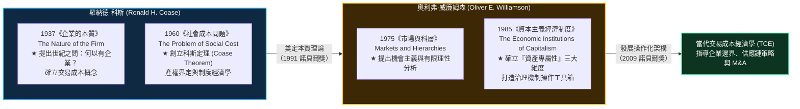
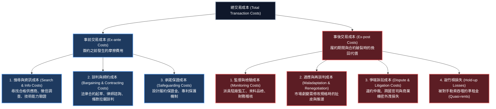
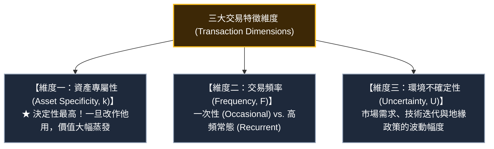
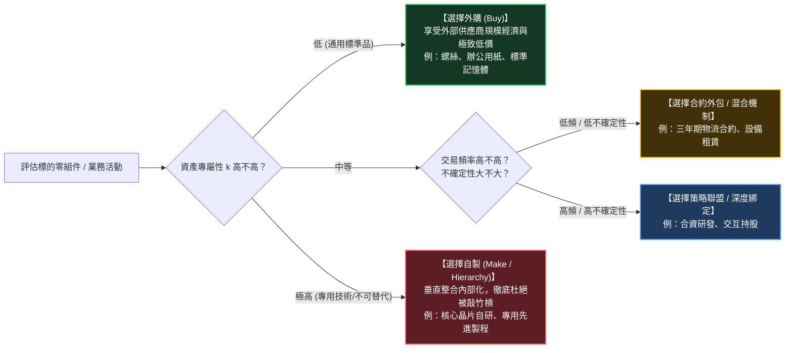

---
{"dg-publish":true,"permalink":"/98/tce/","tags":["商業概念","經濟學","產業分析","組織理論","策略管理","供應鏈管理","垂直整合","PMBA"],"dg-note-properties":{"aliases":["交易成本理論","交易成本經濟學","TCE","Transaction Cost Economics","TCE 交易成本理論","交易成本","Transaction Costs","科斯定理","Coase Theorem","企業本質理論","Theory of the Firm"],"tags":["商業概念","經濟學","產業分析","組織理論","策略管理","供應鏈管理","垂直整合","PMBA"]}}
---


# 交易成本理論 (Transaction Cost Economics, TCE / 交易成本經濟學)

> **商管核心價值**：  
> 「如果市場機制（看不見的手）是最有效率的資源配置方式，為什麼現實世界中會存在『企業』這種靠行政命令協調的科層組織？答案是：利用市場價格機制從來都不是免費的，市場交易本身充滿摩擦力與交易成本。當在市場上搜尋、協商、防範被敲竹槓的成本高於企業內部的管理成本時，企業便應運而生；企業的邊界，就是交易成本與組織管理成本的動態均衡點。」——羅納德·科斯（Ronald H. Coase）與奧利弗·威廉姆森（Oliver E. Williamson）  
> 
> 在策略管理與產業分析中，**交易成本理論（TCE）** 是解答企業核心命題**「自製 vs. 外購（Make-or-Buy）」**與**「垂直整合（Vertical Integration）」**的基石理論。它透過「有限理性」與「機會主義」兩大人性假設，結合「資產專屬性」、「交易頻率」與「環境不確定性」三大維度，為經理人提供了精準判斷應採取**市場現貨採購（Market）**、**長期策略聯盟（Hybrid）**或**全面內部化兼併（Hierarchy）**的嚴謹決策架構。

---

## 一、 理論淵源與學術奠基

### 1.1 兩大諾貝爾經濟學獎巨擘之世紀傳承



#### 1. 羅納德·科斯（Ronald Coase, 1991 諾貝爾獎）：企業誕生的本質
- **世紀之問**：新古典經濟學假設「價格機制」完美無瑕，能以零成本自動協調供需。但如果市場真的如此完美，為什麼勞工要進入工廠聽從老闆指揮？為什麼企業內部不使用價格投標來調動人力？
- **核心洞察**：**利用市場是有成本的（Costs of using the price mechanism）**。這包括：尋找交易對象的搜尋成本、談判並草擬合約的談判成本、以及監督對方不違約的執行成本。
- **企業邊界定理**：
  $$\text{企業最適規模邊界：} \quad MC_{\text{內部組織額外交易的管理成本}} = MC_{\text{公開市場進行該筆交易之交易成本}}$$
  當內部管理成本因組織官僚膨脹而超過市場交易成本時，企業的擴張便達到了極限。

#### 2. 奧利弗·威廉姆森（Oliver Williamson, 2009 諾貝爾獎）：治理機制的微觀操作化
- 將科斯的宏觀哲學轉化為可精確衡量的組織治理學說。
- 確立了**兩大人性假定**（有限理性、機會主義）與**三大交易維度**（資產專屬性、頻率、不確定性），完整解構了「市場失靈」導致「企業科層替代市場」的微觀機理。

---

## 二、 交易成本的分類與產生機理

### 2.1 交易成本的生命週期分類 (Ex-ante vs. Ex-post)



---

### 2.2 交易成本爆發的「兩大人性」與「兩大環境」交織

威廉姆森指出，交易成本並非憑空產生，而是當人類認知缺陷遇上嚴苛市場環境時的必然產物：

```
                    【環境維度 (Environment)】
                      不確定性與複雜性 (Uncertainty & Complexity)
                                ▲
                                │
                    ┌───────────┴───────────┐
                    │                       │
                    ▼                       ▼
            【有限理性】                         【合約不完全性】
    (Bounded Rationality)             (Incomplete Contracting)
    人腦算力與預見力有限，               無法在合約中窮盡未來
    無法預知所有未來事件。               可能發生的所有意外狀況。
                    │                       │
                    ▼                       ▼
           【少數議價情境】                      【敲竹槓風險】
    (Small-Numbers Bargaining)             (Hold-up Problem)
    事前可能有很多競爭者，               被套牢方陷入任人宰割，
    事後被綁定為少數甚至獨家。             引發嚴重的交易摩擦。
                    ▲                       ▲
                    │                       │
                    └───────────┬───────────┘
                                │
                                ▼
                       機會主義傾向 (Opportunism)
                    「以狡詐的方式謀求自利」
                    【人性維度 (Human Nature)】
```

1. **有限理性（Bounded Rationality） $\times$ 環境不確定性（Uncertainty） $\Longrightarrow$ 「不完全合約（Incomplete Contracts）」**：
   - 如果人類擁有無限算力，就能預先簽訂一份涵蓋未來 20 年所有天氣、政局、匯率與技術變動的「完全合約」，交易成本為零。
   - 但因人類理性有限，且環境充滿高度動態不確定性，**現實中所有的長期商業合約都必然是不完全的（存在大量未約定的合約空白區）**。
2. **機會主義傾向（Opportunism） $\times$ 少數議價（Small-Numbers Bargaining） $\Longrightarrow$ 「敲竹槓危機（Hold-up）」**：
   - 機會主義意味著「只要有空子可鑽，對手就會利用資訊不對稱說謊、偷工減料或違背口頭承諾」。
   - 當交易形成專屬綁定後，外部競爭消失，不完全合約的空白區立刻成為對方事後勒索的槓桿。

---

## 三、 決定治理機制的「三大交易維度」

威廉姆森提出，評估一筆交易究竟應該「外包」還是「自製」，取決於三大核心自變項：



### 3.1 資產專屬性（Asset Specificity）的六大類型

資產專屬性是 TCE 中最重要的概念。**若一項投資專門為某特定交易而設計，一旦終止合作，該資產無法轉售或轉用價值極低，即具備高度資產專屬性**。
其產生的超額價值稱為**準租金（Quasi-rent）**：
$$\text{專屬準租金 (Quasi-Rent)} = \text{該資產在目前特定合作下的收益} - \text{轉移到次佳用途 (Next Best Alternative) 的殘存收益}$$

| 專屬性類別 | 實質內涵 | 產業代表案例 |
| :--- | :--- | :--- |
| **1. 地點專屬性 (Site Specificity)** | 資產一旦建造於特定地理位置便不可移動，搬遷成本極高。 | 煉焦廠緊貼鋼鐵廠高爐興建；發電廠緊鄰煤礦坑口；高鐵軌道專用維修基座。 |
| **2. 實體資產專屬性 (Physical Asset)** | 設備、模具或機台是專門為了符合某單一客戶的特殊規格客製化打造。 | 鴻海為蘋果 iPhone 一體成型鋁合金機殼採購的專用 CNC 機台；特殊晶片封裝載板模具。 |
| **3. 人力資產專屬性 (Human Asset)** | 員工累積了只有在特定企業或特定合作中才管用的專屬默會知識（Tacit Knowledge）。 | 熟悉某半導體廠獨門配方與製造工藝的資深工程師；掌握某軍工客戶機密系統架構的研發團隊。 |
| **4. 專用資產 (Dedicated Assets)** | 為了滿足單一買方龐大訂單而進行的產能巨額擴張，若該客戶抽單，將形成嚴重產能閒置。 | 電池廠為某車廠專門擴建 20GWh 的電芯產線；物流業者為單一電商打造專用自動化物流中心。 |
| **5. 品牌資產專屬性 (Brand Name)** | 品牌的信譽與無形資產高度依賴合作夥伴的服務品質來維護。 | 麥當勞、星巴克特許加盟店的商標權，若加盟商偷工減料，將摧毀母品牌商譽。 |
| **6. 時間專屬性 (Temporal Specificity)** | 交易價值高度取決於時間的精準同步，一旦延遲，價值歸零。 | 新鮮現擠生乳的冷鏈收購；飛機航班降落後的地面地勤行李裝卸。 |

---

### 3.2 敲竹槓問題（The Hold-up Problem）深度實證剖析

#### 經典案例：通用汽車（GM）與費雪車體（Fisher Body, 1926）
1. **背景**：早期汽車車身是木製的，通用汽車希望採用一體成型鋼製封閉式車身，邀請 Fisher Body 為其客製化製造。
2. **資產專屬性產生**：Fisher Body 必須投入數百萬美元採購專用巨大沖壓機（具備極高的實體專屬性與地點專屬性）。
3. **敲竹槓威脅**：
   - Fisher Body 擔心：如果我投資了專用沖壓機，通用汽車事後若要求降價，我的沖壓機無法改作他用，只能認賠（被通用敲竹槓）。
   - 通用汽車擔心：若訂單爆量，Fisher Body 故意產能跟不上藉機敲詐高價，通用將面臨停工危機（被 Fisher 敲竹槓）。
4. **TCE 解決方案**：
   - 雙方最初嘗試簽訂一份長達 10 年的「成本加成（Cost-plus）」合約，但合約無法涵蓋生產效率優化與廠房搬遷爭議，爭端不斷。
   - **最終結局（科層整合）**：1926 年，**通用汽車徹底收購兼併 Fisher Body（垂直整合）**，將外部合約交易轉化為內部科層協調，敲竹槓風險歸零。

---

## 四、 組織治理機制光譜：市場 vs. 混合 vs. 科層

威廉姆森依據資產專屬性（$k$）與交易頻率（$F$），劃定出企業應選擇的三大治理機制（Governance Spectrum）：

```
【治理機制光譜 (Governance Spectrum)】

  外部化 (Outsourcing)                                 內部化 (In-house)
  ◄─────────────────────────────────────────────────────────────────►
  
   【市場治理 (Market)】         【混合治理 (Hybrid)】         【科層治理 (Hierarchy)】
   • 現貨市場採購 (Spot)         • 長期策略聯盟 (Alliance)     • 垂直整合自製 (Make)
   • 標準化大宗物料 (Commodity)  • 特許加盟 (Franchise)        • 全資收購兼併 (M&A)
   • 高激勵強度 (High-powered)   • 合資企業 (Joint Venture)    • 低激勵強度 (Low-powered)
   • 零管理負擔，隨時切換        • 雙方共同承諾，分擔風險      • 行政權威控制，管理官僚
  ─────────────────────────────────────────────────────────────────────
   資產專屬性：極低 (k ≈ 0)       資產專屬性：中等              資產專屬性：極高 (k >> 0)
   敲竹槓風險：無                敲竹槓風險：中等              敲竹槓風險：內部化消除
```

### 4.1 三大治理機制深度對照矩陣

| 比較維度 | 市場治理 (Market) | 混合治理 (Hybrid) | 科層治理 (Hierarchy) |
| :--- | :--- | :--- | :--- |
| **典型組織形式** | 公開市場詢價、現貨採購、短期合約 | 長期供應協議、策略聯盟、合資、授權加盟 | 設立內部事業部、自建產線、垂直收購 |
| **適用資產專屬性 ($k$)** | **極低（通用大宗品）** | **中等（特定客製化）** | **極高（高度專用資產）** |
| **協調機制** | 看不見的手（價格機制 $P$） | 合約條款＋信譽機制＋聯合委員會 | 看得見的手（行政權威與命令） |
| **激勵強度 (Incentives)** | **高強度激勵（High-powered）**<br>自負盈虧，效率極高 | **中等強度激勵**<br>共享利潤或依約分潤 | **低強度激勵（Low-powered）**<br>內部領死薪水，易產生官僚摸魚 |
| **主要成本承擔** | 外部交易成本（搜尋、詢價） | 合約協商與再談判成本 | 內部管理與科層官僚成本 |
| **適應動態變化方式** | 自發性適應（Autonomous Adaptation） | 協同再協商適應 | 合作性行政適應（Coordinated Adaptation） |

---

### 4.2 威廉姆森邊界公式：何時自製？何時外購？

令：
- $\Delta C = C_{\text{自製生產成本}} - C_{\text{市場外購生產成本}}$（通常 $\Delta C > 0$，因為外部供應商擁有規模經濟與外包競爭效率，內部自製生產成本往往較高）。
- $\Delta G = G_{\text{內部科層管理成本}} - G_{\text{市場外部交易成本}}$（當資產專屬性 $k$ 升高時，市場交易成本爆炸，使 $\Delta G < 0$）。

```
決策準則：
當 (市場交易成本 - 內部管理成本) > (自製生產成本 - 外購生產成本) 時，選擇【自製 / 垂直整合】！
```



---

## 五、 當代科技顛覆：數位時代與 AI 重塑企業邊界

傳統 TCE 建立於工業時代的實體資產假設上；在互聯網、雲端算力與人工智慧時代，交易成本的形態發生了根本性位移：

### 5.1 平台經濟與生態系：交易成本急遽下降驅動的去中介化
1. **搜尋成本（Search Costs）近乎歸零**：
   - 過去要找到全球最便宜的零件供應商需耗費數月參展與徵信；如今透過電子商務平台與全球供應鏈數據庫，秒級完成比價。
2. **監督與履約成本大幅降低**：
   - 物聯網（IoT）即時追蹤貨況、區塊鏈智能合約（Smart Contracts）自動扣款防賴帳、Uber 司機雙向評分機制。
3. **結果（非典型無界組織）**：
   - **Uber、Airbnb 不擁有車輛與房產，卻協調了全球數百萬服務節點**。這是因為數位平台將外部交易成本降得比內部雇傭管理成本更低，催生了龐大的零工經濟（Gig Economy）。

---

### 5.2 逆向演進：在 AI 與先進半導體領域，TCE 驅動「重新垂直整合」
儘管數位時代大幅降低了標準交易成本，但在尖端科技賽道，**資產專屬性與地緣政治不確定性反而飆升至歷史極值**：
- **Apple 自研 Apple Silicon（M 系列 / A 系列晶片）**：
  - 過去外購 Intel 處理器；但當行動終端需要極致功耗比與神經網絡引擎時，通用晶片無法滿足蘋果要求（實體與技術專屬性極高）。若繼續依賴 Intel，蘋果將面臨產品藍圖受制於人的「敲竹槓風險」，因此蘋果果斷將晶片架構**全面內部化自製**。
- **台積電與 ASML 的共生混合治理**：
  - 極紫外光（EUV）曝光機每台高達數億美元，研發耗資百億。台積電曾注資 ASML 研發並包下大量產能，以長期戰略聯盟深度綁定，防範因專用資產過重而產生的雙向敲竹槓問題。

---

## 六、 經理人實戰決策工具箱：自製 vs. 外購 7 步檢核表

企業高階策略委員會在審查重大外包（Outsourcing）或收購（M&A）案時，應逐條檢核以下清單：

```markdown
### 📋 Make-or-Buy 交易成本戰略審計表

- [ ] 1. 【專屬資產識別】：該專案是否需要我方或供應商投入無法轉作他用的「客製化設備、特殊產線或專屬軟體」？
         （若 是 ➔ 敲竹槓風險極高，亮黃燈）
- [ ] 2. 【準租金規模衡量】：若終止合作，該專用資產轉向二手市場或替代客戶時，價值是否會損失超過 40%？
         （若 是 ➔ 外部市場存在極大勒索空間）
- [ ] 3. 【合約漏洞預判】：未來三至五年內，產品規格、技術標準或法規是否存在劇烈未知的變動？
         （若 是 ➔ 簽約前無法窮盡條款，不完全合約風險高）
- [ ] 4. 【市場競爭格局】：在該特定領域，外部合格且具備技術能力的供應商是否少於 3 家？
         （少數議價情境 ➔ 供應商具備強大議價權與背叛誘因）
- [ ] 5. 【智慧財產外洩】：外包過程中，是否必須向供應商揭露企業核心專利、演算法或商業機密？
         （若 是 ➔ 監督防偷成本過高，強烈建議自製）
- [ ] 6. 【規模經濟差距】：外部專業供應商的生產成本優勢（$\Delta C$），是否足以覆蓋潛在的交易監督風險？
         （若差距巨大且專屬性可控 ➔ 傾向混合合約外購）
- [ ] 7. 【內部官僚成本】：若將該業務內部化自製，是否會導致組織架構臃腫、削弱市場競爭敏銳度？
         （若自製管理成本過高 ➔ 考慮以合資企業或少數股權投資替代完全兼併）
```

---

## 七、 PMBA 模組講義與知識網絡鏈結

### 7.1 官方課程與模組雙向反向鏈結
- [[04_主題選修/12_產業分析與投資策略/02_模組筆記/Module_1_總論與架構/M1-3_產業獲利結構差異與十大經典理論\|M1-3 產業獲利結構差異與十大經典理論]]：
  - **十大經典理論之第 2 大支柱**：深入解析 TCE 如何作為「自製 vs 外購」的底層決策工具，並以台積電關鍵設備策略聯盟為實證。
- [[04_主題選修/12_產業分析與投資策略/02_模組筆記/Module_1_總論與架構/M1-6_產業分析模式與九大分析工具矩陣\|M1-6 產業分析模式與九大分析工具矩陣]]：
  - 模式九「企業邊界與生態系邊界分析」：評估產業鏈上下游垂直整合的必要性。
- [[04_主題選修/10_創業與企業財務策略/02_模組筆記/Module_1_創新思維與商業模式/M1-9_商業模式畫布架構與價值主張設計\|M1-9 商業模式畫布架構與價值主張設計]]：
  - 商業模式畫布之「關鍵合作夥伴（Key Partners）」：以策略聯盟降本避險，避免過早重資產自製引發的財務僵化。
- [[04_主題選修/10_創業與企業財務策略/02_模組筆記/Module_1_創新思維與商業模式/M1-10_七大市場力量與商業戰略價值公式\|M1-10 七大市場力量與商業戰略價值公式]]：
  - 「轉換成本（Switching Costs）」與「獨家資源（Cornered Resource）」：資產專屬性正是構建極高轉換成本壁壘的核心驅動力。

### 7.2 商業概念庫相關卡片
- [[98_商業概念庫/value-net_價值網\|value-net_價值網]]（供應商與互補者的治理博弈，做大餅與分大餅）
- [[98_商業概念庫/strategy-coopetition_競合戰略 Coopetition\|strategy-coopetition_競合戰略 Coopetition]]（混合治理下的競合共生模式）
- [[98_商業概念庫/vpc-value-price-cost_價值價格成本分析\|vpc-value-price-cost_價值價格成本分析]]（垂直整合對降低成本 $C$ 與保障溢價 $P$ 的影響）
- [[98_商業概念庫/dfm-design-for-manufacturability_可製造性設計\|dfm-design-for-manufacturability_可製造性設計]]（研發端與代工製造端資產專屬性對齊）
- [[98_商業概念庫/competitive-advantage_競爭優勢\|competitive-advantage_競爭優勢]]（以專屬組織能力打造難以被市場替代的護城河）
- [[98_商業概念庫/two-factor-theory_雙因素理論\|two-factor-theory_雙因素理論]]（內部科層組織激勵與管理成本的心理學視角）
- [[98_商業概念庫/framing-effect_框架效應\|framing-effect_框架效應]]（商業外包談判中合約條件的框架鎖定）
