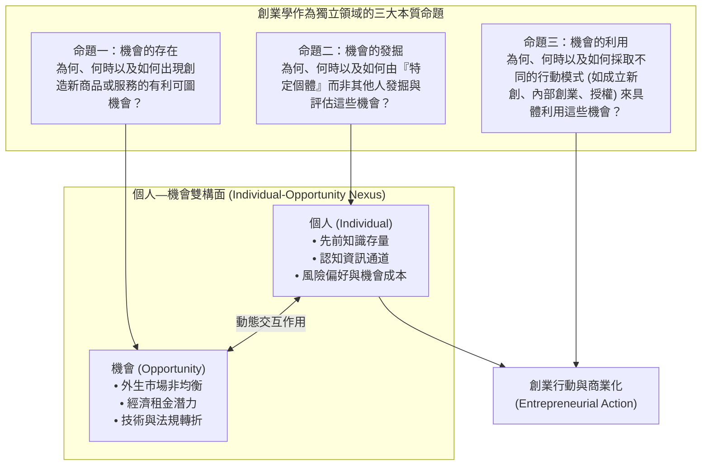

---
{"dg-publish":true,"permalink":"/98/venkataraman/","tags":["商業概念","創業管理","學者典範","PMBA"],"dg-note-properties":{"aliases":["Venkataraman","范卡塔拉曼","Sankaran Venkataraman","個人機會雙構面理論"],"tags":["商業概念","創業管理","學者典範","PMBA"]}}
---


# 范卡塔拉曼 (Sankaran Venkataraman)

> [!NOTE]
> **核心概念精粹**：桑卡蘭·范卡塔拉曼（Sankaran Venkataraman）是當代創業學（Entrepreneurship）的領航學者與奠基人之一。他與斯科特·謝恩（Scott Shane）於 2000 年發表的經典論文《The Promise of Entrepreneurship as a Field of Research》，正式終結了學界長達數十年的範疇紛爭，確立了**「個人—機會雙構面架構（Individual-Opportunity Nexus）」**，奠定了創業學作為獨立學術學科的理論合法性。

---

## 一、 學理定位：創業學作為獨立學科的「獨立宣言」

在 2000 年之前，管理學界長期將創業視為策略管理、微觀經濟學或組織行為學的附庸。學者們要麼陷入「創業者特質論（Trait Theory，試圖證明創業者具備某種超凡人格）」的死胡同，要麼陷入純粹描述「中小企業管理」的實務操作。

范卡塔拉曼與謝恩力挽狂瀾，提出了界定創業學核心研究邊界的**三大根本命題**：



### 個人—機會雙構面核心矩陣

范卡塔拉曼強調，單獨研究「人」或單獨研究「機會」都是片面的，唯有聚焦於兩者的**動態交集與適配**：

| 分析維度 | 傳統特質論觀點 | 范卡塔拉曼雙構面觀點 (Shane & Venkataraman, 2000) |
| :--- | :--- | :--- |
| **研究核心** | 創業者是否更具冒險精神、成就動機或內控傾向？ | 探索**「特定機會的屬性」與「特定個體的認知結構」**如何咬合。 |
| **機會來源** | 創業者憑空想像或心理主觀臆造。 | 源自市場資訊不完全、技術創新或制度變革帶來的客觀價值空間。 |
| **發掘機制** | 隨機發生的靈光一現或天賦異稟。 | 仰賴**先前知識（Prior Knowledge）**的吸收通道與企業家警覺性。 |
| **利用抉擇** | 所有人看到機會都會採取相同行動。 | 取決於個體的**機會成本（Opportunity Cost）**與融資治理能力。 |
| **價值產出** | 創立更多中小企業。 | 推動市場資源的高效重組，創造經濟效率與顧客福利。 |

---

## 二、 機會利用的微觀決策機制：機會成本與預期租金

范卡塔拉曼深入剖析了為什麼有人看到機會後選擇立即離職創業，而有人卻選擇按兵不動？其核心決策模型遵循嚴格的經濟學邏輯：

$$U(\text{Exploitation}) = \mathbb{E}[\Pi] - C_{\text{capital}} - \text{Opportunity Cost}_{\text{individual}} - \rho(\text{Risk})$$

其中：
- $\mathbb{E}[\Pi]$：預期未來經濟租金的折現值。
- $C_{\text{capital}}$：籌措資本與資源拼湊的交易成本。
- $\text{Opportunity Cost}_{\text{individual}}$：創業者放棄既有高薪職位、升遷機會或企業福利的機會成本。
- $\rho(\text{Risk})$：個人面對不確定性時的風險溢價扣減。

### 核心推論：
1. **機會成本是創業的最高門檻**：大企業高階副總裁即便具備頂尖經驗與洞見，其極高的機會成本往往會抑制其獨立創業意願；相反地，處於邊緣、遭遇結構性瓶頸或年輕創業者，其機會成本極低，更容易採取冒險利用行動（這與 [[Nothing to Lose|無物可失]] 心態深刻呼應）。
2. **資訊走廊與專屬通道**：個體只會利用與自己過去生活或工作經驗存在「走廊關聯」的機會，跨領域盲目跳躍往往導致高昂的認知折價與失敗。

---

## 三、 實戰案例剖析：台積電成立過程中的「個人—機會雙構面」

```carousel

<!-- slide -->
### 1. 機會端（The Opportunity）
- 1980 年代中期，全球半導體技術複雜度幾何級數上升，晶圓廠建置成本動輒數億美元。
- 矽谷湧現出大批天才晶片設計師，但他們根本無力自建晶圓廠；與此同時，台灣具備極高素質、紀律嚴明且成本優勢顯著的工程師紅利與工研院試驗線基礎設施。
<!-- slide -->
### 2. 個人端（The Individual - Morris Chang）
- 張忠謀曾任德州儀器（TI）全球資深副總裁，管理全美規模最大的半導體製造體系，深刻洞悉 IDM 模式的利益衝突與產能瓶頸。
- 全球具備張忠謀此種頂級產業聲譽與技術底蘊的人屈指可數，且他在被台灣政府延攬時具備領導全新國家級專案的歷史動機。
<!-- slide -->
### 3. 雙構面的完美咬合
- 這項「純晶圓代工模式」的偉大機會，只有在「張忠謀的專屬經驗與聲譽資本」與「台灣製造紅利」相遇時，才被精準發掘並完美利用。換作任何缺乏 IDM 頂層治理經驗的人，都無法贏得全球晶片巨頭的委外代工信任。
```

---

## 四、 經理人內部創業與組織激勵檢核表（Executive Decision Checklist）

在成熟企業內部推動創業精神（Intrapreneurship）與新創專案孵化時，高層領導者應運用范卡塔拉曼的架構檢核以下四點：

- [ ] **個人—機會專屬適配度檢驗（Individual-Opportunity Fit）**：
  - 我們指派的新事業負責人，是否在該領域具備深厚的先前知識與第一線痛點洞察？還是僅憑人事資歷輪調？
- [ ] **內部創業機會成本重組（Rebalancing Opportunity Costs）**：
  - 組織內部的激勵制度是否壓制了優秀人才的冒險意願？（例如：成功了只有微薄獎金，失敗了卻影響升遷考績）。我們是否設計了模擬股權、獨立利潤分享或內部創投（CVC）機制，使預期回報顯著超越冒險代價？
- [ ] **知識通道與走廊跨界（Information Channels & Corridor Exploitation）**：
  - 公司是否鼓勵跨部門知識流動？第一線業務員與研發工程師是否有機制直接對話，以便讓技術與未滿足的市場需求產生雙構面碰撞？
- [ ] **利用模式路徑抉擇（Mode of Exploitation Strategy）**：
  - 面對一個全新機會，我們應選擇「內部事業部自主研發」、「分拆為獨立子公司引進外部 VC」、還是「技術專利對外授權」？哪種模式最能降低資本交易成本並極大化執行速度？

---

## 五、 關聯概念與知識網絡

* 核心理論基礎：
  * [[opportunity-recognition_創業機會辨識|創業機會辨識 (Opportunity Recognition)]]：范卡塔拉曼理論的認知微觀歷程
  * [[opportunity-discovery_機會發掘|機會發掘 (Opportunity Discovery)]]：客觀實證主義機會觀
  * [[opportunity_機會|機會 (Opportunity)]]：提蒙斯模型機會三要素架構
  * [[schumpeter_熊彼得|約瑟夫·熊彼得 (Joseph Schumpeter)]]：創造性破壞與企業家功能定位
* 組織應用與延伸：
  * [[timmons-model_提蒙斯創業模型|提蒙斯創業模型 (Timmons Model)]]：機會、資源與團隊的動態平衡
  * [[Nothing to Lose|無物可失 (Nothing to Lose)]]：低機會成本下的冒險躍遷邏輯
  * [[Dollinger|多林傑 (Marc J. Dollinger)]]：資源整合與組織化創業模式
  * [[entrepreneurial-capability_創業能力|創業能力 (Entrepreneurial Capability)]]：機會識別與資源整合之動態能力矩陣
