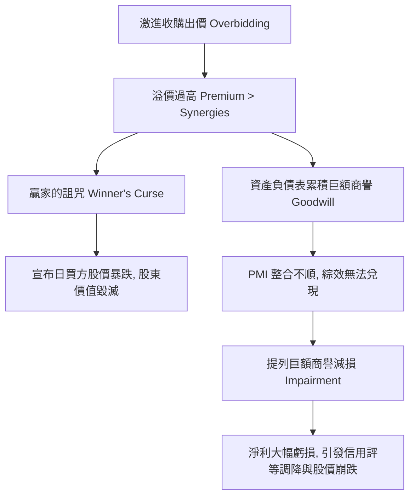

---
{"dg-publish":true,"permalink":"/98/acquisition-premium/","tags":["商業概念","企業併購","財務估值","資本市場","贏家的詛咒","PMBA"],"dg-note-properties":{"aliases":["收購溢價","Acquisition Premium","併購溢價","控制權溢價","Control Premium","買方溢價"],"tags":["商業概念","企業併購","財務估值","資本市場","贏家的詛咒","PMBA"]}}
---


# 收購溢價 (Acquisition Premium & The Winner's Curse)

> **【核心決策摘要】**
> **收購溢價（Acquisition Premium）** 是指在企業併購交易中，買方所提出的**每股收購報價（Offer Price），高於目標公司在交易消息公布前之「不受干擾市價（Undisturbed Share Price）」的超額百分比**。在成熟資本市場中，收購溢價通常落在 **20% 至 40%** 之間。支付溢價的合理性奠基於**控制權價值（Value of Control）** 與預期能實現的**[[98_商業概念庫/merger-acquisition_併購綜效\|併購綜效（M&A Synergies）]]**。然而，收購溢價也是引發「**贏家的詛咒（Winner's Curse）**」的罪魁禍首——若買方在拍賣競價中過度自信，所支付的溢價超過了綜效的真實折現值，則該併購案在簽約瞬間便已造成買方股東財富的實質毀滅，並為未來的巨額**商譽減損（Goodwill Impairment）** 埋下未爆彈。

---

## 1. 概念核心定義與計算準則 (Executive Definition & Valuation Metrics)

### 1.1 核心定義與公式
收購溢價嚴格定義為：**買方向目標公司股東支付以換取其放棄獨立控制權之補償與激勵超額收益**。

$$\text{Premium } (\%) = \left( \frac{P_{\text{Offer}} - P_{\text{Undisturbed}}}{P_{\text{Undisturbed}}} \right) \times 100\%$$

- **$P_{\text{Offer}}$（每股收購對價）**：買方提出的每股現金、股票或混合支付對價。
- **$P_{\text{Undisturbed}}$（不受干擾股價）**：通常選取**併購意向書簽署、市場傳聞洩漏或正式公告日前 20 至 30 個交易日的成交量加權平均價（VWAP）**，以完全濾除內線交易與市場投機拉抬的水分。

```
                ┌─────────────────────────────────────────────────────────┐
                │               收購對價結構與溢價解構圖譜                │
                └────────────────────────────┬────────────────────────────┘
                                             ▼
   ┌──────────────────────────────────────────────────────────────────────────┐
   │ 最終每股收購出價 (Offer Price: P_Offer)                                   │
   └─────────────────────────────────────┬────────────────────────────────────┘
                                         │
                 ┌───────────────────────┴───────────────────────┐
                 ▼                                               ▼
   ┌───────────────────────────┐                   ┌───────────────────────────┐
   │ 目標公司獨立市價           │                   │ 收購溢價 (Premium: 20%~40%)│
   │ (Undisturbed Share Price) │                   ├───────────────────────────┤
   │ • 反映當前公開市場定價     │                   │ 1. 控制權移轉補償溢價     │
   │ • 當前經營團隊之現狀價值   │                   │ 2. 預期綜效現值轉移給被併方│
   └───────────────────────────┘                   └───────────────────────────┘
```

---

## 2. 支付收購溢價的合理性來源 (Economic Justifications for Premiums)

買方願意支付高於公開市場價格的超額對價，必須具備兩大經濟合理性：

### 2.1 控制權價值（Value of Control）
公開市場上的分散少數股東僅持有消極投資權益，無權撤換無能的管理團隊、處分閒置資產或調整資本結構。
- 買方透過收購取得 51% 以上控制權（或 100% 股權），具備徹底重整目標公司的合法權力。
- 若目標公司當前因代理人問題而營運低效，買方透過重組釋放潛在價值的空間，即構成控制權溢價的上限：
  $$\text{Value of Control} = V_{\text{Optimal Management}} - V_{\text{Current Status Quo}}$$

### 2.2 綜效價值的提前透支與轉移（Sharing the Synergy Pie）
併購所帶來的規模經濟、採購降本與交叉銷售綜效（$\Delta V$），理論上由雙方創造。然而在現實併購談判中，目標公司董事會有義務為自身股東爭取最高利益，通常會要求將**預期綜效現值的 50% 至 70%** 透過溢價形式在交割日直接變現領走。

---

## 3. 溢價過高的致命代價：贏家的詛咒與商譽炸彈 (The Pitfalls: Winner's Curse)



1. **贏家的詛咒（The Winner's Curse）**：
   在多家買方競爭激烈的競標拍賣（Auction Process）中，最終勝出的買方往往不是對標的資產最具協同運營能力的企業，而是**對未來綜效估計最樂觀、出價最激進的不理性企業**。贏得拍賣的代價往往是長期的財務苦果。
2. **會計商譽減損炸彈（Goodwill Impairment Risk）**：
   - 買方支付的溢價在資產負債表上被資本化為**商譽（Goodwill = Purchase Price - Fair Value of Net Identifiable Assets）**。
   - 依據 IFRS 3 與 US GAAP，商譽不進行逐年攤銷，但每年必須進行嚴格的減損測試（Impairment Test）。
   - 若被併業務後續營收或獲利未達併購當初的高標預測，企業必須一次性全額打消商譽，直接重創當期營業外損益與淨資產。

---

## 4. 關聯概念與延伸閱讀 (Cross References)

- [[enterprise-m-and-a_企業併購]]：企業併購動機、估值與全流程架構。
- [[merger-acquisition_併購綜效]]：溢價上限的理論決定因子。
- [[merger-acquisition-integration_併購後整合]]：若無法落實 PMI，溢價即成為純粹的價值毀滅。
- [[horizontal-merger-acquisition_水平併購]]：同業併購中溢價對定價權與市佔率的敏感度。
- [[vertical-merger-acquisition_垂直併購]]：上下游整合中的控制權溢價評估。
- [[agency-problem_代理人問題]]：經理人因帝國建造慾望而不惜支付超額溢價的代理成本。
- [[home]]：PMBA 知識庫首頁與模組導航。