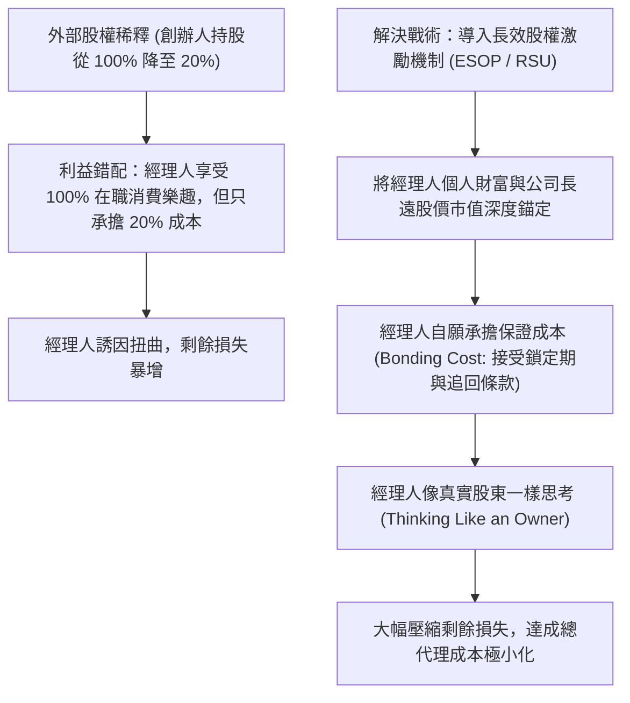

---
{"dg-publish":true,"permalink":"/98/agency-costs/","tags":["商業概念","公司治理","財務管理","產權經濟學","福利經濟學","PMBA"],"dg-note-properties":{"aliases":["代理成本","Agency Costs","委託代理成本","詹森麥克林模型","剩餘損失","監督成本"],"tags":["商業概念","公司治理","財務管理","產權經濟學","福利經濟學","PMBA"]}}
---


# 代理成本 (Agency Costs & Quantitative Welfare Economics)

> **【核心決策摘要】**
> **代理成本（Agency Costs）** 是產權經濟學、合約理論與現代公司理財之量化核心概念，由麥可·詹森（Michael Jensen）與威廉·麥克林（William Meckling）於 1976 年嚴格定義為：**因委託人與代理人間存在目標利益衝突及資訊不對稱，導致企業實體價值無法達到「委託人完全親自經營時之理論極大值」而產生的全社會淨經濟福利損失（Economic Welfare Loss）**。詹森與麥克林將代理成本精準解構為三大不可分割的量化部分：**委託人的監督成本（Monitoring Costs）**、**代理人的保證成本（Bonding Costs）** 以及 **不可避免的剩餘損失（Residual Loss）**。企業治理制度設計的終極目標，並非「徹底消滅代理成本」（因完全消除剩餘損失所需的監督成本將趨向無窮大），而是在**邊際監督收益等於邊際監督成本之處，求得總代理成本（Total Agency Costs）的數學極小值**。

---

## 1. 概念核心定義與詹森-麥克林經典三支柱模型 (The Jensen & Meckling 1976 Framework)

### 1.1 核心定義與全社會福利損失
代理成本在量化福利經濟學中定義為：

$$\text{總代理成本 (Total Agency Costs, TAC)} = M + B + R$$


### 1.2 本質解析：為什麼代理成本不可能為零？
許多初學經理人常犯下「試圖將代理成本降為零」的致命錯誤：
1. **邊際監督成本遞增法則**：為了將經理人的道德風險從 10% 壓降到 5%，需要設立審計委員會；但若想從 1% 壓降到 0.01%，企業必須在每個辦公室安裝監控探頭、每筆 100 元的報銷皆需董事長簽批。
2. **組織官僚癱瘓與效率窒息**：極端的過度監督會徹底摧毀企業的創新活力與靈活決策能力，此時**監督成本的飆升遠超過其所挽回的剩餘損失**。
3. **最優代理成本（Optimal Agency Cost）**：健全的公司治理追求的是總成本曲線的拋物線最低點（Trade-off Minimum）。

---

## 2. 數理模型與最優治理邊界 (Mathematical Modeling & Optimization)

### 2.1 總代理成本極小化微積分模型

設委託人投入的監督水平為 $M \ge 0$，代理人採取的保證投入為 $B \ge 0$。剩餘損失 $R(M, B)$ 是監督與保證的嚴格遞減且嚴格凸函數（Convex Function）：

$$\frac{\partial R}{\partial M} < 0, \quad \frac{\partial^2 R}{\partial M^2} > 0 \quad (\text{邊際監督效益遞減})$$

企業面臨的最優化問題為：

$$\min_{M, B} \text{TAC}(M, B) = M + B + R(M, B)$$

對監督成本 $M$ 求一階導函數並令其等於零（一階最優條件）：

$$\frac{\partial \text{TAC}}{\partial M} = 1 + \frac{\partial R}{\partial M} = 0 \implies \left| \frac{\partial R}{\partial M} \right| = 1$$

```
成本 ($)
  ▲
  │                                     總代理成本 TAC = M + R
  │                                           ╭───────────────╮
  │                                          ╱                 ╲
  │                                         ╱                   ╲
  │   監督成本 M                           ╱   【最優治理平衡點】 ╲
  │       ╱                               │      d(TAC)/dM = 0     │
  │      ╱                                ╰───────────┬───╯─────╯
  │     ╱                                             │
  │    ╱                                              │
  │   ╱          剩餘損失 R(M)                        │
  │  ╱         ╲                                      │
  │ ╱           ╲.....................................│
  └───────────────────────────────────────────────────┴────────────────► 監督強度 (M)
                                                   最優監督水平 M*
```

#### 經理人定量準則：
只要「**多投入 1 元監督成本，能換取多於 1 元的剩餘損失減少（$|\partial R / \partial M| > 1$）**」，就應毫不猶豫加大監督力度；一旦邊際減損等於 1 元，任何額外的監督審批都屬於摧毀股東價值的過度治理！

---

### 2.2 詹森自由現金流假說與負債的紀律約束效應 (Jensen's FCF Hypothesis)

詹森（1986）在其經典論文中提出了利用**資本結構（負債融資）** 來精確消除剩餘損失的偉大模型：

$$\text{FCF} = \text{營業現金流入} - \text{所有正 NPV 專案所需的必要資本支出}$$

1. **自由現金流對代理成本的刺激**：當企業帳上擁有充沛的無主「未分配自由現金流」時，經理人受到極大誘惑將其用於低效率的帝國建造（如收購非核心業務以彰顯個人名望）或在職消費，此時剩餘損失達到峰值。
2. **負債作為紀律約束武器（Debt as a Disciplinary Mechanism）**：
   - 股東發放股利隨時可以停止，對經理人沒有剛性約束力；
   - 但**銀行借款與公司債的本金償還與利息支付具備法律剛性契約約束**！
   - 企業透過適度舉債（如發行債券買回庫藏股），迫使經理人每個月必須準時將現金吐出給債權人，否則公司將面臨清算破產、經理人將名譽掃地被解雇。
   - 剛性還債壓力極大化擠壓了經理人浪費現金的自由裁量空間，從而**以極低成本有效摧毀了經理人建造帝國的剩餘損失**！

---

## 3. 股權激勵如何降低股權代理成本？ (Equity Incentives & Alignment)

詹森與麥克林指出，外部股權比例越高，代理成本越高；當創辦人持有 100% 股權時，代理成本為零。



---

## 4. 產業標竿與實戰應用場景 (Industry Benchmarks & Applications)

| 產業類別 | 主要代理成本構成 | 典型表現形式 | 標竿解決方案 |
| :--- | :--- | :--- | :--- |
| **成熟傳產大型製造業 (現金牛)** | **巨額剩餘損失 (帝國擴張)** | 帳上數百億自由現金無處可去，盲目跨界投資無關產業（如紡織廠買地產、鋼鐵廠跨界賣保險） | 透過激進加槓桿、大規模提高常態現金分紅或註銷式股票回購（強制吐出現金） |
| **高科技新創與軟體業 (SaaS)** | **高昂保證成本與道德風險** | 創辦團隊面臨外部創投稀釋，早期經理人可能中途跳槽帶走核心代碼 | 嚴格設計「4年成熟期 + 1年懸崖期」之 [[98_商業概念庫/equity-vesting_股權成熟機制\|equity-vesting_股權成熟機制]] 與單/雙引爆點加速條款 |
| **家族控股企業集團 (新興市場)** | **第二類代理成本 (大股東掏空)** | 大股東以超低利息挪用上市公司資金為家族私人事業擔保 | 引入獨立董事實質一票否決權、少數股東集體訴訟機制、強制資訊即時揭露 |

---

## 5. 經典企業個案深度剖析 (Deep Dive Case Studies)

### 5.1 成功典範：KKR 收購 RJR Nabisco 的「負債紀律治癒代理成本」
- **收購前代理成本峰值**：RJR Nabisco 每年產生數十億美元菸草現金流，管理層斥巨資打造 10 架專機隊，在職消費奢華無度，剩餘損失巨大。
- **治理重構手術**：
  1. 1989 年，私募股權巨頭 KKR 以 **\$250 億美元** 完成史上最大槓桿收購（LBO），其中超過 **\$200 億美元** 為外部發行的高收益債務（垃圾債）。
  2. 收購完成首週，KKR 立即解散了奢華專機隊，掛牌拍賣專屬航站樓與總部奢華藝術品。
  3. 由於每年必須償還數十億美元剛性利息，新管理團隊不得不將所有非核心低效資產分拆出售，全力深耕核心菸草與食品業務，將營業利潤率提升 35%。
- **成效**：負債作為硬性約束工具，在三年內將該公司的非必要代理成本壓縮了 80% 以上。

### 5.2 失敗警示：日本奧林巴斯（Olympus）世紀掏空案的「內部監督徹底失靈」
- **醜聞曝光**：2011 年，奧林巴斯新上任的英國籍 CEO 伍德福德（Michael Woodford）發現公司過去支付了數億美元離奇的海外諮詢收購顧問費，隨即向董事會提出質疑，卻在當天慘遭董事會全票解職。
- **代理成本黑洞剖析**：
  1. **剩餘損失長達 20 年**：自 1990 年代日本泡沫經濟破裂起，奧林巴斯高層為了掩蓋數十億美元的證券投資巨額虧損，透過複雜的海外皮包公司與假收購洗錢平帳。
  2. **監督成本（Audit & Board）形同虛設**：日本傳統董事會由內部提拔的忠誠元老組成，強調集體默契與忠誠文化，外部審計師與合規部門長期被蒙蔽或不敢發聲。
- **後果**：醜聞被外媒踢爆後，股價雪崩 80%，市值蒸發數十億美元，多位前董事長被判刑，成為全球公司治理中「監督成本虛設引發災難性剩餘損失」的教科書反面案例。

---

## 6. 高階經理人決策實戰工具箱 (Executive Action Playbook)

### 6.1 代理成本全景優化檢驗四分圖

```
                    ┌────────────────────────────────────────┐
                    │      代理成本極小化決策實戰矩陣        │
                    └───────────────────┬────────────────────┘
                                        ▼
    ┌───────────────────┬───────────────┴───────────────┬───────────────────┐
    ▼                   ▼                               ▼                   ▼
【1. 監督成本維度】     【2. 保證成本維度】             【3. 剩餘損失維度】 【4. 資本結構約束維度】
• 審計委員會是否獨立運作 • 管理層是否主動承擔責任保險  • 經理人是否有過度投資 • 企業自由現金流是否過多
• 內控系統是否符合 COSO  • 薪酬合約是否內建追回條款    • 併購案是否真正創造正 • 是否應增加股利或舉債回購
• 邊際審批是否引發官僚   • 股權激勵鎖定年限是否夠長    • 是否因厭惡風險錯失良機 • 讓剛性債務壓制在職消費
```

---

## 7. 關聯知識網絡與導航地圖 (Knowledge Network & Cross-References)

### 7.1 本主題核心三部曲
- **[[98_商業概念庫/corporate-governance_公司治理\|corporate-governance_公司治理]]** · 內部制度與外部市場制衡體系、兩大治理哲學與董事會獨立性
- **[[98_商業概念庫/agency-problem_代理人問題\|agency-problem_代理人問題]]** · 所有權與經營權分離、三大維度代理衝突與隧道效應
- **[[98_商業概念庫/agency-costs_代理成本\|agency-costs_代理成本]]** · 詹森-麥克林福利損失模型、監督成本、保證成本與剩餘損失極小化（本篇）

### 7.2 跨領域財務與策略鏈結
- [[98_商業概念庫/capital-structure_資本結構\|capital-structure_資本結構]] · 詹森自由現金流假說：負債融資作為約束代理成本之紀律利器
- [[98_商業概念庫/free-cash-flow_自由現金流量\|free-cash-flow_自由現金流量]] · 自由現金流的代理成本雙刃劍效應
- [[98_商業概念庫/equity-vesting_股權成熟機制\|equity-vesting_股權成熟機制]] · 解決股東與核心管理層代理成本的核心股權工具
- [[98_商業概念庫/Shareholder_Value_Added_SVA_股東價值增加法\|Shareholder_Value_Added_SVA_股東價值增加法]] · 衡量代理成本扣除後股東真實經濟價值增加
- [[98_商業概念庫/second-generation-succession_二代接班\|second-generation-succession_二代接班]] · 家族企業治理結構傳承中代理成本的轉型

### 7.3 課程筆記與導航主頁
- [[02_核心必修/01_財務管理/L09_資本結構理論與決策\|L09_資本結構理論與決策]] · 財務策略模組九：資本結構、代理成本與公司治理
- [[04_主題選修/10_創業與企業財務策略/_歷史版本封存/_創業與企業財務策略 MOC\|_創業與企業財務策略 MOC]] · 企業財務策略與資本市場運作全景地圖
- [[home\|home]] · 全球 PMBA 知識庫總導航主頁面