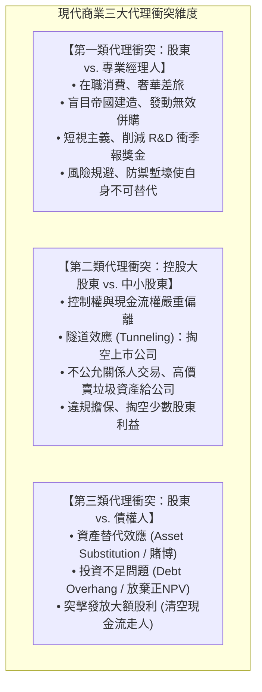

---
{"dg-publish":true,"permalink":"/98/agency-problem/","tags":["商業概念","公司治理","財務管理","產權經濟學","PMBA"],"dg-note-properties":{"aliases":["代理人問題","代理問題","Principal-Agent Problem","委託代理問題","Agency Problem","委託人代理人衝突"],"tags":["商業概念","公司治理","財務管理","產權經濟學","PMBA"]}}
---


# 代理人問題 (Principal-Agent Problem & Structural Conflicts)

> **【核心決策摘要】**
> **代理人問題（Principal-Agent Problem，又稱委託代理問題）** 源於現代企業制度中**「所有權（Ownership）」與「經營權（Control）」的徹底分離**。經濟學大師麥可·詹森（Michael Jensen）與威廉·麥克林（William Meckling）於 1976 年奠定經典理論基礎，指出當委託人（Principal，如股東）將資產支配權與營運決策權授予代理人（Agent，如專業經理人）時，由於**雙方效用目標不一致（Goal Incongruence）**，且存在客觀無法消除的**資訊不對稱（Information Asymmetry）**，代理人必然具備自利誘因損害委託人利益以謀求個人私利。代理衝突在企業實務中體現為三大經典維度：**第一類（股東 vs. 經理人）**、**第二類（控股大股東 vs. 外部中小股東）** 以及 **第三類（股東 vs. 債權人）**。

---

## 1. 概念核心定義與本質 (Executive Definition & Theoretical Essence)

### 1.1 核心定義與產生根源
代理問題在合約理論與微觀經濟學中被定義為：**委託人委託代理人代為處理某項事務，但由於委託人無法以零成本完全觀測到代理人的真實努力程度、資訊與動機，導致代理人在追求自身效用最大化時，做出了偏離委託人福利最大化的次優決策**。

```
                       代理人問題爆發的「鐵三角先決條件」
                                       ▲
                                      ╱ ╲
                                     ╱   ╲
                                    ╱     ╲
                     【目標函數不一致】─────【資訊不對稱】
                     (股東求長期財富增值    (經理人掌握現場實況
                      經理人求薪酬權力)     股東僅能看歷史報表)
                                    ╲     ╱
                                     ╲   ╱
                                      ╲ ╱
                                       ▼
                             【契約不完全性】
                           (未來充滿未知黑天鵝
                            不可能把所有情境寫進合約)
```

### 1.2 道德風險與逆向選擇 (Moral Hazard & Adverse Selection)
- **事前的逆向選擇（Adverse Selection）**：在簽約聘用前，經理人隱瞞自身的真實能力、道德缺陷或健康狀況，導致董事會以高薪聘請了劣質代理人（劣幣驅逐良幣）。
- **事後的道德風險（Moral Hazard）**：在簽約入職後，由於經理人不用承擔全部虧損後果（有限責任），其工作努力程度 $e$ 低於自我經營時的水準，甚至濫用職權進行自利謀私。

---

## 2. 三大維度代理衝突深度解構 (The 3 Dimensions of Agency Conflicts)



### 2.1 第一類代理衝突：股東 vs. 專業經理人 (Type I Conflict)
歐美分散股權企業最核心的治理難題：
1. **在職消費（Perquisite Consumption）**：購置奢華公務專機、裝潢豪華辦公室、以公司名義支付高額私人會所會費。
2. **帝國建造（Empire Building）**：經理人的薪酬往往與「公司規模與總資產」高度正相關，而非利潤率。因此經理人熱衷於進行大規模併購，即便併購摧毀了股東的淨現值（NPV < 0）。
3. **防禦塹壕效應（Managerial Entrenchment）**：經理人故意投資只有自己擅長管理的專利技術，增加董事會撤換自己的重置成本；在面臨外部敵意收購時實施「毒藥丸（Poison Pill）」條款保護自身職位。

### 2.2 第二類代理衝突：控股大股東 vs. 外部中小股東 (Type II Conflict - 隧道效應)
亞洲與新興市場家族企業中最普遍、破壞力最大的治理頑疾：
- **金字塔股權結構（Pyramidal Ownership）**：家族大股東透過層層持股（A 控制 B，B 控制 C，C 控制上市公司 D），以 **5%** 的底層實質現金流權，牢牢掌控了上市公司 **51%** 的董事會投票表決權。
- **隧道效應（Tunneling）**：大股東如同在上市公司底部挖了一條秘密隧道，將上市公司的資金輸送至家族 100% 持有的私人皮包公司：
  - 以高於市價 5 倍的荒謬價格，將私人土地賣給上市公司。
  - 要求上市公司以全部存款為家族關係企業的銀行貸款進行連帶保證擔保。

### 2.3 第三類代理衝突：股東 vs. 債權人 (Type III Conflict)
當企業財務槓桿過高時，股東利用「有限責任制度」進行道德賭博：
1. **資產替代效應（Asset Substitution / Risk Shifting）**：放棄原本低風險低收益的穩健專案，將借來的資金全數孤注一擲於極高風險的投機項目。如果賭贏了，清償固定債務後的大量暴利全歸股東享有；如果賭輸了，公司破產倒閉，實質資產損失全由債權人承擔。
2. **債務積壓與投資不足（Debt Overhang / Underinvestment）**：當公司面臨破產邊緣時，即便存在一個內部回報率極佳的正 NPV 專案，股東也拒絕出資，因為該專案賺到的每一分錢都會被既有債權人強制扣押去還債，股東一無所獲。

---

## 3. 數理模型與道德風險分析 (Mathematical Modeling & Contract Theory)

委託人設計最優激勵契約的微觀經濟學模型：

設經理人的努力程度為 $e \in \{0, 1\}$，付出的個人努力成本為 $C(e)$（$C(1) = c > 0$，$C(0) = 0$）。
企業產出為 $Y \in \{Y_H, Y_L\}$，產出分佈取決於努力程度：
- 若經理人努力（$e=1$）：高產出 $Y_H$ 的機率為 $p_H$。
- 若經理人偷懶（$e=0$）：高產出 $Y_H$ 的機率為 $p_L$（其中 $p_H > p_L$）。

委託人提供薪酬契約 $W(Y)$：當產出為 $Y_H$ 時支付 $w_H$，為 $Y_L$ 時支付 $w_L$。

#### 經理人的誘因相容約束（Incentive Compatibility Constraint, IC）：
經理人選擇努力的期望效用必須大於偷懶的期望效用：

$$p_H w_H + (1 - p_H) w_L - c \ge p_L w_H + (1 - p_L) w_L$$

化簡得薪酬差距必須滿足：

$$\Delta w = w_H - w_L \ge \frac{c}{p_H - p_L}$$

#### 經理人理論洞察：
若產出受外部運氣（噪音 $\epsilon$）干擾極大（即 $p_H - p_L \to 0$），為了激勵經理人努力，必須拉開天文數字般的薪酬差距 $\Delta w$。但若經理人具備風險規避（Risk Aversion）特徵，給予其過大的薪酬波動將迫使委託人支付極其高昂的**風險補償溢價**，這正是委託人必須承受的代價。

---

## 4. 產業標竿與實戰應用場景 (Industry Benchmarks & Applications)

| 代理問題類別 | 典型產業與場景 | 核心利益衝突點 | 經典制度防範工具 |
| :--- | :--- | :--- | :--- |
| **Type I (股東 vs 經理人)** | 歐美大型多元化控股集團、缺乏控股股東的消費品上市公司 | 經理人追求在職消費、規模擴張、規避技術換代風險 | 引入激進避險基金（Activist Hedge Funds）、嚴格的長效 [[equity-vesting_股權成熟機制]] |
| **Type II (大股東 vs 中小股東)** | 亞洲新興市場家族企業、地產集團、控股多層次子公司架構 | 大股東關係交易掏空、挪用上市公司資產為家族母集團輸血 | 累積投票制、獨立非執行董事一票否決權、少數股東單獨表決制（Majority of Minority） |
| **Type III (股東 vs 債權人)** | 高槓桿房地產、困境重組企業、私募基金槓桿收購（LBO） | 股東過度舉債後進行高風險投機、破產前夕突擊分紅轉移資產 | 債務保護性契約條款（Debt Covenants：限制最高負債比、限制最高分紅額、資產抵押） |

---

## 5. 經典企業個案深度剖析 (Deep Dive Case Studies)

### 5.1 第一類代理衝突典範：RJR Nabisco 的「帝國在職消費」
- **案例背景**：1980 年代全美食品與煙草巨頭 RJR Nabisco 擁有充沛自由現金流。
- **經理人失控行為**：
  1. CEO 羅斯·強森（Ross Johnson）將企業當作私人提款機，公司斥資數千萬美元組建了包含 **10 架頂級豪華公務機的「航空艦隊」**，甚至為公務機隊專門建造了配備五星級廚師與義大利大理石的專屬航站樓。
  2. 聘請數十位好萊塢明星與體育巨星擔任虛職顧問，公款支付奢華派對與高爾夫錦標賽。
  3. 忽視股東價值，股價長期低迷，經理人卻享受帝王般待遇。
- **治理糾偏下場**：引發了華爾街歷史上最著名的私募股權槓桿收購戰（KKR 斥資 250 億美元發動敵意收購入主，賣掉全部專機並解雇管理層，《門口的野蠻人》經典範本）。

### 5.2 第二類代理衝突典範：大同公司百年老店的「控制權壕溝防禦」
- **案例背景**：台灣歷史悠久的家電與重電大廠大同公司，坐擁台北精華地段數千億元龐大土地資產。
- **大股東代理掏空與壕溝防禦**：
  1. 林氏家族實質持股比例極低，卻透過金字塔子公司相互持股與委託書徵求，長期掌控董事會全部決策權。
  2. 旗下轉投資事業（華映、綠能）長年巨額虧損，上市公司連續十多年未發放任何股利，但內部高管薪酬與關係交易毫無節制。
  3. 當外部市場派股東意圖角逐董事席次時，公司派利用修改章程、違規剔除外部提名候選人等手段強烈抗拒監督。
- **下場**：金管會與證券主管機關介入處罰，修改《公司法》第 173 條之 1（大同條款），最終市場派聯合外資成功改選董事會，結束家族百年統治。

---

## 6. 高階經理人決策實戰工具箱 (Executive Action Playbook)

### 6.1 代理人問題三階預警指標矩陣

```
                    ┌────────────────────────────────────────┐
                    │      代理問題高危紅旗監控檢測儀        │
                    └───────────────────┬────────────────────┘
                                        ▼
    ┌───────────────────┬───────────────┴───────────────┬───────────────────┐
    ▼                   ▼                               ▼                   ▼
【指標 1：控制偏離度】  【指標 2：關係交易異常】        【指標 3：薪酬與業績背離】 【指標 4：自由現金沉澱】
• 投票權 / 現金流權 > 2x • 關聯方交易佔營收 > 20%       • 淨利潤連續 3 年下滑    • 帳上現金極度充沛但拒不
• 存在複雜交叉持股鏈條   • 且定價明顯偏離外部公允市價    • 但高管總薪酬持續上升   • 分紅也不做資本支出
• 預警：第二類代理掏空   • 預警：隧道效應資金轉移        • 預警：第一類內部人自肥 • 預警：經理人建造帝國衝動
```

---

## 7. 關聯知識網絡與導航地圖 (Knowledge Network & Cross-References)

### 7.1 本主題核心三部曲
- **[[corporate-governance_公司治理]]** · 內部制度與外部市場制衡體系、兩大治理哲學與董事會獨立性
- **[[agency-problem_代理人問題]]** · 所有權與經營權分離、三大維度代理衝突與隧道效應（本篇）
- **[[agency-costs_代理成本]]** · 詹森-麥克林福利損失模型、監督成本、保證成本與剩餘損失極小化

### 7.2 跨領域財務與策略鏈結
- [[Agency_Theory_Corporate_Governance_代理理論與公司治理]] · 全域代理理論與組織契約哲學框架
- [[equity-vesting_股權成熟機制]] · 透過時間鎖定與加速機制解決經理人道德風險
- [[capital-structure_資本結構]] · 負債作為約束股東與經理人自由現金流浪費的紀律工具
- [[free-cash-flow_自由現金流量]] · 詹森自由現金流假說（FCF Hypothesis）之利益衝突本源
- [[second-generation-succession_二代接班]] · 家族企業傳承中第二類代理問題之爆發與防範

### 7.3 課程筆記與導航主頁
- [[L09_資本結構理論與決策]] · 財務策略模組九：資本結構決策與股東/債權人代理衝突
- [[_創業與企業財務策略 MOC]] · 企業財務策略與資本市場運作全景地圖
- [[home]] · 全球 PMBA 知識庫總導航主頁面