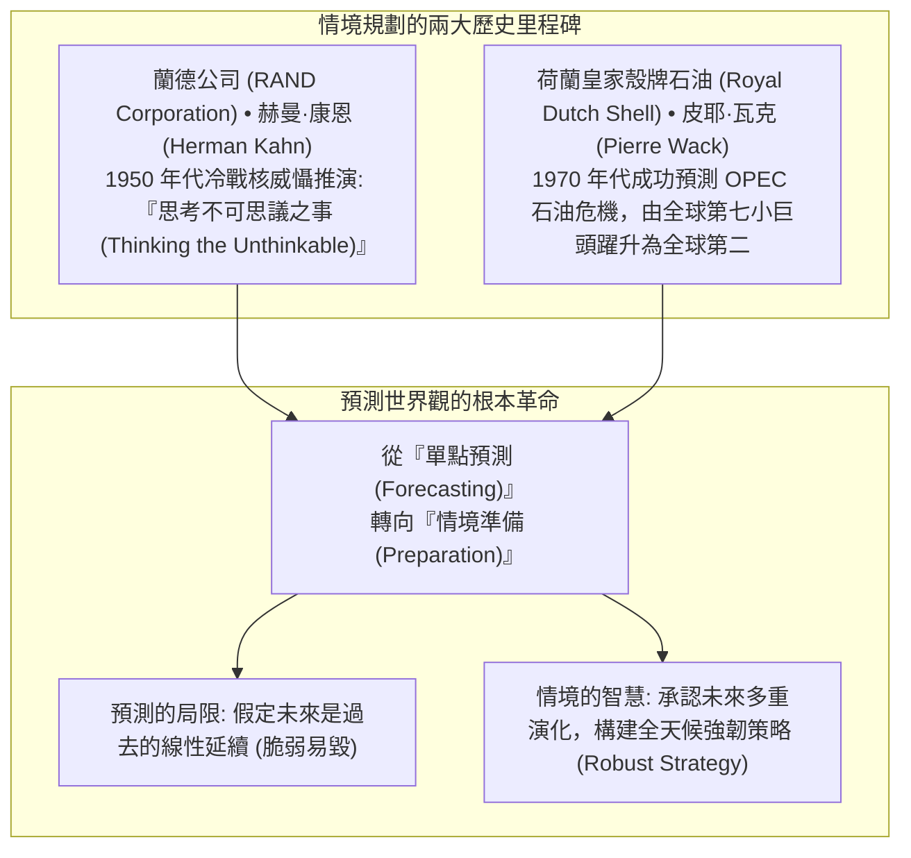
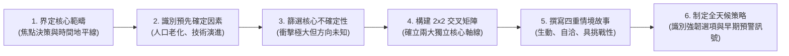

---
{"dg-publish":true,"permalink":"/98/analysis/","tags":["商業概念","策略管理","決策科學","未來學","PMBA"],"dg-note-properties":{"aliases":["情境分析","Scenario Analysis","情境規劃","情境規劃法","Scenario Planning"],"tags":["商業概念","策略管理","決策科學","未來學","PMBA"]}}
---


# 情境分析 (Scenario Analysis)

> [!NOTE]
> **核心概念精粹**：情境分析（Scenario Analysis），亦稱情境規劃（Scenario Planning），是一種系統性探索、勾勒與評估「多重潛在未來世界」的策略思考工具。它從根本上揚棄了「未來可以被單點精確預測」的脆弱幻想，而是將外生環境中的**預先確定因素（Predetermined Elements）**與**核心不確定性（Critical Uncertainties）**交織融合，建構出數個邏輯自洽、互相排斥且具啟發性的未來情境，以此對沖戰略盲區並鍛造組織的動態韌性。

---

## 一、 學理淵源：從冷戰推演到殼牌石油的傳奇

情境分析的現代演進，完成了從軍事博弈到跨國企業策略治理的典範躍遷：



---

## 二、 經典 2x2 情境規劃矩陣建構六步法

建構一套具備高決策價值的情境分析體系，必須嚴格遵循六大邏輯階梯：



### 經典 2x2 交叉矩陣架構範例（以能源轉型為例）

| 核心軸線交集 | 不確定性軸線 1：地緣政治格局（全球多邊協同） | 不確定性軸線 1：地緣政治格局（各國脫鉤孤立） |
| :--- | :--- | :--- |
| **不確定性軸線 2：<br>綠能技術突破極速** | **情境一：綠色繁榮新紀元（Green Renaissance）**<br>跨國碳交易市場成熟，潔淨能源普及，化石巨頭徹底淘汰。 | **情境二：綠色壁壘軍備競賽（Green Fortresses）**<br>各國築起碳關稅壁壘，關鍵鋰鎳稀土成為地緣勒索武器。 |
| **不確定性軸線 2：<br>綠能技術成本瓶頸** | **情境三：漸進轉型共存態（Slow Convergence）**<br>全球協商推動低碳轉型，但化石能源作為基載電力長期共存。 | **情境四：化石爭奪至暗時刻（Carbon Jungle）**<br>國際氣候協議徹底崩潰，各國重啟燃煤與傳統油氣爭奪戰。 |

---

## 三、 經典企業實戰案例：殼牌石油如何靠情境規劃在兩次危機中登頂

```carousel

<!-- slide -->
### 1. 1973 年第一次石油危機的奇蹟預演
- **歷史常規**：1970 年前，所有跨國石油巨頭均樂觀預測「原油價格將無限期維持在每桶 2 美元左右」；
- **殼牌的逆向思考**：皮耶·瓦克帶領的情境團隊敏銳洞察到：中東阿拉伯產油國的民族自決意識覺醒，地緣局勢高度緊繃；
- **情境推演**：殼牌專門推演了「如果 OPEC 成立卡特爾聯盟、實施石油禁運並將油價拉高數倍」的極端情境；
- **成果**：當 1973 年贖罪日戰爭爆發、油價暴漲 4 倍時，所有競爭對手陷入癱瘓，而殼牌早已依據情境預案調整了提煉產能與合約條款，一舉躍升為全球第二大石油巨頭。
<!-- slide -->
### 2. 1986 年油價崩跌的二次勝出
- 1980 年代初油價高達每桶 35 美元時，殼牌再次構想「如果全球供應過剩導致油價腰斬至 15 美元」的情境；
- 殼牌提前出售高成本邊際油田，削減資本開支；當 1986 年油價真正腰斬時，殼牌手握充沛現金，在歷史谷底大舉逆勢低價收購優質資產。
```

---

## 四、 經理人情境分析執行檢核表（Executive Decision Checklist）

在董事會或策略委員會審視公司中長期五年發展計畫時，高階領導應檢驗下列維度：

- [ ] **打破單一基準情境依賴（Escape Base-Case Trap）**：
  - 我們的策略規劃是否只押注在一個「最可能發生的標準情境（Base Case）」上？如果該情境的假設前提被外部環境推翻，公司是否有成熟的替代方案可立即啟動？
- [ ] **獨立兩大軸線檢驗（Orthogonal Axes Test）**：
  - 在構建 2x2 矩陣時，兩條不確定性軸線是否高度獨立（Orthogonal）？（若軸線 A 是經濟成長，軸線 B 是消費者所得，兩者高度相關，則無法形成真正的四維世界觀）。
- [ ] **強韌策略篩選（Robust Strategies Identification）**：
  - 我們所提出的策略舉措中，有哪些是「無論未來落入哪一個情境，推動它都是正確的無悔決策（No-Regret Moves）」？有哪些是專屬於特定極端情境的避險選項？
- [ ] **弱訊號早期預警指標（Early Warning Signals Dashboard）**：
  - 針對每一個未來情境，我們是否設定了客觀的監測「風向球指標（Signposts）」？（例如：某項技術專利申請數、特定法規草案一讀）。一旦指標亮起黃燈，組織能否自動觸發對應的策略轉向？

---

## 五、 關聯概念與知識網絡

* 核心策略與決策工具：
  * [[scenario-planning_情境規劃|情境規劃 (Scenario Planning)]]：情境分析的組織方法論與歷史實踐
  * [[contingency-planning_應變計畫|應變計畫 (Contingency Planning)]]：特定極端情境被觸發時的營運應急手冊
  * [[monte-carlo-simulation_蒙地卡羅模擬|蒙地卡羅模擬 (Monte Carlo Simulation)]]：情境分析在連續變數上的量化隨機演算
  * [[fat-tail-theory_肥尾理論|肥尾理論 (Fat-Tail Theory)]]：極端黑天鵝事件在情境構建中的權重賦予
* 領導力與組織心智：
  * [[conceptual-skills_概念技能|概念技能 (Conceptual Skills)]]：高階領導洞察宏觀趨勢與跨界推演之核心才能
  * [[Weak_Signals_弱訊號與小趨勢辨識|弱訊號與小趨勢辨識]]：情境轉向早期預警信號之捕捉
  * [[confirmation-bias_確認偏誤|確認偏誤 (Confirmation Bias)]]：打破只看符合預期資訊的認知防線
  * [[Tolerance_of_Ambiguity_不確定性容忍度與控制感|不確定性容忍度與控制感 (Tolerance of Ambiguity)]]：擁抱多重未來之心智韌性
