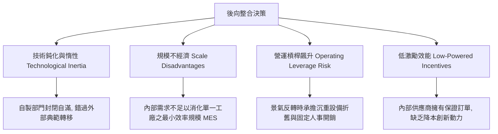

---
{"dg-publish":true,"permalink":"/98/backward-integration/","tags":["商業概念","垂直整合","交易成本理論","供應鏈韌性","企業邊界","PMBA"],"dg-note-properties":{"aliases":["後向整合","Backward Integration","上游整合","供應鏈整合","垂直後向整合","Make-or-Buy"],"tags":["商業概念","垂直整合","交易成本理論","供應鏈韌性","企業邊界","PMBA"]}}
---


# 後向整合 (Backward Integration & Upstream Supply Chain Mastery)

> **【核心決策摘要】**
> **後向整合（Backward Integration）** 是指企業沿著[[98_商業概念庫/Firm_Value_Chain_企業價值鏈\|企業價值鏈]]向**上游的原物料開採、關鍵零組件研發、製造設備或底層智慧財產權延伸組織邊界**的戰略決策。其核心本質是將原本依賴外部市場採購（Buy/Outsource）的活動，轉化為內部自製與自主控制（Make/Insource）。後向整合的理論基石奠基於**交易成本理論（TCE）**，旨在防範供應商的**伺機主義與套牢威脅（Hold-up Problem）**、確保關鍵稀缺資源的供應安全、保護核心技術黑盒子。然而，後向整合伴隨著**龐大資本支出、技術迭代落後風險（Technological Inertia）** 與組織內部官僚低激勵效能。

---

## 1. 概念核心定義與企業邊界理論 (Executive Definition & Theoretical Framework)

### 1.1 核心定義
在企業戰略與供應鏈架構中，後向整合定義為：**企業將採購輸入端（Inputs）的生產流程納入自身產權與管理控制之下，直接掌控產品製造所需的核心要素與技術堆疊**。

```
                    ┌─────────────────────────────────────────────────────────┐
                    │               後向整合與企業邊界擴張圖譜                │
                    └────────────────────────────┬────────────────────────────┘
                                                 ▼
        ┌───────────────────┐        ┌───────────────────┐        ┌───────────────────┐
        │  上游：原物料/零組件  │ ──────▶ │   中游：核心製造商   │ ──────▶ │  下游：分銷/零售/客戶  │
        └─────────▲─────────┘        └───────────────────┘        └───────────────────┘
                  │
                  │ <=== 後向整合 (Backward Integration) ───
                  │
        ┌─────────┴─────────┐
        │ 自建晶片設計/晶圓廠 │
        │ 掌握特用化學品/鋰礦 │
        │ 自主研發製造母機設備 │
        └───────────────────┘
```

### 1.2 經典經濟學基石：交易成本理論（TCE - Coase & Williamson）
依據奧利佛·威廉姆森（Oliver Williamson）的交易成本理論，企業與外部供應商進行市場交易時，面臨三大維度特徵：
1. **資產專屬性（Asset Specificity, $k$）**：
   - **實體資產專屬性（Physical Asset Specificity）**：專門為特定買方規格定製的模具、機械。
   - **場地專屬性（Site Specificity）**：為節省運輸成本而緊鄰買方設立的工廠（如高爐旁的煉鋼廠）。
   - **專用人力資產（Human Asset Specificity）**：專門針對特定系統累積的工程技術訣竅。
   - **專用用途資產（Dedicated Assets）**：專門為單一客戶大訂單額外擴建的產能。
2. **有限理性與環境不確定性（Bounded Rationality & Environmental Uncertainty）**：未來市場無法完全預測，合約本質上必定是**不完全合約（Incomplete Contracts）**。
3. **伺機主義（Opportunism）與準租金套牢（Quasi-Rent Hold-up）**：
   一旦買方投入沉沒成本，外部專屬供應商即具備在合約重議時發動敲竹槓（Hold-up）勒索加價的動機。

```
市場治理成本 M(k) vs 企業科層內部治理成本 G(k)
成本
 ▲
 │        \
 │         \  市場交易成本 M(k) (隨專屬性飆升)
 │          \
 │           \      / 內部治理成本 G(k) (具備固定官僚成本但抗套牢)
 │            \    /
 │             \  /
 │              \/   <--- 企業邊界損益平衡點 (Break-even k*)
 │              /\
 │             /  \
 └────────────┴────┴─────────────────▶ 資產專屬性 (k)
    k < k*: 選擇市場外包 (Buy)           k > k*: 選擇後向整合 (Make)
```

> **PMBA 決策準則**：當資產專屬性 $k > k^*$ 時，市場交易成本（談判、防弊、斷供風險）將超過內部組織協調的官僚成本，此時**後向整合（自製 Make）是唯一符合經濟理性的均衡解**。

---

## 2. 後向整合的三大核心戰略動機 (Strategic Motivations)

### 2.1 確保供應鏈韌性與戰略解耦 (Security of Supply & Anti-Allocation)
在關鍵原物料或零組件陷入結構性短缺（如疫情期間車用晶片缺貨、AI 時代 CoWoS 先進封裝產能排擠）時，外部供應商傾向將產能分配給最高出價者或簽署保證量合約的巨頭。
- 透過後向整合自建產能或鎖定排他性產權，企業能確保在產能緊縮期擁有第一優先順位（Priority Allocation），避免產線停擺。

### 2.2 防範技術機密外洩與維持「架構性創新」主導權
當零組件屬於高度系統協同的「整合式架構（Integral Architecture）」而非「模組化架構（Modular Architecture）」時，將其交給外部供應商製造會面臨兩大風險：
1. 供應商轉身將工程 Know-how 應用於競品，稀釋先行者優勢。
2. 外部標準化零組件無法達到極致能效比與緊湊體積優化（如 Apple iPhone 內部晶片與主機板堆疊）。

### 2.3 獲取上游超額利潤池（Capturing Upstream Profit Pools）
依據施振榮（Stan Shih）的**微笑曲線（Smile Curve）**，高附加價值往往集中在價值鏈兩端的「上游基礎研發與核心智財」以及「下游品牌與通路」，中游純組裝製造毛利最薄。後向整合進軍上游核心專利與特用材料，能直接捕獲上游寡占者的超額經濟租金（Economic Rents）。

---

## 3. 後向整合的高昂代價與戰略陷阱 (The Hidden Costs & Pitfalls)



1. **技術落後與資產沉沒陷阱（Technological Obsolescence）**：
   外部專業供應商面向全球眾多客戶，能將龐大 R&D 費用分攤至巨額出貨量，且隨時處於全球激烈競爭的最前線。企業內部自製部門容易因內部保護主義而喪失技術敏銳度，最終落入「自製成本比市場採購更貴、技術比市場落後」的困境。
2. **規模不經濟（Dis-economies of Scale & MES Mismatch）**：
   上游資本密集型產業往往具備極高的**最小效率規模（Minimum Efficient Scale, MES）**。例如，一座現代先進半導體晶圓廠需每月數萬片晶圓投片量方能攤提折舊。若企業自身需求無法填滿產能，單位成本將顯著高於台積電等專業代工廠。
3. **垂直鎖定效應（Vertical Lock-in & Flexibility Loss）**：
   當新興技術或替代材料出現時，已完成後向整合的企業往往因不願報廢既有工廠資產，產生[[sunk-cost_沉沒成本|沉沒成本謬誤]]，遲遲不肯轉向新技術，形成戰略包袱。

---

## 4. 經典與前沿案例對照分析 (Benchmark Case Studies)

### 4.1 成功典範：Apple 自研 Apple Silicon 的垂直後向超越
- **戰略背景**：蘋果過去在 Mac 電腦高度依賴 Intel 處理器。然而自 2015 年起，Intel 晶圓製程屢屢卡關（14nm 停滯多年）、功耗過高且發熱嚴重，嚴重限制了 MacBook 的輕薄化與效能進化。
- **後向整合動作**：蘋果自收購 P.A. Semi 起長期深耕 ARM 架構晶片自研，最終全面推出 M 系列晶片，徹底切斷與 Intel 的採購關係。
- **戰略回報**：
  - 實現業界最強的「每瓦效能比（Performance-per-Watt）」。
  - 軟硬體深度垂直整合（macOS 與 M 晶片統一記憶體架構），創造競爭對手無法抄襲的硬體護城河。

### 4.2 成功典範：Tesla 電池芯自研與鋰礦冶煉延伸
- **戰略背景**：電池佔純電動車成本高達 30%~40%，且鋰、鎳、鈷等上游原物料受大宗商品價格與地緣政治牽制。
- **後向整合動作**：特斯拉不僅與松下（Panasonic）合資 Gigafactory，更自行研發 4680 結構化大圓柱電池，並在德州直接投資數億美元興建氫氧化鋰精煉廠。
- **戰略回報**：鎖定電池供應量、自主優化電池乾電極製造工藝，向每千瓦時（kWh）成本跌破 100 美元的終極目標邁進。

### 4.3 災難警示：Boeing 787 夢幻客機過度「逆向解耦/外包」的血淚教訓
- **外包悲劇**：波音在開發 787 時，為降低自身資本支出與研發風險，過度削減後向整合，將機翼、機身等核心結構的研發、設計與製造外包給全球 50 多家第一級供應商（Tier-1）。
- **失控後果**：因供應商間缺乏協同介面、技術標準不一與合約糾紛，導致機件接合失效、電池起火，專案延宕近四年，超支數百億美元。
- **逆向修正**：波音被迫耗資數十億美元直接收購出問題的供應商工廠（如收購 Vought Aircraft 在南卡羅來納州的 787 工廠），重新重回後向整合老路。

---

## 5. 高階經理人自製與外購決策矩陣 (The Make-or-Buy Decision Matrix)

企業高層在評估是否啟動後向整合時，可依據以下兩維矩陣進行系統性決策：

```
                    高 ▲ ──────────────────────────────────────────┐
                       │ 【策略合作 / 股權投資】   │ 【全面後向整合 (Make)】       │
                       │ • 簽訂長期保障供應合約   │ • 自建工廠或 100% 收購       │
                       │ • 少數股權投資綁定產能   │ • 保障最高機密與無縫介面     │
   資產專屬性          │ (例如: 汽車廠注資電池廠) │ (例如: Apple 自研 M 系列晶片)│
  (Asset Specificity)  ├──────────────────────────┼──────────────────────────────┤
                       │ 【現貨市場採購 (Buy)】   │ 【產能外包或授權生產】       │
                       │ • 多家供應商比價比質     │ • 轉向 ODM/代工廠量產        │
                       │ • 維持最高彈性與低成本   │ • 專注上游研發下游品牌       │
                    低 │ (例如: 採購標準螺絲/紙箱)│ (例如: Nike 鞋類委外代工)    │
                       └──────────────────────────┴──────────────────────────────▶
                                 低                   高
                                      對核心競爭力的戰略重要性
```

### 決策檢核清單 (Due Diligence Checklist)
1. **內部消耗是否達到最小效率規模（MES）**？若自用量不足 MES 的 70%，後向整合通常得不償失。
2. **該零組件的技術演進速度是否極快**？若產業處於技術典範轉移劇烈期，自建資產將迅速面臨巨額減損。
3. **是否存在外部準整合替代方案（Virtual Integration）**？是否能透過長約定金、聯合研發、專用設備共同出資等方式，達到防套牢效果而無需承擔重資產負擔。

---

## 6. 關聯概念與延伸閱讀 (Cross References)

- [[forward-integration_前向整合]]：企業向價值鏈下游的通路與客戶服務端延伸。
- [[TCE_Transaction_Cost_Economics_交易成本理論]]：資產專屬性、有限理性與伺機主義對企業邊界的嚴密推導。
- [[Virtual_Integration_虛擬整合與資源槓桿]]：戴爾（Dell）等企業利用資訊透明度取代產權實體擁有的混合治理機制。
- [[vertical-merger-acquisition_垂直併購]]：以收購上游供應商為手段的法律反壟斷審查與投入封鎖爭議。
- [[Firm_Value_Chain_企業價值鏈]]：波特價值鏈內部物流與生產作業分析。
- [[merger-acquisition-integration_併購後整合]]：收購上游零組件廠後的跨文化與系統整合要務。
- [[home]]：PMBA 知識庫首頁與模組導航。