---
{"dg-publish":true,"permalink":"/98/barriers-to-entry/","tags":["商業概念","策略管理","產業分析","波特五力","競爭優勢","護城河","進入障礙","PMBA"],"dg-note-properties":{"aliases":["進入障礙","市場進入障礙","產業進入障礙","進入壁壘","Barriers to Entry","Entry Barriers","barriers-to-entry","market-barriers-to-entry_市場進入障礙"],"tags":["商業概念","策略管理","產業分析","波特五力","競爭優勢","護城河","進入障礙","PMBA"],"類別":"商業概念庫"}}
---


# 進入障礙 (Barriers to Entry / 市場進入壁壘)

> **核心名言**：  
> 「潛在進入者帶來的威脅強度，取決於既有產業中的進入障礙高低，以及新進入者預期既有競爭者會採取的報復烈度。如果進入障礙高，或者新進者預期會遭遇既有霸主的激烈報復，則進入威脅就會被實質壓制。」  
> —— 麥可·波特（Michael E. Porter, *Competitive Strategy*, 1980）  
>  
> 「在評估一家企業的長期獲利能力時，最關鍵的單一維度就是它的護城河有多寬、有多深。而護城河本質上就是由極高的進入障礙所構築的防禦工事。」  
> —— 華倫·巴菲特（Warren Buffett）

---

## 一、 核心定義與經濟學本質

### 1.1 經典理論定義與典範演進
- **產業經濟學定義（Joe Bain, 1956）**：
  產業經濟學先驅喬·貝恩（Joe S. Bain）在其開創性著作《產業組織障礙》（*Barriers to New Competition*）中首創此概念，將進入障礙定義為：**「使既有在位企業（Incumbents）能夠持續享有超額經濟利潤（Supranormal Profits），而不會吸引潛在競爭者進入市場的所有結構性因素總和。」**
- **波特五力架構視角（Michael Porter, 1980）**：
  波特在《競爭策略》中將進入障礙確立為分析產業結構五大力量之首——**「潛在進入者的威脅（Threat of New Entrants）」**的決定性防波堤。進入障礙的高低直接決定了整個產業利潤池（Profit Pool）是否會被外來資本稀釋侵蝕。
- **可競爭市場理論視角（William Baumol, 1982）**：
  包莫爾（Baumol）的「可競爭市場理論（Contestable Markets Theory）」指出：真正構成進入障礙的不是單純的資本支出規模，而是**「沉沒成本（Sunk Costs）」**。如果新進入者在失敗退出時能夠收回所有投資，則該市場是「完全可競爭的」；反之，若進入需要投入無法回收的沉沒資產，該資產便構成了堅不可摧的進入障礙。

---

### 1.2 進入障礙的經濟學機制模型
在微觀經濟學上，進入障礙迫使潛在進入者承擔非對稱的成本劣勢或風險溢價：

$$	ext{進入門檻溢價} = 	ext{新進者初始單位成本 } (AC_{	ext{Entrant}}) - 	ext{在位者長期平均成本 } (AC_{	ext{Incumbent}})$$

```
【進入障礙對產業超額利潤的保護機制】

   價格 / 成本
      ▲
      │           【無障礙市場】                             【高進入障礙市場】
      │       外來資本自由湧入削價競爭                   進入障礙築起厚重防護罩
  P_1 ├─────────────────────────────────────► P_超額 ┌────────────────────────┐
      │                                             │   在位企業持續享有     │
      │                                             │   超額經濟利潤 (Rent)  │
  P_0 ├─ ─ ─ ─ ─ ─ ─ ─ ─ ─ ─ ─ ─ ─ ─ ─ ─ ─ ─ ─ ─ ─ ─ ┴────────────────────────┤ ◄── 長期平均成本 (LRAC)
      │                                               資本難以跨越壁壘       │
      └─────────────────────────────────────────────────────────────────────────────►
                                                                              產量 (Q)
```

- 若缺乏進入障礙，高利潤會迅速引發「淘金熱」，資本湧入擴充產能，將價格打回邊際成本（$P = MC$），超額利潤歸零；
- 唯有在高進入障礙的產業中，在位企業才能長年維持高 [[return-on-invested-capital_資本投入報酬率|投入資本報酬率 (ROIC)]]，抵禦外來競爭侵蝕。

---

## 二、 波特七大核心進入障礙來源 (Porter's Seven Sources)

波特在《競爭策略》最新修訂版中，將產業進入障礙嚴謹解構為七大微觀驅動因子：

```mermaid
flowchart TD
    subgraph SevenBarriers ["【波特七大進入障礙核心來源】"]
        direction TB
        B1["1. 供給端規模經濟 (Supply-side Economies of Scale)<br/>逼迫新進者必須冒大產能過剩風險，或承擔單位高成本"]
        B2["2. 需求端規模利益 / 網絡效應 (Network Effects)<br/>用戶愈多產品價值愈高，新進者面臨先有雞還是先有蛋的死局"]
        B3["3. 顧客轉換成本 (Customer Switching Costs)<br/>更換供應商伴隨高昂財務、程序、學習或心理代價"]
        B4["4. 資本需求門檻 (Capital Requirements)<br/>前期研發、廠房、高風險未擔保信用等不可回收沉沒支出"]
        B5["5. 與規模無關的既得優勢 (Incumbency Advantages)<br/>專利智財、專屬原物料取得、最優地理位置、累積品牌資產"]
        B6["6. 配銷通路的不平等接取 (Unequal Access to Channels)<br/>既有龍頭綁定主要經銷商或排擠實體貨架位置"]
        B7["7. 限制性政府政策與法規執照 (Restrictive Government Policy)<br/>特許執照、嚴格環保認證、藥證審批、外資所有權限制"]
    end

    style SevenBarriers fill:#f8fafc,stroke:#334155,stroke-width:2px
    style B1 fill:#eff6ff,stroke:#1d4ed8,stroke-width:2px
    style B2 fill:#fefce8,stroke:#a16207,stroke-width:2px
    style B3 fill:#f0fdf4,stroke:#15803d,stroke-width:2px
    style B4 fill:#fee2e2,stroke:#b91c1c,stroke-width:2px
    style B5 fill:#faf5ff,stroke:#7e22ce,stroke-width:2px
    style B6 fill:#fff7ed,stroke:#c2410c,stroke-width:2px
    style B7 fill:#f1f5f9,stroke:#475569,stroke-width:2px
```



### 2.1 深度拆解七大障礙維度

1. **供給端規模經濟（Supply-side Economies of Scale）**：
   - 詳見專題卡片：[[economies-of-scale_規模經濟]]。
   - 由於在位企業具備龐大產能，能將研發、模具、廠房等固定成本大幅分攤。
   - 新進入者面臨**「兩難困局」**：
     - *策略 A*：以大規模直接切入，但必須承擔巨額固定資本風險，且擴產必然引發市場供給過剩與既有者價格戰；
     - *策略 B*：以小規模試水溫，但單位生產成本必然遠高於龍頭，注定在價格戰中被秒殺。
2. **需求端規模利益 / 網絡效應（Demand-side Benefits of Scale / Network Effects）**：
   - 產品對單一使用者的價值，隨著其他使用者數量的增加而遞增（如社交網絡、支付系統、作業系統）。
   - 新進者即便產品技術更優，也無法跨越「臨界規模（Critical Mass）」的死亡之谷（例如 Google+ 無法擊敗 Facebook，新作業系統無法撼動 Windows/iOS）。
3. **顧客轉換成本（Customer Switching Costs）**：
   - 詳見專題卡片：[[switching-costs_轉換成本]]。
   - 買方更換供應商時所需承擔的額外代價（員工重新培訓成本、資料遷移風險、合約解約金）。當轉換成本極高時，新進者必須提供大幅超越現狀的性能提升或巨額價格折讓，才能撬動客戶。
4. **巨額資本需求（Capital Requirements）**：
   - 尤其指難以透過抵押融資收回的「無形資產沉沒投資」，如前期數十億美元的基礎科學研發（R&D）、品牌建立宣傳費、客戶信用貸款。資本市場對高風險新進者通常索求極高的風險溢價（Hurdle Rate）。
5. **與規模無關的既得優勢（Incumbency Advantages Independent of Size）**：
   - **專利保護與商業機密**：關鍵製程配方（如可口可樂糖漿配方、半導體蝕刻化學劑）；
   - **專屬優質原物料取得**：鎖定全球最富集鋰礦或稀土開採權；
   - **最優地理位置**：黃金三角窗實體門市（統一超商）、水深足夠的深水碼頭；
   - **累積經驗曲線（Learning Curve）**：在位者歷經數百萬次生產後累積的微小良率改善訣竅（Tacit Knowledge）。
6. **配銷通路的限制性接觸（Unequal Access to Distribution Channels）**：
   - 實體通路貨架空間有限（Slotting Allowances 上架費）。既有領導品牌透過排他合約、高額返利綁定批發商與零售商，使新品牌根本「進不去通路、見不到消費者」。
7. **限制性政府政策與執照（Restrictive Government Policy）**：
   - 銀行、電信、特許公用事業、醫療製藥執照。政府法規透過嚴格的安全檢驗、排碳審查與合規門檻，人為拉高了進入代價（如 FDA 新藥臨床試驗平均耗時 10 年、耗資 10~25 億美元）。

---

## 三、 進入障礙 vs. 退出障礙四象限矩陣 (Entry-Exit Matrix)

麥可·波特特別強調，**分析產業獲利結構時，絕不能只看「進入障礙」，必須將「進入障礙」與「退出障礙（Exit Barriers）」合併研判**：

```text
【波特進入障礙與退出障礙矩陣】

                     退出障礙低 (Low Exit)            退出障礙高 (High Exit)
              ┌───────────────────────────────┬───────────────────────────────┐
              │      【最理想產業結構】       │       【高報酬、高風險】      │
 進入障礙高   │ • 報酬率高且穩定              │ • 景氣好時獲利極豐厚          │
 (High Entry) │ • 外人進不來，失敗者易撤退     │ • 景氣差時大家死撐不退，價格戰│
              │ • 典型：專利製藥、特許諮詢     │ • 典型：晶圓代工、鋼鐵、石化  │
              ├───────────────────────────────┼───────────────────────────────┤
              │      【平庸但穩定產業】       │       【最凶險災難產業】      │
 進入障礙低   │ • 報酬率低但相對穩定          │ • 進入極容易，退出極痛苦      │
 (Low Entry)  │ • 競爭者進出頻繁              │ • 長期產能嚴重過剩、全員慘賠  │
              │ • 典型：手搖飲店、乾洗店       │ • 典型：舊世代面板、傳統航運  │
              └───────────────────────────────┴───────────────────────────────┘
```

> [!CRITICAL] 經理人關鍵警示：高退出障礙引發的價格割喉
> 當產業「進入障礙低、退出障礙高」時（如高負債固定資產折舊、工會解雇限制），一旦市場需求下滑，虧損企業無法輕易破產退出，必然透過「邊際成本定價（甚至負現金流拋售）」發動流血價格戰，拖垮整個產業的利潤池！

---

## 四、 結構性障礙 vs. 預期報復行為 (Structural vs. Retaliatory Barriers)

新進入者是否敢於跨越雷池，不僅取決於客觀的**「結構性進入障礙」**，更取決於其對在位霸主**「主觀預期報復（Expected Retaliation）」**的恐懼程度：

### 4.1 在位者強烈報復的四大預兆訊號
1. **雄厚防衛資源與「現金彈藥庫」**：在位者資產負債表上躺著數百億美元自由現金，隨時能發動無底線價格戰將新進者燒死在沙灘上。
2. **對該市場的高度承諾與專屬資產**：該業務是在位者的核心命脈（Core Business），退無可退，具備拼死防守的戰略決心。
3. **過剩產能的「前置威脅（Capacity Pre-emption）」**：在位者刻意保留 20%~30% 閒置產能（如 Dixit 產能賽局模型），一旦新進者開賣，在位者瞬間開出產能打壓市價。
4. **過往激進報復的歷史名聲（Reputation for Toughness）**：在位者曾有過「不惜代價訴訟到底、哪怕兩敗俱傷也要消滅對手」的歷史紀錄。

---

## 五、 經典實證產業案例剖析 (Flagship Case Studies)

### 5.1 案例一：半導體先進製程（台積電的無敵綜合進入障礙）
在全球晶圓代工市場，台積電（TSMC）築起了當代商業史上最極致的複合進入障礙：
1. **資本需求門檻**：一座 2nm 先進晶圓廠投資額高達 **200 億美元**，每年資本支出超過 300 億美元，全球僅剩極少數主權國家級財力能夠支撐。
2. **供給端規模經濟與良率壁壘**：月產數十萬片晶圓攤提巨額光罩與研發費用，製程良率高達 90%+，使新進者每片晶片製造成本高出數倍。
3. **客戶轉換成本**：蘋果、輝達重新驗證一家新代工廠需耗時 18~24 個月、耗資數億美元，且承擔晶片上市延誤被競爭者超車的致命風險。
4. **生態系鎖定**：與 EDA 軟體工具（Synopsys/Cadence）、矽智財（ARM）及設備巨頭（ASML）緊密咬合的開放創新平台（OIP）。

### 5.2 案例二：台灣高鐵（自然獨占與特許進入障礙）
1. **龐大不可回收沉沒成本**：數千億台幣的土木軌道工程與機電號誌，若不營運毫無其他轉售用途。
2. **政府特許專營權**：BOT 合約享有數十年西部走廊高速鐵路獨家營運權，法規直接杜絕第二家業者興建平行軌道。
3. **強大網絡效應**：站點與高鐵生活圈接駁網絡形成完整運輸閉環，後進者無法以局部路線競爭。

---

## 六、 高階經理人決策工具箱：護城河評估與突圍策略 (Executive Playbook)

```
┌────────────────────────────────────────────────────────────────────────────┐
│              高階經理人「進入障礙診斷與攻防」決策檢核表                      │
├────────────────────────────────────────────────────────────────────────────┤
│ 【在位者防禦視角：加固護城河】                                              │
│ ☐ 1. 檢視自身核心優勢是否為「可輕易買到的通用資產」？如果是，壁壘極脆弱。 │
│ ☐ 2. 積極拉高客戶轉換成本：從單純賣硬體轉向軟硬整合、雲端資料綁定與會員制。│
│ ☐ 3. 專屬資產專利化：將現場隱性工程經驗轉化為嚴密的專利保護網（Patent Net）│
│ ☐ 4. 掌控關鍵瓶頸：鎖定核心原物料獨家供應協議或買斷關鍵通路獨家貨架。     │
├────────────────────────────────────────────────────────────────────────────┤
│ 【挑戰者進攻視角：繞過壁壘的特洛伊木馬戰術】                                │
│ ☐ 1. 拒絕正面硬碰硬：切忌在對手的規模經濟防線內與其打消耗價格戰。         │
│ ☐ 2. 採取破壞式創新（Disruptive Innovation）：從巨頭忽視的低階利基市場切入│
│ ☐ 3. 架構重組繞過瓶頸：利用新技術介面直接繞開傳統通路（如 D2C 品牌繞過實體）│
│ ☐ 4. 爭取政策非對稱支持：利用法規開放（如開放金融 Open Banking）突破執照特許│
└────────────────────────────────────────────────────────────────────────────┘
```

---

## 七、 知識圖譜關聯與雙向鏈結 (Bidirectional Knowledge Links)

### 7.1 核心系列套裝導航（策略護城河三部曲）
- **[[barriers-to-entry_進入障礙]]** · 潛在進入者防線、結構性與行為性進入壁壘（本篇）
- **[[switching-costs_轉換成本]]** · 顧客鎖定效應、六大轉換成本維度與定價溢價權
- **[[economies-of-scale_規模經濟]]** · 供給端規模效益、最小有效規模 (MES) 與固定成本分攤

### 7.2 核心策略理論對接
- [[Porter's Five Forces Analysis_波特五力分析]] · 五力模型中潛在進入者威脅之完整框架
- [[Firm_Value_Chain_企業價值鏈]] · 內部九大活動如何構築差異化與成本優勢壁壘
- [[value-system_產業價值體系|Value_System_產業價值體系]] · 產業垂直分工網絡、五大連結條件與利潤池位移
- [[Porter's Diamond Model_波特鑽石模型]] · 國家競爭優勢、高級專屬要素與產業聚落
- [[value-chokepoint_價值咽喉]] · 產業鏈關鍵瓶頸與不可替代之超額定價特權
- [[competitive-matrix_競爭矩陣]] · 競品護城河評估與四象限戰略定位

### 7.3 課程筆記與主控台
- [[M1-5_波特五力分析與量化架構]] · 五力打分雷達圖、CR4/HHI 量化衡量與反制戰略
- [[_產業分析與投資策略 MOC]] · 全課導航總地圖
- [[home]] · 全球 PMBA 知識庫總導航主頁面
