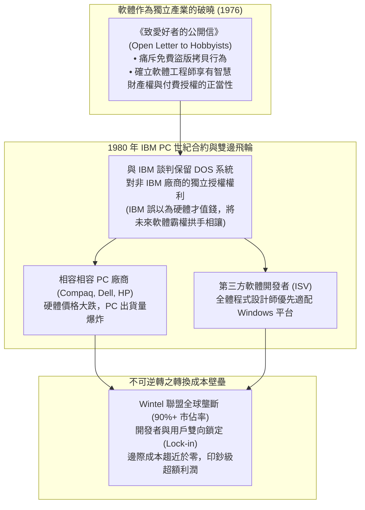

---
{"dg-publish":true,"permalink":"/98/bill-gates/","tags":["商業概念","企業領袖","平台策略","科技壟斷","PMBA"],"dg-note-properties":{"aliases":["比爾蓋茲","Bill Gates","威廉·亨利·蓋茲三世","微軟創辦人"],"tags":["商業概念","企業領袖","平台策略","科技壟斷","PMBA"]}}
---


# 比爾蓋茲 (Bill Gates)

> [!NOTE]
> **核心概念精粹**：比爾·蓋茲（Bill Gates, 1955–），微軟公司（Microsoft）共同創辦人，是全球個人電腦（PC）軟體產業的奠基者與最卓越的商業策略大師之一。他在 1970 年代確立了「軟體作為獨立高價值智財權」的商業模式，並透過與 IBM 的傳奇合約、開放相容授權與 Windows 作業系統，建立了強大的**雙邊網路效應（Two-Sided Network Effects）**與全球 PC 生態壟斷。晚年他轉型為全球最具影響力的慈善家，以商業數據思維創立「催化劑慈善資本主義（Catalytic Philanthropy）」，致力於消滅全球傳染病與貧窮。

---

## 一、 學理定位：平台戰略與網路效應的商業宗師

比爾·蓋茲的商業戰略構成了現代平台經濟學（Platform Economics）與[[98_商業概念庫/network-effects_網絡效應\|雙邊市場理論]]的教科書源頭：



---

## 二、 蓋茲戰略思維四大核心維度矩陣

| 戰略維度 | 核心運作機理與哲學 | 經典戰役體現 |
| :--- | :--- | :--- |
| **1. 平台與開放生態<br>(Platform Ecosystem)** | 賦能生態夥伴賺取絕大多數利潤，但掌控關鍵作業系統瓶頸；對手在硬體價格戰中廝殺，微軟穩收每台授權費。 | 相較於蘋果的封閉一體化，微軟授權全世界所有 OEM 廠生產 PC，一舉拿下全球 90% 以上市佔。 |
| **2. 捆綁銷售與防禦<br>(Bundling Strategy)** | 將新興競爭威脅的功能，以「免費或套件形式」捆綁整合進核心平台，利用龐大既有通路實施降維打擊。 | 將 Word、Excel、PowerPoint 打包為 Microsoft Office 摧毀 WordPerfect；將 IE 瀏覽器免費內建摧毀網景（Netscape）。 |
| **3. 偏執狂危機意識<br>(Paranoid Vigilance)** | 「微軟距離破產永遠只有 18 個月。」時刻警惕下一個在車庫中可能顛覆自己的新技術弱訊號。 | 1995 年發布著名的《網際網路海嘯（The Internet Tidal Wave）》備忘錄，一夜之間將全公司策略轉向網際網路。 |
| **4. 催化劑慈善資本主義<br>(Catalytic Philanthropy)** | 拒絕低效的傳統施捨，引入創投（VC）與量化指標思維，投資高風險、高公益回報的生醫研發。 | 蓋茲基金會投入數百億美元，推動全球消滅小兒麻痺症進度達 99.9%，資助新世代瘧疾疫苗。 |

---

## 三、 經典企業實戰案例：瀏覽器大戰與反壟斷審判

```carousel

<!-- slide -->
### 1. 網景之爭與「網際網路海嘯」
- **歷史威脅**：1994 年網景（Netscape Navigator）崛起，創辦人馬克·安德森狂言「網景瀏覽器將使 Windows 退化為一套毫無價值的設備驅動程式集合」；
- **蓋茲的反擊**：蓋茲展現驚人的戰略敏捷性，迅速調集千人工程師研發 Internet Explorer（IE），並將其免費預先安裝於每一台 Windows 95 電腦中；
- **結果**：網景市佔率在三年內從 80% 暴跌至 10% 以下，最終被美國線上（AOL）低價收購。
<!-- slide -->
### 2. 1998 年美國司法部反壟斷世紀大審判
- **政府重拳**：美國司法部控訴微軟濫用作業系統壟斷地位非法捆綁 IE 瀏覽器，聯邦法院一度判決「將微軟強制分拆為兩家公司」；
- **治理代價**：蓋茲親自出庭接受殘酷質詢，微軟陷入長達數年的法律訴訟泥淖，雖然最終避免了分拆命運，但公司內部變革受到嚴重牽制；
- **歷史教訓**：反壟斷陰影讓微軟在 2000 年代不敢大舉碾壓新創，直接為 Google 與蘋果的再次崛起讓出了關鍵的戰略空間。
```

---

## 四、 經理人比爾·蓋茲式平台戰略檢核表（Executive Decision Checklist）

在構建數位平台、制定夥伴生態系或評估網絡效應時，高階管理團隊應依序檢驗：

- [ ] **雙邊網絡效應飛輪檢驗（Two-Sided Network Flywheel）**：
  - 我們的平台是否真正實現了「供給端越多 $\to$ 需求端越繁榮 $\to$ 吸引更多供給端」的自發增長？我們為開發者創造的價值，是否顯著大於我們自身收取的平台佣金？
- [ ] **邊際成本趨零與可擴張性（Zero-Marginal-Cost Scalability）**：
  - 我們的核心軟體與數據服務，在服務第一萬名客戶與服務第一千萬名客戶時，邊際製造成本是否趨近於零？是否具備非線性的超額利潤爆發力？
- [ ] **反壟斷法規與生態掠奪邊界（Antitrust & Predatory Limits）**：
  - 我們利用核心主業優勢向相鄰市場擴張時（如平台包夾），是否跨過了反不正當競爭法的紅線？我們是否正在激怒並摧毀原先支持我們的第三方生態夥伴？
- [ ] **18 個月破產偏執體檢（The 18-Month Bankruptcy Radar）**：
  - 如果今天出現了一項徹底繞過我們現有平台的全新底層架構（如當年的互聯網之於作業系統，或當前的生成式 AI 之於傳統軟體），我們能否在一夜之間調轉全公司的航向？

---

## 五、 關聯概念與知識網絡

* 領袖博弈與傳奇人物：
  * [[steve-jobs_賈伯斯|賈伯斯 (Steve Jobs)]]：個人電腦與行動時代微軟最強大的哲學宿敵
  * [[jensen-huang_黃仁勳|黃仁勳 (Jensen Huang)]]：AI 時代接棒微軟引領全球算力標準之新霸主
  * [[great-company_好公司|好公司 (Great Company)]]：微軟從 PC 軟體霸主向雲端與 AI 再生的偉大組織
* 平台策略與經濟學理論：
  * [[network-effects_網絡效應|網絡效應 (Network Effects)]]：微軟 Windows 與 Office 全球壟斷之底層動力學
  * [[platform-envelopment_平台包夾|平台包夾 (Platform Envelopment)]]：微軟將瀏覽器與辦公套件包夾進作業系統之經典戰術
  * [[switching-costs_轉換成本|轉換成本 (Switching Costs)]]：跨國企業深度綁定 Windows 與 Active Directory 之遷移壁壘
  * [[viable-business_好事業|好事業 (Viable Business)]]：極高邊際利潤率與高可持續現金流之商業典範
