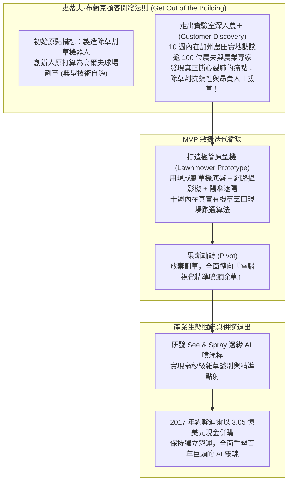

---
{"dg-publish":true,"permalink":"/98/blue-river-technology/","tags":["商業概念","精實創業","人工智慧","創業管理","PMBA"],"dg-note-properties":{"aliases":["藍河科技","Blue River Technology","藍河農業科技","精準除草機器人"],"tags":["商業概念","精實創業","人工智慧","創業管理","PMBA"]}}
---


# 藍河科技 (Blue River Technology)

> [!NOTE]
> **核心概念精粹**：藍河科技（Blue River Technology），由史丹佛大學畢業生豪爾赫·赫勞德（Jorge Heraud）與李·雷登（Lee Redden）於 2011 年創立，是全球公認的**精實創業（Lean Startup）顧客開發與最小可行產品（MVP）敏捷驗證的教科書級典範**。兩位創辦人走出實驗室，深入加州農田親自訪談上百位農夫，以極簡原型驗證痛點，將電腦視覺與深度學習成功導入農業噴灑，開發出革命性的「See & Spray」機器人，創立僅六年即被百年農機巨頭[[98_商業概念庫/john-deere_約翰迪爾\|約翰迪爾（John Deere）]]以 **3.05 億美元全現金收購**。

---

## 一、 學理淵源：精實創業「走出大樓」的傳奇實踐

藍河科技的誕生，源於史丹佛大學精實創業大師史蒂夫·布蘭克（Steve Blank）的著名課程《精實發射台（The Lean LaunchPad）》：



---

## 二、 藍河科技精實創業驗證歷程矩陣

| 驗證階段 | 核心假設與行動 | 遭遇挑戰與關鍵發現 | 敏捷應對策略 |
| :--- | :--- | :--- | :--- |
| **1. 痛點探索期<br>(Problem Interview)** | 假設：高爾夫球場需要自動化割草機器人來節省維護成本。 | 訪談發現高爾夫球場管理員對草坪高度有極致苛求，且人工成本並非其核心痛點。 | **果斷推翻原構想**，轉向加州產值極高的有機生菜與草莓種植園。 |
| **2. 現場原型期<br>(MVP Experiment)** | 假設：電腦視覺能否在泥濘多塵的真實農田中辨識出作物與雜草？ | 強烈陽光照射導致反光、陰影遮擋使影像識別準確率大幅驟降。 | 創辦人為攝影機加裝防眩光遮陽棚與人造補光燈，在十週內將識別率提升至 90% 以上。 |
| **3. 產品市場適配<br>(Achieving PMF)** | 假設：農民是否願意為這項技術付費？能創造多少經濟效益？ | 證明其「Smart Mac」機器人能替農民節省高達 90% 的化學農藥與昂貴除草人工。 | 獲得頂級創投 Khosla Ventures 領投，啟動大規模商業化試點。 |
| **4. 產業規模化<br>(Scale & Exit)** | 挑戰：新創公司缺乏全球製造、經銷網路與大型農機底盤技術。 | 自行建廠造拖拉機將面臨巨大的資本與時間障礙。 | 選擇與全球最大農機巨頭約翰迪爾聯姻，以 3.05 億美元被併購，技術直接搭載於全球巨型農機。 |

---

## 三、 經典案例深度對照：藍河科技（成功） vs 傳統封閉研發新創（失敗）

```carousel

<!-- slide -->
### 1. 藍河科技的精實勝利（以問題為核心）
- **心態**：兩位創辦人始終保持「愛上問題，而非愛上自己的解法」；
- **實地扎根**：每天開著皮卡車泡在加州農田裡，手上滿是泥巴，親眼看著農夫如何操作機械；
- **極速修正**：根據農夫的反饋每週迭代代碼與噴嘴機構，從最初笨重的割草機演進為頂尖的邊緣深度學習精準點射系統，創造了 6 年 3.05 億美元退出的創業神話。
<!-- slide -->
### 2. 封閉式高科技新創的滑鐵盧（以技術為核心）
- **對照案例**：同期許多矽谷農業機器人新創，團隊全由名校博士組成，關在實驗室耗時 3 年研發極度複雜的仿生採摘機器人；
- **盲區慘劇**：從未在早期讓真實農民測試，產品造價高達數十萬美元，在田間颠簸震動下頻繁當機，農民根本買不起也修不起，在融資燒光後悲慘倒閉。
```

---

## 四、 經理人精實新創孵化檢核表（Executive Decision Checklist）

在公司內部推動新創專案孵化（Intrapreneurship）或個人創業時，領導者應依序檢驗：

- [ ] **走出大樓顧客訪談數（Customer Interviews Count）**：
  - 專案負責人在寫下第一行商業代碼或申請專利前，是否真正面對面訪談了至少 100 位一線真實潛在客戶？還是只坐在會議室看市場二手報告？
- [ ] **最小可行產品極速交付（10-Week MVP Test）**：
  - 我們能否在 10 週之內，利用市面上現成的開源工具與替代零件，組裝出一個「能跑通核心功能但外觀粗糙的極簡原型（MVP）」？如果需要兩年才能做出第一個樣品，請立即叫停。
- [ ] **致命假設優先證偽（Riskiest Assumption Testing, RAT）**：
  - 本專案最可能導致滅頂的核心假設是什麼？（例如：算法能否在強光下識別？客戶是否願意付費？）團隊是否優先把資源投入在檢驗這項最致命假設上？
- [ ] **及時軸轉果斷度（Willingness to Pivot）**：
  - 當真實客戶反饋無情打臉我們最初的設想時，創始團隊是像藍河科技一樣迅速「軸轉（Pivot）」轉向真實痛點，還是固執己見繼續燒錢自嗨？

---

## 五、 關聯概念與知識網絡

* 核心併購方與產業賦能：
  * [[john-deere_約翰迪爾|約翰迪爾 (John Deere)]]：以 3.05 億美元收購藍河科技並全面推動 AI 智慧農業之母體
  * [[PMF_產品市場契合度 Product-Market Fit|產品市場契合度 (PMF)]]：藍河科技在農田除草痛點上達成之教科書級契合
  * [[lean-startup_精實創業|精實創業 (Lean Startup)]]：布蘭克顧客開發法與精實發射台方法論之傳世典範
  * [[MVP最小可行產品|最小可行產品 (MVP)]]：十週內以割草機改裝驗證核心假設之實務工具
* 創業投資與退出策略：
  * [[great-idea_好創意|好創意 (Great Idea)]]：從最初高爾夫割草點子軸轉為十億商業機會之躍遷
  * [[viable-business_好事業|好事業 (Viable Business)]]：以極致降低農藥成本創造無可爭議之客戶 ROI
  * [[disruptive-innovation_破壞式創新|破壞式創新 (Disruptive Innovation)]]：邊緣精準點射對傳統化學農藥巨頭之低端顛覆
  * [[entrepreneur-traits_創業者特質|創業者特質 (Entrepreneur Traits)]]：不怕髒、深入田間泥濘之極限實踐精神
