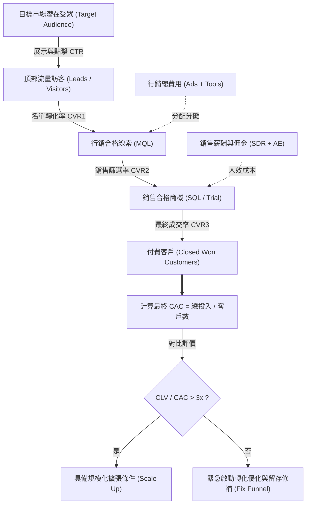

---
{"dg-publish":true,"permalink":"/98/cac-customer-acquisition-cost/","tags":["商業概念","創業管理","行銷管理","財務策略","PMBA"],"dg-note-properties":{"aliases":["獲客成本","Customer Acquisition Cost","CAC","Blended CAC","Paid CAC"],"tags":["商業概念","創業管理","行銷管理","財務策略","PMBA"]}}
---


# 獲客成本 (Customer Acquisition Cost, CAC)

> **【核心決策摘要】**
> **獲客成本（Customer Acquisition Cost, CAC）** 是衡量企業每獲取一位付費新客戶所必須投入的全部行銷、銷售與技術轉換成本的總和。在現代創業管理與企業成長策略中，CAC 不僅是流量採購效率的檢驗標尺，更是檢驗商業模式是否具備「可規模化（Scalability）」的核心邊界條件。當邊際獲客成本（Marginal CAC）低於邊際客戶終身價值（Marginal CLV）時，擴張投資創造經濟利潤；反之，若陷入付費廣告競價的「效能跑步機（Performance Treadmill）」，盲目衝刺 GMV 只會加速企業資金耗盡。

---

## 1. 概念核心定義與本質 (Executive Definition & Theoretical Essence)

### 1.1 核心定義
獲客成本在微觀經濟學與行銷科學中被嚴格定義為：**企業在特定核算週期內，為激發潛在市場需求、引導消費者通過銷售漏斗，並最終完成商業首購所耗費的一切資源現值與新增付費客戶數量的比值**。

```
                    特定週期內全部行銷與銷售支出 (全負擔成本)
CAC = ──────────────────────────────────────────────────────────
                     該週期內新增的付費客戶總數
```

### 1.2 本質解析：從「流量費用」躍升為「資本配置效率」
高階經理人必須超越傳統會計科目將廣告費視為「期間營業費用（Opex）」的狹隘思維，將 CAC 視為一種**無形資產投資的資本化支出**：
1. **邊際報酬遞減法則（Law of Diminishing Marginal Returns）**：在給定市場區隔內，早期採用者（Early Adopters）意向最高、獲客成本最低；隨著市場滲透進入大眾市場，新客觸達難度呈非線性陡峭攀升。
2. **流量黑洞與競價通膨（The Performance Treadmill）**：過度依賴單一付費通路（如 Google Ads、Meta 競價）會導致獲客利潤被平臺地租完全抽乾（Andrew Chen 提出的「差勁點擊率法則」Law of Shitty Clickthroughs）。
3. **有機引力與全負擔成本意識（Full-burdened Perspective）**：許多新創團隊常犯下只計算「廣告投放直接費用」的嚴重錯誤，忽視了 SDR/AE 銷售團隊薪酬、佣金、行銷科技（MarTech）軟體訂閱費與內容製作折舊，導致真實獲客成本被嚴重低估 30% 至 50%。

---

## 2. 數理模型與關鍵量化公式 (Mathematical Modeling & Quantitative Metrics)

### 2.1 全負擔獲客成本計算模型 (Fully-Burdened CAC)

為求決策精準，企業必須按全負擔標準核算：

$$\text{CAC}_{\text{Full-Burdened}} = \frac{\sum \text{Paid Ads} + \sum \text{S\&M Salaries \& Commissions} + \sum \text{MarTech Tools} + \sum \text{Agency/Content Fees}}{\Delta \text{New Customers}}$$

其中：
- $\sum \text{Paid Ads}$：數位廣告直接競價與展示投放支出。
- $\sum \text{S\&M Salaries}$：行銷團隊、B2B 開發代表（SDR）、客戶經理（AE）之全額薪資、獎金與勞健保提撥。
- $\sum \text{MarTech Tools}$：CRM（如 Salesforce/HubSpot）、自動化行銷軟體、CDP 資料平臺訂閱成本。
- $\Delta \text{New Customers}$：該計算期內新轉化的淨新增付費客戶數。

### 2.2 混合獲客成本 vs. 付費獲客成本 (Blended CAC vs. Paid CAC)

在多通路運作時，經理人需嚴格區分兩種計算口徑：

| 指標名稱 | 數學公式 | 適用場景與決策含義 |
| :--- | :--- | :--- |
| **混合獲客成本 (Blended CAC)** | $\frac{\text{Total S\&M Spend}}{\text{Total New Customers (Paid + Organic)}}$ | 全局財務視角。評估公司總體獲客效率，但容易被病毒擴散或品牌既有知名度掩蓋付費通路的低效。 |
| **付費獲客成本 (Paid CAC)** | $\frac{\text{Direct Paid Ad Spend}}{\text{New Customers Attributed to Paid Channels}}$ | 邊際資本配置視角。直接檢驗擴大投放預算時的單客獲取成本，為行銷團隊調整出價策略的真實依據。 |

### 2.3 歸因模型（Attribution Modeling）與邊際成本遞增

客群獲取路徑往往經歷多次接觸（Multi-touch）：

$$\text{CAC}_i = \sum_{j=1}^{K} w_{ij} \cdot C_j$$

- $w_{ij}$ 為第 $j$ 個行銷觸點在第 $i$ 位客戶轉化中的歸因權重（可採首次接觸 First-touch、最終點擊 Last-touch、線性均分 Linear 或數據驅動的 Shapley 價值歸因）。
- $C_j$ 為各觸點單位邊際成本。經理人需動態監控 $\frac{\partial \text{CAC}}{\partial Q}$，一旦邊際成本高於平均成本，即表明該渠道已逼近飽和拐點。

---

## 3. 戰略框架與營運機制 (Strategic Framework & Operational Dynamics)

### 3.1 全漏斗轉換與 CAC 形成機制

獲客成本並非孤立數字，而是銷售漏斗各節點轉換率（Conversion Rates）的綜合產物：



### 3.2 壓低 CAC 的五大戰略槓桿 (The 5 Levers to Reduce CAC)

1. **產品驅動成長 (PLG, Product-Led Growth)**：以產品本身作為獲客主力，透過免費增值（Freemium）模式降低嘗試門檻，靠產品體驗推動使用者自發轉化。
2. **病毒傳播係數 (K-Factor / Viral Loop)**：設計自帶社交推薦的激勵機制：
   $$K = i \times c$$
   （$i$ 為每位客戶發出邀請數，$c$ 為每個邀請的轉化率）。當 $K > 1$ 時，有機裂變將使整體 Blended CAC 逼近於零。
3. **精準區隔與高意向 Targeting**：結合 [[market-segmentation_市場區隔]] 與 [[target-market-selection_目標市場選擇]]，停止亂槍打鳥式的廣泛投放，將有限預算重押於高終身價值潛力的核心畫像群體。
4. **內容與 SEO 複利資產**：產出高權威度產業白皮書、專業教學與解決方案指引，建立不隨廣告停止而消失的被動搜尋流量護城河。
5. **銷售漏斗轉化率倍增工程 (CRO, Conversion Rate Optimization)**：針對落地頁（Landing Page）、結帳體驗、Onboarding 引導流程進行 A/B 測試，將總體轉化率提升 1 個百分點，通常可使 CAC 下降 20%~40%。

---

## 4. 產業標竿與實戰應用場景 (Industry Benchmarks & Applications)

各商業型態因客戶價值、購買頻率與銷售複雜度不同，其 CAC 容忍度與結構展現巨大差異：

| 商業模式 | 典型 CAC 區間 | 主要成本構成 | 關鍵監控指標 | 致命風險點 |
| :--- | :--- | :--- | :--- | :--- |
| **B2B 企業級軟體 (Enterprise SaaS)** | \$5,000 ~ \$50,000+ | 企業銷售人員（AE）薪酬、客製化 PoC 驗證、商務招待 | 銷售週期天數、SQL 成交率 | 決策週期過長（>9 個月），導致沉沒銷售成本吞噬毛利 |
| **B2B 中小企業軟體 (SMB SaaS)** | \$200 ~ \$2,000 | 數位廣告、自導式試用引導（Onboarding）、自動化郵件 | 自由試用轉付費率（Trial-to-Paid CVR） | 客戶流失率（Churn Rate）過高，未及收回 CAC 客戶即解約 |
| **DTC 電商 / 消費零售 (B2C DTC)** | \$20 ~ \$150 | Meta/Google 競價廣告、KOL 合作、折扣補貼 | ROAS（廣告投資報酬率）、首單毛利率 | 隱私政策升級導致追蹤失效，平台競價費用每年增長 20%+ |
| **雙邊平臺 / 外送與叫車 (Marketplace)** | \$5 ~ \$30 (用戶端)<br>\$100 ~ \$300 (司機端) | 促銷優惠券、推薦獎金、雙邊供需補貼 | 雙邊匹配效率、次月復購留存率 | 補貼一旦停止用戶立即轉移至競品平臺，無品牌忠誠度 |

---

## 5. 經典企業個案深度剖析 (Deep Dive Case Studies)

### 5.1 成功典範：Slack 以 PLG 模式顛覆 B2B 獲客天花板
- **背景挑戰**：傳統企業協同軟體（如 Microsoft、IBM）仰賴昂貴的直銷團隊，單一客戶獲取成本動輒數萬美元，新創極難切入。
- **獲客機制創新**：
  1. **自下而上滲透（Bottom-up Adoption）**：繞過繁瑣的企業 IT 採購部門審批，直接提供基層工程團隊極具吸引力的免費版本。
  2. **網絡效應觸發自體增殖**：團隊內部溝通自然產生網狀黏性，一人使用即拉入整組同事，使病毒係數 $K \approx 1$。
  3. **自然抵達付費閾值**：當歷史訊息累積達到 10,000 則限制時，團隊主動推動部門主管刷企業信用卡解鎖 Pro 版本。
- **成果**：Slack 在早期幾無大規模付費廣告投入的情況下，以極低 Blended CAC 獲得爆炸性成長，成為 SaaS 史上增長速度最快的獨角獸之一。

### 5.2 失敗警示：Casper 與 DTC 品牌的「流量跑步機」潰敗
- **商業死穴**：床墊 DTC 品牌 Casper 創立初期依靠社群行銷與開箱影片迅速崛起，但忽視了床墊屬於「超長置換週期（8~10年一購）」的低頻產品。
- **CAC 失控崩潰路徑**：
  1. 隨著競品大量湧入複製開箱策略，Google 與 Facebook 的「Mattress」關鍵字競價呈指數級攀升。
  2. Casper 的顧客終身價值幾乎等於單次購買價值（CLV 缺乏複購延伸空間），無法承受飆漲的 Paid CAC。
  3. 2019 年 IPO 招股書揭露：每賣出一張約 \$1,000 的床墊，行銷費用高達近 \$300，加上退貨成本與供應鏈支出，單客利潤實質為負。
- **經理人啟示**：缺乏高頻複購（LTV 鎖定）的單次交易型商業模式，絕不可長期依賴外部付費流量作為核心成長引擎。

---

## 6. 高階經理人決策實戰工具箱 (Executive Action Playbook)

### 6.1 CAC 健康度四象限診斷矩陣

```
                    高 CLV (高終身價值)
                            │
            【象限 II：戰略精耕區】 │ 【象限 I：甜蜜黃金區】
            • 特徵：B2B 企業大單，    │ • 特徵：高定價、強複購、
              高銷售成本與長週期       │   高效率有機自傳播
            • 策略：深化客戶成功，    │ • 策略：全力注資擴大產能，
              提高終身單客 ARPU       │   快速搶佔市場份額
    ───────────────┼───────────────
            【象限 III：死亡泥淖區】│ 【象限 IV：薄利快打區】
            • 特徵：高獲客成本，      │ • 特徵：快消品、工具型產品，
              但客戶價值低、易流失   │   客單價低但獲客極快
            • 策略：立即叫停付費推廣，│ • 策略：嚴格控制投放出價，
              重構產品價值與留存     │   依賴病毒裂變與規模經濟
                            │
                    低 CLV (低終身價值)
    高 CAC ────────────────────────── 低 CAC
```

### 6.2 經理人常見獲客成本認知盲區與避坑清單
- [ ] **盲區一：以 Blended CAC 掩蓋 Paid CAC 的惡化**：當公司既有品牌帶來大量自然流時，總體混合 CAC 看似健康，但實質上新增付費廣告渠道的邊際投入可能早已虧損。
- [ ] **盲區二：忽略「退貨、拒付與即時解約」對真實分母的侵蝕**：以「註冊數」或「未扣除首月退費的訂單數」作為客戶總數，導致 CAC 被虛假美化。
- [ ] **盲區三：銷售人力成本未全額計入**：未將獵頭費、新人培訓期薪酬、未成單銷售員的基本工資計入 S&M 總支出。
- [ ] **盲區四：靜態看待 CAC**：忽視不同流量渠道在擴張時的「邊際成本遞增效應」，以早期小樣本測試數據作為大規模融資擴張預算的前提。

---

## 7. 關聯知識網絡與導航地圖 (Knowledge Network & Cross-References)

### 7.1 本主題核心三部曲
- **[[cac-customer-acquisition-cost_獲客成本]]** · 獲客投入全負擔精算、流量歸因與邊際效率遞減（本篇）
- **[[clv-customer-lifetime-value_顧客終身價值]]** · 折現現金流模型、同期群留存微笑曲線與負流失率擴張
- **[[unit-economics-model_單位經濟模型]]** · LTV/CAC 比率、回本週期（Payback Period）與規模化可行性驗證

### 7.2 跨領域策略與行銷鏈結
- [[switching-costs_轉換成本]] · 建立高轉換壁壘以延長留存週期，攤平初始獲客成本
- [[market-segmentation_市場區隔]] · 精準界定高潛力目標市場，避免無效流量浪費
- [[positioning-strategy_定位策略]] · 佔據獨特顧客心智認知，建立自然品牌防禦力
- [[equity-financing_股權融資]] · 創投融資盡職調查（Due Diligence）核心驗證指標

### 7.3 課程筆記與導航主頁
- [[M1-5_創業構想發展與兩階段可行性評估]] · 創業構想深入評估之行銷可行性與經濟模型
- [[_創業與企業財務策略 MOC]] · 創業財務與資本結構核心導航地圖
- [[home]] · 全球 PMBA 知識庫總導航主頁面