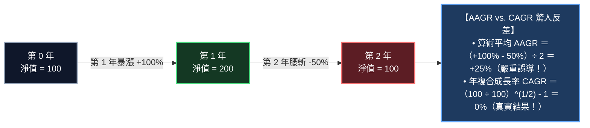
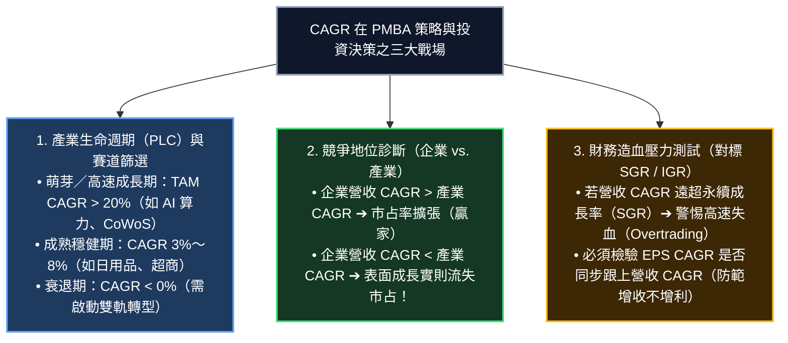

---
{"dg-publish":true,"permalink":"/98/cagr-compound-annual-growth-rate/","tags":["商業概念","財務分析","投資策略","產業分析","成長評估","估值模型","PMBA"],"dg-note-properties":{"aliases":["CAGR","CAGR 年複合成長率","年複合成長率","複合年均成長率","複合年增長率","Compound Annual Growth Rate"],"tags":["商業概念","財務分析","投資策略","產業分析","成長評估","估值模型","PMBA"]}}
---


# CAGR 年複合成長率 (Compound Annual Growth Rate)

> **商管核心價值**：  
> 「算術平均成長率常因劇烈波動而製造繁榮幻覺，唯獨 **CAGR（年複合成長率）** 能穿透噪音，誠實衡量財富、營收或市場規模跨越數年的真實複利速度。然而，頂尖分析師絕不盲信單一 CAGR 數字——因為它只看『頭尾兩點』，容易被低基期操弄，也隱藏了中途的波動與失血危機。」  
> 
> 在 PMBA 產業分析、企業估值與資本配置中，**CAGR（Compound Annual Growth Rate，年複合成長率）** 是衡量跨多年度（$n \ge 2$）平滑複利增速的黃金標準指標。它廣泛應用於評估 **[[98_商業概念庫/TAM\|總體潛在市場（TAM）]]** 擴張速度、企業長期營收與 EPS 成長動能、以及投資組合之長期年化回報率。

---

## 一、 核心定義與數理公式

### 1.1 標準計算公式
假設某指標（營收、淨利、市場規模或資產淨值）在期初值為 $V_{\text{begin}}$，經過 $n$ 個年度後達到期末值 $V_{\text{end}}$，則其年複合成長率為：

$$\text{CAGR} = \left( \frac{V_{\text{end}}}{V_{\text{begin}}} \right)^{\frac{1}{n}} - 1$$

- **⚠️ 最常見計算陷阱（期數 $n$ 的認定）**：
  - 若資料涵蓋 **2021 年至 2026 年**（共 6 個年度報表），實際經過的複利成長區間數為 **$n = 2026 - 2021 = 5$**，而非 6！
- **⚡ 高管心算利器：72 法則（Rule of 72）**：
  $$\text{規模翻倍所需年數} \approx \frac{72}{\text{CAGR (\%)}}$$
  - $\text{CAGR} = 10\%$ ➔ 約 **7.2 年**翻倍
  - $\text{CAGR} = 15\%$ ➔ 約 **4.8 年**翻倍
  - $\text{CAGR} = 24\%$ ➔ 約 **3.0 年**翻倍
  - $\text{CAGR} = 36\%$ ➔ 約 **2.0 年**翻倍

---

### 1.2 為何不能用「算術平均成長率（AAGR）」？——波動耗損數理證偽

假設某科技股淨值：第 0 年為 **100 元** ➔ 第 1 年暴漲 $+100\%$ 至 **200 元** ➔ 第 2 年腰斬 $-50\%$ 回到 **100 元**。



- **波動拖累近似公式（Volatility Drag）**：
  由算術-幾何平均不等式（AM-GM Inequality）可知，只要各期成長率存在波動（變異數 $\sigma^2 > 0$），CAGR 必然嚴格小於算術平均成長率：
  $$\text{CAGR} \approx \text{AAGR} - \frac{\sigma^2}{2}$$
  **管理意涵**：波動率 $\sigma$ 越大，算術平均對真實複利增速的灌水就越嚴重。投資與經營追求的是「低波動、高平滑的複利成長」，而非大起大落的過山車。

---

## 二、 成長率指標全景對照：CAGR vs. AAGR vs. YoY vs. IRR

| 指標名稱 | 數學本質 | 核心適用場景 | 最大優勢 | 致命盲點 |
| :--- | :--- | :--- | :--- | :--- |
| **CAGR**<br>（年複合成長率） | **幾何平均年化增速** | 評估 3～10 年期產業 TAM、企業營收/EPS、長期投資績效 | 消除中途短期噪音，真實反映長期複利斜率 | 只看頭尾兩點，掩蓋中途波動與現金流進出 |
| **AAGR**<br>（算術平均成長率） | 各期增速簡單加總除以 $n$ | 單純衡量歷史單年增速期望值 | 計算極為直觀 | 嚴重高估高波動資產的實際複利報酬（波動耗損） |
| **YoY**<br>（年增率） | 本期對比去年同期之單期變化 | 財報季檢視短期動能與景氣轉折點 | 反應最靈敏，可消除季節性干擾 | 易受單一基期事件（一次性訂單、疫情）扭曲 |
| **IRR**<br>（內部報酬率） | 使多期現金流淨現值 $\text{NPV} = 0$ 之折現率 | 創投基金（VC/PE）、專案資本預算、分批投入/配息投資 | **精準計入中途每一筆現金流入與流出時點** | 計算複雜，且隱含「中途現金流可按 IRR 再投資」假設 |

---

## 三、 PMBA 實戰應用：從產業賽道到企業財務體檢



- **經典實戰判讀——「相對 CAGR」才是真護城河**：
  若某 AI 零組件廠過去 3 年營收 CAGR 達 **25%**，乍看極為亮眼；但若整體 AI 伺服器產業同期 CAGR 高達 **60%**，這代表該企業的市占率其實正在**急遽萎縮**，並未真正享有技術護城河！

---

## 四、 CAGR 四大致命陷阱與經理人防雷審計

在閱讀券商研究報告、新創募資簡報（Pitch Deck）或併購盡職調查（DD）時，必須嚴格防範以下四大陷阱：

1. **起終點挑選偏誤（Cherry-Picking / 低基期魔術）**：
   - 簡報者刻意挑選「景氣谷底或虧損低谷」作為 $V_{\text{begin}}$，挑選「景氣最高峰」作為 $V_{\text{end}}$，就能在圖表上變魔術般造出 40%+ 的假性高 CAGR。
2. **掩蓋中途劇烈波動與破產風險（Volatility Blindness）**：
   - 兩家企業 5 年營收 CAGR 同為 15%：A 公司每年穩健成長 15%；B 公司前三年連續衰退 -30% 瀕臨斷鏈，第 4～5 年靠單一爆款翻倍。兩者在風險定價與估值倍數（P/E）上天差地別。
3. **負值與零值失靈（Negative / Zero Breakdown）**：
   - 當企業期初淨利為負（虧損 $-500$ 萬）而期末轉盈（$+1,000$ 萬）時，$\left(\frac{1000}{-500}\right)^{1/n}$ 在實數域無意義。**嚴禁對負數硬套 CAGR**，應改以「營收 CAGR」、「EBITDA 改善幅度」或「營業利益率提升百分點」衡量。
4. **忽視期間現金流進出與股本稀釋**：
   - 評估投資報酬時，若期間有大額現金增資、股利發放或分批注資，必須改用 **IRR**；評估企業成長品質時，若「營收 CAGR 很高但 EPS CAGR 很低」，往往代表公司靠不斷增發新股（股權稀釋）或殺價換量來堆高營收。

```markdown
### 📋 經理人與投資人 CAGR 審計 5 步檢核表

- [ ] 1. 【期數 $n$ 驗算】：確認報告中 $n$ 是否等於「期末年份 − 期初年份」，排除多算 1 年拉低或少算 1 年灌水的計算錯誤。
- [ ] 2. 【滾動區間防作弊（Rolling CAGR）】：將起點往前後各移動 1 年重算 CAGR，檢驗高增速是否純屬「挑低基期」的數字遊戲。
- [ ] 3. 【搭配標準差與年度走勢】：拉出每一年的 YoY 柱狀圖，確認成長曲線是「平滑複利」還是「末期單點爆發／劇烈震盪」。
- [ ] 4. 【三率對照驗證品質】：同步比對「營收 CAGR」、「營業利益 CAGR」與「稀釋後 EPS CAGR」，嚴防增收不增利或股權過度稀釋。
- [ ] 5. 【橫向對標產業與 SGR】：確認公司 CAGR 是否跑贏整體產業 TAM 增速，並檢核是否超出自身 [[sustainable-growth-rate_永續成長率|永續成長率（SGR）]] 造成現金流緊繃。
```

---

## 五、 PMBA 模組講義與知識網絡鏈結

### 5.1 官方課程與模組雙向反向鏈結
- [[04_主題選修/12_產業分析與投資策略/02_模組筆記/Module_1_總論與架構/M1-3_產業獲利結構差異與十大經典理論\|M1-3 產業獲利結構差異與十大經典理論]]：
  - **市場成長率（Growth Rate）基礎條件**：高速成長期（高 CAGR）廠商容易共存擴張；成熟低速期（低 CAGR）則演變為零和搶市與洗牌整併。
- [[04_主題選修/10_創業與企業財務策略/02_模組筆記/Module_1_創新思維與商業模式/M1-9_商業模式畫布架構與價值主張設計\|M1-9 商業模式畫布架構與價值主張設計]]：
  - **市場規模擴張與營收預估**：商業計畫書（BP）預測未來 3～5 年營收與市場滲透率時的核心基準指標。

### 5.2 商業概念庫相關卡片
- [[98_商業概念庫/sustainable-growth-rate_永續成長率\|sustainable-growth-rate_永續成長率]]（在不發行新股且維持負債比下，企業財務結構所能支撐的最高成長上限）
- [[98_商業概念庫/IGR_內部成長率 Internal Growth Rate\|IGR_內部成長率]]（完全仰賴內部保留盈餘所能支撐的最高自然增速）
- [[98_商業概念庫/TAM\|TAM（總體潛在市場）]] ｜ [[98_商業概念庫/SAM\|SAM（可服務市場）]]（CAGR 最常搭配衡量的賽道市場空間指標）
- [[98_商業概念庫/dcf_現金流量折現法\|dcf_現金流量折現法]]（未來自由現金流預測期之核心增速假設參數）
- [[98_商業概念庫/davis-double-whammy_戴維斯雙殺效應\|davis-double-whammy_戴維斯雙殺效應]]（EPS CAGR 預期上修或下修如何引爆 P/E 倍數的雙擊／雙殺）
