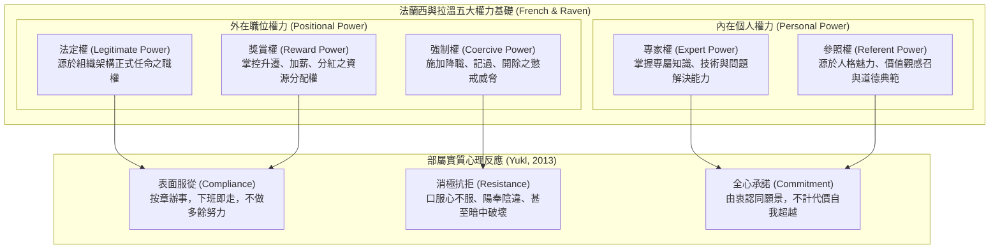

---
{"dg-publish":true,"permalink":"/98/can-zhao-quan/","tags":["商業概念","領導力","組織行為","權力與政治","PMBA"],"dg-note-properties":{"aliases":["參照權","模範權","感召權","Referent Power","認同權"],"tags":["商業概念","領導力","組織行為","權力與政治","PMBA"]}}
---


# 參照權 (Referent Power)

> [!NOTE]
> **核心概念精粹**：參照權（Referent Power / 模範權），是約翰·法蘭西與伯特倫·拉溫（French & Raven）經典五大權力基礎中最具持久感召力的**個人性權力（Personal Power）**。它不依賴於組織賦予的正式頭銜、獎金資源或懲罰手段，而是源於部屬對領導者**非凡個人魅力、崇高道德情操、遠大願景或卓越品格的深層欽佩、情感依附與心理認同（Identification）**。參照權能激發團隊超越職責邊界的全心承諾（Commitment），是轉換型領導與真誠領導的核心引擎。

---

## 一、 學理淵源：法蘭西與拉溫的權力基礎理論

法蘭西與拉溫（French & Raven, 1959）將社會與組織內部的影響力來源嚴格劃分為五大形態，並深刻對比了「職位權力」與「個人權力」在下屬心理機制上的本質分水嶺：



---

## 二、 參照權 vs 職位權力的深度特徵對照

| 比較維度 | 外在職位權力（法定權、獎賞權、強制權） | 內在個人權力：參照權（Referent Power） |
| :--- | :--- | :--- |
| **權力來源** | 董事會或母公司自上而下的正式制度授權。 | 下屬、同儕甚至上級自下而上的自發認同與賦予。 |
| **依賴載體** | 職稱頭銜、組織章程、公章簽署權。 | 領導者本人的言行一致、犧牲精神、價值觀共鳴。 |
| **持續時效** | **脆弱易逝**：一旦卸任、調職或退休，權力瞬間歸零。 | **歷久彌新**：即使失去所有頭銜，依然享有崇高的終身影響力。 |
| **激勵心理** | 外在誘因驅動（胡蘿蔔與大棒），引發精打細算的算計。 | **內在動機激發**：部屬渴望成為「像領導者一樣的人」，獲得精神昇華。 |
| **適用情境** | 例行常規運作、危機初期的強制命令。 | **重大組織變革、生死存亡轉型、需要團隊背水一戰**。 |

---

## 三、 經典企業實戰案例：賈伯斯的現實扭曲力場 vs 張忠謀的誠信感召

```carousel

<!-- slide -->
### 1. 賈伯斯（Steve Jobs）的願景感召與現實扭曲力場
- **現象描繪**：賈伯斯常要求工程師在看似不可能的時間內完成極限任務（如幾週內將 Mac 開機時間縮短 10 秒）；
- **參照權機制**：團隊工程師明知他是個脾氣暴躁的偏執狂，卻依然為他連續數月每週工作 90 小時；
- **核心動力**：源於賈伯斯對「改變世界、在宇宙中留下痕跡」的極致狂熱與美學品味，激發了天才工程師對其願景的崇拜，心甘情願挑戰極限。
<!-- slide -->
### 2. 張忠謀的誠信正直（Integrity）典範力量
- **治理實踐**：張忠謀在創立台積電時，確立「誠信正直」為四大核心價值之首；
- **道德力量**：張忠謀數十年如一日堅持「永不與客戶競爭、絕不洩漏客戶晶片設計藍圖」的諾言，在面對英特爾、蘋果與輝達等巨頭博弈時展現鋼鐵風骨；
- **成果**：這種無懈可擊的道德參照權，不僅感召全球頂尖工程師赴湯蹈火，更贏得了全球科技巨頭長達數十年的無條件信任，構築了任何競品無法用金錢買到的信用護城河。
```

---

## 四、 經理人參照權培育檢核表（Executive Decision Checklist）

在領導重大轉型或跨部門協同作戰時，高管應檢核自身的參照權儲備：

- [ ] **言行一致檢驗（Walk-the-Talk Integrity）**：
  - 我們所宣導的企業文化與價值觀，自己是否在每一次高壓決策中百分之百踐行？當面臨短期利潤誘惑時，我們是否曾為了個人利益踐踏原則？
- [ ] **以身作則與承擔下檔（Skin-in-the-Game & Sacrifice）**：
  - 在要求團隊勒緊褲帶或加班攻堅時，領導者是否率先削減自身特權並身先士卒守在第一線？還是只坐在冷氣辦公室遙控指揮？
- [ ] **脫離頭銜之純影響力（Title-Free Influence Test）**：
  - 「如果今天剝奪了我所有的正式行政頭銜與年終獎金簽發權，我的團隊中有多少人依然願意跟隨我的戰略方向共同奮鬥？」
- [ ] **同理授權與光環讓渡（Credit-Sharing & Humility）**：
  - 專案取得重大勝利時，我們是將榮譽全數歸於第一線同仁，還是獨攬鎂光燈？面對失敗時，我們是否展現擔當，為下屬承擔外部政治風暴？

---

## 五、 關聯概念與知識網絡

* 權力體系與領導形態：
  * [[bases-of-social-power_權力基礎|權力基礎 (Bases of Social Power)]]：法蘭西與拉溫社會影響力大一統架構
  * [[legitimate-power_法定權|法定權 (Legitimate Power)]]：正式職位權力之邊界與局限
  * [[expert-power_專家權|專家權 (Expert Power)]]：專業技能資本所帶來的威信
  * [[leadership-2_魅力型領導|魅力型領導 (Charismatic Leadership)]]：參照權在領袖個人特質維度之體現
* 現代領導與情商實踐：
  * [[authentic-leadership_真誠領導|真誠領導 (Authentic Leadership)]]：自我覺察與道德透徹所築構之參照權基石
  * [[transformational-leadership_轉換型領導|轉換型領導 (Transformational Leadership)]]：以願景激勵下屬超越個人利益
  * [[servant-leadership_僕人式領導|僕人式領導 (Servant Leadership)]]：透過服務與賦能部屬贏得深層崇敬
  * [[emotional-intelligence_情緒智商|情緒智商 (Emotional Intelligence)]]：高情商同理心對參照權之滋養
