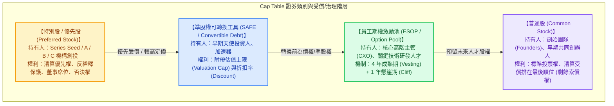
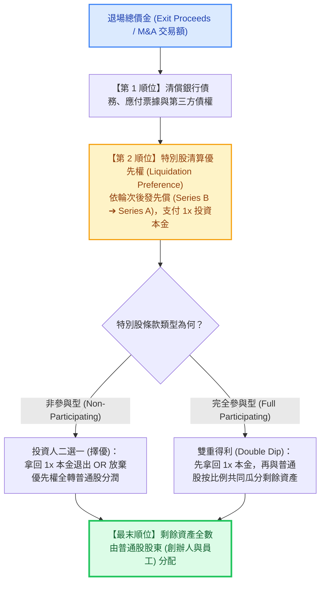

---
{"dg-publish":true,"permalink":"/98/cap-table-cap-table/","tags":["商業概念","創業融資","企業財務策略","創投資本","公司治理","股權激勵","PMBA"],"dg-note-properties":{"aliases":["股權結構表","Cap Table","Capitalization Table","股權架構表","資本化結構表","cap-table_股權結構表 Cap Table","cap-table"],"tags":["商業概念","創業融資","企業財務策略","創投資本","公司治理","股權激勵","PMBA"]}}
---


# 股權結構表 (Capitalization Table, Cap Table)

> 💡 **導航與索引**：本篇為新創企業與成長型企業資本運作、控制權分配與融資稀釋之核心底冊，亦可參閱融資博弈協議 [[98_商業概念庫/term-sheet_投資意向書 Term Sheet\|投資意向書 (Term Sheet)]]、退場清算防線 [[98_商業概念庫/liquidation-preference_清算優先權\|清算優先權 (Liquidation Preference)]]、股權防護機制 [[98_商業概念庫/anti-dilution_反稀釋條款\|反稀釋條款 (Anti-Dilution)]]、股東每股獲利完全稀釋檢驗 [[98_商業概念庫/diluted-eps_稀釋後每股盈餘\|稀釋後每股盈餘 (Diluted EPS)]]、資本退場機制 [[98_商業概念庫/exit-strategy_出場機制 Exit Strategy\|出場機制 (Exit Strategy)]]、融資缺口預測 [[98_商業概念庫/AFN_外部融資需求模型 Additional Funds Needed\|外部融資需求模型 (AFN)]]，以及企業資本總覽 [[98_商業概念庫/financial-structure_財務結構\|財務結構 (Financial Structure)]]。

## 一、 核心定義與創投財務學本質

- **股權結構表 (Capitalization Table，簡稱 Cap Table)** 是企業記錄**所有股東出資明細、股權類別（普通股、各輪優先股/特別股）、發行股份數量、完全稀釋持股比例（Fully Diluted Ownership Percentage）、員工期權池（ESOP Pool）以及未轉換衍生證券（SAFE、可轉換公司債）**的動態資本結構總帳冊。
- **創業家的「數位生命線」與權力地圖**：
  在創業財務與創投資本（VC）運作中，Cap Table 絕非單純記錄歷史出資的靜態會計底稿，而是貫穿企業全生命週期的三大核心中樞：
  1. **治理權力中樞**：決定董事會席次結構、股東會投票權多寡與重大決策一票否決權（Protective Provisions）。
  2. **融資定價中樞**：決定每一輪新資金注入時，新股發行價格（Price Per Share, PPS）與新舊股東的動態稀釋比例。
  3. **價值分配中樞**：在企業發生收購、併購（M&A）或破產清算時，作為執行**「清算瀑布模型（Waterfall Analysis）」**的唯一數理分配依據。
- **已發行流通股 (Issued & Outstanding) vs. 完全稀釋股數 (Fully Diluted Shares)**：
  - **已發行流通股數（Basic Shares）**：僅計算當前法律上已實質發行並完成登記的普通股與特別股股數。
  - **完全稀釋股數（Fully Diluted Shares）**：假定所有已核准之員工認股權池（無論已授予或未授予）、認股權證（Warrants）、可轉換公司債（Convertible Notes）及 SAFE 全數行權或轉換為普通股後的理論總股數。
  - > 🚨 **創投融資鐵律**：機構投資人（VC）在核定每股收購價格（PPS）與自身持股比例時，**一律以「完全稀釋總股數」為唯一計算基準**，以確保自身權益不被未行權期權無端稀釋。

---

## 二、 Cap Table 核心構成要件與證券受償階層



### 1. 核心四大持股板塊剖析

| 證券類別 | 典型持有人 | 經濟與治理權利特徵 | 清算受償順位 |
| :--- | :--- | :--- | :---: |
| **特別股 (Preferred Stock)**<br>*(Series A / B / C...)* | 機構創投 (VC)、企業創投 (CVC)、私募基金 (PE) | • 享有 $1\times$ 或更高之[[98_商業概念庫/liquidation-preference_清算優先權\|清算優先權]]<br>• 加權平均[[98_商業概念庫/anti-dilution_反稀釋條款\|反稀釋保護]]<br>• 重大決策否決權與領售權 (Drag-Along)<br>• 可按約定比例自願轉換為普通股 | **第一順位**<br>(優先於普通股) |
| **過渡轉換工具 (SAFE / 可轉債)**<br>*(Convertible Securities)* | 早期天使投資人、創業加速器 (如 Y Combinator) | • 尚未轉換為正式股權之合約契約<br>• 約定於下一輪定價融資時按**估值上限（Cap）**或**折扣率（Discount，如 80%）**自動轉股 | **準股權/次順位**<br>(可轉債具債權屬性) |
| **員工認股權池 (ESOP Pool)**<br>*(Stock Options)* | 未來引進之關鍵高管（VP/CTO）、核心工程師 | • 激勵長期留任與績效貢獻<br>• 通常預留 **$10\% \sim 15\%$** 股權額度<br>• 嚴格遵循「4 年成熟、滿 1 年拿 25%」之懸崖期機制 | 轉股後等同普通股 |
| **普通股 (Common Stock)**<br>*(Founder Shares)* | 創始人、共同創辦人、早期技術入股合夥人 | • 承擔企業最高失敗風險，享有「剩餘索償權」<br>• 具備標準法定表決權（或雙層股權架構 Dual-Class Super-voting） | **最末位**<br>(瓜分剩餘資產) |

---

## 三、 數理建模：多輪融資稀釋瀑布與 Option Pool Shuffle 陷阱

### 1. 股權稀釋基礎核心公式
$$\text{投後估值 (Post-Money Valuation)} = \text{投前估值 (Pre-Money Valuation)} + \text{本輪新投資金額 (New Investment)}$$
$$\text{新投資人持股比例} = \frac{\text{本輪投資金額}}{\text{投後估值}}$$
$$\text{每股價格 (Price Per Share, PPS)} = \frac{\text{投前估值}}{\text{融資前完全稀釋總股數 (Pre-Money Fully Diluted Shares)}}$$
$$\text{新發行股份數} = \frac{\text{本輪投資金額}}{\text{每股價格 (PPS)}}$$

### 2. 創投融資經典「期權池洗牌陷阱」（The Option Pool Shuffle）
在 Term Sheet 談判中，VC 通常會要求設立或擴大員工期權池（例如 15%）。但**期權池設立的時間點**，對創辦人的實質稀釋具有天壤之別：
- **陷阱做法：投前設立期權池（Pre-Money Option Pool，VC 慣常條款）**：
  VC 要求將 15% 期權池計入「投前估值」範圍內。
  - **數理後果**：這 15% 的股權稀釋**完全由原始創始團隊 100% 獨立吸收**！VC 的新資金絲毫不承擔期權池稀釋。
  - **實質效果**：使創辦人承擔更重稀釋，等同於**變相壓低了實際投前估值（Effective Pre-money Valuation）**。
- **平衡做法：投後設立期權池（Post-Money Option Pool）**：
  期權池在 VC 資金到位後由全體新舊股東按投後比例共同分攤稀釋，創辦人稀釋幅度顯著較小。

### 3. 新創三輪融資稀釋演化全景試算（實戰數理推導）

假設某 AI 新創由兩位創辦人創立，初始總股數為 10,000,000 股：

```text
【新創股權演化全景：創立 ➔ 天使輪 ➔ A 輪 ➔ B 輪】

       100% ┌────────────────────────────────────────────────────────┐
            │ 創始團隊 (Founders) 100%                               │ (創立時：1,000 萬股)
            ├─────────────────────────────────────────┬──────────────┤
        85% │ 創始團隊 85%                            │ ESOP 15%     │ (種子期：設立期權池)
            ├──────────────────────────┬──────────────┼──────────────┤
       68%  │ 創始團隊 68%             │ ESOP 12%     │ A 輪 VC 20%  │ (A輪：稀釋 20%)
            ├──────────────┬───────────┼──────────────┼──────────────┤
      56.6% │ 創始團隊 56.6%│ ESOP 10% │ A 輪 VC 16.7%│ B 輪 VC 16.7%│ (B輪：稀釋 16.7%)
        0%  └──────────────┴───────────┴──────────────┴──────────────┘
```

| 融資階段 | 融資條件與估值 | 創始團隊股數與佔比 | 員工期權池 (ESOP) | 外部投資人持股比例 | 備註與治理意涵 |
| :--- | :--- | :---: | :---: | :---: | :--- |
| **創立階段** | 資本額 100 萬元<br>原始普通股 10,000,000 股 | **10,000,000 股**<br>(**100.0%**) | 0 股<br>(0.0%) | 無<br>(0.0%) | 創辦人絕對控股，按 60/40 分配，簽訂 4 年 Vesting 協議。 |
| **種子輪 (Seed)** | 設立 15% 員工期權池<br>(新增 1,764,706 股) | **10,000,000 股**<br>(**85.0%**) | **1,764,706 股**<br>(**15.0%**) | 無 | 總股數擴大為 11,764,706 股。預留期權為招募 CTO 準備。 |
| **A 輪定價融資** | 投前估值 1 億元<br>融資金額 2,500 萬元<br>(投後 1.25 億，釋出 20%) | **10,000,000 股**<br>(**68.0%**) | **1,764,706 股**<br>(**12.0%**) | **A 輪 VC 優先股**<br>2,941,176 股<br>(**20.0%**) | 每股價格 $PPS = \frac{100,000,000}{11,764,706} \approx \$8.50$ 元。<br>總股數增至 14,705,882 股。創始團隊仍具 2/3 絕對多數。 |
| **B 輪擴張融資** | 投前估值 3 億元<br>融資金額 6,000 萬元<br>(投後 3.6 億，釋出 16.7%) | **10,000,000 股**<br>(**56.6%**) | **1,764,706 股**<br>(**10.0%**) | **A 輪**：16.7%<br>**B 輪 VC 優先股**：<br>2,941,176 股 (**16.7%**) | 每股價格 $PPS = \frac{300,000,000}{14,705,882} \approx \$20.40$ 元。<br>總股數增至 17,647,058 股。創辦人持股跌破 60%，進入董事會共治階段。 |

---

## 四、 退場清算瀑布模型 (Exit Waterfall Analysis)

當企業發生退場事件（Trade Sale 出售、被科技巨頭併購 M&A 或解散清算）時，收購總價金並非簡單按持股比例瓜分，而是嚴格依照 Cap Table 中各輪特別股契約之「清算優先權階層」進行**逐層截流分配**：



### 實戰案例警示（平庸退場時創辦人被清空洗出場）：
若某新創累計融資 8,000 萬元特別股，均附帶 **$1\times$ 參與型清算優先權**。幾年後市場轉冷，公司以 **8,500 萬元**被產業對手折價收購：
1. **特別股優先償付**：VC 優先拿走 8,000 萬元本金；
2. **剩餘資產瓜分**：剩餘 500 萬元由 VC（佔 40%）與創始團隊（佔 60%）共同分配，創辦團隊僅分得 300 萬元！
3. **殘酷啟示**：雖然公司以 8,500 萬元售出，但因嚴苛的清算條款，創辦人辛苦創業多年實質回報趨近於零。

---

## 五、 高階經理人與創始團隊實戰三大軍規

### 1. 嚴守「乾淨 Cap Table 原則」（The Clean Cap Table Principle）
- **杜絕早期股權過度分散**：種子期切忌將大量股份（如 10%~20%）輕率贈送給「非全職顧問、不適任早期合夥人或小額天使」。
- **全員強制綁定成熟機制（Vesting Schedule）**：
  所有全職創始人與核心員工之股份，必須白紙黑字簽訂 **4 年按月成熟、滿 1 年懸崖期（4-Year Vesting with 1-Year Cliff）**。若某合夥人創業 6 個月後因理念不合離職，公司依法有權按原價購回其 100% 未成熟股份，徹底防範「離職員工帶著 30% 股權坐地收租」，避免 Cap Table 遭受永久污染而導致後續 VC 拒絕投資。

### 2. 警惕 SAFE 與可轉債的「隱形稀釋水下炸彈」（SAFE Overhang）
- 很多早期新創因圖方便，連續透過 Y Combinator SAFE 或可轉換借款融資 3~4 輪，表面上沒有發行新股，Cap Table 帳面看似極其乾淨。
- **水下炸彈引爆點**：當公司迎來第一輪機構定價融資（Series A）時，所有累積發行、帶有不同 Valuation Cap（例如 1.5 億與 2.5 億）的 SAFE 將被**強制同時轉股**。此時創辦人往往驚駭地發現，自己的持股在一夜之間被瞬間稀釋 35%~45%！創業者必須隨時維護「SAFE 試算模擬表」，嚴密監控隱形稀釋天花板。

### 3. 平衡「每股價格 (PPS)」與「控制權條款」的戰略權衡
- 創業融資談判切莫盲目沉迷於「虛榮估值（Vanity Valuation）」。
- 高估值若伴隨高風險對賭協議、**完全棘輪反稀釋條款（Full Ratchet Anti-dilution）**或多重特別股否決權，一旦外部景氣下行，下一輪融資估值調降（Down Round），完全棘輪條款將強制將過去 VC 的換股價格直接拉低至當前低價，引發普通股被毀滅性稀釋，創辦團隊將瞬間喪失公司主導權並淪為替投資人打工的受僱者。

---

## 六、 關聯主題與模組網絡

- 🧭 **課程核心模組對接**：
  - [[04_主題選修/10_創業與企業財務策略/00_課程導航與進度/mindmap_創業與企業財務策略_心智圖導航\|創業與企業財務策略 心智圖導航]]（新創融資生命週期、股權激勵架構與投資條款）
  - [[04_主題選修/10_創業與企業財務策略/01_創投總經與個案/cases_新創與企業融資案例庫\|新創與企業融資案例庫]]（新創融資各輪股權釋出比例、特別股轉換與 Cap Table 演化實戰）
  - [[04_主題選修/10_創業與企業財務策略/02_模組筆記/Module_1_創新思維與商業模式/M1-5_創業構想發展與兩階段可行性評估\|M1-5 創業構想發展與兩階段可行性評估]]（團隊股權配置、創始人激勵與治理結構審查）
  - [[04_主題選修/10_創業與企業財務策略/02_模組筆記/Module_2_產品創新與精實驗證/M2-4_新創財務預測與外部融資需求模型\|M2-4 新創財務預測與外部融資需求模型]]（AFN 外部融資缺口轉化為股權融資需求與 Cap Table 稀釋模擬）
  - [[04_主題選修/10_創業與企業財務策略/02_模組筆記/Module_1_創新思維與商業模式/M1-2_白板決策鏈與財務價值三角\|M1-2 白板決策鏈與財務價值三角]]（資本傳導鏈、創始人持股防線與股權價值分配）
- 🔗 **核心概念原子卡片**：
  - [[98_商業概念庫/term-sheet_投資意向書 Term Sheet\|投資意向書 (Term Sheet)]]
  - [[98_商業概念庫/liquidation-preference_清算優先權\|清算優先權 (Liquidation Preference)]]
  - [[98_商業概念庫/anti-dilution_反稀釋條款\|反稀釋條款 (Anti-Dilution)]]
  - [[98_商業概念庫/diluted-eps_稀釋後每股盈餘\|稀釋後每股盈餘 (Diluted EPS)]]
  - [[98_商業概念庫/exit-strategy_出場機制 Exit Strategy\|出場機制 (Exit Strategy)]]
  - [[98_商業概念庫/convertible-corporate-bonds_可轉換公司債\|可轉換公司債 (Convertible Bonds)]]
  - [[98_商業概念庫/equity-dilution_股權稀釋\|股權稀釋 (Equity Dilution)]]
  - [[98_商業概念庫/financial-structure_財務結構\|財務結構 (Financial Structure)]]
  - [[98_商業概念庫/AFN_外部融資需求模型 Additional Funds Needed\|外部融資需求模型 (AFN)]]
