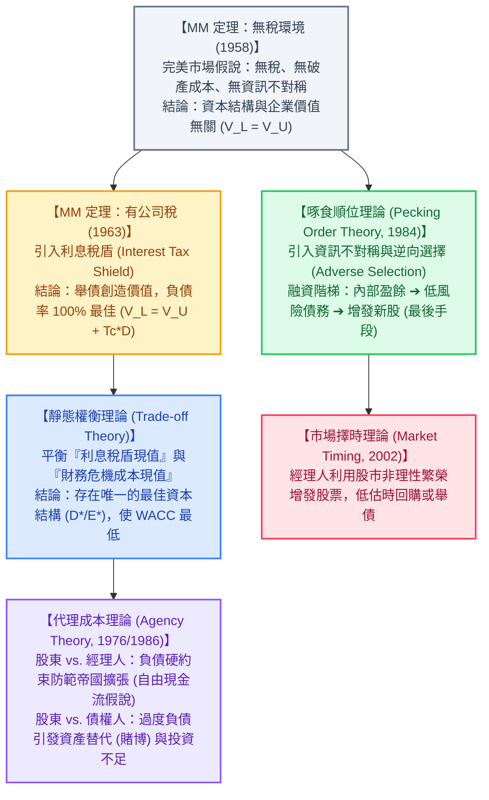
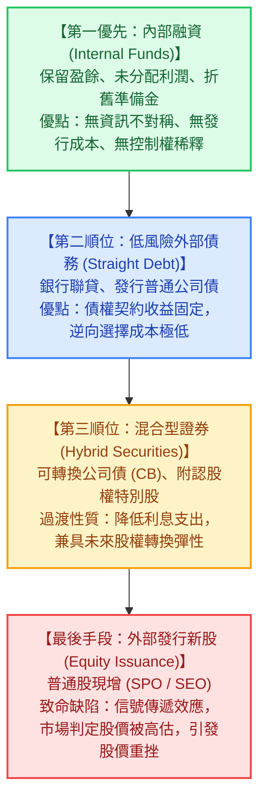

---
{"dg-publish":true,"permalink":"/98/capital-structure/","tags":["商業概念","財務管理","公司理財","資本結構","企業財務策略","PMBA"],"dg-note-properties":{"aliases":["資本結構","Capital Structure","capital-structure","最佳資本結構","最適資本結構","Optimal Capital Structure","資本結構理論","MM定理"],"tags":["商業概念","財務管理","公司理財","資本結構","企業財務策略","PMBA"]}}
---


# 資本結構 (Capital Structure)

> 💡 **導航與索引**：本篇為公司理財（Corporate Finance）與企業財務決策之最核心基石，探討企業如何配置長期負債與權益以極小化融資成本並極大化公司總價值。亦可參閱資產負債表全局視角 [[98_商業概念庫/financial-structure_財務結構\|財務結構 (Financial Structure)]]、折現率估算基準 [[98_商業概念庫/wacc_加權平均資本成本\|加權平均資本成本 (WACC)]]、股權要求回報率模型 [[98_商業概念庫/capm_資本資產定價模型\|資本資產定價模型 (CAPM)]]、固定利息放大機制 [[98_商業概念庫/financial-leverage_財務槓桿\|財務槓桿 (Financial Leverage / DFL)]]、產銷敏感度 [[98_商業概念庫/DOL_營運槓桿\|營運槓桿度 (DOL)]]、總體風險複合指標 [[98_商業概念庫/degree-of-total-leverage-dtl_總槓桿\|總槓桿度 (DTL)]]、股東權益拆解工具 [[98_商業概念庫/dupont-analysis_杜邦分析法\|杜邦分析法 (DuPont)]]、完全稀釋檢驗 [[98_商業概念庫/diluted-eps_稀釋後每股盈餘\|稀釋後每股盈餘 (Diluted EPS)]]、新創股權地圖 [[98_商業概念庫/cap-table_股權結構表 Cap Table\|股權結構表 (Cap Table)]]，以及融資缺口預測 [[98_商業概念庫/AFN_外部融資需求模型 Additional Funds Needed\|外部融資需求模型 (AFN)]]。

---

## 一、 核心定義與「資本結構 vs. 財務結構」本質辨析

### 1. 核心定義與終極決策目標
- **資本結構 (Capital Structure)** 係指企業**為其長期資產與成長投資進行融資所採用的永久性長期資金來源組合**，主要包含**長期負債（Long-term Debt，如銀行長期借款、應付公司債）**、**特別股/優先股（Preferred Stock）**以及**普通股東權益（Common Equity，包含股本、資本公積與保留盈餘）**。
- **公司理財的終極雙重等價目標**：
  $$\min \text{WACC} \iff \max V = D + E$$
  企業的總市場價值 $V$ 等於債務市值 $D$ 加上權益市值 $E$。在既定的營業現金流（EBIT）下，**使加權平均資本成本（WACC）降至最低點的長期融資組合，必然使企業總市場價值達到極大化**。該融資組合即為企業追求的「最佳資本結構（Optimal Capital Structure）」。

### 2. 資本結構 (Capital Structure) vs. 財務結構 (Financial Structure) 深度辨析

```text
【資產負債表右側：財務結構 vs. 資本結構範圍對照】

  ┌─────────────────────────────────────────────────────────┐
  │                 【財務結構 (Financial Structure)】        │
  │                 涵蓋右側所有負債與權益項目 (全集)          │
  │  ┌───────────────────────────────────────────────────┐  │
  │  │ 流動負債 (Current Liabilities)                     │  │ ◄── 僅屬財務結構
  │  │ (應付帳款、短期借款、應付費用等短期營業與金融負債) │  │     (營運資本管理範疇)
  │  ├───────────────────────────────────────────────────┤  │
  │  │              【資本結構 (Capital Structure)】      │  │
  │  │              特指永久性長期資金來源 (子集)         │  │ ◄── 同時屬於
  │  │  • 非流動負債 (長期借款、應付公司債)               │  │     財務結構與資本結構
  │  │  • 特別股股本                                      │  │     (公司理財核心範疇)
  │  │  • 普通股權益 (股本、資本公積、保留盈餘)           │  │
  │  └───────────────────────────────────────────────────┘  │
  └─────────────────────────────────────────────────────────┘
```

| 比較維度 | 資本結構 (Capital Structure) | 財務結構 (Financial Structure) |
| :--- | :--- | :--- |
| **資金涵蓋範圍** | **僅限長期永久性資金**（長期負債 ＋ 特別股 ＋ 普通股權益） | **全部資金來源**（流動負債 ＋ 長期負債 ＋ 股東權益） |
| **學術與管理領域** | **公司理財 (Corporate Finance)**、資本預算、價值評估 | **財務報表分析 (FS Analysis)**、信用評等、營運資金管理 |
| **核心管理視角** | **大餅如何切割（Pie Model）**、資本成本極小化、融資契約設計 | **資金來源與資產期限匹配（以長支長）**、防範流動性危機 |
| **決策變數** | 負債權益比（$D/E$）、權益成本（$r_E$）、加權平均資本成本（$\text{WACC}$） | 負債比率（$L/A$）、流動比率、長期資金佔不動產廠房比率 |
| **理論支撐基石** | MM 定理、靜態權衡理論、啄食順位理論、代理成本理論 | 營運資金策略（穩健/激進型）、杜邦分析、現金流量匹配模型 |

---

## 二、 資本結構經典理論演化全景

資本結構理論是現代財務學發展最完備的領域之一，其演進體現了從「完美市場無摩擦」逐步走向「加入真實世界市場摩擦（稅盾、破產成本、資訊不對稱、代理問題）」的深化歷程：



### 1. 莫迪利安尼-米勒定理（MM 定理：無稅環境，1958）——資本結構無關論

#### (1) 完美資本市場六大假設
1. **無交易成本與無稅收**：無個人與公司所得稅，證券買賣無手續費。
2. **無財務危機成本**：企業借款無破產清算成本。
3. **同質預期 (Homogeneous Expectations)**：所有投資人對企業未來獲利與風險有相同預期。
4. **無資訊不對稱**：內部人與外部投資人掌握完全相同的資訊。
5. **對等借貸能力**：個別投資人可按照與企業完全相同的無風險利率進行借貸。
6. **營業風險獨立**：企業的投資決策與籌資決策相互獨立。

#### (2) MM 第一命題：資本結構無關論（Pie Model）
$$V_L = V_U$$
- **核心論點**：企業的總市場價值取決於**資產負債表左側資產的獲利能力與營業風險（EBIT）**，而與右側如何切割融資大餅無關。
- **無套利證明：自製槓桿（Homemade Leverage）**：
  若負債公司（槓桿公司 $L$）的總市值大於無負債公司（無槓桿公司 $U$），投資人可以賣出高估的 $L$ 公司股票，自行借款（個人自製槓桿）買入 $U$ 公司的股票，複製出完全相同的現金流並賺取無風險套利利潤。市場套利力量將迅速撫平價差，迫使 $V_L = V_U$。

#### (3) MM 第二命題：權益成本隨槓桿線性上升
$$r_E = r_U + \frac{D}{E}(r_U - r_D)$$
- $r_E$：負債公司的權益資本成本。
- $r_U$：無負債公司的權益資本成本（純反映企業本業營業風險）。
- $r_D$：負債成本。
- $\frac{D}{E}(r_U - r_D)$：**財務風險溢酬（Financial Risk Premium）**。
- **數理結論**：雖然負債成本 $r_D$ 低於權益成本，但舉債帶來的財務風險會迫使股東要求更高的回報率，**權益成本攀升的幅度恰好完全抵消了引入低成本債務的好處**。因此，加權平均資本成本（WACC）恆定等於 $r_U$，資本結構無法降低資金成本。

---

### 2. MM 定理（有公司稅環境，1963）——利息稅盾效應

#### (1) MM 第一命題（含稅）：利息稅盾創造價值
稅法允許利息支出列為營業外費用扣抵所得稅，政府實際上替舉債企業承擔了部分融資成本：
- **每年利息稅盾金額**：$\text{Tax Shield} = D \times r_D \times T_C$
- **永久負債之稅盾現值（以 $r_D$ 折現）**：
  $$\text{PV}(\text{Tax Shield}) = \frac{D \times r_D \times T_C}{r_D} = T_C \times D$$
- **含稅 MM 第一命題公式**：
  $$V_L = V_U + T_C \times D$$
  每一元新增負債，均為企業直接創造 $T_C$ 元的淨價值增厚。

#### (2) MM 第二命題（含稅）：稅後權益成本與 WACC 單調遞減
$$r_E = r_U + \frac{D}{E}(r_U - r_D)(1 - T_C)$$
$$\text{WACC} = \frac{E}{V} r_E + \frac{D}{V} r_D(1 - T_C) = r_U \left[ 1 - T_C \frac{D}{V} \right]$$
- **極端推論**：隨著負債比率 $\frac{D}{V}$ 提升至 100%，WACC 單調遞減至最低點，公司價值達到極大化。
- **實務背離與反思**：現實中無任何理性企業會採用 100% 負債，這證明必然存在反向制約力量——**財務危機成本與破產威脅**。

---

### 3. 靜態權衡理論 (Static Trade-off Theory) —— 最佳資本結構的誕生

靜態權衡理論修正了 MM 含稅模型的極端推論，指出企業價值取決於**「利息稅盾利益」與「財務危機成本」之間的邊際權衡**：

$$V_L = V_U + \text{PV(利息稅盾)} - \text{PV(財務危機成本)} - \text{PV(代理成本)}$$

```text
【靜態權衡理論：最佳資本結構曲線圖】

  企業價值 (V)
       ▲                                 最佳資本結構 (D*/E*)
       │                                     ┌─────┐ (max V)
       │                                   ┌─┘     └─┐
       │                             ┌─────┘         └──┐  權衡理論實際價值 V_L
       │                       ┌─────┘                  └───┐
       │                 ┌─────┘                            └───┐
       │           ┌─────┘ 稅盾主導期                             └─── 危機成本主導期
       │     ┌─────┘ (利盾收益 > 危機成本)                          (危機成本 > 稅盾收益)
       │   ┌─┘
  V_U ─┼───┴───────────────────────────────────────────────────────► 無負債價值 (水平線)
       │
  WACC │
       │   ╲                                                    ╱
       │    ╲                                                  ╱
       │     ╲                                                ╱
       │      ╲                                              ╱
       │       └───┐                                    ┌───┘
       │           └───────────┐            ┌───────────┘
  min  │                       └────────────┘  最佳資本結構點 (min WACC)
  WACC ┼────────────────────────────────────────────────────────────►
       0                                D*/E*                      100% 負債比率 (D/V)
```

#### (1) 最佳平衡點（$D^*/E^*$）判定準則
- **邊際稅盾現值 $=$ 邊際財務危機成本現值**：
  $$\frac{d[\text{PV(Tax Shield)}]}{dD} = \frac{d[\text{PV(Financial Distress)}]}{dD}$$
- 當槓桿低時，破產概率微乎其微，稅盾利益占絕對主導，企業價值快速爬升；
- 當負債超過臨界點 $D^*/E^*$ 後，財務困窘機率呈指數型飆升，邊際危機成本迅速超越邊際稅盾，導致企業價值斷崖式下跌、WACC 反轉急遽攀升。

#### (2) 財務危機成本的雙重維度
1. **直接破產成本 (Direct Bankruptcy Costs)**：
   破產法庭規費、清算重整律師費、獨立審計與財務顧問費。通常僅佔企業資產的 **$2\% \sim 5\%$**。
2. **間接破產成本 (Indirect Bankruptcy Costs)**：
   **遠比直接成本致命，通常佔資產的 $10\% \sim 20\%$ 以上**：
   - **客戶轉單**：客戶擔憂保固失效與售後中斷，拒絕簽署長約；
   - **供應商緊縮信用**：供應商取消放帳，要求貨到付現（COD）甚至預付貨款；
   - **頂尖人才流失**：核心研發、銷售主管與關鍵工程師加速跳槽；
   - **經理人精力耗竭**：管理階層疲於應付債權人談判，無暇顧及核心營運與市場競爭。

---

### 4. 啄食順位理論 (Pecking Order Theory / Myers & Majluf, 1984)

啄食順位理論基於**經理人與外部投資人間的「資訊不對稱（Information Asymmetry）」**，認為企業融資並不存在固定的「最佳負債率目標」，而是遵循嚴格的融資階梯：



- **信號傳遞與逆向選擇（Signaling & Adverse Selection）**：
  經理人比外部投資人更清楚公司的真實內在價值。**當管理層決定發行新股時，理性市場會直覺推斷「當前股價必然被高估」，否則管理層不會賤賣股權**。因此，新股發行公告往往伴隨股價大幅下跌（股權折價懲罰）。
- **財務彈性原則 (Financial Slack)**：
  企業在景氣好時應刻意保留充裕的未動用借款額度與現金儲備，確保在重大投資機會來臨時不必被迫以折價發行新股。

---

### 5. 代理成本理論與自由現金流假說 (Agency Theory)

#### (1) 股東 vs. 經理人的代理問題：負債的「防禦性紀律約束」
- 麥可·詹森（Michael Jensen, 1986）提出**自由現金流假說（Free Cash Flow Hypothesis）**：當企業擁有豐沛未受約束的自由現金流時，經理人往往傾向於推動無效的「帝國建立（Empire Building）」、非相關多元化收購或追求個人特權消費。
- **負債作為紀律工具**：剛性的利息與本金支付義務，**強制將多餘的自由現金流抽離經理人掌控**。經理人若不全力提升經營效率，公司將立即面臨倒閉危機與職位不保，因此舉債能顯著降低股東與經理人間的代理成本。

#### (2) 股東 vs. 債權人的代理衝突（財務困境時的雙重扭曲）
1. **資產替代問題（Asset Substitution / 道德風險與賭博傾向）**：
   當公司瀕臨破產時，股東承擔有限責任（底線為零），卻享有向上暴賺的無窮收益。股東會指使管理層將資金投注於「勝率極低、但一旦成功回報極高」的超高風險賭博性專案——**贏了利潤全歸股東，輸了損失由債權人承擔**。
2. **投資不足問題（Underinvestment / 債務懸垂 Debt Overhang）**：
   即便眼前出現淨現值為正（$\text{NPV} > 0$）的優質投資案，但因專案產生的現金流將優先被債權人強制扣押以清償舊債，股東無法從中獲利，導致股東寧願放棄有利於企業生存的健康投資。

---

## 三、 數理建模、公式推導與實戰試算

### 1. 核心資本結構比率換算
$$\text{負債比率 (Debt Ratio)} = \frac{D}{V} = \frac{D}{D + E}$$
$$\text{負債權益比 (Debt-to-Equity, D/E)} = \frac{D}{E}$$
$$\text{兩者相互轉換}：\frac{D}{V} = \frac{\frac{D}{E}}{1 + \frac{D}{E}} \quad \iff \quad \frac{D}{E} = \frac{\frac{D}{V}}{1 - \frac{D}{V}}$$

### 2. Hamada 方程：Beta 槓桿還原與加槓桿 (Unlevering & Relevering)
在公司理財與估值實務（如評估非上市公司、新跨入業務或專案融資）時，無法直接取得目標公司的股票 Beta，必須透過 Hamada 方程進行槓桿調整：

$$\beta_L = \beta_U \left[ 1 + (1 - T_C) \frac{D}{E} \right] \quad \iff \quad \beta_U = \frac{\beta_L}{1 + (1 - T_C) \frac{D}{E}}$$

- $\beta_L$（Levered Beta）：**負債 Beta**，包含商業營業風險與財務槓桿風險。
- $\beta_U$（Unlevered Beta / Asset Beta）：**資產 Beta**，已剔除資本結構影響，純粹反映本業經營風險。
- **實務標準三步驟**：
  1. 選取同產業上市同儕公司，取得其平均 $\beta_{L,\text{peers}}$；
  2. 依同儕的資本結構還原為無槓桿資產 $\beta_U$；
  3. 依**目標公司自身的目標資本結構（Target $D/E$）**重新加槓桿，計算出目標公司的 $\beta_L$，進而以 CAPM 計算權益成本 $r_E$。

### 3. EBIT-EPS 無差異點分析 (Indifference Point Analysis)
當企業面臨「發行長期債券」與「增發普通股」兩種融資方案時，計算使兩種方案之每股盈餘（EPS）完全相等的息稅前利潤水準（$\text{EBIT}^*$）：

$$\frac{(\text{EBIT}^* - I_1)(1 - T_C) - PD_1}{S_1} = \frac{(\text{EBIT}^* - I_2)(1 - T_C) - PD_2}{S_2}$$

- $I_1, I_2$：方案一與方案二的利息支出；
- $PD_1, PD_2$：特別股股利；
- $S_1, S_2$：方案一與方案二的發行流通在外普通股股數。
- **決策法則**：
  - 若企業預期未來的 $\text{EBIT} > \text{EBIT}^*$：**選擇債券融資（方案一）**，財務槓桿效益能顯著拉升 EPS；
  - 若企業預期未來的 $\text{EBIT} < \text{EBIT}^*$：**選擇權益融資（方案二）**，避免剛性利息造成盈餘崩跌甚至虧損。

---

## 四、 實戰情境試算：槓桿推移與企業價值拋物線演化

假設某製造企業總資產市值為 10 億元，無負債狀態下權益成本 $r_U = 10\%$，所得稅率 $T_C = 20\%$，無風險利率 $R_f = 2\%$，市場風險溢酬 $\text{MRP} = 6\%$（資產 $\beta_U = 1.33$）：

| 資本結構方案 | 負債權益比 ($D/E$) | 負債比率 ($D/V$) | 信用評等 | 稅前負債利率 ($r_D$) | 槓桿 Beta ($\beta_L$) | 權益成本 ($r_E$) | 稅後 WACC | 預期企業價值 ($V$) |
| :---: | :---: | :---: | :---: | :---: | :---: | :---: | :---: | :---: |
| **純權益公司** | **0.00** | **0.0%** | AAA | 3.50% | 1.33 | 10.00% | **10.00%** | 10.00 億元 |
| **低度負債** | **0.25** | **20.0%** | AA | 4.00% | 1.60 | 11.60% | **9.92%** | 10.08 億元 |
| **適度負債** | **0.50** | **33.3%** | A | 4.80% | 1.87 | 13.20% | **9.60%** | 10.42 億元 |
| **最佳資本結構★** | **0.80** | **44.4%** | **BBB** | **5.50%** | **2.19** | **15.12%** | **9.35%★** | **10.70 億元★** |
| **高度負債** | **1.20** | **54.5%** | BB (垃圾債) | 7.50% | 2.61 | 17.67% | **9.81%** | 10.19 億元 |
| **過度槓桿** | **2.00** | **66.7%** | B | 10.50% | 3.47 | 22.80% | **11.20%** | 8.93 億元 |
| **破產危機邊緣** | **4.00** | **80.0%** | CCC | 16.00% | 5.60 | 35.60% | **17.36%** | 5.76 億元 |

> 📌 **試算結論解讀**：
> 1. 當 $D/E$ 從 $0$ 逐步拉升至 $0.80$（負債比率約 44.4%）時，利息稅盾效應顯著發揮，WACC 由 $10.00\%$ 降至最低點 **$9.35\%$**，企業價值達到峰值 **$10.70$ 億元**（淨增厚 7,000 萬元！）。
> 2. 一旦 $D/E$ 突破 1.00，信用評等降入非投資等級（BB 以下），債券殖利率與破產風險溢酬呈指數級爆炸，WACC 急速飆升至 $17.36\%$，企業價值遭受嚴重毀滅。此即典型的「靜態權衡倒 U 型曲線」。

---

## 五、 企業高階經理人（CFO / CEO）資本結構實戰決策三大軍規

### 1. 動態目標資本結構區間（Target Range）管理
- **切忌追求靜態單一點位**：真實資本市場充滿利率波動、景氣循環與股票市場情緒，CFO 不應將資本結構鎖定在「40.0%」這一孤立數字，而應設定**動態目標容忍區間（如 $35\% \sim 45\%$）**。
- **逆週期調節與彈性修復**：在景氣高點或股市高估時，積極增發股票或保留現金以降低槓桿；在景氣衰退資產便宜或低利率環境時，適度發行長期低利固定債券以回購股票。

### 2. 行業特質與資產負債容量（Debt Capacity）評估
資本結構絕無「一體適用」的放諸四海皆準標準，其本質取決於企業底層資產的現金流波動性：
- **低負債容量產業（科技研發、生物醫藥、半導體 IC 設計）**：
  營業槓桿極高、研發支出大、資產多為無法抵押的無形資產與智慧財產權（IP）。此類企業宜維持極低負債率（甚至淨現金狀態），嚴格奉行啄食順位與財務彈性。
- **高負債容量產業（電信公用事業、收費公路、不動產開發、倉儲物流）**：
  現金流如流水般穩定、需求缺乏價格彈性、擁有充沛可供抵押的實體不動產與廠房設備。此類企業應大膽運用長期債務與稅盾利益，維持 $50\% \sim 65\%$ 的負債比率以放大股東權益報酬率（ROE）。

### 3. 嚴守利息保障倍數（ICR）與淨負債防線
在融資實務中，銀行與信評機構通常透過「債務契約限制條款（Debt Covenants）」對資本結構施加硬性枷鎖：
- **利息保障倍數防線**：$\text{ICR} = \frac{\text{EBIT}}{\text{利息費用}}$ 平時應維持在 **$3.0\times \sim 5.0\times$ 以上**；若跌破 $2.0\times$，企業將面臨借款利率大幅加碼甚至銀行抽銀根之致命危機。
- **槓桿倍數防線**：$\frac{\text{淨負債}}{\text{EBITDA}} \le 2.5\times \sim 3.0\times$（淨負債 $=$ 總金融負債 $-$ 現金與約當現金）。若超越 $4.0\times$，通常會引發信用評等降評至非投資級，徹底喪失低成本發債能力。

---

## 六、 關聯主題與模組網絡

- 🧭 **課程核心模組對接**：
  - [[02_核心必修/01_財務管理/L08_資本結構理論與決策|L08 資本結構理論與決策：財務槓桿與EBIT-EPS分析]]（槓桿效應、自製槓桿無套利均衡與無稅 MM 理論）
  - [[02_核心必修/01_財務管理/L09_資本結構理論與決策|L09 資本結構理論與決策：MM定理與當代權衡模型]]（含稅 MM 定理、破產危機成本、代理問題與啄食順序）
  - [[02_核心必修/02_財務報表分析/Ch06_長期償債能力分析|Ch06 長期償債能力分析]]（財務結構比率、利息保障倍數與長期資本適足率）
  - [[04_主題選修/10_創業與企業財務策略/00_課程導航與進度/mindmap_創業與企業財務策略_心智圖導航|創業與企業財務策略 心智圖導航]]（新創多輪融資、股權稀釋與資本結構演化）
  - [[04_主題選修/12_產業分析與投資策略/02_模組筆記/Module_1_產業框架與動態競爭/M1-2_三大景氣循環與資本評價邏輯|M1-2 三大景氣循環與資本評價邏輯]]（資本市場景氣週期對企業負債容忍度與融資管道之衝擊）
- 🔗 **核心概念原子卡片雙向互聯**：
  - [[financial-structure_財務結構|財務結構 (Financial Structure)]]（資產負債表全局負債與權益配置 vs. 資本結構長期資金辨析）
  - [[wacc_加權平均資本成本|加權平均資本成本 (WACC)]]（資本結構優化之核心目標折現函數）
  - [[capm_資本資產定價模型|資本資產定價模型 (CAPM)]]（計算權益資本成本 $r_E$ 之核心定價工具）
  - [[financial-leverage_財務槓桿|財務槓桿 (Financial Leverage / DFL)]]（固定利息費用對每股盈餘的放大效應）
  - [[DOL_營運槓桿|營運槓桿度 (DOL)]]（固定營業成本對營業利益之放大效應）
  - [[degree-of-total-leverage-dtl_總槓桿|總槓桿度 (DTL)]]（營運槓桿與財務槓桿之複合乘數）
  - [[diluted-eps_稀釋後每股盈餘|稀釋後每股盈餘 (Diluted EPS)]]（潛在稀釋型證券對股東每股獲利之完全稀釋檢驗）
  - [[cap-table_股權結構表 Cap Table|股權結構表 (Cap Table)]]（新創企業股權分配、期權池與多輪融資稀釋底冊）
  - [[AFN_外部融資需求模型 Additional Funds Needed|外部融資需求模型 (AFN)]]（營運成長缺口轉換為長期負債與股權融資之預測模型）
  - [[enterprise-value_企業價值|企業價值 (Enterprise Value, EV)]]（資本結構決策之最終極大化目標標的）
