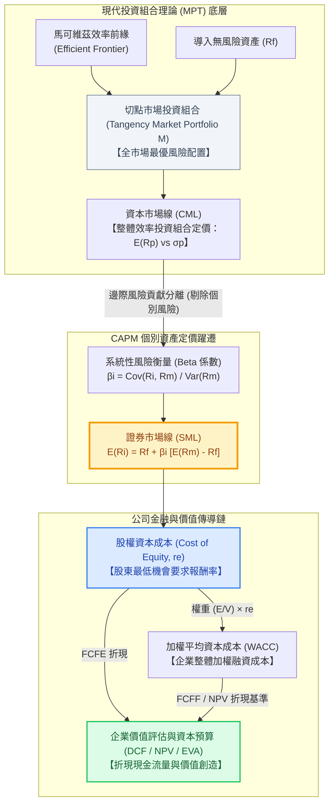
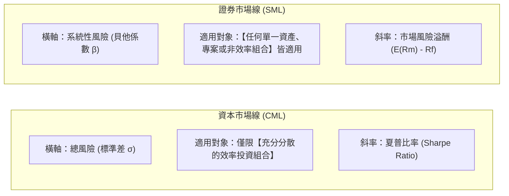

---
{"dg-publish":true,"permalink":"/98/capm/","tags":["商業概念","財務管理","投資學","資產定價","公司理財","資本成本","PMBA"],"dg-note-properties":{"aliases":["CAPM","Capital Asset Pricing Model","資本資產定價模型","資本資產訂價模型","證券市場線","Security Market Line","SML","貝他係數","Beta"],"tags":["商業概念","財務管理","投資學","資產定價","公司理財","資本成本","PMBA"]}}
---

# 資本資產定價模型 (Capital Asset Pricing Model, CAPM)

> 💡 **導航與索引**：本篇為現代資產定價理論與股權資本成本（Cost of Equity）估算之基石模型，亦可參閱綜合折現基準 [[98_商業概念庫/wacc_加權平均資本成本\|加權平均資金成本 (WACC)]]、企業估值母法 [[98_商業概念庫/dcf_現金流量折現法\|DCF 現金流量折現法]]、價值管理模型 [[98_商業概念庫/sva_股東價值增加\|股東價值增加 (SVA)]]、資本預算黃金法則 [[98_商業概念庫/NPV_淨現值法 _Net Present Value\|淨現值法 (NPV)]]、股利折現模型 [[98_商業概念庫/dividend-discount-model_股利折現模型\|股利折現模型 (DDM)]] 與成長機會評價 [[98_商業概念庫/pvgo_成長機會現值\|成長機會現值 (PVGO)]]。

---

## 一、 核心定義與策略財務哲學

- **資本資產定價模型 (Capital Asset Pricing Model, CAPM)** 由威廉·夏普（William Sharpe, 1964）、約翰·林特納（John Lintner, 1965）與簡·莫辛（Jan Mossin, 1966）在哈利·馬可維茲（Harry Markowitz, 1952）現代投資組合理論（MPT）的均異分析架構上獨立開創。夏普亦因此榮獲 1990 年諾貝爾經濟學獎。CAPM 是現代金融學、公司理財與資產定價領域最核心的基礎支柱。
- **核心哲學與本質**：
  - **風險與期望報酬的精確對價**：高風險伴隨高預期報酬，但並非所有風險都能在資本市場上換取報酬溢酬。任何資產的必要報酬率僅取決於「貨幣時間價值（無風險利率 $R_f$）」與「承擔不可分散之市場系統性風險所獲得的風險補償（市場風險溢酬 $\beta \times [E(R_m) - R_f]$）」。
  - **系統性風險 vs. 個別風險的二分法則**：
    - **非系統性風險（Unsystematic / Idiosyncratic Risk，個別公司特定風險）**：如單一產品研發失敗、工廠罷工、訴訟危機等。此類風險可藉由跨產業、跨資產的充分分散投資（Diversification）完全消除。**資本市場是殘酷且有效率的，絕不會對可以免費分散消除的風險支付任何溢酬補償**。
    - **系統性風險（Systematic / Market Risk，市場整體宏觀風險）**：如地緣政治衝突、央行無預警升息、全球性通膨與景氣循環蕭條等。此類風險無法透過分散投資規避，承擔此風險的投資人必須獲得市場風險溢酬。
  - **破解傳統三大管理與會計盲點**：
    1. **破除「總風險（波動度 $\sigma$）決定報酬」的直覺謬誤**：許多經理人誤以為新創或波動劇烈（$\sigma$ 極大）的專案必然要求極高的必要報酬率；CAPM 證明，若該專案與大盤連動度低甚至呈負相關，其對整體投資組合的邊際風險貢獻極低，市場要求的折現率反而較低。
    2. **破除「股權資本沒有成本」的會計盲點**：傳統會計損益表僅將負債利息列為費用，形成「不借錢就沒有資金成本」的假象。CAPM 量化了股東將資金託付給企業所承擔的**機會成本（Opportunity Cost of Equity, $r_e$）**，確立了股權成本遠高於債券成本的客觀事實。
    3. **破除「全公司統一套用單一折現率」的資本預算錯誤**：許多跨國多元化集團使用全公司統一的 WACC 審批所有專案，導致「接受過多高風險低回報專案、錯殺低風險高價值專案」的逆向選擇惡果。CAPM 提供依據專案特定系統性風險（$\beta$）精確定價的科學依據。

---

## 二、 核心架構 / 價值傳導鏈

從馬可維茲效率前緣、資本市場線（CML）躍遷至個別資產定價的證券市場線（SML），並傳導至公司評價與資本預算體系：

---

## 三、 CAPM 數理模型與四大關鍵參數深層拆解

### 1. 核心定價公式
$$E(R_i) = R_f + \beta_i \left[ E(R_m) - R_f \right]$$

### 2. 四大參數實務計量標準與規範

| 參數代號 | 財務意涵 | 實務計量標準與取值規範 | 經理人常見謬誤與陷阱 |
| :--- | :--- | :--- | :--- |
| **$E(R_i)$** | 資產 $i$ 的必要報酬率 / 股權資本成本 ($r_e$) | 投資人持有該資產所要求的最低門檻收益率，作為股東權益之機會成本。 | ❌ 誤將歷史過去的會計 ROE 當作股東未來的要求報酬率。 |
| **$R_f$** | 無風險利率 (Risk-Free Rate) | 實務通常採用**流動性極佳之 10 年期政府公債殖利率（10-Year Sovereign Bond Yield）**，以匹配企業長期投資的生命週期。 | ❌ 誤用隔夜拆款利率或 3 個月短期國庫券，導致期限錯配與短期利率雜訊干擾。 |
| **$\beta_i$** | 貝他係數 (Beta Coefficient) | 衡量資產相對於整體市場投資組合的系統性風險敏感度：$$\beta_i = \frac{\text{Cov}(R_i, R_m)}{\text{Var}(R_m)} = \rho_{i,m} \frac{\sigma_i}{\sigma_m}$$ | ❌ 誤以為 Beta 是固定的常數；未考慮資本結構槓桿變化與營運週期對 Beta 的劇烈影響。 |
| **$E(R_m) - R_f$** | 股權市場風險溢酬 (ERP / MRP) | 整體股票市場相對於無風險資產要求的超額補償。成熟市場（如美股 S&P 500）長期幾何/算術平均通常落在 **4.5% ~ 6.0%**。 | ❌ 採用牛市單一年度極端短期溢酬推估，導致估值折現率劇烈失真。 |

### 3. 證券市場線 (SML) vs. 資本市場線 (CML) 關鍵對比

- **SML 的定價法則**：所有正確定價的資產，其預期報酬率皆應落在 SML 線上。
- **詹森阿爾法（Jensen's Alpha, $\alpha$）與價值發現**：
  $$\alpha_i = R_i - \left[ R_f + \beta_i (R_m - R_f) \right]$$
  - **$\alpha_i > 0$（資產落於 SML 上方）**：該資產在給定系統性風險下提供超越預期的超額回報，**市場價格被低估（Undervalued）**，買進將創造超額價值。
  - **$\alpha_i < 0$（資產落於 SML 下方）**：報酬率無法彌補其承擔的系統性風險，**市場價格被高估（Overvalued）**，實質在毀滅投資人財富。

---

## 四、 槓桿調整與 Hamada 方程式（營運風險 vs. 財務風險分離）

在公司理財中，一家企業的股票 Beta 不僅反映本業營運特性，更受到資本結構負債比率的劇烈放大。羅伯特·濱田（Robert Hamada, 1972）結合 Modigliani-Miller 定理，提出了資產 Beta 與股權 Beta 的轉換方程式：

### 1. 兩大風險維度解構
- **無槓桿貝他（資產 Beta, $\beta_U$ 或 $\beta_{\text{Asset}}$）**：剔除所有債務融資結構後的純資產風險，僅衡量**企業本業營運風險（Business Risk）**，由產業特性、產品生命週期與營運槓桿（固定成本佔比）決定。
- **有槓桿貝他（股權 Beta, $\beta_L$ 或 $\beta_{\text{Equity}}$）**：股東實際面對的風險，為營運風險疊加負債融資產生的**財務槓桿風險（Financial Risk）**。

### 2. Hamada 方程式（考量企業所得稅 $T_c$）
$$\beta_L = \beta_U \left[ 1 + (1 - T_c) \frac{D}{E} \right]$$

反向推導無槓桿資產 Beta：
$$\beta_U = \frac{\beta_L}{1 + (1 - T_c) \frac{D}{E}}$$

- $D/E$：負債對股權之市場價值比率（Debt-to-Equity Ratio）。
- $T_c$：法定公司所得稅率（反映利息負債之稅盾庇護）。

### 3. 實務標竿法（Pure-Play Method）三步驟估算非上市專案或新創折現率
當評估一家非上市公司、新創企業或大型企業跨界進入新產業之專案時，因缺乏自身歷史股價數據，財務長必須嚴格執行三步驟：
1. **去槓桿（Unlevering）**：挑選數家與新專案業務高度相似的公開上市公司（Pure-Play Peers），取得各家的股票 $\beta_L$ 及個別資本結構，運用 Hamada 方程式反推各家的純營運資產 $\beta_{U,k}$。
2. **同業中位數平均（Peer Averaging）**：取同行純營運資產 Beta 的中位數或同等加權平均，得到該目標產業的基準營運風險 $\overline{\beta_U}$。
3. **再槓桿（Relevering）**：代入目標公司或該專案未來規劃之目標資本結構 $(D/E)_{\text{target}}$，計算出專案專屬的股權貝他 $\beta_{L,\text{project}}$，進而透過 CAPM 定價出該專案嚴謹的資本成本。

---

## 五、 資本成本定價三大流派全方位對比

在公司理財與投資評價中，估算股權資本成本有三大經典模型：

| 比較維度 | 資本資產定價模型 (CAPM) | 股利折現模型 (DDM / Gordon Growth) | 套利定價理論 (APT) / Fama-French 多因子模型 |
| :--- | :--- | :--- | :--- |
| **開創學者與年代** | Sharpe (1964), Lintner (1965) | Myron J. Gordon (1956) | Stephen Ross (1976) / Fama & French (1993) |
| **理論底層架構** | 現代投資組合理論 (MPT) 與市場均衡 | 現金流直接折現（內在價值倒推） | 無套利均衡條件（多宏觀/特徵因子線性回歸） |
| **風險因子架構** | **單一因子**（市場超額報酬 $R_m - R_f$） | **無直接風險因子**（隱含於股利成長率） | **多因子**（市場、規模 SMB、價值 HML、動能等） |
| **核心計算公式** | $r_e = R_f + \beta [E(R_m) - R_f]$ | $r_e = \frac{D_1}{P_0} + g$ | $r_e = R_f + \beta_1 F_1 + \beta_2 F_2 + \dots + \beta_k F_k$ |
| **最大實務優勢** | 理論結構簡潔優雅、參數客觀、適用範圍極廣，為**全球 85% 以上企業與投行之首選** | 直觀易懂，直接連結公司分紅政策 | 對歷史數據解釋力高，捕捉更多風險維度 |
| **核心假設限制** | 假定單一市場投資組合可充分代表所有風險；實證存在低 Beta 異常 | 僅適用於**股利發放穩定且可預測的成熟期企業**；對不配息科技股完全失效 | 因子定義難以標準化、參數繁多、資料需求高且缺乏廣泛業界共識 |

---

## 六、 經理人決策洞察與實務應用五大軍規

### 1. 拒絕「全公司統一套用單一 WACC」的資本配置陷阱
- 許多集團企業管理層因圖方便，無論是成熟穩定的水電部門還是高風險的 AI 晶片研發專案，通通採用集團整體的 WACC（如 8%）折現。
- **逆向選擇惡果**：
  - 低風險優質專案（真實要求報酬率僅 5%，預期回報 7%）因低於 8% 而被**錯誤否決**；
  - 高風險冒險專案（真實要求報酬率應為 14%，預期回報 10%）因高於 8% 而被**錯誤核准**。
- **經理人紀律**：資本預算的折現率**取決於資金的用途（專案本身風險 $\beta_{\text{project}}$），而非資金的來源（公司整體 WACC）**！

### 2. 新創企業與成長型公司的規模溢酬（Size Premium）調節
- 小型新創企業通常缺乏流動性、融資管道受限且抵禦黑天鵝能力弱，實務上常在標準 CAPM 基礎上擴充為**累積法（Build-Up Method）**：
  $$r_e = R_f + \beta \times \text{ERP} + \text{Size Premium (規模溢酬)} + \text{SCRP (個別特定風險溢酬)}$$
- 依據 Duff & Phelps / Kroll 數據，微型企業（Micro-cap）之規模溢酬通常需追加 3% ~ 5%。

### 3. 跨國跨境投資的國家風險溢酬（Country Risk Premium, CRP）
- 跨國併購或海外設廠時，不能單純採用母國無風險利率。財務長必須依據主權債信用違約交換（CDS Spread）或政府公債利差，在折現率中追加該新興市場之 $\text{CRP}$：
  $$r_e = R_f + \beta \times \text{ERP} + \text{CRP}$$

### 4. 營運槓桿（Degree of Operating Leverage, DOL）對 Beta 的傳導
- 固定成本佔比越高之企業（如晶圓代工廠、航空公司、資本密集重工業），其營運槓桿越大，景氣循環敏感度越高，其資產 $\beta_U$ 自然顯著高於輕資產、純變動成本之軟體服務業。

### 5. 理論局限與現代批判（保持謙遜思維）
- **羅爾批判（Roll's Critique, 1977）**：真正的「市場投資組合」必須包含全球所有資產（含未上市股權、房地產、人力資本、藝術品），實務以 S&P 500 或加權指數作為代理變數本質上是不完美的。
- **低 Beta 異常（Low-Beta Anomaly）**：費雪·布萊克（Fischer Black）與後續實證研究發現，真實市場中低 Beta 股票的風險調整後收益往往系統性優於高 Beta 股票，促成了後續聰明貝他（Smart Beta）與多因子量化投資的蓬勃發展。

---

## 七、 關聯主題與模組網絡

- 🧭 **課程核心模組對接**：
  - [[02_核心必修/01_財務管理/L03_基本財務報表與分析II_現金流量評價\|L03 基本財務報表與分析II 現金流量評價]]（股權自由現金流折現、權益資金成本 $r_e$ 定價體系）
  - [[02_核心必修/01_財務管理/L08_資本結構理論與決策\|L08 資本結構理論與決策]]（財務槓桿放大風險、Hamada 方程式資產與股權 Beta 轉換）
  - [[02_核心必修/01_財務管理/L09_資本結構理論與決策\|L09 資本結構理論與決策]]（有稅 MM 定理、WACC 最佳資本結構與股權成本曲線）
  - [[02_核心必修/01_財務管理/L05_資本支出預算(或投資)決策\|L05 資本支出預算決策]]（專案特定折現率、純度標竿法 Pure Play 與逆向選擇陷阱）
  - [[04_主題選修/10_創業與企業財務策略/00_課程導航與進度/mindmap_創業與企業財務策略_心智圖導航\|創業與企業財務策略 心智圖導航]]（資本成本理論：加權平均資本成本 WACC 計算與 CAPM）
  - [[04_主題選修/10_創業與企業財務策略/00_課程導航與進度/progress_📊 課程與筆記進度追蹤\|課程與筆記進度追蹤]]（W09 企業財務策略概論、折現率體系）
  - [[04_主題選修/12_產業分析與投資策略/02_模組筆記/Module_1_總論與架構/M1-2_三大景氣循環與資本評價邏輯\|M1-2 三大景氣循環與資本評價邏輯]]（資本成本與門檻收益率 Hurdle Rate = WACC + α）
- 🔗 **核心概念原子卡片**：
  - [[98_商業概念庫/wacc_加權平均資本成本\|加權平均資金成本 (WACC)]] ｜ [[98_商業概念庫/dcf_現金流量折現法\|現金流量折現法 (DCF)]]
  - [[98_商業概念庫/NPV_淨現值法 _Net Present Value\|淨現值法 (NPV)]] ｜ [[98_商業概念庫/sva_股東價值增加\|股東價值增加 (SVA)]]
  - [[98_商業概念庫/dividend-discount-model_股利折現模型\|股利折現模型 (DDM)]] ｜ [[98_商業概念庫/pvgo_成長機會現值\|成長機會現值 (PVGO)]]
  - [[98_商業概念庫/return-on-invested-capital_資本投入報酬率\|資本投入報酬率 (ROIC)]] ｜ [[98_商業概念庫/capital-structure_資本結構\|資本結構]]
