---
{"dg-publish":true,"permalink":"/98/changes-in-net-working-capital/","tags":["商業概念","財務管理","現金流量","企業評價","PMBA"],"dg-note-properties":{"aliases":["淨營運資金變動","Changes in Net Working Capital","營運資金變動額","營運資本追加","Delta NWC"],"tags":["商業概念","財務管理","現金流量","企業評價","PMBA"]}}
---


# 淨營運資金變動 (Changes in Net Working Capital, $\Delta\text{NWC}$)

> **【核心決策摘要】**
> **淨營運資金變動額（Changes in Net Working Capital, $\Delta\text{NWC}$）** 代表企業在特定會計週期內，為支撐業務規模擴張或因應營運效率變化，而在非現金營運資產與營運負債上所產生的**淨投資追加（現金流出）或淨資本釋放（現金流入）**。在折現現金流量模型（DCF）中，$\Delta\text{NWC}$ 與資本支出（CapEx）並列為從利潤推導企業自由現金流量（FCFF）與營業現金流量（OCF）時不可或缺的「現金調節閥」。若企業在營收快速增長時未能有效壓低**現金循環週期（CCC）**，$\Delta\text{NWC}$ 將急遽膨脹並吞噬全部會計利潤，引發商業史上最危險的**「無獲利成長陷阱（The Growth Trap / Overtrading）」**。

---

## 1. 概念核心定義與本質 (Executive Definition & Theoretical Essence)

### 1.1 核心定義與數理表達
淨營運資金變動額被嚴格定義為期末非現金營業淨營運資金相較於期初的淨增加量：

$$\Delta\text{NWC}_t = \text{Operating NWC}_t - \text{Operating NWC}_{t-1}$$

在現金流量表中，其本質是營運資產負債科目的淨現金吸收效應：

$$\Delta\text{NWC} = (\Delta\text{應收帳款} + \Delta\text{存貨} + \Delta\text{預付款}) - (\Delta\text{應付帳款} + \Delta\text{應計未付費用} + \Delta\text{合約負債/預收款})$$

```
                   ┌────────────────────────────────────────┐
                   │    淨營運資金變動對現金流的調節機制    │
                   └───────────────────┬────────────────────┘
                                       ▼
       ┌───────────────────────────────┴───────────────────────────────┐
       ▼                                                               ▼
【$\Delta\text{NWC} > 0$：營運資金追加 (Cash Outflow)】         【$\Delta\text{NWC} < 0$：營運資金釋放 (Cash Inflow)】
 • 應收帳款增加 / 存貨大量積壓                                  • 加速催收應收帳款 / 庫存精確出清
 • 現金被鎖死在供應鏈中                                         • 供應商帳期拉長 / 預收訂單款增加
 • 扣減當期現金流：FCFF 與 CFO 減少                             • 增加當期現金流：FCFF 與 CFO 增加
```

### 1.2 本質解析：成長型企業的「現金失血黑洞 (Overtrading)」
企業界常見的致命錯覺是：「只要營收與利潤持續增長，企業財務就無比健康。」
然而，在實務中，**過快的高速擴張往往是誘發企業破產的直接元兇（Overtrading）**：
- 假設某製造企業淨利率為 $6\%$，而其淨營運資金佔營收比重為 $30\%$。
- 當營收成長 1,000 萬元時，帳面淨利潤增加 60 萬元；
- 但為了支持這筆新增營收，企業必須追加採購原料並允許客戶延期付款，$\Delta\text{NWC}$ 剛性增加 $1,000 \times 30\% = 300$ 萬元！
- **淨現金流赤字**：$60\text{萬 (利潤流入)} - 300\text{萬 (營運資金流出)} = \mathbf{-240\text{萬}}$！
- 營收跑得越快，現金流失血速度越驚人。若缺乏外部股權或長債融資支撐，企業將在訂單最繁榮的頂峰猝然倒閉。

---

## 2. 數理模型與 CCC 聯動機制 (Mathematical Modeling & CCC Linkage)

### 2.1 現金循環週期（CCC）對 $\Delta\text{NWC}$ 的底層定量映射

淨營運資金的規模與變動，本質上是由**現金循環週期（Cash Conversion Cycle, CCC）** 的長短所決定的：

$$\text{CCC} = \text{DIO (存貨周轉天數)} + \text{DSO (應收帳款天數)} - \text{DPO (應付帳款天數)}$$

將全年營收設為 $\text{Sales}$，則企業日常維持的非現金營業淨營運資金近似滿足：

$$\text{Operating NWC} \approx \frac{\text{Sales}}{365} \times \text{CCC}$$

對其進行微分拆解，可清晰看見 $\Delta\text{NWC}$ 的兩大驅動引擎：

$$\Delta\text{NWC} \approx \underbrace{\frac{\Delta\text{Sales}}{365} \times \text{CCC}_{\text{old}}}_{\text{規模增長驅動效應}} + \underbrace{\frac{\text{Sales}_{\text{new}}}{365} \times \Delta\text{CCC}}_{\text{營運效率變動效應}}$$

#### 經理人量化洞察：
1. **若 CCC 維持不變（$\Delta\text{CCC} = 0$）**：營運資金變動純粹由營收增長 $\Delta\text{Sales}$ 驅動。CCC 越長，擴張的資金代價越高。
2. **若進行營運管理變革（$\Delta\text{CCC} < 0$）**：只要將周轉天數壓縮數天，即使在營收大幅增長的情境下，第二項的負值也能完全抵消第一項，實現**「營收高速增長，同時釋放真金白銀」**的極致境界！

---

## 3. 戰略框架與專案生命週期中的 J 曲線 (Strategic Framework & The J-Curve)

### 3.1 資本預算與新產品發布的營運資金全生命週期

在評估新工廠建設或新產品立項（Capital Budgeting）時，$\Delta\text{NWC}$ 呈現典型的動態平衡軌跡：

```mermaid
gantt
    title 新專案營運資金全生命週期流轉軌跡
    dateFormat X
    axisFormat 年 %d
    section 專案營運資金流動
    初始鋪貨期 (期初：大額現金流出 -Delta NWC) :crit, 0, 1
    營運擴張期 (期間：隨銷售增長持續小幅追加) :active, 1, 4
    成熟平穩期 (期間：NWC 保持穩定，Delta NWC 約為 0) :done, 4, 8
    專案終止期 (終期：存貨全部出清、應收帳款全額收回 +NWC 回收) :milestone, 8, 8
```



- **期初投資階段（Phase 1）**：在產品尚未售出前，企業必須先期採購備品、建立通路展示樣品、鋪設初期庫存，此時發生顯著的 $\Delta\text{NWC} > 0$（初始現金流出）。
- **專案終結階段（Terminal Year）**：專案壽命到期時，停止採購新料，將所有剩餘庫存折價出清，收回所有客戶未清欠款，並付清最後一筆供應商款項。此時期初與歷年投入的所有營運資金將**100% 逆向釋放回流（NWC Recovery，$\Delta\text{NWC} < 0$，形成大額現金流入）**。

---

## 4. 產業標竿與實戰應用場景 (Industry Benchmarks & Applications)

| 產業類別 | $\Delta\text{NWC}$ 對擴張的敏感度 | 核心管理瓶頸 | 經理人關鍵戰術 |
| :--- | :--- | :--- | :--- |
| **快時尚服飾 (Fast Fashion)** | **極度敏感**。<br>SKU 數萬種，每季換季滯銷將導致存貨劇烈吸收現金 | 流行週期僅數週，滯銷庫存立即沉澱為死資金 | 導入 RFID 即時追蹤、小單快反生產機制（Shein 模式）壓減存貨佔用 |
| **大型工程成套設備** | **顯著吸收現金**。<br>單筆專案週期長達 1~3 年，驗收付款節點漫長 | 客戶按工程進度拖延撥款，工程墊資龐大 | 導入不可撤銷信用狀（L/C）、分階段 milestones 預收款機制 |
| **生技製藥 (Pharma)** | **兩極化**。<br>研發期幾無 NWC；商業化上市首年爆發性鋪貨 | 藥品進入全球醫院與藥房通路的初期鋪貨備貨巨額支出 | 與全球跨國藥廠簽訂商業化授權（Licensing），轉嫁通路鋪貨資金負擔 |
| **雲端軟體 (SaaS)** | **天然反向調節**。<br>營收擴張自帶預收合約負債，$\Delta\text{NWC} \le 0$ | 客戶續約率與年繳付款意願 | 提供年繳方案 15%~20% 折扣，激勵客戶提前注入現金 |

---

## 5. 經典企業個案深度剖析 (Deep Dive Case Studies)

### 5.1 成功典範：Inditex (Zara) 藉由壓縮 CCC 實現「零 $\Delta\text{NWC}$ 擴張」
- **產業痛點**：傳統成衣業從設計、向遠東採購布料、跨洋船運到門市鋪貨需耗時 6~9 個月，每逢展店必須提前注入巨額營運資金備貨。
- **Zara 的革命性供應鏈**：
  1. 堅持將半數生產留在西班牙與葡萄牙鄰近工廠，實現設計到上架僅需 **15 天**。
  2. 首批訂單僅生產預期銷量的 20%~30%，透過門市 POS 數據即時捕捉爆款後才進行追加生產。
  3. 存貨周轉極快，店內商品兩週全數清空，幾無打折季庫存積壓。
- **成效**：Zara 在全球瘋狂拓展數千家門市的過程中，營收增長並未引發營運資金黑洞，其 $\Delta\text{NWC}$ 長期保持接近於零甚至為負，實現了純靠本業自我造血的全球零售擴張奇蹟。

### 5.2 失敗警示：小鳴單車與硬體新創在擴產頂峰的「營運資金休克」
- **崩潰路徑**：2017 年共享單車激戰期間，多家新創為了搶佔市場份額，在未收到足夠押金前向富士達、飛鴿等代工廠簽署數百萬輛單車的採購大單。
- **$\Delta\text{NWC}$ 致命擠壓**：
  1. 代工廠要求支付 30% 訂金並在出廠時結清全款（流動資產中的預付款與在途物資急遽膨脹）。
  2. 數十萬輛單車投放到城市街頭後，缺乏維護調度能力，折舊與損壞率高達 40%，無法產生實質現金回流。
  3. 當營運資金追加（$\Delta\text{NWC}$）數倍於其融資儲備時，供應商堵門討債，企業在訂單生產量最大的巔峰瞬間宣告破產。

---

## 6. 高階經理人決策實戰工具箱 (Executive Action Playbook)

### 6.1 壓縮 $\Delta\text{NWC}$ 現金漏斗的四大營運槓桿

```
                    ┌────────────────────────────────────────┐
                    │      極小化 $\Delta\text{NWC}$ 現金消耗戰術陣     │
                    └───────────────────┬────────────────────┘
                                        ▼
    ┌───────────────────┬───────────────┴───────────────┬───────────────────┐
    ▼                   ▼                               ▼                   ▼
【應收帳款 (AR) 壓縮】 【存貨 (Inventory) 精益】       【應付帳款 (AP) 延展】 【合約負債 (Unearned) 擴充】
• 推行 2/10 net 30   • 推行安全庫存動態算法           • 導入反向保理供應鏈金融 • 推廣預付年繳方案
• 建立客戶信用等級熔斷 • 呆滯物料超過 90 天強制拍賣    • 與戰略供應商綁定長期   • 鎖定服務訂閱預充值
• 導入數位化即時發票催收 • 向上游推行供應商管理庫存(VMI) • 將零散採購整合獲取帳期 • 將尾款比例壓低至 10% 內
```

### 6.2 經理人營收擴張現金流排雷清單
- [ ] **檢核 1：在批准次年營收增長 30% 以上的高增長預算前，是否已將相應的 $\Delta\text{NWC}$ 現金流出納入現金預算表？**
- [ ] **檢核 2：新專案立項時，是否準確計入了「期初營運資金鋪底」與「專案終期營運資金回收」？**
- [ ] **檢核 3：業務團隊的績效獎金發放，是以「合同簽訂額」還是「回款扣除營運資金佔用成本後」為計算依據？**
- [ ] **檢核 4：當期 $\Delta\text{NWC}$ 的增長，是否有超過 50% 來自於「逾期 90 天以上的應收帳款」？（若是，必須立即提列壞帳並叫停信用放水）。**

---

## 7. 關聯知識網絡與導航地圖 (Knowledge Network & Cross-References)

### 7.1 本主題核心三部曲
- **[[net-working-capital_淨營運資金]]** · 營業 NWC 與會計 NWC 辨析、短期償債三道防線與資本沉澱成本
- **[[working-capital-management_營運資金管理]]** · 配合型、激進型與保守型三大資產融資政策博弈
- **[[changes-in-net-working-capital_淨營運資金變動]]** · 現金流量調節閥、CCC 現金循環週期聯動與「無獲利成長」陷阱（本篇）

### 7.2 跨領域財務與策略鏈結
- [[enterprise-free-cash-flow-liang_企業自由現金流量]] · $\Delta\text{NWC}$ 作為計算 FCFF 與企業價值的核心扣除項
- [[operating-cash-flow-statement_營業活動現金流量]] · 間接法調和中流動資產負債科目增減的現金流映射
- [[CCC_現金循環週期 Cash Conversion Cycle]] · 決定 $\Delta\text{NWC}$ 敏感度與資金周轉效率的最底層量化指標
- [[unit-economics-model_單位經濟模型]] · 警惕單元微觀毛利被宏觀營運資金追加侵蝕之擴張陷阱
- [[net-working-capital-2_淨營運資金回收]] · 資本預算專案終期之營運資金回流機制

### 7.3 課程筆記與導航主頁
- [[L09_資本結構理論與決策]] · 財務策略模組九：現金流預測與營運資本動態管理
- [[_創業與企業財務策略 MOC]] · 企業財務策略與資本市場運作全景地圖
- [[home]] · 全球 PMBA 知識庫總導航主頁面