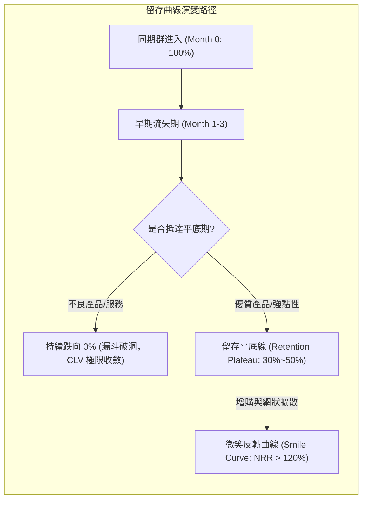

---
{"dg-publish":true,"permalink":"/98/clv-customer-lifetime-value/","tags":["商業概念","創業管理","行銷管理","財務策略","PMBA"],"dg-note-properties":{"aliases":["顧客終身價值","Customer Lifetime Value","CLV","LTV","顧客生命週期價值"],"tags":["商業概念","創業管理","行銷管理","財務策略","PMBA"]}}
---


# 顧客終身價值 (Customer Lifetime Value, CLV / LTV)

> **【核心決策摘要】**
> **顧客終身價值（Customer Lifetime Value, CLV 或 LTV）** 指單一顧客在與企業維持商業關係的完整生命週期內，預期能為企業貢獻的**未來現金毛利淨折現總值**。CLV 不僅是客戶關係管理（CRM）的評估指標，更是企業戰略估值（Valuation）、定價策略、留存投資以及單位經濟可行性的基石。現代高階管理決策指出：企業的本質價值，即為其現有與未來所有客戶 CLV 之折現加總（Customer Equity）；唯有透過提升淨收入留存率（NRR）實現「負流失（Negative Churn）」，企業才能打破邊際獲客成本上升的枷鎖，實現指數級複利成長。

---

## 1. 概念核心定義與本質 (Executive Definition & Theoretical Essence)

### 1.1 核心定義
顧客終身價值（CLV）在現代財務金融與行銷科學中被嚴格定義為：**考慮貨幣時間價值（Time Value of Money）與客戶動態流失概率（Churn Probability）後，個別客戶生命週期內產生之邊際貢獻毛利的貼現淨現值（NPV）**。

### 1.2 本質解析：四大維度穿透客戶經濟學
1. **毛利貢獻導向而非營收導向**：許多初學者常以「營收（Revenue）」計算 LTV，此舉具有致命誤導性。未扣除銷貨成本（COGS）與履約成本的營收無法支撐獲客投資；真正的 CLV 必須嚴格基於**毛利（Gross Margin）**。
2. **留存率的槓桿乘數效應**：顧客留存率（Retention Rate, $r$）的小幅提升，會透過分母 $(1 - r)$ 對終身價值產生非線性的倍增推動力（貝恩諮詢研究顯示：客戶留存率提升 5%，企業利潤可增長 25% 至 95%）。
3. **動態群組異質性（Cohort Heterogeneity）**：客戶價值並非均質分佈。頂部 20% 的高價值客戶往往貢獻了 80% 以上的累計毛利，平均化（Averaging）思維常導致高價值客群服務不足、低價值客群過度補貼。
4. **資本成本與風險折現**：長期留存產生的現金流具有不確定性，必須採用加權平均資本成本（WACC）或相應風險折現率予以貼現。

---

## 2. 數理模型與關鍵量化公式 (Mathematical Modeling & Quantitative Metrics)

### 2.1 基礎留存靜態模型 (Simple Constant Churn Model)

在假設客戶流失率固定且未考慮資金時間價值的簡易情境下：

$$\text{CLV}_{\text{Simple}} = \text{ARPU} \times \text{Gross Margin \%} \times \text{Average Customer Lifespan}$$

已知平均客戶生命週期（Lifespan）為流失率（Churn Rate, $c$）的倒數，即 $\text{Lifespan} = \frac{1}{c} = \frac{1}{1 - r}$（$r$ 為留存率），代入得：

$$\text{CLV}_{\text{Simple}} = \frac{\text{ARPU} \times \text{Gross Margin \%}}{\text{Churn Rate}}$$

- $\text{ARPU}$（Average Revenue Per User）：每用戶平均收入。
- $\text{Gross Margin \%}$：毛利率（扣除雲端伺服器、客訴支援、支付手續費與直接物流成本）。
- $\text{Churn Rate}$：該週期客戶流失率（$1 - \text{留存率}$）。

### 2.2 金融貼現無窮期界動態模型 (Finite & Infinite Horizon DCF Model)

在考量資本折現率 $i$（通常取企業 WACC 或投資人要求回報率）時，單一客戶在無窮週期內的折現總值為：

$$\text{CLV} = \sum_{t=1}^{\infty} \frac{M_t \cdot r^{t-1}}{(1 + i)^t}$$

若假設每期毛利貢獻 $M$ 與留存率 $r$ 為常數，利用等比級數求和公式化簡得著名的經典金融 CLV 公式：

$$\text{CLV} = M \times \frac{r}{1 + i - r}$$

若考慮客戶在期初即發生首筆交易（即 $t=0$ 付款），公式調整為：

$$\text{CLV} = M \times \frac{1 + i}{1 + i - r}$$

### 2.3 淨收入留存率（NRR）與負流失模型 (Net Negative Churn Expansion)

在優質 B2B SaaS 企業中，既有客戶的增購（Up-sell）與跨品類加購（Cross-sell）金額若超越流失客戶的損失，淨收入留存率將突破 100%（$\text{NRR} > 100\%$）：

$$\text{NRR} = \frac{\text{期初既有客群本期產生收入} + \text{擴增收入 (Expansion)} - \text{降級收入 (Contraction)} - \text{流失收入 (Churn)}}{\text{期初既有客群本期產生收入}}$$

當 $\text{NRR} > 100\%$ 時，即使不再獲取任何新客，企業現有客群的現金流亦呈現複利指數擴張，CLV 突破傳統天花板，展現巨大的資本溢價。

---

## 3. 戰略框架與營運機制 (Strategic Framework & Operational Dynamics)

### 3.1 同期群分析與留存微笑曲線 (Cohort Analysis & Retention Smile)

監控 CLV 是否真實改善，核心在於觀察不同「入夥月份（Cohort）」客戶隨時間推移的留存百分比：



- **平底線高度（Plateau Height）**：反映產品與市場契合度（Product-Market Fit, PMF），決定了基礎 CLV 的下限。
- **微笑反彈（Smile Upturn）**：透過計量收費擴充、座席數增加或跨部門部署，實現單客價值的二次爆發。

### 3.2 提升 CLV 的四大策略支柱

```
                   ┌─────────────────────────────────────────┐
                   │        極大化顧客終身價值 (CLV)         │
                   └────────────────────┬────────────────────┘
          ┌─────────────────┬───────────┴───────────┬─────────────────┐
          ▼                 ▼                       ▼                 ▼
   【拉長生命週期】   【提升客單毛利】        【擴大錢包份額】    【降低服務邊際成本】
  • 強化轉換成本     • 價值基礎定價          • 交叉銷售與升級    • 客戶自助式服務
  • 主動式 CSM 護理  • 剔除低毛利定製        • 模組化產品擴展    • AI 智慧客服賦能
  • 早期流失預警機制 • 提高年繳方案比例      • 平台生態系連帶    • 規模化雲端架構攤提
```

1. **築高客戶轉換成本（Switching Costs）**：透過資料深度沉澱、工作流程嵌入（Workflow Integration）與全員習慣養成，使客戶更換供應商的摩擦成本遠高於續約代價。
2. **客戶成功體系（Customer Success Management, CSM）**：轉被動客服為主動介入，透過產品健康度評分（Health Score）與使用活躍度指標，在合約到期前 90 天排除障礙。
3. **價值計量型定價架構（Usage-based Pricing）**：使定價與客戶業務成功深度掛鉤（如 Snowflake 依算力用量計費、Stripe 依金流交易額抽成），自動分享客戶成長紅利。

---

## 4. 產業標竿與實戰應用場景 (Industry Benchmarks & Applications)

| 產業維度 | 核心驅動引擎 | 健康度評估基準 (Benchmarks) | CLV 關鍵致命傷 |
| :--- | :--- | :--- | :--- |
| **B2B 企業級 SaaS** | NRR、合約年限、席位擴充 | • NRR > 120%<br>• 毛利率 75%~85%<br>• 月流失率 < 0.5%~1% | 關鍵客戶高層主管異動；客製化承諾過多導致交付成本失控 |
| **B2C 訂閱制平臺 (如 Netflix, Spotify)** | 內容庫豐富度、個性化演算法 | • 月流失率 2%~3%<br>• 客戶平均壽命 30~48 個月<br>• 毛利率 40%~50% | 內容疲勞（Content Exhaustion）；訂閱費用提價過激引發群體退訂 |
| **消費金融 / 信用卡 (FinTech)** | 循環利息、刷卡手續費、交叉理財 | • 客戶關係年限 5~8 年<br>• 複合年貢獻率 > 15% | 壞帳違約率（NPL）飆升；同業高額開卡禮惡意挖角 |
| **高端醫療 / 專業服務** | 信任資產、高轉換成本、品牌聲譽 | • 轉介紹率 > 40%<br>• 終身重複採購率 > 60% | 核心專業人才跳槽帶走整批病患或關鍵客群 |

---

## 5. 經典企業個案深度剖析 (Deep Dive Case Studies)

### 5.1 成功典範：Snowflake 憑藉消費制與超高 NRR 創造 CLV 奇蹟
- **商業模式**：Snowflake 揚棄傳統 SaaS 固定的年度坐席授權模式，改採純粹的「運算與儲存使用量計費（Consumption-based Pricing）」。
- **CLV 幾何級數放大機制**：
  1. 客戶初始採用成本極低（Land），僅需導入單一部門或小型資料專案。
  2. 隨著客戶數據量爆炸與分析需求加深，算力消耗自動水漲船高（Expand）。
  3. 2020 年 IPO 時，Snowflake 創下令人震撼的 **158% 淨收入留存率（NRR）**。
- **財務涵義**：現有客群每年在不依賴任何新獲客的情況下自發增長 58%，其 CLV 呈現無窮發散趨勢，支撐了高達數百億美元的極致估值倍數。

### 5.2 失敗警示：Blue Apron（生鮮食材包）的「漏斗破洞」慘劇
- **模式痛點**：Blue Apron 開創了生鮮半成品食材包訂閱模式，投入天價行銷預算補貼獲客（提供首週免費或高額折扣）。
- **CLV 破滅骨牌效應**：
  1. **低留存率**：超過 70% 的客戶在享受完前兩週折扣後立即退訂，6 個月留存率跌破 15%。
  2. **高履約與物流損耗**：冷鏈物流與包裝成本居高不下，實質毛利率不足 30%。
  3. **計算倒掛**：靜態預估的客戶生命週期為 12 個月，但真實生命週期不足 2.5 個月，實際 CLV 遠低於初期高達 \$100+ 的獲客成本。
- **經理人啟示**：未經留存壓力測試的獲客擴張，本質上只是「把現金免費送給羊毛黨客戶」，是偽需求商業模式的典型範本。

---

## 6. 高階經理人決策實戰工具箱 (Executive Action Playbook)

### 6.1 顧客終身價值優化九宮格矩陣

```
                    高留存率 (強黏性)
                            │
            【策略：重點深耕護城河】 │ 【策略：最核心利潤引擎】
            • 特徵：穩定忠誠，但客單低 │ • 特徵：高毛利、超長壽命
            • 行動：交叉銷售升級配備， │ • 行動：配備專屬 VIP CSM，
              挖掘未被滿足的升級需求  │   建立戰略合夥聯盟
    ───────────────┼───────────────
            【策略：邊緣淘汰或自動化】 │ 【策略：高危預警挽留區】
            • 特徵：低毛利且隨時跳槽   │ • 特徵：單筆貢獻巨大但極易流失
            • 行動：轉向完全自導服務， │ • 行動：指派高管介入定期拜訪，
              嚴格控制任何額外服務成本 │   重構產品服務交付契約
                            │
                    低留存率 (高流失)
    低毛利貢獻 ────────────────────────── 高毛利貢獻
```

### 6.2 CLV 決策實戰檢核清單 (Executive Checklist)
- [ ] **檢查點 1：是否以真實毛利而非營收計入分母？** 嚴格剔除伺服器直接成本、金流手續費與退換貨損失。
- [ ] **檢查點 2：是否對不同獲客渠道分拆 Cohort 分析？** 識別出哪些廣告渠道雖然 CAC 低，但引進的客戶皆為短命羊毛黨（實質低 CLV）。
- [ ] **檢查點 3：是否設立了前瞻性流失預警指標？** 監控登入頻率驟降、功能使用量萎縮等「行為流失（Usage Churn）」，而非等到客戶遞交解約通知書才啟動挽留。
- [ ] **檢查點 4：折現率是否合理反映市場環境？** 在高利率與緊縮貨幣環境下，拉高貼現率 $i$ 重新評估遠期現金流的真實價值。

---

## 7. 關聯知識網絡與導航地圖 (Knowledge Network & Cross-References)

### 7.1 本主題核心三部曲
- **[[cac-customer-acquisition-cost_獲客成本]]** · 獲客成本精算口徑、歸因模型與邊際收益遞減規律
- **[[clv-customer-lifetime-value_顧客終身價值]]** · 折現現金流模型、同期群留存微笑曲線與負流失率擴張（本篇）
- **[[unit-economics-model_單位經濟模型]]** · LTV/CAC 比率、回本週期（Payback Period）與商業模式可規模化檢驗

### 7.2 跨領域財務與策略鏈結
- [[dcf_現金流量折現法]] · CLV 數理推導背後的現金流量折現原理與永續年金公式
- [[wacc_加權平均資本成本]] · 金融貼現模型中折現率 $i$ 的資本成本基準
- [[switching-costs_轉換成本]] · 延展客戶壽命、降低流失率的最強戰略護城河
- [[customer-equity_顧客權益]] · 企業所有現有與潛在客戶 CLV 之聚合現值

### 7.3 課程筆記與導航主頁
- [[M1-5_創業構想發展與兩階段可行性評估]] · 創業構想深入評估之顧客價值主張與財務預測
- [[_創業與企業財務策略 MOC]] · 創業財務與資本結構核心導航地圖
- [[home]] · 全球 PMBA 知識庫總導航主頁面