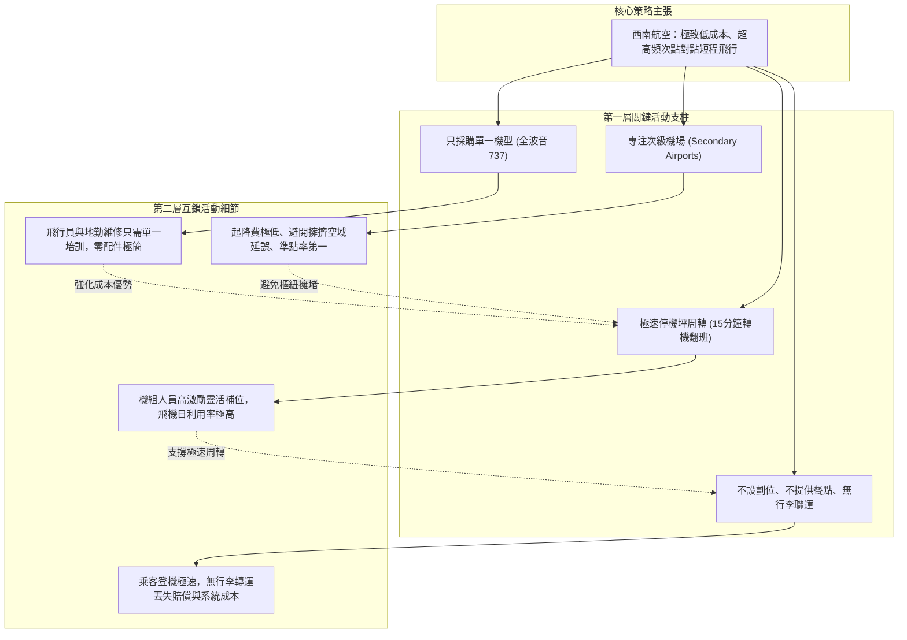

---
{"dg-publish":true,"permalink":"/98/competition-strategy/","tags":["商業概念","策略管理","產業分析","競爭優勢","PMBA"],"dg-note-properties":{"aliases":["競爭策略","Competitive Strategy","波特三大通用競爭策略","Generic Strategies","策略定位"],"tags":["商業概念","策略管理","產業分析","競爭優勢","PMBA"]}}
---


# 競爭策略 (Competitive Strategy & Generic Strategies)

> **【核心決策摘要】**
> **競爭策略（Competitive Strategy）** 是指企業在特定產業競爭結構中，透過主動選擇「有別於對手的獨特價值主張與營運活動組合」，以創造並維持**持久競爭優勢（Sustainable Competitive Advantage, SCA）** 的總體行動藍圖。策略大師麥可·波特（Michael Porter）確立了三大經典一般性競爭策略：**成本領導（Cost Leadership）**、**差異化（Differentiation）** 與 **集中化（Focus / Niche）**。高階管理決策的關鍵在於破除「運營效益（Operational Effectiveness）」的同質化迷思——策略的本質不是「做得比對手更完美」，而是「做得與對手截然不同」；企業必須做出明確的**放棄與取捨（Trade-offs）**，並依靠整套難以被單點抄襲的**活動系統（Activity System）** 咬合築起壁壘，嚴防墜入「卡在中間（Stuck in the Middle）」的無利潤死局。

---

## 1. 概念核心定義與本質 (Executive Definition & Theoretical Essence)

### 1.1 核心定義：運營效益 vs. 策略定位
波特在《策略是什麼？》（*What is Strategy?*）中指出經理人最容易混淆的根本觀念：

```
                    ┌─────────────────────────────────────────┐
                    │      運營效益 vs. 策略定位之本質差異     │
                    └────────────────────┬────────────────────┘
                                         ▼
         ┌───────────────────────────────┴───────────────────────────────┐
         ▼                                                               ▼
【運營效益 (Operational Effectiveness)】                        【策略定位 (Strategic Positioning)】
 • 定義：在相同活動上比對手執行得更好 (如 TQM、精益生產)         • 定義：執行「不同於對手的活動」或以「不同方式執行」
 • 結果：推動生產力前緣向外擴展，但引發同質化軍備競賽           • 結果：建立獨一無二的客製化活動鏈，創造結構性護城河
 • 終局：好處全被客戶與供應商拿走，企業陷入零和利潤侵蝕         • 終局：擁有持久的定價溢價或成本結構優勢，享有超額利潤
```

### 1.2 波特三大通用競爭策略矩陣 (Porter's Generic Strategies Matrix)

企業的競爭優勢根本上源於兩條路徑：**低成本** 或 **差異化溢價**；結合目標市場的涵蓋範疇（寬廣產業範圍 vs. 狹窄利基市場），構成四大戰略象限：

```
                      競爭優勢來源 (Strategic Advantage)
                          低成本 (Lower Cost)  │  差異化 (Differentiation)
                 寬廣   ────────────────────┼────────────────────────
    競爭範疇     (Broad)  【1. 全面成本領導】│    【2. 全面差異化】
    (Strategic          • Costco, TSMC代工  │    • Apple, LVMH
     Target)     窄小   ────────────────────┼────────────────────────
                 (Narrow) 【3A. 成本集中化】 │    【3B. 差異集中化】
                        • 宜家特定族群      │    • 法拉利 (Ferrari)
```

1. **全面成本領導策略（Cost Leadership）**：以產業內最低的總體成本結構提供標準化產品，依靠無情壓縮採購、製造與營運費用，即便在激烈價格戰中仍能維持全產業最高利潤率（參見 [[economies-of-scale_規模經濟]]）。
2. **全面差異化策略（Differentiation）**：在全產業範圍內創造被客戶認知為「獨一無二」的產品特性、卓越品質、尊榮品牌或生態黏性，使顧客產生低價格敏感度，進而獲取超額定價溢價（參見 [[pricing-power_溢價能力]] 與 [[brand-equity_品牌權益]]）。
3. **集中化策略（Focus Strategy）**：放棄廣大主流市場，全力聚焦於特定地理區域、特殊買方群體或狹窄產品線（利基市場 Niche Market），在該垂直領域建立極致的成本或差異化統治力。
4. **「卡在中間（Stuck in the Middle）」的致命陷阱**：企業試圖討好所有人，既缺乏成本領導所需的極致規模與採購議價權，又缺乏支撐高溢價的獨特品牌與技術壁壘。其利潤率必然遠低於產業均值，最終被低價與高端兩頭夾擊而淘汰。

---

## 2. 數理模型與微觀經濟學利潤機制 (Mathematical Modeling & Profit Mechanics)

在微觀經濟學架構中，單一企業的長期經濟利潤可表示為：

$$\Pi_i = \left[ P_i(D_i) - C_i(Q_i) \right] \cdot Q_i$$

其中 $P_i$ 為產品價格，$C_i$ 為單位生產與交付成本，$D_i$ 為消費者感知差異化程度。

```
顧客願付價格 (Willingness to Pay, WTP)
        ▲
        │       ┌────────────────────────────────┐
        │       │   消費者剩餘 (Consumer Surplus) │
價格 (P)├───┬───┴────────────────────────────────┤
        │   │ 企業利潤 (Profit Margin = P - C)   │  <-- 競爭策略目標：拉大 (P - C) 空間
成本 (C)├───┴───┬────────────────────────────────┤
        │       │   投入成本 (Cost of Production)│
        0 ───────┴────────────────────────────────┴──► 價值軸 (Value Continuum)
```

### 2.1 成本領導的微觀算式
成本領導者將 $C_i$ 壓至同業平均成本 $\bar{C}$ 之下（$C_i \ll \bar{C}$）：
- **戰術 A（等價收割）**：以市場均價 $\bar{P}$ 銷售，享有超額利潤差 $(\bar{P} - C_i) > (\bar{P} - \bar{C})$。
- **戰術 B（降價進攻）**：將售價壓低至 $P_i < \bar{P}$（但 $P_i > C_i$），將缺乏成本優勢的對手逼入虧損區，迅速搶佔市佔率。

### 2.2 差異化的微觀算式
差異化者大幅推升顧客願付價格 $\text{WTP}_i$，使得價格溢價遠超越其為此付出的額外研發與品牌成本：
$$(P_i - \bar{P}) \gg (C_i - \bar{C})$$
企業利潤空間 $(P_i - C_i)$ 獲得實質結構性擴張。

---

## 3. 戰略框架與活動系統密合度 (Strategic Framework & Activity System Fit)

### 3.1 活動系統圖譜（Activity System Maps）與難以模仿性

持久競爭優勢從不建立在單一核心技術或行銷花招上，而是源於數十項營運活動構成的**互鎖活動系統（Activity System）**：



#### 活動系統的三階密合（Fit）：
1. **一階密合（一致性 Consistency）**：每項營運活動都與核心競爭策略高度方向一致。
2. **二階密合（相互強化 Reinforcement）**：活動之間互相增強效益（如單一機型大幅加速了維修與翻班效率）。
3. **三階密合（最優化替代 Optimization of Effort）**：整體活動鏈消除了不必要的浪費（不提供餐點徹底免除了垃圾清運與延誤）。
- **對手的抄襲壁壘**：對手若只複製其中一兩項活動（如傳統航空嘗試不提供餐點），必然引發其原有顧客強烈不滿且無法降低整體成本，最終模仿失敗。

---

## 4. 產業標竿與實戰應用場景 (Industry Benchmarks & Applications)

| 策略類型 | 代表企業 | 核心競爭優勢構造 | 放棄與取捨 (Trade-offs) |
| :--- | :--- | :--- | :--- |
| **全面成本領導** | **台積電 (TSMC)**<br>(代工製造) | 資本支出百億美元形成的巨大規模經濟、驚人的晶圓製造良率（Yield Rate）與全球頂尖供應鏈壓價權 | 放棄自有品牌晶片設計，堅守純晶圓代工，不與客戶競爭 |
| **全面成本領導** | **Costco 好市多** | 嚴選少於 4,000 個 SKU 的極致周轉、倉儲式陳列、毛利率強制不得超過 14% | 放棄品類豐富度、放棄華麗裝潢與單品高毛利爆發 |
| **全面差異化** | **Apple 蘋果** | 封閉 iOS 生態系統、卓越軟硬體一體化體驗、高端工業設計與極致品牌忠誠度 | 放棄低階廉價手機市場、放棄高度開放的安卓式客製化自由度 |
| **集中差異化** | **法拉利 (Ferrari)** | 賽車血統、極致超跑性能、每年嚴格限制出貨量維持稀缺性與尊榮象徵 | 放棄大眾乘用車市場、放棄追求年出貨數十萬輛的量產規模 |

---

## 5. 經典企業個案深度剖析 (Deep Dive Case Studies)

### 5.1 成功典範：台積電的策略演進（從成本領導到雙重優勢）
- **初期定位（成本領導純代工）**：1987 年張忠謀創立台積電時，全球半導體皆為整合元件製造廠（IDM，如 Intel、TI 自己設計且自己製造）。台積電首創「純晶圓代工模式」，承諾絕不推出自有晶片。
- **規模經濟護城河**：
  1. 全球無晶圓廠（Fabless，如高通、輝達、聯發科）皆將訂單匯聚至台積電，使其晶圓製造累積產量遠超任何單一 IDM。
  2. 巨大的產能吞吐量攤薄了巨額微影設備的固定折舊，推動台積電製造單位成本顯著低於競爭對手。
- **後期躍升（技術絕對差異化）**：在 7nm、5nm、3nm 極紫外光（EUV）世代，台積電憑藉工程師紅利與研發良率，成為全球唯一具備超高良率量產能力的代工廠，享有極強的定價自主權，兼具成本優勢與差異化壁壘。

### 5.2 失敗警示：Kmart 百貨的「卡在中間」崩潰慘劇
- **迷失定位**：在 1980 年代以前，Kmart 是全美首屈一指的折扣百貨巨頭。但隨後面對新興對手時失去策略焦點：
  1. 面對**沃爾瑪（Walmart）**：沃爾瑪依靠先進的電腦化物流與供應鏈將成本壓到極限；Kmart 供應鏈老化，在價格戰上被打得潰不成軍。
  2. 面對**塔吉特（Target）**：塔吉特轉向「平價奢華與時尚設計（Cheap Chic）」差異化定位，吸引高收入中產階級；Kmart 賣場老舊混亂，完全無法提供溢價體驗。
- **崩潰下場**：Kmart 既無法做到全美最低價，又毫無品牌特色，利潤率被兩頭抽乾，市佔率一路雪崩，最終於 2002 年聲請破產重整。

---

## 6. 高階經理人決策實戰工具箱 (Executive Action Playbook)

### 6.1 波特競爭策略健全度五大檢驗準則
- [ ] **準則 1：獨特價值主張（Unique Value Proposition）**：你能否用一句話講清楚你為目標客戶創造的價值與同業有何根本不同？（非「品質更好」這種虛幻口號）。
- [ ] **準則 2：客製化活動鏈（Tailored Value Chain）**：你的研發、生產、銷售活動是否經過專門定制以支撐該主張？（還是完全沿用同業通用的標準流程？）。
- [ ] **準則 3：明確的放棄取捨（Clear Trade-offs）**：策略的本質是決定「不去做什麼」。你的策略是否明確列出了哪些業務、哪些客戶是堅決不碰的？
- [ ] **準則 4：活動互鎖咬合（Fit Across the Value Chain）**：各部門活動之間是否存在一階、二階、三階的緊密互鎖？單獨拆出任何一項是否都無法成立？
- [ ] **準則 5：長期連續性（Continuity of Direction）**：組織是否願意抵禦短期誘惑，維持該策略方向至少 3~5 年以沉澱無形資產？

---

## 7. 關聯知識網絡與導航地圖 (Knowledge Network & Cross-References)

### 7.1 本主題核心三部曲
- **[[competition-strategy_競爭策略]]** · 波特三大通用策略、活動系統互鎖咬合與策略定位本質（本篇）
- **[[cross-industry-competition_跨界競爭]]** · 跨界降維打擊、平臺包夾（Platform Envelopment）與非對稱生態博弈
- **[[competition-risk_競爭風險]]** · 超競爭環境中的紅皇后效應、破壞性創新突襲與價格戰囚徒困境

### 7.2 跨領域策略與行銷鏈結
- [[competitive-advantage_競爭優勢]] · 競爭策略所追求之終極超額利潤源泉（SCA）
- [[Porter's Five Forces Analysis_波特五力分析]] · 制定競爭策略必備之產業五力結構診斷
- [[barriers-to-entry_進入障礙]] · 維持競爭策略成果不被模仿者迅速瓦解的防禦護城河
- [[pricing-power_溢價能力]] · 差異化策略成功實施後所展現之定價權指標
- [[core-competence_核心能力]] · 支撐企業競爭策略底層運作之組織難模仿核心資源

### 7.3 課程筆記與導航主頁
- [[M1-4_台灣產業發展歷程與決策工具箱]] · 台灣代工產業競爭策略轉型與彈性網絡護城河
- [[_創業與企業財務策略 MOC]] · 企業營運策略與獲利模型全景地圖
- [[home]] · 全球 PMBA 知識庫總導航主頁面