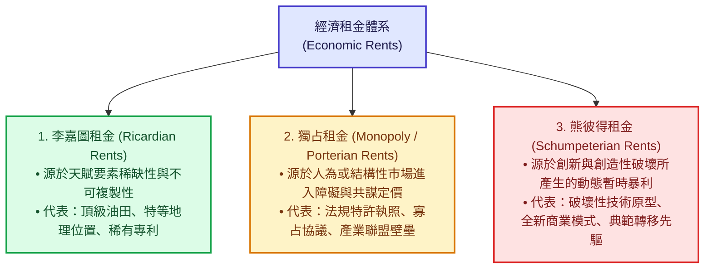
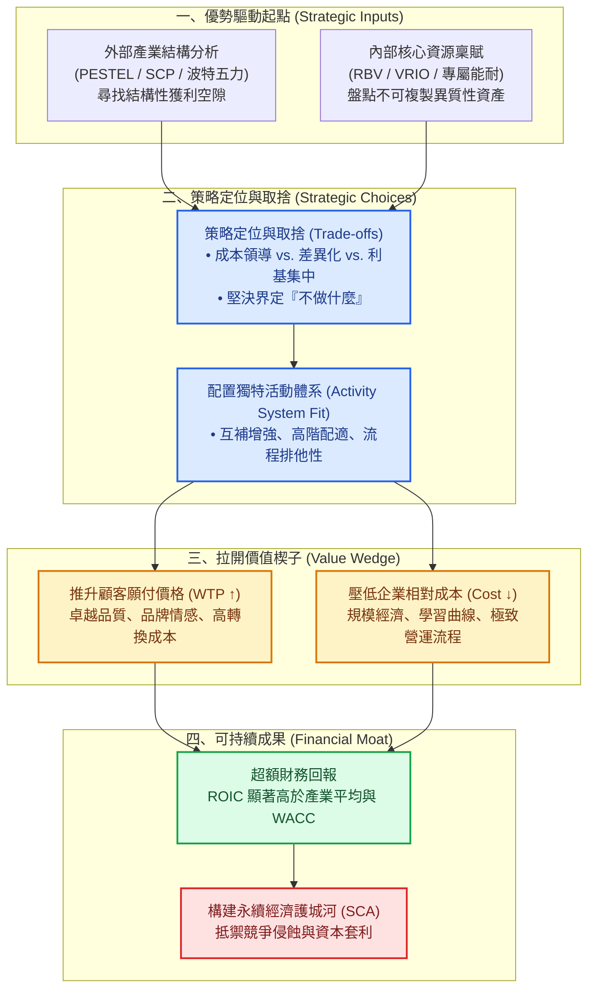
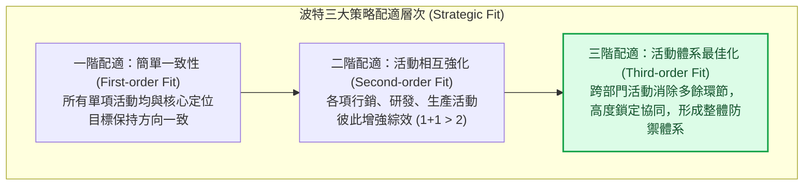
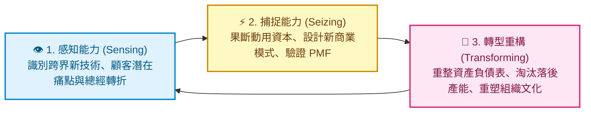
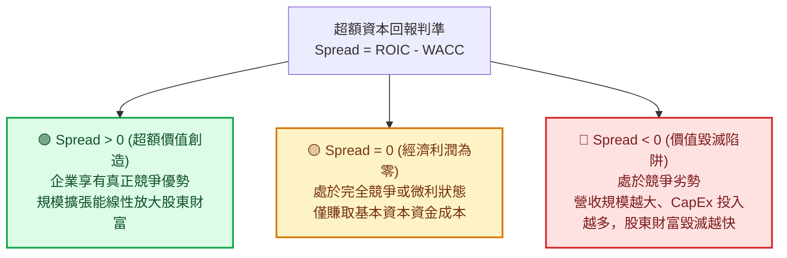
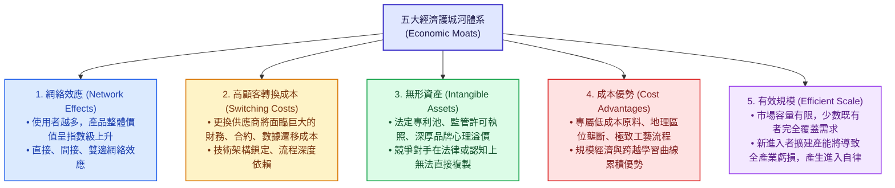
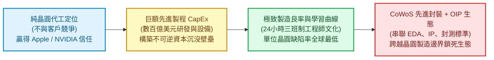
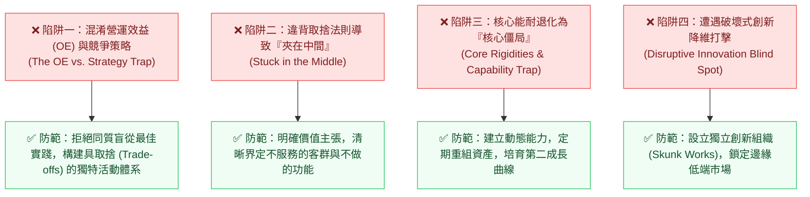

---
{"dg-publish":true,"permalink":"/98/competitive-advantage/","tags":["商業概念","競爭策略","策略管理","產業分析","資源基礎觀點","價值創造","PMBA"],"dg-note-properties":{"aliases":["競爭優勢","持續競爭優勢","永續競爭優勢","競爭利基","Competitive Advantage","Sustainable Competitive Advantage","SCA"],"tags":["商業概念","競爭策略","策略管理","產業分析","資源基礎觀點","價值創造","PMBA"]}}
---


# 競爭優勢 (Competitive Advantage)

> **商管核心價值**：
> 「如果一家企業沒有競爭優勢，那麼它最好不要去競爭。」——傑克·威爾許（Jack Welch）  
> 「營運效益（Operational Effectiveness）並不是策略；競爭優勢源自於你與競爭對手『採取截然不同的活動』，或是『以截然不同的方式執行相似活動』。」——麥可·波特（Michael E. Porter）  
> 
> 在現代商業管理與產業經濟學中，**競爭優勢（Competitive Advantage）** 是策略管理的核心靈魂。它並非抽象的主觀口號，而是企業在面對市場競爭時，能夠持續創造高於產業平均水準的「經濟剩餘（Economic Surplus）」，並將其轉化為超越資本成本之「超額資本報酬率（ROIC > WACC）」的根本體系能力。

---

## 一、 核心定義與理論基石

### 1.1 學術與實務定義之演進
競爭優勢的定義在當代商管學界歷經了三大經典理論的遞進深化：

1. **外在定位與活動配置觀（Michael E. Porter, 1985）**：
   - 波特在《競爭優勢》（*Competitive Advantage*）中確立：競爭優勢源自企業為顧客創造的**價值（Value）**超越其創造價值所付出的**成本（Cost）**。企業的優勢最終可化約為兩大基石：**低成本（Lower Cost）** 或 **差異化溢價（Differentiation）**。
2. **內在資源與組織能耐觀（Jay B. Barney, 1991）**：
   - 資源基礎觀點（RBV）提出：當企業實施一項能創造價值的專屬策略，而該策略**「無法被任何現有或潛在競爭對手同時實施，且對手無法複製其效益」**時，企業即享有競爭優勢；若此優勢在競爭者竭力模仿後依然無法被消除，則稱之為**持續競爭優勢（Sustainable Competitive Advantage, SCA）**。
3. **價值網絡與非對稱博弈觀（Adam Brandenburger & Harborne Stuart, 1996）**：
   - 奠基於合作賽局理論，提出**「價值楔子模型（Wedge Model）」**：競爭優勢的本質在於企業在「顧客願付價格（Willingness to Pay, WTP）」與「供應商機會成本（Supplier Opportunity Cost, SOC）」之間拉開的差距，顯著大於產業內所有競爭者所能拉開的差距。

---

### 1.2 經濟學本質：超額經濟租金（Economic Rents）

商管決策必須嚴格區分**「會計利潤（Accounting Profit）」**與**「經濟租金 / 經濟利潤（Economic Rents）」**：
- **會計利潤**：僅扣除顯性成本（財務支出、折舊與稅額），容易因景氣循環或資本規模放大而虛增。
- **超額經濟租金**：扣除全體資本（股權與債權）的「機會成本」後所剩餘的真實價值創造。



真正的競爭優勢，必須能為股東持續帶來高於「加權平均資本成本（WACC）」的「投入資本報酬率（ROIC）」，即創造持久的正向**經濟附加價值（Economic Value Added, EVA > 0）**。

---

### 1.3 策略層次因果傳導鏈

競爭優勢並非憑空誕生，而是企業內外部要素深度耦合的產物：



---

## 二、 兩大古典與現代戰略思維流派對決

在管理學演進史上，關於「競爭優勢到底從何而來」，形成了兩大核心學派與一個動態演化流派的世紀交鋒：

### 2.1 外在定位學派（Market-Based View / Positioning School - Michael Porter）

- **核心哲學**：**外部決定論**。企業獲利結構首先取決於所處產業的吸引力（五力分析），其次取決於企業在該產業中的相對定位（Positioning）。
- **三大通用競爭策略（Generic Strategies）**：
  1. **[[cost-leadership-strategy_成本領導策略|成本領導策略 (Cost Leadership)]]**：以全產業為目標，將單位總成本降至業界最低，以規模經濟、製程革新、採購議價權抵抗價格戰。
  2. **[[differentiation-strategy_差異化策略|差異化策略 (Differentiation)]]**：提供全產業顧客認定具獨特性、不可替代的價值（品質、設計、品牌、服務），從而獲取定價特權與忠誠度。
  3. **[[focused-strategy_集中化策略|集中化策略 (Focus Strategy)]]**：聚焦於特定細分客群、地理區域或特殊品類（成本集中或差異化集中），避開全能巨頭鋒芒。



- **波特的嚴肅警示：營運效益（OE）$\neq$ 競爭策略（Strategy）**：
  - **營運效益（Operational Effectiveness, OE）**：指執行相似活動時做得比對手更好、更快（如推行六標準差、引進最新 CRM、實施精實生產）。OE 會不斷將生產力邊界（Productivity Frontier）向外推展。
  - **致命陷阱**：OE 的成果極易被同業快速模仿複製，最終演變為全員同質化的價格割喉戰（Hypercompetition），顧客成為唯一贏家，所有廠商利潤競底。
  - **策略的真諦**：在於建立難以被對手打包抄襲的**活動體系（Activity Systems）**。單一技術很容易被買走，但由上百個緊密嵌合的活動所構成的「配適網絡」，對手只要漏抄一項就會全盤皆輸。

---

### 2.2 內在能耐學派（Resource-Based View, RBV & VRIO 框架）

- **核心哲學**：**內部稟賦論**。由 Birger Wernerfelt (1984)、Jay Barney (1991)、Margaret Peteraf (1993) 建立。認為外部市場競爭瞬息萬變，唯有企業內部深植的異質性（Heterogeneity）與不可完全流動性（Immobility）資源，才是永續優勢的源泉。
- **VRIO 分析檢驗架構**：

| 評估維度 | 核心檢核問題 | 否定之策略後果 (No) | 肯定之策略後果 (Yes) | 競爭地位判讀 |
| :--- | :--- | :--- | :--- | :--- |
| **V - 價值性<br>(Value)** | 該資源是否能幫助企業掌握外部機會、中和環境威脅？ | 資源無法創造顧客剩餘，淪為純粹成本包袱。 | 具備基礎價值，可進入下一層檢驗。 | **競爭劣勢 (Competitive Disadvantage)** |
| **R - 稀少性<br>(Rarity)** | 該資源是否僅為少數現有與潛在競爭者所掌握？ | 眾多同業皆擁有相同資源，容易引發同質競爭。 | 具備稀缺特徵，具備超額溢價基礎。 | **競爭均勢 (Competitive Parity)** |
| **I - 難以模仿性<br>(Inimitability)** | 缺乏該資源的企業在獲取或開發時，是否面臨巨大的成本劣勢？ | 對手可快速複製、逆向工程或在要素市場直接購買。 | 存在結構性阻隔機制，對手複製成本高昂。 | **暫時性優勢 (Temporary Advantage)** |
| **O - 組織配合力<br>(Organization)** | 企業的結構、流程、激勵考核機制是否能充分釋放該資源潛力？ | 懷璧其罪，組織官僚遲鈍無法將資源變現（如全錄 PARC）。 | 組織與管理體系完美配適，全方位轉化為營運績效。 | **持續競爭優勢 (Sustainable Advantage)** |

- **支撐「難以模仿性 (I)」的四大阻隔機制（Isolating Mechanisms）**：
  1. **獨特歷史路徑依賴（Unique Historical Conditions / Path Dependency）**：企業在特定歷史機遇下獲取的資產（如特定時代政策特許、創辦初期取得的關鍵地理區位、數十年積累的組織文化），後人難以逆轉時間重現。
  2. **因果模糊性（Causal Ambiguity）**：競爭對手甚至企業內部主管自己，都無法完全釐清究竟是哪一項特定因素、哪套制度造就了成功。這使得對手無從著手模仿。
  3. **社會複雜性（Social Complexity）**：深植於人與人、團隊、供應商之間複雜的信任、默契、人際網絡與企業聲譽（如豐田汽車的看板供應鏈文化、台積電工程師夜班輪值的責任感文化）。
  4. **法定產權與專利保護（Legal Protection & Patents）**：排他性專利池、營業秘密法、特許營運牌照。

---

### 2.3 動態能力學派（Dynamic Capabilities - David Teece）

在科技典範轉移與地緣政治劇烈波動的「深層不確定性（Knightian Uncertainty）」環境下，傳統 RBV 靜態資源極易退化為**「核心僵局（Core Rigidities）」**。David J. Teece 提出「動態能力」，強調企業動態配置、更新與重構內部資產的能耐：



---

### 2.4 三大戰略流派系統化對比矩陣

| 比較維度 | 外在定位學派 (Porter) | 內在資源基礎觀點 (Barney) | 動態能力觀點 (Teece) |
| :--- | :--- | :--- | :--- |
| **優勢起點** | 外部市場結構與利潤池分佈 | 內部專屬異質性資源與能耐 | 面對環境劇變時的敏捷轉型能耐 |
| **核心分析單位** | 產業（Industry）、活動（Activities） | 資源（Resources）、能耐（Capabilities） | 慣性流程（Routines）、動態架構 |
| **策略核心命題** | 選擇哪一個賽道？採取哪種定位？ | 我們擁有什麼別人沒有的獨特資產？ | 我們如何隨著外在演化重構自身能力？ |
| **環境假設** | 相對穩定、結構可分析預測 | 中度動態、資源流動存在摩擦力 | 高速動態、技術顛覆頻繁、高度不確定 |
| **超額利潤本質** | 獨占租金（Monopoly Rents） | 李嘉圖租金（Ricardian Rents） | 熊彼得創新租金（Schumpeterian Rents） |
| **面臨的最大風險** | 忽視內部執行力與資源短缺 | 陷入「核心僵局」，對外部變革視而不見 | 過度追求頻繁變動而喪失既有累積優勢 |

---

## 三、 競爭優勢的量化評估與財務指標體系

商管決策嚴禁淪為空泛口號，必須落實至**微觀經濟楔子模型**與**總體財務審判矩陣**中。

### 3.1 價值創造與捕獲的「楔子模型（Wedge Model）」

```text
顧客端願付價格 (WTP, Willingness to Pay)
   │
   ├─────── 【顧客剩餘 (Consumer Surplus) = WTP - Price】
   │        (決定顧客轉換意願與品牌忠誠度)
產品定價 (Price)
   │
   ├─────── 【企業利潤 / 經濟價值捕獲 = Price - Cost】
   │        (轉化為企業損益表毛利與營益)
企業生產總成本 (Cost)
   │
   ├─────── 【供應商剩餘 (Supplier Surplus) = Cost - SOC】
   │        (維繫供應鏈夥伴穩定協同)
供應商機會成本 (SOC, Supplier Opportunity Cost)
```

$$\text{總創造價值 (Total Value Created)} = \text{WTP} - \text{SOC} = (\text{WTP} - P) + (P - C) + (C - \text{SOC})$$

#### 競爭優勢的量化數學條件：
若企業 $i$ 相對於代表性同業 $j$ 具備競爭優勢，其充要條件為其拉開的價值楔子絕對值大於同業：

$$\Delta V = (\text{WTP}_i - C_i) - (\text{WTP}_j - C_j) > 0$$

- **差異化優勢（Differentiation-driven Advantage）**：
  $$\text{WTP}_i - \text{WTP}_j > C_i - C_j \quad (C_i \ge C_j)$$
  企業雖然承擔了較高的研發與製造成本，但其產品為顧客帶來的滿意度溢價（WTP 躍升）大幅超越了成本增量（如蘋果 iPhone）。
- **成本優勢（Cost-driven Advantage）**：
  $$C_j - C_i > \text{WTP}_j - \text{WTP}_i \quad (\text{WTP}_i \le \text{WTP}_j)$$
  企業的產品在體驗上可能略遜於對手，但透過供應鏈管理與規模經濟，使其成本降幅遠大於價格降幅（如好市多 Costco、西南航空）。

---

### 3.2 終極財務審判指標：超額資本回報率（ROIC）與杜邦拆解

任何商業模式的優勢，最終必須反映於**投入資本報酬率（Return on Invested Capital, ROIC）**與**加權平均資本成本（WACC）**的利差（Spread）：

$$\text{ROIC} = \frac{\text{稅後淨營業利潤 (NOPAT)}}{\text{投入資本 (Invested Capital)}} = \frac{\text{NOPAT}}{\text{營收 (Sales)}} \times \frac{\text{營收 (Sales)}}{\text{投入資本 (Invested Capital)}}$$

- **利潤率驅動（Margin Drive）**：$\frac{\text{NOPAT}}{\text{Sales}}$，反映**定價權與差異化溢價能力**。
- **週轉率驅動（Turnover Drive）**：$\frac{\text{Sales}}{\text{Invested Capital}}$，反映**規模經濟與極致營運資產效率**。



---

### 3.3 競爭優勢維持期（Competitive Advantage Period, CAP）

- **CAP 概念（Michael Mauboussin）**：資本市場對於一家企業能維持超額資本回報（$\text{ROIC} > \text{WACC}$）的預期時間跨度。
- **均值回歸規律（Mean Reversion）**：在自由市場資本主義下，高 ROIC 猶如一塊肥肉，必然引來龐大競爭資本競逐模仿，導致 ROIC 隨時間衰減回歸至社會平均資本成本（WACC）。
- **SCA 的本質**：在於透過**經濟護城河**最大程度延長 CAP 的衰減半衰期，為股東賺取更長久的折現現金流。

---

## 四、 持續競爭優勢（SCA）的五大經濟護城河壁壘

晨星公司（Morningstar）與當代投資策略學界將真正的持久競爭優勢歸納為五大**經濟護城河（Economic Moats）**：



### 1. 網絡效應（Network Effects）
- **機制**：系統價值隨著用戶規模以平方增長（梅特卡夫定律：$V \propto N^2$）。
- **分類**：
  - **直接網絡效應**：同邊用戶增加提升價值（如 WhatsApp、電話網絡）。
  - **雙邊 / 間接網絡效應**：一側用戶群增加吸引另一側開發者或商家（如 iOS 吸引 App 開發者、Visa 信用卡吸引實體店家）。
- **戰略結果**：極易形成「贏者通吃（Winner-Takes-Most）」的寡占或獨占格局。

### 2. 高顧客轉換成本（Switching Costs）
- **機制**：客戶更換對手產品時，必須承擔顯性金錢代價或隱性沈沒成本：
  - **技術與數據遷移成本**：企業核心 ERP（SAP/Oracle）更換需耗時數年、承擔業務停擺風險。
  - **學習與習慣慣性**：工程師對專業軟體（如 Adobe Photoshop、EDA 工具 Synopsys）的使用習慣與快捷鍵肌肉記憶。
  - **相容性鎖定**：硬體生態專屬接口或專屬通訊協定。

### 3. 無形資產（Intangible Assets）
- **專利權（Patents）**：如生技製藥的原廠專利保護期（享有 10~20 年獨占暴利定價）。
- **特許執照（Regulatory Licenses）**：公用事業、電信頻譜特許、賭場執照、金融牌照（政府人為構築法定進入壁壘）。
- **品牌特權（Pricing Power Brand）**：非單純的知名度，而是能將品牌轉化為**「定價溢價（Pricing Power）」**的能力（如愛馬仕、法拉利，漲價反而刺激銷量）。

### 4. 成本與規模優勢（Cost Advantages）
- **製程專有技術（Proprietary Process）**：歷經長年摸索累積的工藝配方與隱性知識。
- **[[economies-of-scale_規模經濟|規模經濟 (Economies of Scale)]]**：高固定成本被巨大產能分攤，使單位成本隨產量上升而持續下降，迫使新進者面臨規模劣勢。
- **獨家地理位置**：如近港口的重工業水泥廠、鄰近水力發電廠的低電價資料中心。

### 5. 有效規模（Efficient Scale）
- **機制**：在特定受地理或容量限制的利基市場（如鐵路、港口裝卸、跨國天然氣管道、特定化學專利藥），市場需求僅足以支撐一到兩家企業維持合理的獲利規模。
- **威懾效果**：新進入者若斥資建廠切入，整體市場產能必然過剩，引發慘烈同歸於盡價格戰，因此潛在新進者會理智選擇放棄進入。

---

## 五、 跨產業標竿企業實戰深度剖析

### 5.1 案例一：台積電（TSMC）——技術純代工定位與先進封裝生態壁壘



- **策略定位取捨**：創立之初堅決確立「Pure-play Foundry（純晶圓代工）」模式，絕不涉足自有 IC 設計，徹底消除客戶對「技術被剽竊」的疑慮，贏得全球晶片巨頭的底層信任。
- **護城河機制**：
  1. **資本與學習曲線壁壘**：每年投入數百億美元 CapEx（佔營收 30% 以上），建立起後進者在財務上無法企及的先進製程晶圓廠。
  2. **OIP 開放創新平台與 CoWoS**：聚集全球數百家 IP、EDA 工具廠與封測夥伴，形成牢不可破的產業技術標準，將客戶的轉換成本拉升至極致。
- **財務績效**：長期維持 > 53% 毛利率與逾 50% 營益率，創造全球半導體製造業近 90% 的超額利潤池。

---

### 5.2 案例二：蘋果（Apple）——軟硬協同閉環與極致 WTP 護城河

- **價值創造邏輯**：蘋果從不參與純硬體規格的廉價軍備競賽，而是專注於極致的端到端（End-to-End）使用者體驗：
  1. **垂直整合 Apple Silicon**：自主研發 M 系列與 A 系列晶片，達到軟硬體能耗比的最佳化，創造顯著領先同業的性能差距。
  2. **雙向封閉生態系統**：iOS、iCloud、AirDrop、Apple Watch 之間高度無縫聯動，構築難以割捨的顧客數據與使用習慣轉換成本。
- **價值捕獲能力**：
  - 全球智慧型手機出貨量佔比僅約 18%~20%，卻常年豪取全產業 **85% 以上的營業利潤池**。
  - 展現出極致的**定價特權（Pricing Power）**與顧客願付價格（WTP）。

---

### 5.3 案例三：好市多（Costco）與鴻海（Foxconn）——極致營運效率與規模飛輪

這兩家巨頭代表了**低成本與極致週轉率（Efficiency Kings）**的典型範式：

| 營運構面 | 好市多 (Costco) | 鴻海 (Foxconn) |
| :--- | :--- | :--- |
| **核心商業定位** | 全球大眾倉儲批發零售 | 全球 3C 電子製造代工服務 (EMS) |
| **SKU 與品類策略** | **極致精簡**：僅保留約 3,800~4,000 項熱門 SKU，單品採購量極大。 | **全垂直整合零組件**：模具、機殼、連接器自製率極高。 |
| **毛利率與定價承諾** | 自我設限毛利率上限不得超過 14%~15%（業界平均 25%~35%）。 | 代工毛利「毛三到四」，但營收基數高達數兆台幣。 |
| **核心獲利來源** | **會員費收入（Membership Fees）**貢獻絕大部分營業利益。 | 藉由規模採購取得原料折扣，優化產線稼動率與良率。 |
| **營運資金優勢** | **負現金循環週期（CCC < 0）**：消費者現場刷卡付現，貨款 30~60 天後才付給廠商，坐享供應商無息浮存金（Float）。 | 龐大的全球供應鏈即時調度排程能力，極致壓縮存貨天數（DSI）。 |

---

### 5.4 案例四：輝達（NVIDIA）——軟硬一體與 CUDA 生態護城河

- **戰略佈局**：早在 2006 年，黃仁勳力排眾議，強制在每一顆 GeForce GPU 中植入 CUDA 架構，每年額外承擔數億美元的晶片面積成本與驅動軟體研發開銷，長達十餘年未見明顯回報。
- **護城河爆發**：當深度學習與生成式 AI 爆發時，全球高校、研究機構、大型科技公司的 AI 開發者早已習慣使用 CUDA 軟體庫（cuDNN, TensorRT）。
- **競爭維度升級**：競爭對手（如 AMD、Intel、新興 ASIC 新創）即便硬體純算力（FLOPS）指標能追平輝達，也無法在短時間內複製數百萬開發者的代碼相容性與軟體生態。NVIDIA 將晶片競爭維度由「單顆硬體」升級為「整座資料中心與軟體全端系統」，享有高達 75% 以上的驚人毛利率。

---

## 六、 經理人常見四大認知陷阱與優勢侵蝕機制

企業建立競爭優勢極為艱辛，但優勢的瓦解往往迅速而致命。高階經理人必須嚴加防範四大戰略迷思：



### 1. 混淆「營運效益（OE）」與「競爭策略」
- **迷思**：誤以為引進最新的生成式 AI 工具、推動自動化產線、導入降本增效流程就是「企業策略」。
- **下場**：這些工具同業同樣可以向外採購。當所有廠商都採取相同的最佳實踐時，產品規格迅速收斂同質化，市場陷入**「紅海賽跑（Red Queen Effect）」**——每個人都必須拼盡全力奔跑，才能勉強留在原地，所有超額利潤皆被消費者瓜分。

### 2. 違背「取捨法則（Trade-offs）」導致「夾在中間（Stuck in the Middle）」
- **迷思**：貪戀所有市場份額，試圖「既要高品質與頂級服務，又要極致低價格」。
- **下場**：波特早已指出，魚與熊掌不可兼得。高差異化需要客製研發、精緻包裝與高額行銷費用，這與追求標準化、極致規模經濟的低成本路線天然衝突。試圖兼顧兩者的企業最終通常落得「成本比不過專業代工廠、品牌比不過奢華名牌」，陷入最危險的破產虧損泥淖。

### 3. 「核心能耐」退化為「核心僵局（Core Rigidities）」
- **迷思**：過去成功的經驗、專利與組織文化成為不可撼動的神聖圖騰。
- **下場**：當技術 S 曲線發生躍遷（如柯達膠卷面臨數位相機、諾基亞 Symbian 面臨 iOS/Android），過往最引以為傲的資本配置與人才結構，反倒成為扼殺組織轉型的最大枷鎖（能力陷阱 Capability Trap）。

### 4. 忽視克里斯汀生之「破壞式創新（Disruptive Innovation）」
- **迷思**：既有市場領導者往往過度傾聽高階核心客戶的意見，持續投入資源在主流市場進行「持續性創新（Sustaining Innovation）」。
- **下場**：新創企業從既有者看不上眼、利潤微薄的「低端市場（Low-end Foothold）」或「新市場（New-market Foothold）」切入，以看似性能較差、但更便宜、更便捷的方案站穩腳跟；隨著新技術沿著 S 曲線快速迭代，最終由下而上顛覆產業龍頭（如個人電腦顛覆大型主機、數位相機顛覆底片、純電動車對燃油車的滲透）。

---

## 七、 關聯主題與模組網絡

- 🧭 **課程核心模組對接**：
  - [[04_主題選修/12_產業分析與投資策略/02_模組筆記/Module_1_總論與架構/M1-3_產業獲利結構差異與十大經典理論|M1-3 產業獲利結構差異與十大經典理論]]（SCP 典範、RBV 資源基礎觀點、四大獲利驅動模型）
  - [[04_主題選修/12_產業分析與投資策略/02_模組筆記/Module_1_總論與架構/M1-5_波特五力分析與量化架構|M1-5 波特五力分析與量化架構]]（五力雷達圖、產業獲利天花板與結構決定論）
  - [[04_主題選修/12_產業分析與投資策略/02_模組筆記/Module_1_總論與架構/M1-6_產業分析模式與九大分析工具矩陣|M1-6 產業分析模式與九大分析工具矩陣]]（PESTEL、PLC、VRIO、BCG、GE 矩陣工具鏈）
  - [[04_主題選修/12_產業分析與投資策略/02_模組筆記/Module_1_總論與架構/M1-7_產業市場空間與策略群組|M1-7 產業市場空間與策略群組]]（策略群組地圖 SGM、七大移動障礙、競爭空白區）
  - [[04_主題選修/10_創業與企業財務策略/02_模組筆記/Module_2_產品創新與精實驗證/M2-1_精實產品開發與服務創新驗證|M2-1 精實產品開發與服務創新驗證]]（投入資本 Invested Capital、NWC 營運資金、ROIC 競爭矩陣推導）
  - [[mindmap_產業分析與投資策略_心智圖導航|產業分析與投資策略 心智圖導航]]
- 🔗 **核心概念原子卡片雙向鏈結**：
  - [[competitive-matrix_競爭矩陣]] ｜ [[competition-strategy_競爭策略]] ｜ [[positioning-strategy_定位策略]]
  - [[cost-leadership-strategy_成本領導策略]] ｜ [[differentiation-strategy_差異化策略]] ｜ [[focused-strategy_集中化策略]]
  - [[differentiation-advantage_差異化優勢]] ｜ [[product-differentiation_產品差異化]]
  - [[economic-moat_經濟護城河]] ｜ [[barriers-to-entry_進入障礙]] ｜ [[barriers-mobility-barriers_移動障礙 Mobility Barriers|移動障礙 (Mobility Barriers)]]
  - [[switching-costs_轉換成本]] ｜ [[economies-of-scale_規模經濟]] ｜ [[value-chain_價值鏈]]
  - [[value-proposition_價值主張]] ｜ [[value-net_價值網]] ｜ [[value-curve_價值曲線]] ｜ [[vpc-value-price-cost_價值價格成本分析|VPC 價值價格成本分析]]
  - [[return-on-invested-capital_資本投入報酬率]] ｜ [[total-asset-turnover-ratio_總資產週轉率]] ｜ [[dupont-analysis_杜邦分析法]]
  - [[cash-switching-cycle_現金轉換週期]] ｜ [[strategic-groups-strategic-groups_策略群組 Strategic Groups|策略群組 (Strategic Groups)]]
  - [[strategy-coopetition_競合戰略 Coopetition]] ｜ [[SWOT分析]] ｜ [[BCG矩陣]]
