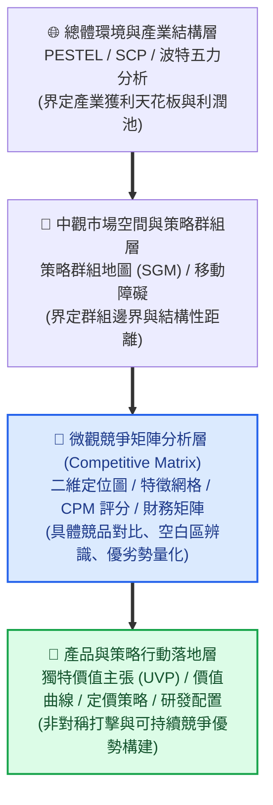
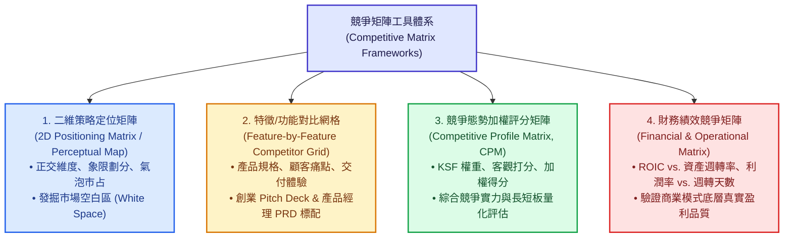
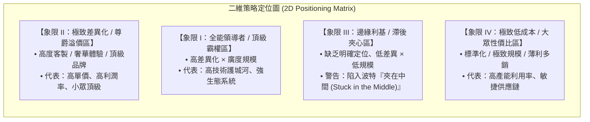
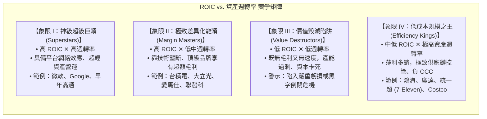
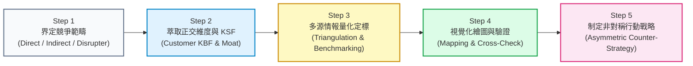
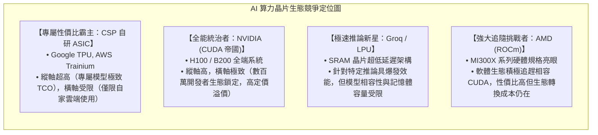
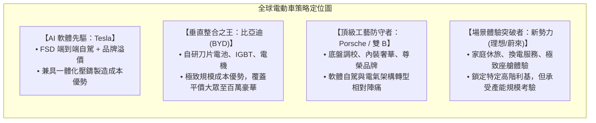
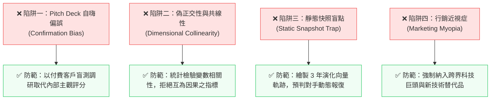

---
{"dg-publish":true,"permalink":"/98/competitive-matrix/","tags":["商業概念","競爭策略","策略管理","產品管理","市場定位","創業策略","PMBA"],"dg-note-properties":{"aliases":["競爭矩陣","競爭者分析矩陣","競爭態勢矩陣","競爭分析網格","Competitive Matrix","Competitor Analysis Matrix","Competitor Grid","CPM"],"tags":["商業概念","競爭策略","策略管理","產品管理","市場定位","創業策略","PMBA"]}}
---

# 競爭矩陣 (Competitive Matrix / Competitor Analysis Matrix)

> **商管核心價值**：商場如戰場，知己知彼百戰不殆。然而在多維動態競爭中，企業常陷入「自說自話的產品偏袒」或「盲目跟隨龍頭的同質化肉搏」。**競爭矩陣（Competitive Matrix）** 是將高維度、繁複混亂的市場競爭格局，透過關鍵決策維度進行「策略降維（Dimensionality Reduction）」的視覺化與量化決策工具。它幫助經理人發掘「競爭空白區（White Space）」、確立「獨特價值主張（UVP）」、構建「移動障礙（Mobility Barriers）」，並擬定精準的非對稱突圍戰略。

---

## 一、 核心定義與策略本質

### 1.1 學術與實務定義
- **競爭矩陣（Competitive Matrix / Competitor Analysis Matrix）** 是指企業在擬定競爭策略、規劃新產品線、編寫商業計畫書（Pitch Deck）或進行資本配置時，用以系統化解構、對比、定位自身與直接對手、間接替代者在關鍵策略要素上相對優劣勢的結構化分析架構。
- 廣義的競爭矩陣涵蓋：
  1. **二維策略定位圖（2D Positioning / Perceptual Map）**
  2. **特徵功能對比網格（Feature-by-Feature Grid）**
  3. **競爭態勢加權評分矩陣（Competitive Profile Matrix, CPM）**
  4. **財務營運效能矩陣（Financial & Operational Matrix）**

### 1.2 策略本質的三大核心價值
1. **策略降維與競爭透明化 (Dimensionality Reduction & Market Visibility)**：
   真實市場包含數十家廠商、上百項產品特徵與供應鏈細節。競爭矩陣透過嚴謹萃取「顧客核心購買準則（KBF）」與「產業[[key-success-factors-ksf_關鍵成功因素\|關鍵成功因素 (KSF)]]」，將複雜局勢投影至可直觀判讀的二維或矩陣框架中，讓隱晦的競爭格局一目了然。
2. **發掘「競爭空白區 (White Space)」與非對稱定位**：
   透過正交軸向的切割，能清晰識別市場上「顧客需求未被充分滿足、現有巨頭未曾涉足或不屑經營」的策略利基（Niche），為企業落實[[98_商業概念庫/differentiation-strategy_差異化策略\|差異化策略]]或發動破壞式創新提供著力點。
3. **破除「自我膨脹偏誤 (Confirmation Bias)」與確立取捨 (Trade-offs)**：
   麥可·波特（Michael Porter）曾深刻指出：「策略的本質在於選擇『不作什麼』以及願意承擔『取捨（Trade-offs）』。」優質的競爭矩陣迫使團隊屏除「我們什麼都比對手好」的幻覺，客觀面對資源限制與對手的真正護城河。

### 1.3 競爭矩陣在策略層次體系中的銜接定位

---

## 二、 競爭矩陣的四大主流範式深度解構

---

### 2.1 範式一：二維策略定位矩陣 / 感知圖 (2D Positioning Matrix / Perceptual Map)

#### (1) 基本架構與座標軸設計
二維定位矩陣以直角坐標系呈現，選取兩項最關鍵且彼此相互獨立的策略維度作為 X 軸與 Y 軸。市場上的主要廠商或產品品牌以散佈點或氣泡（Bubble）呈現，**氣泡面積通常正比於廠商的營收規模或市占率**。

#### (2) 座標軸選取的「三大黃金法則」
1. **嚴格正交性（Orthogonality / 低共線性）**：
   - **嚴禁將互為因果或高度正負相關的變數設為雙軸**。
   - *反面教材*：X 軸設為「產品售價」，Y 軸設為「製造成本」或「毛利率」。因為售價與成本天然相關，所有企業只會沿著 45 度對角線排列，矩陣退化為一維線條，徹底失去四象限分析價值。
   - *正確範例*：X 軸設為「營運模式（標準化大眾 vs. 深度客製化）」，Y 軸設為「交付時效（即時現貨 vs. 長期專案打造）」；或 X 軸「價格門檻」，Y 軸「技術生態開放性」。
2. **反映顧客真實購買決策（Key Buying Factors, KBF）**：
   - 座標軸必須來自消費者心中真實衡量價值的主觀尺度（如效率、安全、地位聲譽、總體持有成本 TCO），而非內部研發人員自造的生僻工程名詞。
3. **具備可持續的策略位移可能性**：
   - 企業可以透過研發創新、併購或行銷投入，在座標軸上實現主動位移，跨越[[98_商業概念庫/barriers-mobility-barriers_移動障礙 Mobility Barriers\|移動障礙]]。

#### (3) 核心戰略產出：辨識「競爭空白區 (White Space)」
在定位圖中，當某一象限或區域呈現「完全無廠商盤踞」或「僅有衰退老舊品牌」時，即形成**競爭空白區（White Space）**。經理人需進一步辨識：
- **真正的藍海機會 (True Blue Ocean)**：潛在需求巨大，但受制於過去技術未成熟或商業模式落後而無人開發（如早期 iPad 填補筆電與手機之間的掌上娛樂空白；寶雅填補超商與量販店之間的美妝生活雜貨空白）。
- **偽需求陷阱 (Ghost Space)**：看似無人競爭，實則是因缺乏真實付費意願、單位經濟學（Unit Economics）無法損益兩平的市場死胡同。

---

### 2.2 範式二：特徵與功能對比網格 (Feature-by-Feature Competitor Grid)

#### (1) 基本架構
特徵網格是創業融資商業計畫書（Pitch Deck）、精實創業（Lean Startup）與產品經理撰寫產品需求規格書（PRD）中最常見的工具。
- **橫軸**：列出市場主要玩家（本企業、龍頭巨頭 A、直接對手 B、傳統替代方案 C）。
- **縱軸**：列出顧客核心痛點、產品核心功能、技術參數、商業模式、收費定價與售後服務等關鍵構面。

| 評估維度與關鍵特徵 | 本企業方案 (Our Venture) | 既有產業龍頭 (Incumbent A) | 新興直接競品 (Competitor B) | 傳統手動/替代品 (Substitutes) |
| :--- | :--- | :--- | :--- | :--- |
| **目標核心客群** | 中小微型企業 (SMBs) | 全球前 500 大跨國企業 | 早期科技愛好者 | 一般廣大個人用戶 |
| **部署上線週期** | **即插即用（< 10 分鐘）** | 6~12 個月導入顧問服務 | 1~2 週自行安裝 | 無需導入，但耗費人力 |
| **收費模式架構** | **按用量訂閱 (SaaS Usage-based)** | 高額初始買斷授權 + 年維護費 | 固定月費制 | 人工薪資成本 |
| **核心技術專利** | 專屬 AI 輕量化推論架構 | 傳統大型單體伺服器架構 | 開源模型微調包裝 | 人工作業流程 |
| **數據安全合規** | SOC2、ISO27001、GDPR | 國防級專屬伺服器機房 | 僅基礎雲端加密 | 零碎紙本與本機 Excel |
| **總體持有成本 (TCO)** | **極低（依成效付費）** | 極高（數百萬專案預算） | 中等 | 隱形工時浪費巨大 |

#### (2) 警惕「Pitch Deck 陷阱」：克服自我膨脹偏差
- **致命錯誤（The "All-Checks" Trap）**：
  許多創業團隊在簡報中將自己的產品「全部打綠色勾勾（✔）」，而所有競爭對手「全部打紅色叉叉（✘）」。
  這種呈現方式在成熟投資人與高階主管眼中極度缺乏說服力，暴露出團隊對產業缺乏敬畏之心、忽視對手深厚護城河與市場真實複雜度。
- **商管思維的核心轉變：展示「非對稱優勢」而非「全能超越」**：
  成熟的特徵矩陣應坦然呈現競品的優勢（例如：龍頭品牌擁有雄厚資本、全球線下服務網絡、極致可靠性），並清晰展示自身的**非對稱優勢（Asymmetric Advantage）**——「在特定極致痛點上，我們能提供 10 倍好且敏捷的解決方案，並透過結構性優勢讓對手無法迅速跟進」。

---

### 2.3 範式三：競爭態勢加權評分矩陣 (Competitive Profile Matrix, CPM)

#### (1) 理論來源與量化公式
源自經典策略管理理論（Fred David 策略分析體系），透過計量方式將質化的競爭態勢轉化為客觀加權得分，用以宏觀衡量企業在所處產業中的相對戰略實力。

$$\text{CPM 加權總分} = \sum_{i=1}^{n} (W_i \times R_{ij})$$

其中：
- $W_i$：第 $i$ 項[[key-success-factors-ksf_關鍵成功因素\|關鍵成功因素 (Critical Success Factors, CSF / KSF)]]之權重，介於 $0.0 \sim 1.0$ 之間，且嚴格滿足：
  $$\sum_{i=1}^{n} W_i = 1.0$$
  權重高低由產業經濟特性決定，代表該因素對贏得市場份額與創造超額利潤的重要性。
- $R_{ij}$：企業 $j$ 在第 $i$ 項關鍵成功因素上的客觀評分（Rating），標準商管評分尺度為 1~4 分：
  - **4 分 = 主要優勢 (Major Strength)**：領先全產業，具備專利或不可替代性。
  - **3 分 = 次要優勢 (Minor Strength)**：高於產業平均水準，具備良好競爭力。
  - **2 分 = 次要劣勢 (Minor Weakness)**：低於產業平均水準，尚待補強。
  - **1 分 = 主要劣勢 (Major Weakness)**：顯著落後對手，構成致命軟肋。
- **加權得分 ($W_i \times R_{ij}$)**：兩者乘積，加總後得到各企業的總體競爭實力分數（介於 1.0 ~ 4.0 之間）。

#### (2) 標準 CPM 矩陣實務範例（以高科技 B2B 雲端運算產業為例）

| 關鍵成功因素 (CSF / KSF) | 權重 ($W_i$) | 本企業 (Our Firm) 評分 ($R$) ｜ 加權分 | 龍頭巨頭 A (Leader A) 評分 ($R$) ｜ 加權分 | 敏捷挑戰者 B (Rival B) 評分 ($R$) ｜ 加權分 |
| :--- | :---: | :---: | :---: | :---: |
| 1. 核心專利與軟硬協同技術 | 0.20 | 3 ｜ 0.60 | 4 ｜ 0.80 | 2 ｜ 0.40 |
| 2. 品牌信譽與企業級客戶認證 | 0.15 | 2 ｜ 0.30 | 4 ｜ 0.60 | 2 ｜ 0.30 |
| 3. 開發者生態黏著度 (Ecosystem) | 0.15 | 4 ｜ 0.60 | 4 ｜ 0.60 | 2 ｜ 0.30 |
| 4. 價格競爭力與 TCO 成本效益 | 0.20 | 4 ｜ 0.80 | 2 ｜ 0.40 | 3 ｜ 0.60 |
| 5. 全球通路覆蓋與在地技術支援 | 0.10 | 2 ｜ 0.20 | 4 ｜ 0.40 | 2 ｜ 0.20 |
| 6. 產品客製化彈性與 API 開放度 | 0.20 | 4 ｜ 0.80 | 2 ｜ 0.40 | 4 ｜ 0.80 |
| **加權總分合計 (Total Score)** | **1.00** | **— ｜ 3.30** | **— ｜ 3.20** | **— ｜ 2.60** |

#### (3) CPM 矩陣決策判讀要領
1. **綜觀總分排名**：本企業加權總分（3.30）略微領先業界龍頭 A（3.20），顯示整體競爭力已具備正面抗衡或利基突圍實力。
2. **深度解構「得分結構」**：
   - **本企業的核心優勢支柱**：在「TCO 成本效益」、「開放 API 客製化」與「生態黏著度」取得滿分（4 分），此為突刺對手的利刃。
   - **本企業的致命軟肋**：在「全球通路支援」與「品牌企業認證」僅得 2 分，顯示若直接進攻跨國大客戶的保守核心採購，將承受極高驗證阻力。
   - **策略行動啟示**：在進入策略上應發動「側翼包抄」，先鎖定對價格與 API 彈性敏感的中大型科技公司，積累案例後再回頭挑戰保守傳統巨頭。

---

### 2.4 範式四：財務與營運效能競爭矩陣 (Financial & Operational Matrix)

商管決策不能僅停留在行銷與產品功能層面，商業競爭的最終審判庭是**企業財務報表與資本回報率**。PMBA 課堂推導之「杜邦拆解」與「資本效益矩陣」，能直接穿透產品包裝，檢驗商業模式的底層真偽。

#### (1) 核心財務維度拆解：杜邦方程式視角
企業的投入資本回報率可拆解為「利潤率」與「週轉速度」的乘積：

$$\text{ROIC} \approx \frac{\text{NOPAT}}{\text{營收}} \times \frac{\text{營收}}{\text{投入資本 (Invested Capital)}} = \text{營業利益率 (Margin)} \times \text{資本週轉率 (Turnover)}$$

- **縱軸（Margin 驅動）**：反映產品的**差異化溢價能力與定價話語權（Pricing Power）**。
- **橫軸（Turnover 驅動）**：反映企業的**規模經濟、資產利用率與供應鏈敏捷效率（Operational Efficiency）**。

#### (2) 象限特徵與標竿企業對照表

| 競爭象限 | 財務特徵結構 | 核心策略與護城河來源 | 代表性標竿企業 | 經理人管理挑戰 |
| :--- | :--- | :--- | :--- | :--- |
| **高利潤 ✕ 低中週轉 (極致差異化象限)** | 毛利率 > 50% 營業利益率高 資產龐大但回報豐厚 | 專利池、壟斷技術工藝、無形資產、頂級品牌黏著度。 | **台積電**、**聯發科**、**大立光**、**晶華酒店** | 持續高額研發 CapEx 壓力；防範替代技術顛覆。 |
| **中低利潤 ✕ 極高週轉 (規模營運效率象限)** | 毛利率微薄 (3~8%) 資產週轉極快 [[98_商業概念庫/cash-switching-cycle_現金轉換週期\|現金循環週期 (CCC)]] 接近或小於 0 | 供應鏈整合、規模採購成本、排程自動化、佔用上下游無息資金（Float）。 | **鴻海 (Foxconn)**、**廣達 (Quanta)**、**統一超 (7-11)**、**Costco** | 原物料通膨敏感；稍有呆料或呆帳即侵蝕全年生產利潤。 |
| **兼具利潤與週轉 (超級平台象限)** | 超高毛利且輕資產運作 自由現金流充沛 | 雙邊平台網絡效應、生態系標準主導權、幾乎為零的邊際生產成本。 | **微軟**、**Meta**、**Alphabet** | 反壟斷監管審查；平台生態夥伴反叛。 |
| **低利潤 ✕ 低週轉 (價值毀滅陷阱)** | 營益率跌破損益平衡點 存貨跌價損失沉重 ROIC < WACC | 無差異化紅海廝殺，高固定成本折舊卡死，缺乏定價權。 | 產能過剩的成熟製程二線晶圓廠、傳統夕陽重工組裝 | 必須果斷關廠、出售非核心資產、進行[[98_商業概念庫/dual-transformation-dual-transformation_雙軌轉型 Dual Transformation\|雙軌轉型]]。 |

---

## 三、 競爭矩陣的五步建構方法論

建構一份具備商業實戰價值的競爭矩陣，必須遵循嚴謹的動態推導步驟：

### Step 1：界定三層次競爭範疇 (Define Competitive Boundary)
嚴防只看直接對手的「行銷近視症（Marketing Myopia）」：
1. **直接競爭者 (Direct Competitors)**：提供同類產品、爭奪相同預算的既有廠商（如台積電 vs. 三星晶圓代工；Uber vs. 台灣大車隊）。
2. **間接/替代競爭者 (Indirect / Substitutes)**：以不同技術形態解決顧客相同根本痛點的產品（如高鐵 vs. 國內航空；Zoom vs. 商務商旅旅館）。
3. **潛在跨界顛覆者 (Disruptive Entrants)**：手握全新架構與龐大資金、隨時準備跨界降維打擊的科技巨頭（如 Apple 跨足智慧手錶顛覆瑞士平價石英錶；OpenAI 跨足企業搜尋顛覆傳統入口網站）。

### Step 2：萃取正交關鍵維度與 KSF (Extract Orthogonal Dimensions)
- **需求端（顧客視角）**：檢視顧客決策的八大基本價值向度（Holbrook 價值模型）：效率（省時省力）、卓越（性能品質）、地位（社交認同）、美感（設計外觀）等。
- **供給端（廠商視角）**：檢視自身的[[98_商業概念庫/core-competence_核心能力\|核心能耐]]與經濟護城河：專利智財、高[[98_商業概念庫/switching-costs_轉換成本\|轉換成本]]、網絡效應、規模經濟。
- **維度篩選檢驗**：使用統計或邏輯驗證，確保所挑選之座標維度或評估指標彼此相關係數極低（$r < 0.3$），達成維度正交。

### Step 3：多源情報蒐集與三角驗證 (Triangulation & Benchmarking)
拒絕憑空臆測，透過多重數據源進行交叉驗證：
- **客觀量化數據**：公開財報三表（毛利率、營業利益率、應收帳款天數 DSO、存貨天數 DSI、研發費用佔比）。
- **第三方產業報告**：Gartner 魔術象限、IDC 調研報告、彭博產業研究（Bloomberg Intelligence）。
- **市場真實聲音**：顧客滿意度調研、離巢率（Churn Rate）、社群評價、神祕客親自體驗購買、競品反向工程拆解（Teardown）。

### Step 4：視覺化成圖與動態向量標註 (Dynamic Vector Mapping)
- 繪製二維定位圖、CPM 加權表與特徵網格。
- **標註動態演化向量（Vector Arrow）**：
  市場競爭不是靜止的快照。應在矩陣上以箭頭標註主要對手在過去 3 年的演化軌跡與未來 2 年的戰略移動方向（如某對手正大舉增發研發資本，試圖由象限 IV 向象限 I 躍遷）。

### Step 5：制定非對稱行動戰略 (Formulate Asymmetric Strategy)
根據矩陣落點，擬定具體反制行動：
1. **利基據守**：若處於特定優勢空白區，立即建立技術專利池或客戶長期合約，加高[[98_商業概念庫/barriers-mobility-barriers_移動障礙 Mobility Barriers\|移動障礙]]防範後續追趕者。
2. **非對稱打擊**：避開巨頭最強的維度（如不與龍頭比拼品牌廣告與通用功能），在巨頭結構性忽視的邊緣維度（如特定客製化、在地化法規支援、超高響應速度）發動致命一擊。
3. **重新定義標準**：當自身陷入競爭劣勢時，打破既有遊戲規則，主動宣傳引導顧客重視新維度（如在晶片算力落後時，轉而教育市場關注「每瓦算力能耗比」與「全端軟體易用性」）。

---

## 四、 跨產業實戰標竿案例深度剖析

### 4.1 案例一：全球高階 AI 運算加速晶片生態競爭矩陣

在生成式 AI 與大型語言模型（LLM）爆發浪潮中，全球算力市場形成了截然不同的策略競爭矩陣：
- **主要玩家**：NVIDIA（輝達）、AMD、雲端 CSP 巨頭自研 ASIC（Google TPU / AWS Trainium）、新興 NPU 架構（Groq / Cerebras）。
- **關鍵維度選取**：
  - **X 軸（橫軸）**：軟體生態成熟度與通用可程式化彈性（Software Ecosystem & CUDA Moat）——從「高度封閉專屬 ASIC」到「極致通用開放 CUDA 全端生態」。
  - **Y 軸（縱軸）**：特定推論/訓練工作負載之 TCO 成本效益與能效比（Total Cost of Ownership & Energy Efficiency）。

#### CPM 競爭態勢評分矩陣對比

| 關鍵成功因素 (CSF / KSF) | 權重 | NVIDIA | AMD | CSP 自研 ASIC (Google/AWS) |
| :--- | :---: | :---: | :---: | :---: |
| 1. 軟體全端生態 (CUDA / 開發者庫) | 0.25 | **4 (1.00)** | 2 (0.50) | 2 (0.50) |
| 2. 先進封裝 (CoWoS) 產能保證 | 0.20 | **4 (0.80)** | 3 (0.60) | 3 (0.60) |
| 3. 硬體單晶片與互連頻寬 (NVLink) | 0.20 | **4 (0.80)** | 4 (0.80) | 3 (0.60) |
| 4. 單位推論/訓練 TCO 經濟性 | 0.20 | 3 (0.60) | 3 (0.60) | **4 (0.80)** |
| 5. 跨雲端與本地端泛用部署自由度 | 0.15 | **4 (0.60)** | 3 (0.45) | 1 (0.15) |
| **加權總得分合計** | **1.00** | **3.80** | **2.95** | **2.65** |

- **策略判讀**：NVIDIA 藉由軟體 CUDA 建立極深的顧客[[98_商業概念庫/switching-costs_轉換成本\|轉換成本]]，在通用 AI 訓練市場享有高達 70%~80% 的毛利率；雲端巨頭（CSP）難以在通用市場擊敗 NVIDIA，因此採取後向整合策略，自研特定 ASIC 來消化自家內部常態性推論流量，降低被單一供應商「卡脖子」的利潤剝削。

---

### 4.2 案例二：全球新能源電動車（EV）市場二維矩陣與特徵網格

全球汽車產業正經歷百年一遇的典範轉移，競爭格局由傳統內燃機機械轉向三電與智慧座艙：
- **對比主體**：Tesla、比亞迪（BYD）、傳統豪華車廠（Porsche / Mercedes-Benz）、中國造車新勢力（蔚來 / 小鵬 / 理想）。
- **關鍵維度選取**：
  - **X 軸（橫軸）**：整車製造成本控制與三電垂直整合能力（Cost & Vertical Integration）。
  - **Y 軸（縱軸）**：軟體定義汽車（SDV）、自駕算法與智慧座艙體驗（AI & Software Prowess）。

#### 特徵與競爭網格對比

| 競爭構面 | Tesla | 比亞迪 (BYD) | 傳統豪華車廠 (Porsche/雙B) |
| :--- | :--- | :--- | :--- |
| **核心護城河** | FSD 自駕算法大模型、全球超充網絡、超級工廠生產技術。 | 動力電池垂直一體化、極致性價比、全產業鏈低成本製造。 | 百年品牌資產、精湛機械底盤工藝、全球頂級經銷通路。 |
| **定價與毛利策略** | 隨成本降價以擴張軟體車隊（追求高利潤軟體服務）。 | 價格屠夫戰略，將平價車款毛利率壓至極致，以規模擠壓對手。 | 堅持高單價與高產品溢價，防範品牌資產貶值。 |
| **供應鏈模式** | 部分自研，核心晶片外購或自研設計，高度自動化組裝。 | **高度垂直整合**：電池、半導體、線束、車身幾乎全自製。 | 傳統 Tier-1 / Tier-2 外包採購模式，供應鏈轉向摩擦成本大。 |

---

### 4.3 案例三：台灣連鎖實體零售之「空間與坪效」突圍矩陣

在台灣零售高度密集飽和的市場中，不同零售業態透過空間與商品品類的精準定位，各自劃分地盤：
- **主要玩家**：寶雅（POYA）、統一超（7-Eleven）、全聯福利中心（PX Mart）、屈臣氏 / 康是美、好市多（Costco）。
- **維度選取**：
  - **X 軸（橫軸）**：門市密集度與步行即時便利性（Density & Immediate Convenience）。
  - **Y 軸（縱軸）**：單店營業面積與商品品類廣深度（Store Footprint & SKU Variety）。

| 零售型態 | 代表業者 | 象限特徵 | 核心客群痛點與價值主張 | 財務特徵 |
| :--- | :--- | :--- | :--- | :--- |
| **超小型極致便利** | **統一超 (7-Eleven)** | 高密集度 ✕ 小坪數 (30~50 坪) | 24 小時營業、下樓即達、代收水電、微波即食鮮食。 | 超高客流量、高坪效、[[98_商業概念庫/cash-switching-cycle_現金轉換週期\|負現金循環週期 (CCC < 0)]]。 |
| **社區生鮮大冰箱** | **全聯福利中心** | 中高密集度 ✕ 中坪數 (150~300 坪) | 步行/騎車可達，提供平價生鮮蔬果、乾貨日用品一站購足。 | 高存貨週轉率、極強生鮮供應鏈冷鏈議價權。 |
| **美妝生活休閒專門** | **寶雅 (POYA)** | **中密集度 ✕ 大坪數 (300~500 坪) 【完美競爭空白區】** | 明亮寬敞、女性美妝/襪品/生活雜貨一應俱全，滿足「悠閒逛街挖寶」體驗。 | **高毛利率 (> 43%)**、高顧客客單價、高門市留客時間。 |
| **量販倉儲批量採購** | **Costco (好市多)** | 低密集度 ✕ 超大坪數 (數千坪) | 郊區開車採購、大包裝批量批發價、會員費訂閱制模式。 | 極低毛利率 (10~14%)，全靠高週轉率與會員費貢獻純益。 |

- **策略判讀**：
  寶雅精準發掘了超商（貨架太小無法悠閒逛）與傳統量販店（離市區太遠採購不便）之間的**競爭空白區（White Space）**。其 300~500 坪的店格，提供多達數萬種美妝與個人生活品類，既避免與超商進行即時鮮食價格戰，又免於量販店沉重的停車場資本支出，締造了台灣零售業長年逾 40% 的高毛利率與傲人的 ROE。

---

## 五、 經理人常見四大認知陷阱與實務防範

在商管實務中，競爭矩陣常淪為經理人粉飾太平或自欺欺人的工具。決策者必須嚴加防範以下四大認知偏差：

### 1. 「Pitch Deck 自嗨偏誤」（Confirmation Bias & Feature Fallacy）
- **具體表現**：刻意羅列自家團隊具備、但顧客根本不在意的邊緣功能，以此證明自己「超越巨頭」；將巨頭強大的規模與網絡效應貶低為「大公司病、官僚遲緩」。
- **防範之道**：以「顧客願付價格（Willingness to Pay, WTP）」與第三方付費客戶的盲測調研（Blind Test）為客觀基準。若某項功能客戶不願為其付費，則該特徵在矩陣中權重應歸零。

### 2. 「偽正交性與維度共線性」（Dimensional Collinearity）
- **具體表現**：選取表面名稱不同、但本質高度相關的指標作為 X/Y 軸（如「研發投入金額」與「專利數量」、「客單價」與「平均單店營收」），導致矩陣所有散佈點聚集在一條斜線上。
- **防範之道**：進行變數相關係數檢定，挑選在商業邏輯與統計特徵上彼此獨立的維度（如「營運模式：資產輕重度」對比「市場拓展策略：全球標準化 vs. 區域在地化」）。

### 3. 「靜態快照盲點」（Static Snapshot Trap）
- **具體表現**：將矩陣視為一成不變的死板地圖。忘記當本企業看見空白區發動進攻時，強勢競爭者絕不會坐以待斃，而是會發動價格戰、戰略併購或專利訴訟進行強力反擊。
- **防範之道**：導入動態博弈思維。在繪製矩陣時，以虛線箭頭標示「若我方切入該象限，預期對手將在何種時間窗口內跟進，我方防禦護城河為何」。

### 4. 「行銷近視症」（Marketing Myopia）
- **具體表現**：只盯著眼前的傳統同業（如計程車公會只盯著同質車行，忽略了叫車平台 Uber；傳統相機底片廠只盯著同業富士，忽略了智慧型手機數位相機模組）。
- **防範之道**：在任何競爭矩陣中，強制保留一至二個席位給予「非本產業但解決相同核心痛點的技術替代者」與「握有充沛資本的跨界平台業者」。

---

## 六、 關聯主題與模組網絡

- 🧭 **課程核心模組對接**：
  - [[04_主題選修/12_產業分析與投資策略/02_模組筆記/Module_1_總論與架構/M1-6_產業分析模式與九大分析工具矩陣\|M1-6 產業分析模式與九大分析工具矩陣]]（產業結構層至企業層分析工具鏈、GE矩陣、BCG矩陣）
  - [[04_主題選修/12_產業分析與投資策略/02_模組筆記/Module_1_總論與架構/M1-7_產業市場空間與策略群組\|M1-7 產業市場空間與策略群組]]（策略群組地圖 SGM 構建、七大移動障礙、發掘競爭空白區 White Space）
  - [[04_主題選修/12_產業分析與投資策略/02_模組筆記/Module_1_總論與架構/M1-5_波特五力分析與量化架構\|M1-5 波特五力分析與量化架構]]（五力雷達圖、產業獲利天花板與結構量化模型）
  - [[04_主題選修/10_創業與企業財務策略/02_模組筆記/Module_2_產品創新與精實驗證/M2-1_精實產品開發與服務創新驗證\|M2-1 精實產品開發與服務創新驗證]]（ROIC 競爭矩陣推導、資產週轉率 vs. 營業利益率、CCC 資金真空期）
  - [[04_主題選修/12_產業分析與投資策略/02_模組筆記/Module_1_總論與架構/M1-3_產業獲利結構差異與十大經典理論\|M1-3 產業獲利結構差異與十大經典理論]]（哈佛學派 SCP 典範由上而下決定論）
  - [[04_主題選修/12_產業分析與投資策略/00_課程導航與進度/mindmap_產業分析與投資策略_心智圖導航\|產業分析與投資策略 心智圖導航]]
- 🔗 **核心概念原子卡片**：
  - [[98_商業概念庫/competitive-advantage_競爭優勢\|competitive-advantage_競爭優勢]] ｜ [[98_商業概念庫/competition-strategy_競爭策略\|competition-strategy_競爭策略]] ｜ [[98_商業概念庫/positioning-strategy_定位策略\|positioning-strategy_定位策略]]
  - [[98_商業概念庫/strategic-groups-strategic-groups_策略群組 Strategic Groups\|策略群組 (Strategic Groups)]] ｜ [[98_商業概念庫/barriers-mobility-barriers_移動障礙 Mobility Barriers\|移動障礙 (Mobility Barriers)]]
  - [[98_商業概念庫/value-proposition_價值主張\|value-proposition_價值主張]] ｜ [[98_商業概念庫/value-curve_價值曲線\|value-curve_價值曲線]] ｜ [[98_商業概念庫/economic-moat_經濟護城河\|economic-moat_經濟護城河]]
  - [[98_商業概念庫/cost-leadership-strategy_成本領導策略\|cost-leadership-strategy_成本領導策略]] ｜ [[98_商業概念庫/differentiation-strategy_差異化策略\|differentiation-strategy_差異化策略]] ｜ [[98_商業概念庫/focused-strategy_集中化策略\|focused-strategy_集中化策略]]
  - [[98_商業概念庫/product-differentiation_產品差異化\|product-differentiation_產品差異化]] ｜ [[98_商業概念庫/barriers-to-entry_進入障礙\|barriers-to-entry_進入障礙]] ｜ [[98_商業概念庫/switching-costs_轉換成本\|switching-costs_轉換成本]]
  - [[98_商業概念庫/economies-of-scale_規模經濟\|economies-of-scale_規模經濟]] ｜ [[98_商業概念庫/return-on-invested-capital_資本投入報酬率\|return-on-invested-capital_資本投入報酬率]] ｜ [[98_商業概念庫/total-asset-turnover-ratio_總資產週轉率\|total-asset-turnover-ratio_總資產週轉率]]
  - [[98_商業概念庫/cash-switching-cycle_現金轉換週期\|cash-switching-cycle_現金轉換週期]] ｜ [[98_商業概念庫/dupont-analysis_杜邦分析法\|dupont-analysis_杜邦分析法]] ｜ [[98_商業概念庫/strategy-coopetition_競合戰略 Coopetition\|strategy-coopetition_競合戰略 Coopetition]]
  - [[98_商業概念庫/value-net_價值網\|value-net_價值網]] ｜ [[98_商業概念庫/BCG矩陣\|BCG矩陣]] ｜ [[98_商業概念庫/SWOT分析\|SWOT分析]] ｜ [[98_商業概念庫/nine-box-matrix_九宮格法\|nine-box-matrix_九宮格法]]
