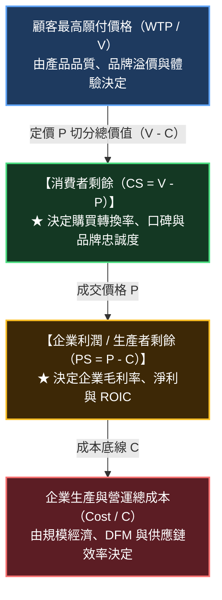
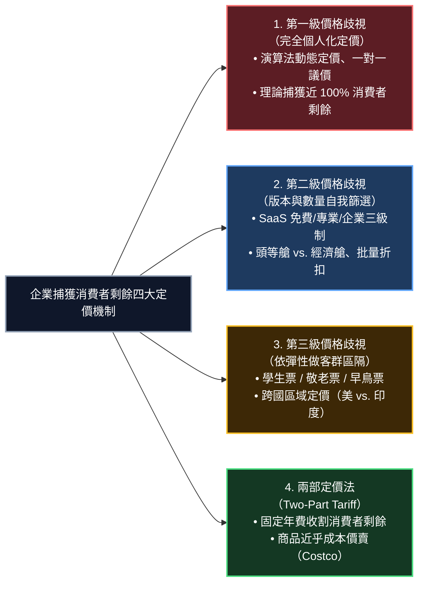

---
{"dg-publish":true,"permalink":"/98/consumer-surplus/","tags":["商業概念","微觀經濟學","定價策略","價值創造","競爭優勢","商業模式","價格歧視","PMBA"],"dg-note-properties":{"aliases":["消費者剩餘","顧客剩餘","買方剩餘","Consumer Surplus","Customer Surplus","Buyer Surplus","CS"],"tags":["商業概念","微觀經濟學","定價策略","價值創造","競爭優勢","商業模式","價格歧視","PMBA"]}}
---


# 消費者剩餘 (Consumer Surplus, CS / 顧客剩餘)

> **商管核心價值**：  
> 「顧客從來不是買『最便宜（$P$ 最低）』的產品，也不是買『最好（$V$ 最高）』的產品；顧客永遠選擇能為自己創造最大『消費者剩餘（$V - P$ 最大）』的產品。」  
> 「商業定價的終極藝術在於微妙的平衡：既要透過分級定價合理捕獲部分消費者剩餘以轉化為企業利潤，又必須刻意為顧客保留足夠豐厚的『超值感』，才能鑄造對手無法撬動的品牌護城河。」——阿爾弗雷德·馬歇爾（Alfred Marshall）與當代策略管理學派  
> 
> 在微觀經濟學與 PMBA 策略管理中，**消費者剩餘（Consumer Surplus, CS）** 是指消費者內心願意為一項商品支付的**最高願付價格（Willingness to Pay, $\text{WTP}$）**，減去實際支付的**市場成交價格（Price, $P$）**之間的正向差額。它量化了交易帶給消費者的「淨福利與超值感」，是連結 **[[98_商業概念庫/vpc-value-price-cost_價值價格成本分析\|VPC 價值-價格-成本架構]]**、**三級價格歧視定價**與**永續競爭優勢**的核心基石。

---

## 一、 理論淵源與微觀經濟學數理模型

### 1.1 學術奠基
- **概念首創**：法國工程師兼經濟學家 **儒勒·杜皮特（Jules Dupuit, 1844）** 在評估橋樑與公共建設的社會效益時首次提出「相對效用」概念。
- **正式定型**：英國新古典經濟學宗師 **阿爾弗雷德·馬歇爾（Alfred Marshall）** 於 1890 年《經濟學原理》（*Principles of Economics*）中正式命名為 **Consumer's Surplus**，並以供需曲線幾何面積將其嚴謹化。

---

### 1.2 核心計算公式與幾何意涵

1. **單一消費者剩餘（Individual Consumer Surplus）**：
   $$\text{CS}_i = \text{WTP}_i - P$$
   - 僅當 $\text{WTP}_i \ge P$（消費者剩餘大於等於 0）時，理性消費者才會完成購買交易。
   - 若某顧客覺得一杯精品咖啡值 NT\$ 200（$\text{WTP} = 200$），而實際售價僅 NT\$ 120（$P = 120$），則其獲得了 **NT\$ 80 的消費者剩餘**。

2. **市場總消費者剩餘（Market Consumer Surplus）**：
   在市場需求函數 $P = D(Q)$ 與均衡價格 $P^*$、成交量 $Q^*$ 下，總消費者剩餘即為需求曲線下方、市場價格線上方之積分面積：
   $$\text{Market CS} = \int_{0}^{Q^*} D(Q)\,dQ - P^* Q^*$$
   - 若需求曲線為線性（最高截距為 $P_{\max}$），則簡化為三角形面積公式：
     $$\text{Market CS} = \frac{1}{2} \times (P_{\max} - P^*) \times Q^*$$

```
  價格 (P)
   ▲
Pmax ●
   │ \
   │  \  【消費者剩餘 (Consumer Surplus, CS)】
   │   \   = 需求曲線下方、價格線 P* 上方之三角形面積
   │    \  = 顧客享有的總「超值福利」
P* ├─────● E (市場均衡點)
   │    /│
   │   / │  【生產者剩餘 (Producer Surplus, PS)】
   │  /  │    = 價格線 P* 下方、供給曲線上方之面積
   │ /   │    = 企業獲得的總經濟利潤 (扣除變動成本)
   └─────┴────────────────────────────► 數量 (Q)
         Q*
```

---

## 二、 策略管理視角：VPC 價值楔子與競爭勝負法則

在策略管理學（Brandenburger & Stuart 價值楔子模型）中，**消費者剩餘**是決定市場份額流向的終極裁判：



### 2.1 市場競爭的「最大消費者剩餘鐵律」
假設市場上有甲、乙兩家競爭對手提供替代產品，理性顧客的選擇準則為：
$$\text{選擇甲企業} \iff (V_{\text{甲}} - P_{\text{甲}}) > (V_{\text{乙}} - P_{\text{乙}})$$
- **策略推論**：
  1. **為何高價精品依然賣爆？** 若 Apple 產品的體驗價值 $V$ 高出對手 NT\$ 15,000，即使定價 $P$ 貴了 NT\$ 8,000，顧客仍多賺了 NT\$ 7,000 的消費者剩餘！
  2. **如何贏得競爭優勢？** 企業必須先將總價值楔子 $V - C$ 拉得比對手更大（參見 [[98_商業概念庫/efficient-frontier_效率前緣\|效率前緣]]），才有本錢同時做到：**留給顧客更大的消費者剩餘（$V - P$ 搶市占），且自己賺取更高的生產者剩餘（$P - C$ 賺超額利潤）**。

---

## 三、 企業如何「捕獲」消費者剩餘？定價策略武器庫

在單一統一定價（Uniform Pricing）下，企業必然錯失高願付客群的超額支付意願（留下過多 CS），同時把低願付客群擋在門外（造成無謂損失 Deadweight Loss）。頂尖企業透過**價格歧視（Price Discrimination）**與**兩部定價**精準收割消費者剩餘：



### 3.1 四大定價策略深度對照與實戰案例

| 定價機制 | 核心運作原理 | 對消費者剩餘（CS）的影響 | 經典商業實證 |
| :--- | :--- | :--- | :--- |
| **第一級價格歧視**<br>（完全價格歧視） | 精準掌握每位買家的個別 $\text{WTP}_i$，每人收取不同價格 | 幾乎將全部 CS 轉化為企業利潤，**但極易引發顧客「被大數據殺熟」的公關危機** | 美國常春藤大學依家庭財力給予不同獎學金；航空/叫車演算法動態定價 |
| **第二級價格歧視**<br>（版本分級定價） | 設計不同功能組合或購買量階梯，讓高願付客群主動挑選高價版本 | 兼顧低價擴大客群與高價收割核心大戶的 CS，心理接受度高 | Notion / ChatGPT Plus / Enterprise 分層訂閱；iPhone 儲存容量階梯定價 |
| **第三級價格歧視**<br>（客群區隔定價） | 依外部可辨識標籤（年齡、職業、地區、購票時間）將不同需求彈性客群隔離 | 對低彈性商務客收高價收割 CS；對高彈性學生客給折扣消除無謂損失 | 高鐵早鳥票與商務車廂；Spotify 與 Netflix 跨國購買力平價（PPP）分區定價 |
| **兩部定價法**<br>（Two-Part Tariff） | 收取「固定入場費（會員年費）」＋「極低邊際使用費」 | 透過低商品售價創造極大單次購物 CS，再以會員年費一次性合理回收部分 CS | **Costco 好市多**（商品毛利壓死於 14% 以下，靠高續卡率會員年費貢獻逾 70% 淨利）；Amazon Prime |

---

## 四、 策略反直覺智慧：為何頂尖巨頭刻意「把剩餘留給顧客」？

許多短視的壟斷企業會試圖透過不斷漲價將顧客的消費者剩餘壓縮至趨近於零（$\text{CS} \to 0$），但這往往是企業走向衰敗的起點：

1. **過度榨取的反噬（零忠誠度與脆弱護城河）**：
   - 當 $\text{CS} \approx 0$ 時，顧客每次消費都在心裡盤算「是不是被當盤子」，毫無情感連結。一旦市場出現性價比略高的挑戰者，顧客會以零猶豫的速度集體出走。
2. **「刻意留餘（Deliberate Surplus Sharing）」的護城河飛輪**：
   - **Amazon 與 Costco 哲學**：貝佐斯名言 *「你的毛利就是我的機會（Your margin is my opportunity）」*。Costco 嚴格規定任何商品毛利率不得超過 14%，刻意將龐大的消費者剩餘留給會員——這創造了無與倫比的**超值口碑（極低獲客成本 CAC）**、**高達 90%+ 的會員續費率**，以及競爭對手根本無法打進來的規模成本壁壘！
   - **行為經濟學加乘**：當顧客長期享有豐厚消費者剩餘，透過 [[98_商業概念庫/endowment-effect_稟賦效應\|稟賦效應]] 與習慣鎖定，會將此超值體驗內化為日常基準，形成極高轉換成本。

---

## 五、 高階經理人定價與剩餘管理檢核清單

```markdown
### 📋 消費者剩餘與定價優化 5 步審計表

- [ ] 1. 【真實 WTP 測繪】：我們的定價是基於「成本加成（Cost-Plus）」，還是基於客觀調研測出的顧客最高願付價格（WTP）？是否錯失了高價值客群的剩餘空間？
- [ ] 2. 【版本階梯設計（第二級歧視）】：產品線是否過度單一？能否透過「基礎版 / 旗艦版 / 企業客製版」設計，讓高 WTP 客戶透過自我篩選釋放利潤？
- [ ] 3. 【防範過度收割警報】：近期漲價或收費條款調整後，客戶 NPS（淨推薦值）或流失率（Churn Rate）是否顯著惡化？是否已逼近顧客的公平感紅線？
- [ ] 4. 【剩餘轉化為護城河】：在非核心獲利品項（引流品／會員商品）上，我們是否刻意保留了足夠驚艷的消費者剩餘，以換取低 CAC 與高復購率？
- [ ] 5. 【跨時空套利防堵】：實施第三級價格歧視（如分區定價、早鳥優惠）時，是否已建立防止「低價區商品回流高價區套利（Arbitrage）」的隔離防火牆？
```

---

## 六、 PMBA 模組講義與知識網絡鏈結

### 6.1 官方課程與模組雙向反向鏈結
- [[04_主題選修/10_創業與企業財務策略/02_模組筆記/Module_1_創新思維與商業模式/M1-9_商業模式畫布架構與價值主張設計\|M1-9 商業模式畫布架構與價值主張設計]]：
  - **價值主張與收益流（Revenue Streams）設計**：剖析如何透過價值主張拉高顧客 $\text{WTP}$，並藉由訂閱、分級與兩部定價模型合理切分消費者剩餘與企業利潤。
- [[04_主題選修/10_創業與企業財務策略/02_模組筆記/Module_1_創新思維與商業模式/M1-10_七大市場力量與商業戰略價值公式\|M1-10 七大市場力量與商業戰略價值公式]]：
  - **定價權（Pricing Power）與市場力量**：唯有具備品牌、網絡效應或轉換成本護城河的企業，才能在拉高定價 $P$ 的同時仍維持正向消費者剩餘。
- [[04_主題選修/12_產業分析與投資策略/02_模組筆記/Module_1_總論與架構/M1-3_產業獲利結構差異與十大經典理論\|M1-3 產業獲利結構差異與十大經典理論]]：
  - **需求價格彈性與市場結構**：需求曲線斜率（彈性大小）直接決定了消費者剩餘的幾何規模以及廠商的加價空間。

### 6.2 商業概念庫相關卡片
- [[98_商業概念庫/vpc-value-price-cost_價值價格成本分析\|vpc-value-price-cost_價值價格成本分析]]（消費者剩餘 $V - P$ 與企業利潤 $P - C$ 的雙向對偶架構）
- [[98_商業概念庫/competitive-advantage_競爭優勢\|competitive-advantage_競爭優勢]]（價值楔子模型中，競爭優勢本質是能同時提供更大 CS 與更高 PS）
- [[98_商業概念庫/efficient-frontier_效率前緣\|efficient-frontier_效率前緣]]（向外推移效率前緣，是無須犧牲利潤即可同步擴大消費者剩餘的終極解法）
- [[98_商業概念庫/market-segmentation_市場區隔\|market-segmentation_市場區隔]]（實施第三級價格歧視、精準收割不同客群消費者剩餘的前置基礎）
- [[98_商業概念庫/endowment-effect_稟賦效應\|endowment-effect_稟賦效應]]（免費試用預先交付心理所有權，有效推升顧客最高願付價格 $\text{WTP}$）
- [[98_商業概念庫/framing-effect_框架效應\|framing-effect_框架效應]]（透過微額框架與折扣框架降低顧客對價格 $P$ 的損失痛感，放大主觀消費者剩餘）
