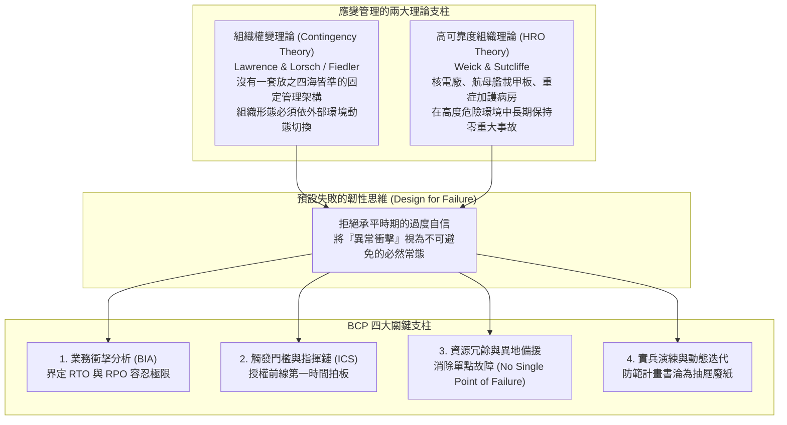
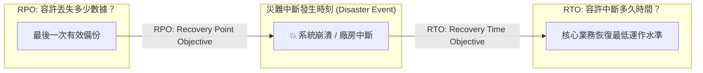

---
{"dg-publish":true,"permalink":"/98/contingency-planning/","tags":["商業概念","策略管理","危機管理","營運管理","PMBA"],"dg-note-properties":{"aliases":["應變計畫","Contingency Planning","業務持續計畫","BCP","Business Continuity Planning","應急預案"],"tags":["商業概念","策略管理","危機管理","營運管理","PMBA"]}}
---


# 應變計畫 (Contingency Planning)

> [!NOTE]
> **核心概念精粹**：應變計畫（Contingency Planning），在現代企業治理中常具體化為**業務持續計畫（Business Continuity Planning, BCP）**，是指組織為了防範、抵禦並在遭遇重大非預期突發事件（如自然災害、資安勒索、供應鏈斷鏈、地緣政治制裁或關鍵高管意外）時，能夠以最短時間、最低代價恢復核心運作所預先制定的系統性應急指引與資源調度架構。它的精髓在於**「預設崩潰（Design for Failure）」**，將混亂時刻的即興恐慌轉化為冷靜受控的程序化執行。

---

## 一、 學理淵源：從權變理論到高可靠度組織

應變計畫的理論根基，跨越了組織管理學與系統安全工程學兩大領域：



---

## 二、 BCP 業務持續計畫的兩大量化黃金指標

在衡量企業應對極端中斷的承受能力時，災難復原工程確立了兩項最核心的量化度量衡：



1. **復原時間目標（Recovery Time Objective, RTO）**：
   - 指從災難發生到核心業務系統、產線或服務恢復至「可接受之最低運作水準」所允許的最大容忍時間。
   - 例如：金融交易系統的 RTO 需在數秒至數分鐘以內；傳統一般製造業的 RTO 可容忍 24~48 小時。
2. **復原點目標（Recovery Point Objective, RPO）**：
   - 指在災難發生前，系統允許丟失的「最大數據時間跨度」。
   - 例如：銀行跨國匯款的 RPO 必須為零（即時雙活備份，一筆交易都不能少）；一般電商後台的 RPO 可容忍回溯至 1 小時前的備份。

---

## 三、 經典企業實戰案例：台積電大地震後的閃電復原 vs 脆弱供應鏈的反思

```carousel

<!-- slide -->
### 1. 台積電的極限 BCP：2024 年花蓮 7.2 強震後的十小時奇蹟
- **背景**：2024 年 4 月 3 日花蓮爆發芮氏規模 7.2 強震，全台晶圓廠面臨晶圓石英管破裂、極紫外光（EUV）精密機台光學移位之極端威脅；
- **應變機制觸發**：
  - 依照 BCP 預案，地震發生 3 秒內自動切斷危險氣體供應，廠區員工十秒內全員疏散，無任何人員傷亡；
  - 應變指揮中心（Emergency Response Center）於 15 分鐘內成立，機台供應商（ASML、應用材料）數百名工程師依既定協議於 2 小時內進駐廠區進行精度校準；
- **成果**：震後僅 10 小時，全廠機台復原率超過 70%；36 小時內全面復工，全季營收指引毫無受挫，被全球金融界譽為全球高科技 BCP 的奇蹟典範。
<!-- slide -->
### 2. 反面警示：單一原料依賴引發的全球斷鏈
- 2021 年全球車用晶片荒爆發期間，日本瑞薩電子（Renesas）那珂工廠發生火災，導致全球各大車廠（豐田、福斯、福特）因缺少關鍵微控制器（MCU）而被迫停產數週；
- **痛點根源**：車廠過去數十年將豐田式「準時生產（Just-in-Time, JIT）」推向極致，消滅了所有安全庫存，且過度依賴單一核心供應商，缺乏有效的供應鏈應變計畫（Contingency Sourcing），最終付出數百億美元停工代價。
```

---

## 四、 經理人應變計畫審計與實兵檢核表（Executive Decision Checklist）

企業應變計畫絕不能淪為向保險公司或監管單位交差的「抽屜文件」，必須定期進行實戰體檢：

- [ ] **明確觸發閾值檢驗（Clear Trigger Thresholds）**：
  - 應變計畫是否明確規定了由誰在什麼條件下宣布「進入危機狀態」？（例如：若主要雲端供應商中斷超過 30 分鐘，或產線停擺超過 2 小時，無需請示董事會，前線應變官即可自動啟動備援協議）。
- [ ] **單點故障清零（Zero Single Point of Failure, SPOF）**：
  - 本公司的核心命脈業務，是否存在不可替代的「單一關鍵員工、單一供應商、單一資料中心」？如果該節點遭遇不可抗力中斷，是否有即時備用方案？
- [ ] **未通知突擊演練（Unannounced Drill Audit）**：
  - 公司上一次舉行「不預先通知的突發性 BCP 實兵演習」是什麼時候？團隊是否在完全切斷主伺服器電源或阻斷主要辦公室通訊時，真正測試過備援系統的切換？
- [ ] **外部利益相關者通報協議（External Communication Protocols）**：
  - 危機發生時，公關、法務與客服部門是否掌握統一口徑的通報模板？能否在事件發生後 1 小時內主動向客戶與主管機關通報透明訊息，以防止謠言引發擠兌與商譽瓦解？

---

## 五、 關聯概念與知識網絡

* 核心危機管理與營運防禦：
  * [[analysis_情境分析|情境分析 (Scenario Analysis)]]：推演黑天鵝世界以制定應變預案
  * [[monte-carlo-simulation_蒙地卡羅模擬|蒙地卡羅模擬 (Monte Carlo Simulation)]]：評估極端中斷對財務與工期之衝擊機率
  * [[fat-tail-theory_肥尾理論|肥尾理論 (Fat-Tail Theory)]]：為不可能發生之極端事件預留戰略儲備
  * [[risk-control_風險控制|風險控制 (Risk Control)]]：從製程公差管理到組織韌性防禦
* 治理與組織行為：
  * [[risk-governance_風險控管|風險控管 (Risk Governance)]]：董事會層級之危機指揮與授權體系
  * [[Tolerance_of_Ambiguity_不確定性容忍度與控制感|不確定性容忍度與控制感 (Tolerance of Ambiguity)]]：混亂衝擊下的高管冷靜心智
  * [[contingency-theory_權變理論|權變理論 (Contingency Theory)]]：應變管理的組織學理論淵源
  * [[great-company_好公司|好公司 (Great Company)]]：基業長青企業之跨週期自我修復力
