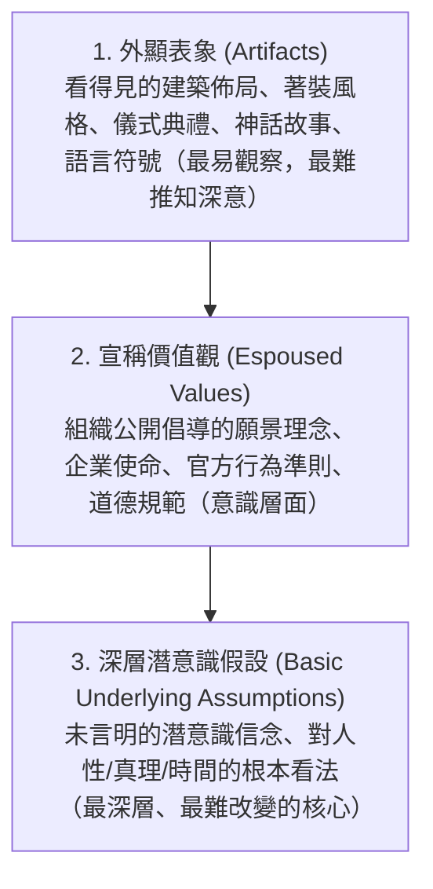

---
{"dg-publish":true,"permalink":"/98/corporate-culture/","tags":["商業概念","組織行為","策略管理","PMBA"],"dg-note-properties":{"aliases":["企業文化","組織文化","corporate-culture_企業文化","Corporate Culture","Organizational Culture"],"tags":["商業概念","組織行為","策略管理","PMBA"],"類別":"商業概念庫"}}
---

# 企業文化 (Corporate Culture)

> **核心名言**：「文化能把策略當早餐吃（Culture eats strategy for breakfast）。」  
> —— 彼得·杜拉克（Peter F. Drucker）

---

## 一、 核心定義與本質

- **企業文化（Corporate Culture）**，又稱**組織文化（Organizational Culture）**，指一個組織在長期解決外部適應與內部整合問題時，所發展、發現或創造的一套**共享價值觀（Shared Values）、核心信仰（Beliefs）、行為規範（Norms）與符號系統**。
- **本質與功能**：
  1. **降低交易與溝通成本**：為組織成員提供隱性的行動指引與心智模式，減少監控與科層溝通摩擦。
  2. **凝聚向心力與組織認同**：塑造組織邊界與身分認同，強化對組織使命與目標的承諾。
  3. **策略執行與護城河**：獨特且強大的企業文化極難被競爭同業模仿，是形成持續性競爭優勢與[[98_商業概念庫/economic-moat_經濟護城河\|economic-moat_經濟護城河]]的深層基石。

---

## 二、 經典理論模型

### 1. 埃德加·沙因（Edgar Schein）文化三層次模型
沙因將組織文化由外而內拆解為三個相互滲透的同心圓層次：

- **管理警示**：許多企業的「宣稱價值觀」（如誠信、創新）若未能深植為員工日常決策的「基本假設」，便會演變為口號文化或雙重標準。

### 2. 卡麥隆與奎恩（Cameron & Quinn）競值架構模型 (CVF)
依據「彈性 vs. 控制」與「內部導向 vs. 外部導向」兩大軸線，將文化分為四種類型：

| 文化形態 | 核心特徵 | 領導風格 | 價值驅動與適用情境 |
| :--- | :--- | :--- | :--- |
| **家族文化 (Clan)** | 內部關注、高彈性，強調團隊合作、關懷同仁與凝聚力 | 導師型、家長型 | 承諾、溝通、人力資本長期培育 |
| **創新型文化 (Adhocracy)** | 外部關注、高彈性，強調冒險開拓、敏捷創新與創業家精神 | 創業家、願景型 | 創新產出、敏捷轉型、高科技與新創 |
| **市場型文化 (Market)** | 外部關注、高控制，強調目標達成、績效競爭與贏得市場 | 成果導向、嚴格督導 | 市占率擴張、獲利率、激烈競爭環境 |
| **科層型文化 (Hierarchy)** | 內部關注、高控制，強調程序規範、秩序穩定與風險控管 | 協調者、管理者 | 效率、標準化、零失誤（如金融合規、製造） |

---

## 三、 經理人策略意涵與實踐

1. **文化與併購整合（Post-Merger Integration, PMI）**：
   - 統計顯示，跨國併購超過 60% 的失敗主因在於「文化衝突（Culture Clash）」而非財務評價。在做 M&A 盡職調查時，必須同步進行組織文化審計。
2. **領導力與文化重塑**：
   - 文化是由領導者「注意什麼、衡量什麼、獎懲什麼」所塑造出來的。
   - 柯特（Kotter）指出，文化變革並非第一步，而是變革行動取得實質成果後，將新行為「錨定」入組織文化之中。

---

## 🔗 關聯主題

- **組織與領導**：[[02_核心必修/03_組織行為/_組織行為 MOC\|_組織行為 MOC]] · [[98_商業概念庫/transformational-leadership_轉換型領導\|transformational-leadership_轉換型領導]] · [[98_商業概念庫/two-factor-theory_雙因素理論\|two-factor-theory_雙因素理論]]
- **變革與整合**：[[98_商業概念庫/change-management_變革管理\|change-management_變革管理]] · [[98_商業概念庫/merger-acquisition_併購綜效\|merger-acquisition_併購綜效]] · [[98_商業概念庫/enterprise-m-and-a_企業併購\|enterprise-m-and-a_企業併購]]
- **跨國環境**：[[98_商業概念庫/_待改寫草稿庫/culture_高低語境文化\|culture_高低語境文化]] · [[98_商業概念庫/_待改寫草稿庫/culture-dimension_霍夫斯泰德文化維度\|culture-dimension_霍夫斯泰德文化維度]] · [[98_商業概念庫/_待改寫草稿庫/culture-2_文化智商\|culture-2_文化智商]]
