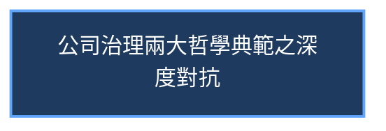

---
{"dg-publish":true,"permalink":"/98/corporate-governance/","tags":["商業概念","公司治理","策略管理","組織契約","PMBA"],"dg-note-properties":{"aliases":["公司治理","Corporate Governance","企業管治","治理機制","董事會治理"],"tags":["商業概念","公司治理","策略管理","組織契約","PMBA"]}}
---


# 公司治理 (Corporate Governance & Institutional Architecture)

> **【核心決策摘要】**
> **公司治理（Corporate Governance）** 是指指導、管理、激勵與制衡企業運作的一整套內部制度安排、外部市場機制與法規制度架構。經濟合作暨發展組織（OECD）將其精闢定義為：「**企業管理層、董事會、股東及其他利害關係人（Stakeholders）之間的權利義務配置與相互制衡體系**」。公司治理的根本出發點在於解決現代企業中「所有權與經營權高度分離」所誘發的委託代理摩擦。一套健全的治理體系，透過**內部治理四大支柱（董事會獨立性、專業委員會、股權激勵契約、內部控制）** 與 **外部治理四大力量（控制權接管市場、經理人聲譽市場、外部審計監管、激進投資人）** 的雙輪驅動，有效防範內部人道德風險與掏空行為，降低企業資本成本，創造高達 20%~25% 的「治理溢價（Governance Premium）」。

---

## 1. 概念核心定義與治理哲學演進 (Executive Definition & Theoretical Evolution)

### 1.1 兩大治理哲學的根本思潮對決
現代商業社會對「企業究竟為誰而存在」存在兩大經典哲學分野：



### 1.2 全球兩大主流治理體系架構
各國法規與資本市場結構塑造了兩種截然不同的公司治理模式：
1. **英美市場導向型（Anglo-Saxon Market-based Model）**：
   - **特徵**：股權高度分散（Institutional Investors 佔多數），單一董事會架構（Unitary Board）。
   - **核心驅動**：高度依賴發達的資本市場外部接管威脅（Hostile Takeover）與股權激勵來約束經理人。
2. **歐陸與日德利害關係人導向型（Continental European / Bank-oriented Model）**：
   - **特徵**：股權相對集中（家族控股或大銀行持股），典型雙層董事會制度（Two-Tier Board：監事會 Supervisory Board + 執行董事會 Management Board）。
   - **核心驅動**：監事會中強制納入工會勞工代表（共同決定制 Codetermination），強調長期共生與產業資本深耕。

---

## 2. 內部治理 vs. 外部治理雙輪驅動機制 (Internal & External Mechanisms)

健全的公司治理絕非單純依靠法規條文，而是依靠內外部市場機制的立體咬合：

```mermaid
flowchart TD
    subgraph 內部治理機制 (Internal Governance)
        A1["董事會架構：獨立董事過半、董總雙職分離"]
        A2["專業委員會：審計、薪酬、提名委員會實權運作"]
        A3["長效激勵契約：股權成熟 (Vesting)、績效限制股 (PSU)"]
        A4["內控與稽核：COSO 風險框架、舞弊吹哨人機制"]
    end

    subgraph 外部治理機制 (External Governance)
        B1["公司控制權市場：敵意併購威脅 (Market for Corporate Control)"]
        B2["經理人聲譽市場：經理人個人職業生涯信用定價"]
        B3["外部獨立審計：四大會計師事務所專業背書與簽證"]
        B4["法律監管與司法救濟：證交法防偽、股東集體訴訟 (Class Action)"]
    end

    A1 & A2 & A3 & A4 ==> C["企業核心經理人決策團隊"]
    B1 & B2 & B3 & B4 ==> C
    C ==> D["極大化企業可持續內在價值，保護全體股東與利害關係人"]
```

### 2.1 內部治理四大核心要件
1. **董事長與執行長（CEO）雙職分離（Duality Separation）**：若同一人身兼董事長（監督者）與 CEO（執行者），等同於「自己監督自己」，監督機制必然名存實亡。
2. **獨立董事實質實權化（Independent Directors）**：獨立董事席次應達到至少三分之一以上（標竿企業如台積電過半），且必須嚴格審查其與控股股東間的無利益關聯性。
3. **高階經理人薪酬契約與追回條款（Clawback Provisions）**：薪酬結構應大幅降低固定薪資比例，綁定 3~5 年以上的長期股權（參見 [[98_商業概念庫/equity-vesting_股權成熟機制\|equity-vesting_股權成熟機制]]）；並明訂若日後發生財報重編或舞弊，公司有權追回全額已發放獎金。
4. **關聯交易嚴格防火牆**：控股股東與關聯企業之資產買賣、借貸擔保必須經無利害關係之獨立審計委員會事前審查並提交股東會表決。

---

## 3. 數理模型與治理溢價 (Mathematical Modeling & Governance Premium)

### 3.1 投資人願付之「公司治理溢價」模型

資本市場對治理健全的企業給予顯著的估值溢價（Corporate Governance Premium），其本質是**降低了股東要求的必要報酬率（權益資本成本 $K_e$ 下降）**：

$$\text{Firm Value } V = \sum_{t=1}^{\infty} \frac{\text{FCFF}_t}{(1 + \text{WACC}_{\text{gov}})^t}$$

$$\text{WACC}_{\text{gov}} = w_d K_d(1-t) + w_e (K_e - \Delta_{\text{gov}})$$

- $\Delta_{\text{gov}}$：治理溢價折減值。當企業資訊揭露透明、內控無舞弊隱患時，外部投資人面臨的資訊不對稱風險大幅降低，要求的流動性與風險貼水下調，推動企業價值倍數（P/E、EV/EBITDA）顯著擴張。
- **實證研究支撐**：麥肯錫（McKinsey）全球投資人調查指出，全球機構投資人願為亞洲高標準公司治理企業平均支付 **20% 至 25%** 的估值溢價。

---

## 4. 產業標竿與實戰應用場景 (Industry Benchmarks & Applications)

| 治理維度 | 頂尖標竿實務 (Best Practice) | 治理失靈高危警訊 (Red Flags) | 實例對比 |
| :--- | :--- | :--- | :--- |
| **董事會結構** | 獨立董事席次過半；董總嚴格分開；獨董具備全球半導體或金融專業背景 | 董事長兼任 CEO；董事名單充斥家族親戚、政界退休官員或利益關係人 | 台積電（獨立董事席次佔多數） vs. 家族化傳統企業 |
| **股權結構與控制權** | 控制權與現金流索償權高度對齊（One Share, One Vote 一股一票） | 複雜的金字塔控股（Pyramid Structure）、交叉持股、以 5% 股權控制 100% 董事會席次 | Google 規範透明的雙重股權 vs. 亞洲部分控股集團 |
| **財務資訊透明度** | 每季主動召開雙語法說會、自願性揭露碳足跡與供應鏈責任、無保留意見審計報告 | 頻繁更換簽證會計師、大額關聯方借款擔保、財報附註晦澀難懂 | 國際機構評等 AAA 企業 vs. 康美藥業、樂視網 |
| **少數股東保護** | 引進累積投票制（Cumulative Voting）、電子投票便利、落實股東提案權 | 封殺市場派提案、阻撓外部股東查帳、透過子公司增資惡意稀釋少數股東 | 先進資本市場監管 vs. 萬科寶能股權爭奪戰早期 |

---

## 5. 經典企業個案深度剖析 (Deep Dive Case Studies)

### 5.1 成功典範：台積電（TSMC）打造全球最高標準獨立董事會
- **制度構建**：台積電創辦人張忠謀早在 2000 年代初期，便立志將台積電建立為「外資願意百分之百信賴的國際級治理標竿」。
- **治理創新機制**：
  1. **獨立董事佔絕對多數**：董事會中獨立董事席次長期超過半數，成員皆為全球科技界與財經界頂級領袖（如前恩智浦執行長、前英國電信執行長、美國商務部前顧問）。
  2. **全面審計與專業委員會授權**：所有併購、大型資本支出與高階人事案，必須先在全由獨董組成的委員會中經受嚴格質詢。
  3. **完美的傳承交棒**：張忠謀於 2018 年退休時推行「雙首長平行領導制（董事長劉德音 + 總裁魏哲家）」，在強大的董事會監督下順利完成權力過渡，市值持續屢創歷史新高。

### 5.2 失敗警示：Theranos 血液檢測世紀詐欺大案的「董事會失明」
- **災難背景**：伊莉莎白·霍姆斯（Elizabeth Holmes）創立的 Theranos 宣稱僅需「指尖一滴血」即可完成數百項血液檢測，估值一度飆升至 90 億美元。
- **治理體系徹底崩潰解構**：
  1. **政治名流俱樂部，毫無醫療專業**：董事會成員包括前國務卿季辛吉、前國防部長馬提斯、前參議員等政軍大老。無一人具備醫學、生物化學或醫療器材認證背景。
  2. **內部人獨裁與資訊封鎖**：霍姆斯與其男友持有超投票權股票，且嚴格禁止董事與一線實驗室科學家單獨接觸。
  3. **審計與合規形同虛設**：董事會從未要求查驗技術盲測數據，完全淪為創辦人的背書橡皮圖章。
- **下場**：被《華爾街日報》記者調查踢爆詐欺造假，公司清算破產，霍姆斯被判處 11 年以上有期徒刑。

---

## 6. 高階經理人決策實戰工具箱 (Executive Action Playbook)

### 6.1 公司治理健全度自我審計清單 (Governance Audit Checklist)
- [ ] **審計 1：董事長與執行長（CEO）是否由不同人員擔任？**（若未分開，是否設立了獨立的「首席獨立董事 Lead Independent Director」？）。
- [ ] **審計 2：審計委員會成員是否 100% 由具備財務會計專業之獨立董事擔任？**
- [ ] **審計 3：過去 3 年內，是否存在向董事、高管或大股東關聯企業提供重大擔保或借款的情事？**
- [ ] **審計 4：高階管理層的薪酬契約中，長期股權激勵（鎖定 3 年以上）佔總薪酬比重是否超過 50%？**
- [ ] **審計 5：內部是否建立了獨立於管理層之外、直接向審計委員會匯報的「反舞弊吹哨人專用管道」？**

---

## 7. 關聯知識網絡與導航地圖 (Knowledge Network & Cross-References)

### 7.1 本主題核心三部曲
- **[[98_商業概念庫/corporate-governance_公司治理\|corporate-governance_公司治理]]** · 內部制度與外部市場制衡體系、兩大治理哲學與董事會獨立性（本篇）
- **[[98_商業概念庫/agency-problem_代理人問題\|agency-problem_代理人問題]]** · 所有權與經營權分離、三大維度代理衝突與隧道效應
- **[[98_商業概念庫/agency-costs_代理成本\|agency-costs_代理成本]]** · 詹森-麥克林福利損失模型、監督成本、保證成本與剩餘損失極小化

### 7.2 跨領域財務與策略鏈結
- [[98_商業概念庫/equity-vesting_股權成熟機制\|equity-vesting_股權成熟機制]] · 解決第一類代理問題、實現股東與經理人利益綁定之核心契約工具
- [[98_商業概念庫/capital-structure_資本結構\|capital-structure_資本結構]] · 詹森自由現金流假說：負債融資作為約束經理人代理成本之紀律工具
- [[98_商業概念庫/shareholder-wealth-maximization_股東財富極大化\|shareholder-wealth-maximization_股東財富極大化]] · 股東至上主義哲學與現代 ESG 利害關係人思潮
- [[98_商業概念庫/second-generation-succession_二代接班\|second-generation-succession_二代接班]] · 家族企業傳承、所有權經營權重構與治理機制進化
- [[98_商業概念庫/risk-governance_風險控管\|risk-governance_風險控管]] · 董事會層級之全面風險管理（ERM）與合規內控

### 7.3 課程筆記與導航主頁
- [[02_核心必修/01_財務管理/L09_資本結構理論與決策\|L09_資本結構理論與決策]] · 財務策略模組九：公司治理、資本結構與代理成本
- [[04_主題選修/10_創業與企業財務策略/_創業與企業財務策略 MOC\|_創業與企業財務策略 MOC]] · 企業財務策略與資本市場運作全景地圖
- [[home\|home]] · 全球 PMBA 知識庫總導航主頁面