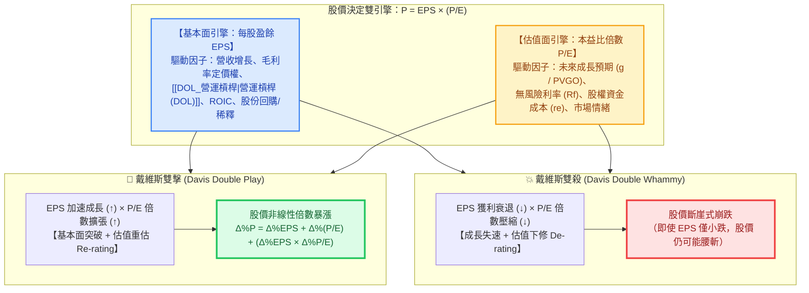

---
{"dg-publish":true,"permalink":"/98/davis-double-whammy/","tags":["商業概念","財務管理","企業評價","證券分析","產業分析","投資策略","PMBA"],"dg-note-properties":{"aliases":["戴維斯雙殺效應","戴維斯雙殺","戴維斯雙擊","戴維斯雙擊效應","戴維斯效應","Davis Double Whammy","Davis Double Play","Davis Effect","davis-double-whammy","davis-double-play"],"tags":["商業概念","財務管理","企業評價","證券分析","產業分析","投資策略","PMBA"]}}
---

# 戴維斯雙殺與雙擊效應 (Davis Double Whammy & Double Play)

> 💡 **導航與索引**：本篇為解析資本市場估值非線性暴漲與崩跌之核心機制，亦可參閱相對估值乘數 [[98_商業概念庫/EPS_本益比_Earnings Per Share\|本益比 (P/E Ratio)]]、基本面獲利指標 [[98_商業概念庫/_待改寫草稿庫/earnings-per-share_每股盈餘\|每股盈餘 (Basic EPS)]] 與 [[98_商業概念庫/diluted-eps_稀釋後每股盈餘\|稀釋後每股盈餘 (Diluted EPS)]]、成長定價錨點 [[98_商業概念庫/pvgo_成長機會現值\|成長機會現值 (PVGO)]]、內在價值母法 [[98_商業概念庫/dcf_現金流量折現法\|現金流量折現法 (DCF)]]，以及折現率基準 [[98_商業概念庫/wacc_加權平均資本成本\|加權平均資本成本 (WACC)]]。

## 一、 核心定義與理論起源

- **理論淵源**：由美國傳奇投資大師**謝爾比·戴維斯（Shelby Cullom Davis, 1909–1994）**於 1940～1990 年代實戰提出（詳載於經典傳記《戴維斯王朝》*The Davis Dynasty*）。戴維斯於 1947 年以 5 萬美元本金投入股市，憑藉精準捕捉企業「盈餘成長」與「估值倍數擴張」的乘數共振，在 47 年間將家族資產複利累積至 9 億美元（年化複合報酬率高達 **23.18%**）。
- **核心財務本質**：
  在資本市場中，企業的每股市價（$P$）並非單純由當期會計獲利線性決定，而是由**「實體基本面獲利（$\text{EPS}$）」**與**「市場預期估值倍數（$P/E$）」**兩個獨立卻高度連動的變數**相乘**而成：
  $$\text{每股市價 } (P) = \text{每股盈餘 } (\text{EPS}) \times \text{本益比倍數 } \left(\frac{P}{E}\right)$$
- **雙向非線性乘數效應**：
  - **📈 戴維斯雙擊 (Davis Double Play / Positive Double Whammy)**：
    當企業處於景氣復甦或第二成長曲線突破拐點，**每股盈餘加速成長（$\text{EPS} \uparrow$）**，同時資本市場對其未來成長前景轉趨樂觀（或受惠降息寬鬆），願意給予更高的**本益比估值倍數（$P/E \uparrow$，Valuation Expansion / Re-rating）**。兩股正向力量相乘，推動股價產生非線性的倍數暴漲。
  - **📉 戴維斯雙殺 (Davis Double Whammy / Negative Double Play)**：
    當高估值企業成長動能失速、護城河受損或遭遇總經升息緊縮，**每股盈餘開始下滑（$\text{EPS} \downarrow$）**，同時市場打破對其高成長的信仰，將其估值體系由「高成長股」降級為「平庸成熟股」，導致**本益比倍數劇烈壓縮（$P/E \downarrow$，Valuation Compression / De-rating）**。獲利衰退與估值下修雙重打擊相乘，引發股價斷崖式崩盤。

---

## 二、 數理機制拆解與 DCF / PVGO 理論錨定

### 1. 離散變動與交叉乘積項推導
設期初股價 $P_0 = \text{EPS}_0 \times (P/E)_0$，期末股價 $P_1 = \text{EPS}_1 \times (P/E)_1$。
令每股盈餘變動率為 $g_{\text{EPS}} = \frac{\Delta \text{EPS}}{\text{EPS}_0}$，本益比變動率為 $g_{\text{PE}} = \frac{\Delta (P/E)}{(P/E)_0}$，則股價總報酬率 $\frac{\Delta P}{P_0}$ 為：
$$1 + \frac{\Delta P}{P_0} = (1 + g_{\text{EPS}}) \times (1 + g_{\text{PE}})$$
$$\frac{\Delta P}{P_0} = g_{\text{EPS}} + g_{\text{PE}} + \underbrace{(g_{\text{EPS}} \times g_{\text{PE}})}_{\text{戴維斯共振交叉項}}$$

### 2. 量化模擬：雙擊與雙殺的極端非對稱威力

| 情境模擬 | 期初狀態 ($t=0$) | 期末狀態 ($t=1$) | 基本面變動 ($g_{\text{EPS}}$) | 估值面變動 ($g_{\text{PE}}$) | 股價終值與總變動率 ($\Delta\% P$) | 財務啟示 |
| :--- | :--- | :--- | :---: | :---: | :---: | :--- |
| **🚀 戴維斯雙擊** （低估成長股突破） | $\text{EPS}_0 = \$10$ $(P/E)_0 = 10\text{x}$ **$P_0 = \$100$** | $\text{EPS}_1 = \$20$ $(P/E)_1 = 25\text{x}$ **$P_1 = \$500$** | **$+100\%$** （獲利翻倍） | **$+150\%$** （估值升格） | **$+400\%$** （股價飆漲 **5 倍**） | 交叉項貢獻高達 $+150\%$，估值擴張與獲利成長產生乘數共振。 |
| **💥 戴維斯雙殺** （高估值明星股失速） | $\text{EPS}_0 = \$10$ $(P/E)_0 = 40\text{x}$ **$P_0 = \$400$** | $\text{EPS}_1 = \$8$ $(P/E)_1 = 20\text{x}$ **$P_1 = \$160$** | **$-20\%$** （微幅衰退） | **$-50\%$** （估值腰斬） | **$-60\%$** （股價蒸發六成） | **獲利僅衰退 20%，股價卻暴跌 60%！** 揭示高本益比缺乏安全邊際的脆弱性。 |

### 3. 與 Gordon 折現模型及 PVGO 的深層理論對接
為何 $\text{EPS}$ 成長率（$g$）微幅下修或總經利率（$r_e$）攀升，會導致本益比（$P/E$）瞬間崩塌？
由 [[dividend-discount-model_股利折現模型|Gordon 股利折現模型]] 與 [[pvgo_成長機會現值|成長機會現值 (PVGO)]] 拆解前瞻本益比（Forward P/E）：
$$\frac{P_0}{\text{EPS}_1} = \frac{1 - b}{r_e - g} = \frac{1 - b}{r_e - (\text{ROE} \times b)} = \frac{1}{r_e} + \frac{\text{PVGO}}{\text{EPS}_1}$$
- **分子與分母的雙重敏感度**：
  1. **成長預期破滅（$g \downarrow$ 與 $\text{PVGO} \downarrow$）**：高本益比科技股（如 $P/E = 40\text{x}$）的股價中，往往有高達 $70\% \sim 80\%$ 來自未來成長機會現值（$\text{PVGO}$）。一旦產業競爭惡化使再投資報酬率 $\text{ROE}$ 下滑，預期成長率 $g$ 由 $8\%$ 降至 $4\%$，分母 $(r_e - g)$ 倍增，導致合理本益比瞬間由 $40\text{x}$ 腰斬至 $15\text{x}$。
  2. **總經折現率衝擊（$r_e \uparrow$）**：當美聯準會（Fed）維持高利率、10 年期公債殖利率攀升時，股權要求報酬率 $r_e$ 與 [[wacc_加權平均資本成本|WACC]] 同步墊高，直接壓縮 $\frac{1}{r_e}$ 基本盤與遠期 $\text{PVGO}$ 折現值，觸發估值倍數壓縮（Multiple Compression）。

---

## 三、 資本市場動態演進四象限矩陣

結合「基本面獲利動能（$\Delta \text{EPS}$）」與「資本市場估值重錨（$\Delta P/E$）」，可將產業與企業生命週期劃分為四大戰略象限：

| 象限分類 | 獲利動能 ($\Delta \text{EPS}$) | 估值倍數 ($\Delta P/E$) | 產業生命週期與市場特徵 | 課堂實證與代表案例 |
| :--- | :---: | :---: | :--- | :--- |
| **Ⅰ. 戴維斯雙擊象限** *(Double Play)* | **$\uparrow$ 加速成長** | **$\uparrow$ 倍數擴張** | 技術 S 曲線突破、新興主導設計確立、寡占定價權形成，法人上調目標價與目標本益比。 | **台積電 (2330)**（AI 算力獨佔推動 EPS 高增 + PVGO 推升本益比）、**廣達 (2382)**（由低毛利筆電代工轉型 AI 伺服器，PE 由 10x 升格至 20x+）。 |
| **Ⅱ. 估值消化象限** *(Multiple Digestion)* | **$\uparrow$ 穩健成長** | **$\downarrow$ 倍數收斂** | 企業獲利持續創高，但增速越過二階導數拐點，或遭遇總經升息壓抑估值；以獲利成長抵銷估值壓縮。 | 高利率環境下之成熟雲端巨頭（CSP），獲利仍增長但資本支出（CapEx）龐大壓抑自由現金流與 PE 擴張。 |
| **Ⅲ. 戴維斯雙殺象限** *(Double Whammy)* | **$\downarrow$ 獲利衰退** | **$\downarrow$ 倍數崩塌** | 產業進入成熟衰退期、遭遇破壞式創新替代、成本無法轉嫁，市場撤銷成長溢價。 | **德國福斯汽車 (VW)**（中國電動車產能外溢夾殺 + 關廠裁員）、**Nike**（營收連續三季衰退 + 高利率下本益比大幅下修）。 |
| **Ⅳ. 景氣谷底／轉機象限** *(Molodovsky Effect)* | **$\downarrow$ 獲利探底** | **$\uparrow$ 表面偏高** | 景氣循環股於谷底時 $\text{EPS}$ 趨近於零，使帳面 $P/E$ 異常飆高；或市場提前交易未來復甦預期。 | 半導體記憶體、航運或塑化產業於景氣週期最低谷時之「高本益比、低股價淨值比 (P/B)」階段。 |

---

## 四、 高階經理人與投資人實戰三大鐵律

### 1. 嚴格區辨「成長股雙殺」與「景氣循環股的本益比陷阱」
- **成長股防範「高 PE + 成長失速」**：投資高本益比成長股時，最大的風險不是「買貴」，而是「成長邏輯證偽」。一旦季報營收或毛利率微幅不如預期（Earnings Miss），將同時遭受 $\text{EPS}$ 下修與 $P/E$ 降級的戴維斯雙殺。
- **景氣循環股防範「莫洛多夫斯基效應（Molodovsky Effect）」**：
  在高度景氣循環產業（如記憶體、面板、航運、原物料）中，**切勿在「超低本益比（如 $P/E = 5\text{x}$）」時誤判為戴維斯雙擊起點而盲目重押！** 因為循環股在景氣最頂峰時 $\text{EPS}$ 處於不可持續的暴利極值，此時市場聰明資金已預期未來兩年產能過剩與報價崩跌，故先行壓低 $P/E$；一旦景氣反轉，將面臨 $\text{EPS}$ 暴跌 $80\%$ 的毀滅性打擊。循環股應在「景氣谷底高 P/E（或低 P/B）、產能出清」時佈局。

### 2. 警惕「假性低本益比」：以稀釋後 EPS 與自由現金流交叉檢驗
- **防範股權稀釋扭曲**：若企業大量發行可轉換公司債（CB）或員工認股權（ESOP），帳面基本 EPS 會虛胖、使本益比看似便宜；必須採用 **[[diluted-eps_稀釋後每股盈餘|稀釋後每股盈餘 (Diluted EPS)]]** 計算真實稀釋本益比，避免落入隱性高估值雙殺陷阱。
- **防範自由現金流背離（P/FCF 警訊）**：如課堂時事剖析，當科技巨頭因龐大不可逆之 AI 資本支出（CapEx）導致帳面 EPS 亮眼（前瞻 PE 偏低），但**股價自由現金流比（P/FCF）卻飆高至 45 倍警戒線**時，一旦終端算力變現不如預期，隨之而來的巨額折舊攤提與資產減損將瞬間引爆戴維斯雙殺。

### 3. 企業 CEO / CFO 的市值管理與雙軌轉型戰略
- **單靠削減成本無法創造戴維斯雙擊**：若經理人僅透過裁員、砍研發費用來美化短期 $\text{EPS}$，資本市場看穿其缺乏長期成長動能（$\text{PVGO} \le 0$），反而會下修其 $P/E$ 倍數，導致市值停滯。
- **啟動雙軌轉型（Dual Transformation）重塑估值錨點**：成熟企業唯有透過「**A 軌**（優化核心本業現金流與 [[return-on-invested-capital_資本投入報酬率|ROIC]]）＋ **B 軌**（佈局高成長第二曲線，如傳統面板廠友達/群創跨足半導體先進封裝 FOPLP、代工大廠切入 AI 伺服器）」，向資本市場證明未來的再投資回報率顯著大於資金成本（$\text{ROIC} > \text{WACC}$），才能贏得機構法人的估值重估（Re-rating），創造股東價值的戴維斯雙擊。

---

## 五、 關聯主題與模組網絡

- 🧭 **課程核心模組對接**：
  - [[04_主題選修/12_產業分析與投資策略/01_總體與個案/macro_總體經濟與課前時事|總體經濟與課前時事]]（台積電 PVGO 估值推導、美債 5.3% 折現率壓縮、Nike 衰退雙殺 vs. 科技股 P/FCF 背離警訊）
  - [[04_主題選修/12_產業分析與投資策略/02_模組筆記/Module_1_總論與架構/M1-2_三大景氣循環與資本評價邏輯|M1-2 三大景氣循環與資本評價邏輯]]（廣達 10 年雙軌轉型估值重估、三大景氣循環週期與 DCF 折現模型）
  - [[04_主題選修/12_產業分析與投資策略/04_產業投資策略與實務/M4-1_產業評價與估值基石|M4-1 產業評價與估值基石]]（DCF 內在價值與相對估值乘數 P/E、P/B、EV/EBITDA 週期校正）
  - [[02_核心必修/01_財務管理/L02_基本財務報表與分析I|L02 基本財務報表與分析 I]]（市場價值指標 P/E 本益比與企業市值映射關係）
  - [[04_主題選修/10_創業與企業財務策略/02_模組筆記/Module_1_創新思維與商業模式/M1-2_白板決策鏈與財務價值三角|M1-2 白板決策鏈與財務價值三角]]（成長率、獲利率與風險折現率之財務價值三角共振）
- 🔗 **核心概念原子卡片**：
  - [[EPS_本益比_Earnings Per Share|本益比 (P/E Ratio)]] ｜ [[valuation-indicator-valuation-metrics_產業評價與估值指標 Valuation Metrics|產業評價與估值指標]]
  - [[earnings-per-share_每股盈餘|每股盈餘 (Basic EPS)]] ｜ [[diluted-eps_稀釋後每股盈餘|稀釋後每股盈餘 (Diluted EPS)]]
  - [[pvgo_成長機會現值|成長機會現值 (PVGO)]] ｜ [[dividend-discount-model_股利折現模型|股利折現模型 (DDM)]]
  - [[dcf_現金流量折現法|現金流量折現法 (DCF)]] ｜ [[sva_股東價值增加|股東價值增加 (SVA)]]
  - [[wacc_加權平均資本成本|加權平均資本成本 (WACC)]] ｜ [[return-on-invested-capital_資本投入報酬率|資本投入報酬率 (ROIC)]]
  - [[dual-transformation-dual-transformation_雙軌轉型 Dual Transformation|雙軌轉型 (Dual Transformation)]]
  - [[DOL_營運槓桿|營運槓桿度 (DOL)]]
