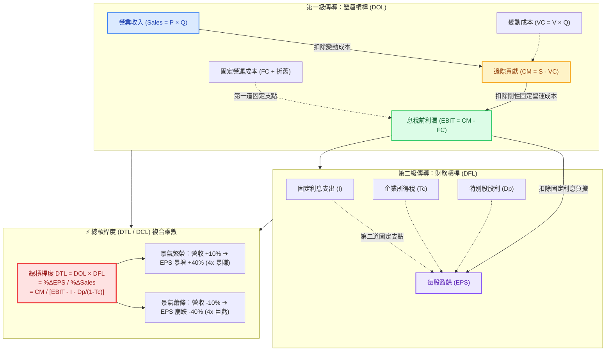

---
{"dg-publish":true,"permalink":"/98/degree-of-total-leverage-dtl/","tags":["商業概念","財務管理","公司理財","成本結構","資本結構","企業風險管理","創業財務","PMBA"],"dg-note-properties":{"aliases":["DTL","DTL_總槓桿","DTL_總槓桿度","DCL","DCL_綜合槓桿","DCL_總槓桿度","總槓桿","總槓桿度","綜合槓桿","綜合槓桿度","Degree of Total Leverage","Degree of Combined Leverage","Total Leverage","Combined Leverage","degree-of-total-leverage","degree-of-combined-leverage"],"tags":["商業概念","財務管理","公司理財","成本結構","資本結構","企業風險管理","創業財務","PMBA"]}}
---


# 總槓桿度 (Degree of Total Leverage, DTL / DCL)

> 💡 **導航與索引**：本篇為評估企業整體營運與財務複合風險之終極彈性指標，亦可參閱第一級放大器 [[98_商業概念庫/DOL_營運槓桿\|營運槓桿度 (DOL)]]、第二級放大器 [[98_商業概念庫/financial-leverage_財務槓桿\|財務槓桿度 (DFL)]]、產銷規模安全線 [[98_商業概念庫/BEP_三大損益兩平點分析 Breakeven Analysis\|三大損益兩平點 (BEP)]]、資本折現標準 [[98_商業概念庫/wacc_加權平均資本成本\|加權平均資本成本 (WACC)]]、股東回報拆解 [[98_商業概念庫/dupont-analysis_杜邦分析法\|杜邦分析法 (DuPont)]]、估值乘數共振 [[98_商業概念庫/davis-double-whammy_戴維斯雙殺效應\|戴維斯雙殺與雙擊效應]]，以及獲利底線指標 [[98_商業概念庫/earnings-per-share_每股盈餘\|每股盈餘 (EPS)]] 與 [[98_商業概念庫/diluted-eps_稀釋後每股盈餘\|稀釋後每股盈餘 (Diluted EPS)]]。

## 一、 核心定義與財務學本質

- **總槓桿度 (Degree of Total Leverage, DTL / Degree of Combined Leverage, DCL)** 係指在企業既定的成本結構與資本結構下，**普通股每股盈餘（EPS）相對於營業收入（Sales / 產銷量 Q）變動之總體彈性係數（Total Elasticity）**。它量化了當市場需求與營收每變動 $1\%$ 時，最終將引發股東每股獲利產生多少百分比的複合放大（或崩跌）效應。
- **損益表兩大斷面的「雙重放大器」與乘數共振**：
  企業從最頂端的營收（Top-line）到底部的每股盈餘（Bottom-line），依序穿越兩道剛性固定成本閘門：
  1. **第一級放大（營運槓桿 DOL，經營風險）**：以固定營運成本（$FC$，折舊與固定薪租）為支點，將營收（$Q$）的波動放大為息稅前利潤（EBIT）的變動。
  2. **第二級放大（財務槓桿 DFL，財務風險）**：以固定財務利息（$I$）與特別股股利為支點，將息稅前利潤（EBIT）的變動進一步二次放大為每股盈餘（EPS）的變動。
  - **核心定理**：兩級槓桿絕非簡單相加，而是**相乘（Multiplicative Interaction）**，形成幾何級數級的總體企業風險（Total Corporate Risk）：
    $$\text{DTL} = \text{DOL} \times \text{DFL} = \frac{\% \Delta \text{EBIT}}{\% \Delta Q} \times \frac{\% \Delta \text{EPS}}{\% \Delta \text{EBIT}} = \frac{\% \Delta \text{EPS}}{\% \Delta Q}$$
- **終極雙刃劍（Double-Edged Sword）**：
  - **🚀 繁榮擴張順風（幾何級數暴利）**：當營收跨越總損益兩平點後，在固定營運成本與固定財務成本雙重固定支撐下，每一塊新增營收扣除微薄變動成本後，幾乎全額直通 EPS，推升股價出現非線性爆發。
  - **💥 蕭條衰退逆風（雙重夾殺崩潰）**：當營收微幅下滑時，剛性折舊與剛性利息雙管齊下侵蝕利潤，EPS 將呈現斷崖式崩跌，極易擊穿利息保障倍數導致債務違約，引爆[[98_商業概念庫/davis-double-whammy_戴維斯雙殺效應\|戴維斯雙殺]]。

---

## 二、 數理公式推導與參數架構



### 1. 變動率定義式（彈性視角）
$$\text{DTL} = \frac{\% \Delta \text{EPS}}{\% \Delta Q} = \frac{\Delta \text{EPS} / \text{EPS}}{\Delta Q / Q} = \frac{\Delta \text{EPS}}{\Delta S} \times \frac{S}{\text{EPS}}$$

### 2. 成本與資本結構點位拆解式
設產品單價為 $P$、單位變動成本為 $V$（單位邊際貢獻 $cm = P - V$）、產銷量為 $Q$、總固定營運成本為 $FC$、年度固定利息為 $I$、特別股股利為 $D_p$、所得稅率為 $T_c$：
$$\text{DOL} = \frac{Q(P - V)}{Q(P - V) - FC} = \frac{\text{邊際貢獻 (CM)}}{\text{EBIT}}$$
$$\text{DFL} = \frac{\text{EBIT}}{\text{EBIT} - I - \frac{D_p}{1 - T_c}}$$
相乘消去 $\text{EBIT}$ 即可推導出總槓桿點位公式：
$$\text{DTL} = \text{DOL} \times \text{DFL} = \frac{Q(P - V)}{Q(P - V) - FC - I - \frac{D_p}{1 - T_c}} = \frac{\text{邊際貢獻總額 (CM)}}{\text{稅前盈餘調整項 (EBT}^*)}$$

- **無特別股情境之經典標準簡化式**：
  $$\text{DTL} = \frac{Q(P - V)}{Q(P - V) - FC - I} = \frac{\text{邊際貢獻 (CM)}}{\text{稅前利潤 (EBT)}} = \frac{S - VC}{S - VC - FC - I}$$

### 3. 與總損益兩平點 (Total Breakeven Point) 的幾何聯立
定義涵蓋固定營運成本與固定財務成本的**總損益兩平銷量 ($Q_{\text{total}}^*$)**：
$$Q_{\text{total}}^* = \frac{FC + I + \frac{D_p}{1 - T_c}}{P - V}$$
代入原式推導：
$$\text{DTL} = \frac{Q}{Q - Q_{\text{total}}^*}$$
- **臨界極限規律**：
  1. 當銷售量 $Q$ 逼近總損益兩平點 $Q_{\text{total}}^*$ 時，分母趨近於零，**$\text{DTL} \to \infty$**！此時企業處於生死邊緣，營收微幅滑落 1% 就足以擊穿所有利潤並引發財務危機。
  2. 當企業既無固定營運成本又無固定負債利息（$FC = 0$ 且 $I = 0$）時，$\text{DTL} = 1.0$。營收變動 10%，EPS 嚴格等比例變動 10%，不存在任何總體槓桿效應。

---

## 三、 槓桿對沖矩陣：DOL 與 DFL 的動態互補博弈

企業在制訂整體戰略與財務政策時，必須將「資產端經營槓桿（DOL）」與「融資端財務槓桿（DFL）」進行動態匹配，維持整體總槓桿（DTL）處於可控安全區間：

```text
                        【營運槓桿度 (DOL，本業資產端)】
                         低 DOL (輕資產 / 低 FC)         高 DOL (重資產 / 高 FC)
                ┌───────────────────────────────┬───────────────────────────────┐
             高 │ 【高風險平衡型模式】          │ 【💥 自毀型破產高危模式 (雙高)】
【財務槓桿   DFL│ 零售通路、航運租賃、金融租賃  │ 算力中心發行高息債 (CoreWeave)、
  (融資資本端)】 │ 本業固定成本低、現金流穩定，  │ 高槓桿房企；重資產又背巨額利息；
                │ 可承受較高負債利息以放大 ROE  │ 營收稍有不慎即遭戴維斯雙殺斷崖
                ├───────────────────────────────┼───────────────────────────────┤
             低 │ 【極度防禦保守型模式】        │ 【🚀 重科技先進製造模式 (台積電)】
             DFL│ 零負債純平台、專業顧問服務    │ 台積電 (2330)、ASML、航太軍工；
                │ 總槓桿極低 (DTL ≈ 1.1~1.3)，  │ 廠房機台折舊高 (高 DOL 賺取暴利)，
                │ 熊市生存力極強，牛市爆發力弱  │ 長年維持極低負債 (低 DFL) 防禦寒冬
                └───────────────────────────────┴───────────────────────────────┘
```

---

## 四、 實戰情境量化模擬：三種資本結構之總槓桿威力對比

假設三家企業目前營收均為 1,000 萬元，但成本與資本結構完全不同：

| 評估項目 | 公司 A（極致穩健型） | 公司 B（台積電先進製造型） | 公司 C（雙高激進冒進型） |
| :--- | :---: | :---: | :---: |
| **營收 ($S$)** | 1,000 萬元 | 1,000 萬元 | 1,000 萬元 |
| - 變動成本 ($VC$) | 600 萬元 (60%) | 200 萬元 (20%) | 200 萬元 (20%) |
| **= 邊際貢獻 ($CM$)** | **400 萬元** | **800 萬元** | **800 萬元** |
| - 固定營運成本 ($FC$) | 100 萬元 | 500 萬元 (重折舊) | 500 萬元 (重折舊) |
| **= 息稅前利潤 ($EBIT$)** | **300 萬元** | **300 萬元** | **300 萬元** |
| **營運槓桿度 (DOL = CM / EBIT)** | **1.33x** | **2.67x** | **2.67x** |
| - 固定利息費用 ($I$) | 0 萬元 (零負債) | 50 萬元 (極低負債) | 200 萬元 (高負債發債) |
| **= 稅前利潤 ($EBT$)** | **300 萬元** | **250 萬元** | **100 萬元** |
| **財務槓桿度 (DFL = EBIT / EBT)** | **1.00x** | **1.20x** | **3.00x** |
| **總槓桿度 (DTL = DOL × DFL)** | **1.33x** | **3.20x** | **8.00x** |
| **情境 1：景氣繁榮，營收 $+15\%$** | 稅前獲利 **$+20.0\%$** | 稅前獲利 **$+48.0\%$** | 稅前獲利 **$+120.0\%$** (暴利翻倍) |
| **情境 2：景氣寒冬，營收 $-15\%$** | 稅前獲利 **$-20.0\%$** (穩健獲利 240萬) | 稅前獲利 **$-48.0\%$** (仍保獲利 130萬) | 稅前獲利 **$-120.0\%$** (轉為**嚴重淨虧損** -20萬) |

- **財務啟發**：公司 C 因追求牛市暴利採用「雙高組合」，其總槓桿高達 **8.0x**。一旦營收僅下滑 15%，利潤不是小跌，而是直接蒸發 120% 跌入虧損深淵，徹底展現總槓桿幾何放大的毀滅性殺傷力。

---

## 五、 高階經理人與創投 (VC) 決策三大軍規

### 1. 新創企業融資的「雙槓桿禁忌」（Startup Capital Structure Taboo）
- 新創企業在產品市場契合（PMF）初期，商業模式與產銷規模尚未跨越損益兩平點，本業固有的營運槓桿極高（$\text{DOL} \gg 3$）。
- **融資紅線**：創辦人切忌在此階段盲目追求不稀釋股權而向金融機構舉借高額固定利息負債（拉高 DFL）。一旦總槓桿 DTL 飆升至 5x 以上，營收稍微不及預期，公司將以驚人速度在 6 個月內燒乾現金流宣告破產。初期融資必須嚴格遵循股權融資、SAFE 或具備延後轉股特性的可轉換公司債（CB）。

### 2. 景氣週期繁榮頂峰的主動「去總槓桿」（De-leveraging at Peak）
- 在朱格拉資本支出週期或產業景氣頂峰時（如航運運價暴漲、晶圓代工滿載），產銷量遠大於兩平點，帳面上計算出的 DTL 數值會短暫顯得平緩溫和。
- **卓越 CFO 的反週期操作**：切莫被繁榮期的低帳面 DTL 迷惑而繼續借債擴產。聰明的財務長應趁景氣高峰企業現金流充沛時，大舉償還高息債務、降低 DFL；一旦景氣反轉、營收掉回兩平點附近時，低 DFL 才能防止總槓桿 DTL 垂直飆升引發資金鏈斷裂。

### 3. 與資本市場估值乘數（P/E）聯動監控防範雙殺
- 資本市場機構法人對於「高 DTL 企業」給予的本益比倍數往往帶有嚴格的風險折價（Risk Discount / De-rating）。
- 當高 DTL 企業遭遇營收衰退時，一方面每股盈餘受總槓桿放大呈倍數暴跌（$\text{EPS} \downarrow\downarrow$），另一方面市場恐慌債務違約風險而同步下調本益比（$P/E \downarrow\downarrow$），將產生毀滅性的[[98_商業概念庫/davis-double-whammy_戴維斯雙殺效應\|戴維斯雙殺]]，股價往往在數月內腰斬再腰斬。

---

## 六、 關聯主題與模組網絡

- 🧭 **課程核心模組對接**：
  - [[04_主題選修/10_創業與企業財務策略/02_模組筆記/Module_1_創新思維與商業模式/M1-2_白板決策鏈與財務價值三角\|M1-2 白板決策鏈與財務價值三角]]（課堂白板推導專題六：三大損益兩平點與雙槓桿乘數效應 DCL）
  - [[04_主題選修/10_創業與企業財務策略/02_模組筆記/Module_2_產品創新與精實驗證/M2-4_新創財務預測與外部融資需求模型\|M2-4 新創財務預測與外部融資需求模型]]（新創敏感度分析與總槓桿 DCL 破產防線）
  - [[02_核心必修/01_財務管理/L08_資本結構理論與決策\|L08 資本結構理論與決策]]（EBIT-EPS 無差異點、無稅 MM 定理與財務槓桿風險傳導）
  - [[02_核心必修/01_財務管理/L09_資本結構理論與決策\|L09 資本結構理論與決策]]（權衡理論 U 型 WACC 曲線與最佳資本結構配置）
  - [[02_核心必修/01_財務管理/L01_財務管理導論\|L01 財務管理導論]]（經營風險 vs 財務風險雙層架構）
  - [[01_基礎先修/01_財務報表分析/Ch07_獲利能力分析\|Ch07 獲利能力分析]]（成本習性、經營槓桿與權益乘數擴張分析）
- 🔗 **核心概念原子卡片**：
  - [[98_商業概念庫/DOL_營運槓桿\|營運槓桿度 (DOL)]]
  - [[98_商業概念庫/financial-leverage_財務槓桿\|財務槓桿度 (DFL)]]
  - [[98_商業概念庫/BEP_三大損益兩平點分析 Breakeven Analysis\|三大損益兩平點分析 (BEP)]]
  - [[98_商業概念庫/davis-double-whammy_戴維斯雙殺效應\|戴維斯雙殺與雙擊效應 (Davis Double Whammy)]]
  - [[98_商業概念庫/wacc_加權平均資本成本\|加權平均資本成本 (WACC)]]
  - [[98_商業概念庫/dupont-analysis_杜邦分析法\|杜邦分析法 (DuPont Analysis)]]
  - [[98_商業概念庫/earnings-per-share_每股盈餘\|每股盈餘 (Basic EPS)]]
  - [[98_商業概念庫/diluted-eps_稀釋後每股盈餘\|稀釋後每股盈餘 (Diluted EPS)]]
