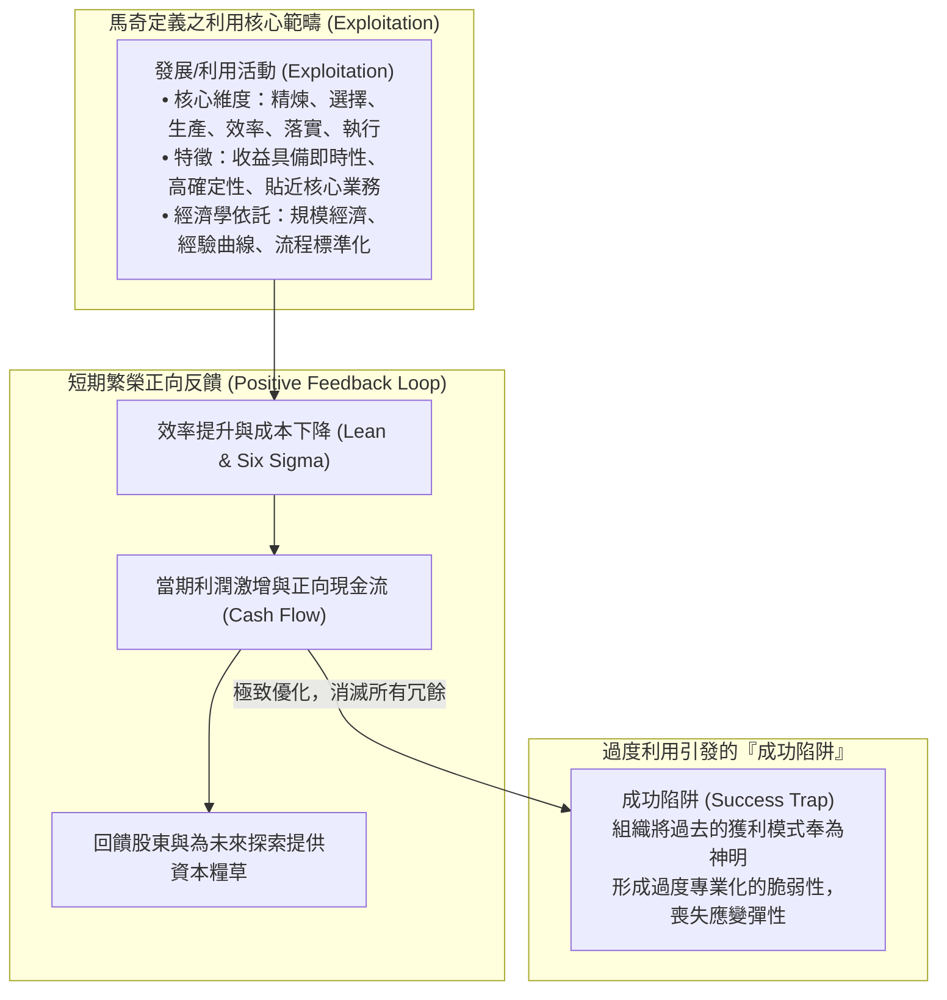

---
{"dg-publish":true,"permalink":"/98/development/","tags":["商業概念","組織學習","營運管理","策略管理","PMBA"],"dg-note-properties":{"aliases":["發展","利用","Exploitation","既有能力深化","效率優化","組織利用"],"tags":["商業概念","組織學習","營運管理","策略管理","PMBA"]}}
---


# 發展／利用 (Exploitation / Development)

> [!NOTE]
> **核心概念精粹**：發展／利用（Exploitation / Development），是詹姆斯·馬奇（James G. March）組織學習雙元架構中不可或缺的基石維度。它指組織聚焦於**現有知識、既有技術、現存客群與標準化流程的精煉（Refinement）、效率優化、規模化擴張與精準執行**。發展／利用是企業獲取當期營業利潤、充沛自由現金流與維持市場霸主地位的直接發動機；然而，過度沉迷於利用而忽視[[98_商業概念庫/exploration_探索\|探索]]，將導致組織陷入致命的「成功陷阱（Success Trap）」。

---

## 一、 學理定位：現金牛業務的效率引擎

在馬奇的組織理論中，「發展／利用（Exploitation）」並非負面詞彙，而是企業生存與繁榮的經濟基礎：



---

## 二、 發展／利用與組織雙巧性（Ambidexterity）的平衡藝術

卓越企業的治理精髓，不在於二選一，而在於實現「左右開弓（Ambidextrous）」的動態平衡：

| 治理維度 | 發展／利用導向（Exploitation Focus） | 組織雙巧性最佳實踐（Ambidextrous Balance） |
| :--- | :--- | :--- |
| **策略目標** | 在既有賽道上做到極致，消滅一切浪費與變異。 | **當下與未來兼顧**：右手深耕成熟業務（利用），左手播種前沿賽道（探索）。 |
| **結構設計** | 傳統科層制、標準作業程序（SOP）、嚴格成本控制。 | **結構雙巧性（Structural Separation）**：利用單位維持層級效率，探索單位給予高度自由。 |
| **文化規範** | 遵從紀律、按章辦事、追求 100% 準確率。 | **脈絡雙巧性（Contextual Ambidexterity）**：前線員工依情境自主調配「精進現狀」與「實驗新法」。 |
| **資本配置** | 70%~80% 資本配置於核心成熟業務。 | 嚴格維持「70-20-10」原則（70% 核心利用、20% 鄰近擴張、10% 激進探索）。 |

---

## 三、 經典企業實戰案例：豐田生產方式的極致利用 vs 富士軟片的雙元轉型

```carousel

<!-- slide -->
### 1. 豐田汽車（Toyota）——發展與利用的全球巔峰
- **極致精煉**：豐田生產方式（TPS）將「利用（Exploitation）」演繹為藝術；
- **改善哲學（Kaizen）**：大野耐一透過看板管理、及時生產（JIT）與全員持續提案，將流水線上每一道裝配動作、庫存搬運的浪費消滅殆盡；
- **商業帝國**：這種對既有技術與工藝的極致利用，賦予豐田汽車無與倫比的高可靠性與成本優勢，連續多年蟬聯全球銷量第一。
<!-- slide -->
### 2. 富士軟片（Fujifilm）——以利用為糧草，反哺跨界探索
- **危機背景**：2000 年代數位相機普及導致傳統膠卷需求斷崖式下跌，柯達破產；
- **雙元自救**：富士軟片總裁古森重隆沒有盲目放棄膠卷，而是將剩餘膠卷工藝的「利用效率」壓榨到極致，獲取穩定現金流；
- **技術跨界**：將膠卷抗氧化技術轉化為「艾詩緹（Astalift）」高檔抗老護膚品，將膜技術轉化為醫療顯示與新藥研發，成功完成了現代商業史上最壯麗的跨界轉型。
```

---

## 四、 經理人業務發展／利用成熟度檢核表（Executive Decision Checklist）

在深耕成熟業務時，高階管理團隊應警惕組織是否已陷入「過度利用」的死胡同：

- [ ] **邊際改善遞減審計（Diminishing Returns Audit）**：
  - 我們投入在成熟產線上的每一分優化成本，所換取的效率提升是否已大幅遞減？（例如投入 1,000 萬僅換取 0.01% 的良率提升）。此時是否應將資本轉向新賽道？
- [ ] **利潤反哺探索承諾（Profit-to-Exploration Pipeline）**：
  - 現金牛事業部所產生的充沛盈餘，是否真正被用來投資未來的探索專案？還是全數被管理層用來進行短期股票回購以衝刺個人 EPS 獎金？
- [ ] **精實除贅度檢驗（Lean Waste Elimination）**：
  - 在既有營運流程中，是否存在多餘的管理層級、無效的跨部門會議或庫存呆滯？我們是否持續推動標準化以釋放管理頻寬？
- [ ] **組織雙巧結構健康度（Ambidexterity Health Check）**：
  - 負責「利用」的高管是否對負責「探索」的創新單位抱有敵意？公司最高管理層是否具備足夠的政治手腕，在兩大陣營之間維持建設性的張力與資源平衡？

---

## 五、 關聯概念與知識網絡

* 組織學習與雙元架構：
  * [[exploration_探索|探索 (Exploration)]]：發展利用之對偶維度，二者共同構成組織學習閉環
  * [[Organizational_Ambidexterity_組織雙巧性|組織雙巧性 (Organizational Ambidexterity)]]：左右開弓同時駕馭探索與利用之高階架構
  * [[economies-of-scale_規模經濟|規模經濟 (Economies of Scale)]]：利用成熟產能實現單位成本最小化
  * [[viable-business_好事業|好事業 (Viable Business)]]：健康單元經濟與正現金流之實質商業基礎
* 營運管理與風險防範：
  * [[time-and-motion-study_時間動作研究|時間動作研究 (Time and Motion Study)]]：消除動作浪費與極致流程優化之工程工具
  * [[short-term_短期主義|短期主義 (Short-Termism)]]：過度偏向當期利用、放棄未來探索之短視陷阱
  * [[cost-leadership-strategy_成本領導策略|成本領導策略 (Cost Leadership Strategy)]]：深耕利用與營運卓越構築之護城河
  * [[great-company_好公司|好公司 (Great Company)]]：以極致利用驅動持久飛輪、基業長青之典範組織
