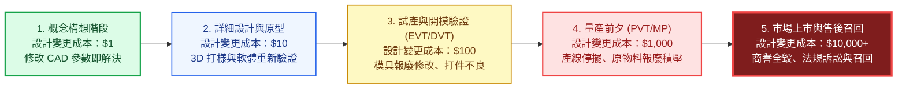
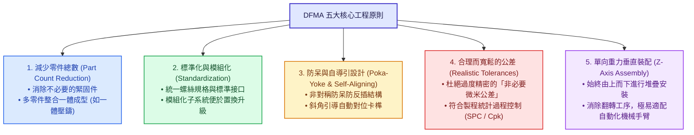
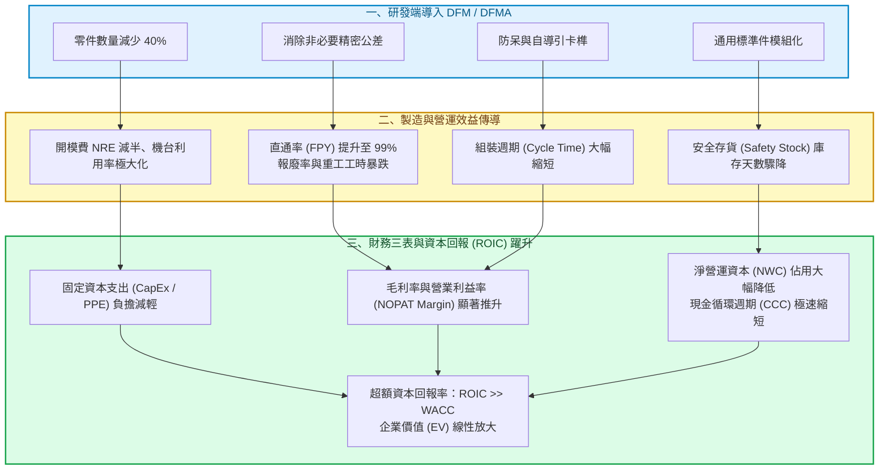
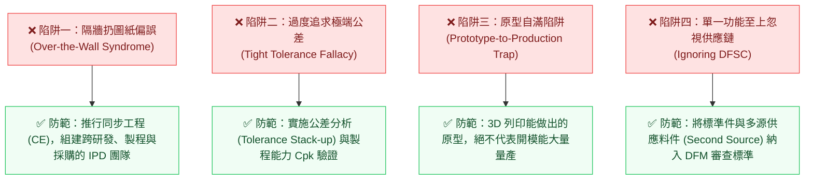

---
{"dg-publish":true,"permalink":"/98/dfm-design-for-manufacturability/","tags":["商業概念","產品開發","生產營運","策略管理","成本控制","供應鏈管理","PMBA"],"dg-note-properties":{"aliases":["DFM_Design for Manufacturability可製造性設計","DFM","可製造性設計","面向製造的設計","Design for Manufacturability","DFMA","Design for Manufacture and Assembly"],"tags":["商業概念","產品開發","生產營運","策略管理","成本控制","供應鏈管理","PMBA"]}}
---

# DFM 可製造性設計 (Design for Manufacturability / DFMA)

> **商管核心價值**：  
> 「產品總生命週期成本的 70%~80%，在研發設計階段就已經被決定了！（70-80% of manufacturing costs are locked in during the design stage.）」  
> 
> 在現代高科技製造、硬體新創與產品生命週期管理（PLM）中，**可製造性設計（Design for Manufacturability, DFM）** 絕非單純的工程繪圖技巧，而是企業連結「前端研發創新」與「後端大規模量產」的最關鍵戰略橋樑。它的本質是在產品開發初期，就將下游的加工工藝、材料特性、裝配公差、檢驗測試與供應鏈限制等要素前置納入考量，從而在**不犧牲產品質量與功能價值（Value）的前提下，實現最低製造成本（Cost）、最短量產爬坡週期（Time-to-Volume）與最高生產良率（Yield）**。

---

## 一、 核心定義與理論演進

### 1.1 學術與實務定義之內涵
- **DFM（Design for Manufacturability / 可製造性設計）**：指在產品設計初期，系統性分析零件的幾何形狀、成型工藝（如射出成型、衝壓、CNC、壓鑄、PCB 佈線等）、材料選用與加工難度，使零件本身易於製造且製程穩定度最高。
- **DFA（Design for Assembly / 可裝配性設計）**：由 Geoffrey Boothroyd 與 Peter Dewhurst 於 1980 年代確立，專注於簡化產品結構、減少零件數量、消除錯誤裝配方向（防呆），使組裝工時與夾治具複雜度降至最低。
- **DFMA（Design for Manufacture and Assembly）**：現代產業界將 DFM 與 DFA 深度融合的統稱。
- **廣義 DFX（Design for Excellence / 卓越設計體系）**：
  - **DFT（Design for Testability）**：可測試性設計（如晶片內建 BIST、電路板測試點配置）。
  - **DFR（Design for Reliability）**：可靠度設計（耐環境衝擊、抗高低溫老化）。
  - **DFSC（Design for Supply Chain）**：供應鏈適配性設計（避免單一稀缺料件、包裝適配貨櫃容積）。
  - **DFE（Design for Environment）**：易拆解與綠色回收循環設計。

---

### 1.2 研發成本的「十倍法則（The Rule of 10）」

在傳統研發思維中，設計部門往往「把圖面拋過牆（Throw over the wall）給生產部門」，導致量產階段遭遇嚴重的良率雪崩與無休止的工程變更（ECO, Engineering Change Order）：

> 📌 **商管決策意涵**：  
> DFM 的戰略核心在於**「工程變更左移（Left-Shifting）」**！在成本最低的 CAD 概念階段解決 90% 的潛在製造缺陷，避免在後端量產時付出數百至數萬倍的慘痛代價。

---

## 二、 DFM / DFMA 的五大核心工程原則

### 1. 減少零件總數（Part Count Reduction）
- **Boothroyd-Dewhurst 三項理論判據**：只有符合以下條件，零件才具備「獨立存在」的必要性：
  1. 該零件在使用過程中相對於其他零件有「相對運動」；
  2. 該零件必須採用截然不同的材料（如導電與絕緣、金屬與彈性橡膠）；
  3. 該零件若不獨立，將阻礙其他零件的組裝或拆解維修。
- 若不符合上述條件，零件應透過結構整合（如一體成型注塑件、一體化壓鑄）直接合併。
- *名言*：「**最可靠且成本為零的零件，就是根本不需要的零件。**」

### 2. 標準化與模組化（Standardization & Modularity）
- 全機盡量使用相同規格的螺絲與連接器（避免裝配工位頻繁更換電動螺絲起子或混用規格）。
- 採用成熟的既有標準零組件（Off-The-Shelf, COTS），降低模具開模費（NRE, Non-Recurring Engineering）與庫存備料風險。

### 3. 防呆與自導引對準（Poka-Yoke & Self-Aligning）
- 採用幾何不對稱凹凸、防呆導銷（Guide Pins）或斜面倒角（Chamfers），使零件在組裝時能「自動滑入正確位置」。
- 確保零件「只有在方向完全正確時才能裝入」，徹底消除人工作業疏失。

### 4. 寬鬆而合理的公差規範（Realistic Tolerances）
- 研發工程師常出於保守心態設定極端嚴苛的微米級公差（如 $\pm 0.005\text{ mm}$），導致製造加工需動用超精密慢走絲或昂貴治具，造成良率急劇跌破損益線。
- DFM 要求工程師了解供應商設備的統計製程能力（Process Capability, $C_{pk}$），在保證功能互換的前提下設定最大可容忍公差。

### 5. 易於自動化與單向重力裝配（Z-Axis Assembly）
- 裝配路徑應設計為**單一垂直方向（Z 軸由上而下）**。
- 避免側向插入、斜向擰緊或在裝配過程中頻繁翻轉產品，大幅降低自動化機械手臂的自由度需求與夾具開發成本。

---

## 三、 DFM 與企業財務結構之深層傳導機制

在 PMBA 課程中，DFM 不僅是製造部門的事，更是直接決定**資產負債表投資效率、現金流健康度與資本回報率（ROIC）**的戰略引擎：

### 1. 壓低固定資產投資（CapEx）與開模風險（PPE）
- 每多一套自研特殊零組件，就需要額外投入數十萬至數百萬新台幣的模具費用（NRE）及治具設備（PPE）。
- 導入 DFM 減少 30% 零件，直接讓新產品前期的硬體資本沉沒成本大幅縮減，降低新創破產清算風險。

### 2. 推升營業利益率（NOPAT Margin）
- **直通率（First Pass Yield, FPY）**是製造毛利的命脈。良好的 DFM 使產線不良率從 5% 降至 0.2%，省下龐大的不良品報廢（Scrap）與二次人工維修重工成本。
- 縮短組裝循環時間（Cycle Time），使單一產線單班產出倍增，極致攤提廠房固定折舊。

### 3. 解放淨營運資本（NWC）與現金循環週期（CCC）
- 減少物料清單（BOM）項次，使供應鏈採購品類大幅收斂。
- 存貨週轉天數（DSI）顯著下降，大量釋放卡死在半成品（WIP）與原物料上的周轉資金，避免「帳面有獲利、手中無現金」的黑字倒閉。

---

## 四、 跨產業代表性標竿案例對標

### 4.1 案例一：特斯拉（Tesla）——一體化壓鑄（Giga Casting）顛覆車身製造
- **傳統造車瓶頸**：傳統汽車後底板由 **70 多個沖壓鋼鋁鈑件**組成，透過數百個機器人進行數千個焊點拼裝，工序漫長、公差累積誤差大，且焊接機器人佔用龐大廠房面積。
- **DFM 極致突破**：馬斯克採用 6,000~9,000 噸超大型壓鑄機（Giga Press），直接將 70 多個零件**融合成單一鋁合金鑄件**：
  - **零件數與焊點**：零件數減少 70+ 個，消除 1,600 多個焊點；
  - **製造成本與工時**：車身製造工時縮短 40%，車身底盤減重 10%，廠房佔用面積大幅縮減；
  - **財務綜效**：直接造就特斯拉 Model Y 冠絕全汽車產業的超高單車毛利率。

---

### 4.2 案例二：台積電（TSMC）——晶圓代工與 IC 設計的 DFM 生態壁壘
- **半導體 DFM 本質**：在 3nm/2nm 先進製程中，光刻機紫外光波長受物理繞射極限影響，光罩上的圖案在晶圓顯影後會產生嚴重的失真變形。
- **OIP 平台的 DFM 協同**：
  - 台積電將龐大的製程製造經驗（製程公差、化學機械研磨 CMP 效應、熱膨脹）轉化為嚴密的 **DFM 規則庫（Design Rule Manual, DRM）**；
  - 透過開放創新平台（OIP），將光學鄰近效應修正（OPC）等 DFM 工具內嵌至 EDA 軟體中（Synopsys / Cadence）；
  - **策略壁壘**：使得 Apple、NVIDIA 的 IC 設計工程師在寫代碼設計晶片時，就「被迫」完全符合台積電的晶圓製造物理限制，建立了極深不可複製的轉換成本護城河。

---

### 4.3 案例三：富士康（鴻海 Foxconn）——機構模具 DFM 構築代工之王護城河
- **外界刻板印象**：認為電子代工（EMS）純粹依賴大量廉價組裝勞工。
- **真實核心能耐**：鴻海真正的起家法寶是「全球無可匹敵的超精密機構件與模具 DFM 能力」：
  - 當蘋果推出極致纖薄、結構複雜的 iPhone 金屬一體成型機殼（Unibody）時，鴻海工程團隊在試產階段（NPI）即與蘋果設計團隊共同進駐，從刀具轉速、切削液排屑、陽極氧化容差全面優化 DFM；
  - 只有鴻機能將看似「根本無法量產的藝術品圖紙」，以數十萬台 CNC 機台實現「日產百萬台且良率維持在 98% 以上」的恐怖規模，奠定其無可撼動的供應鏈統治力。

---

## 五、 經理人常見四大認知陷阱與實務防範

### 1. 隔牆扔圖紙偏誤（Over-the-Wall Syndrome）
- **現象**：工業設計師（ID）與機構工程師（ME）完全不諮詢產線師傅與模具廠，畫出大量深腔死角、倒勾、無法脫模的漂亮圖紙。
- **解法**：導入**同步工程（Concurrent Engineering, CE）**與集成產品開發（IPD）體系，研發首日模具工程師與產線組裝主管即共同參與評審。

### 2. 原型自滿陷阱（Prototype-to-Production Trap）
- **現象**：新創團隊用 3D 列印或手工雕刻做出功能完美的單件樣機（Prototype），便樂觀認定「產品研發已經完成 90%」。
- **解法**：嚴格認清「手工做 1 台」與「工廠每分鐘穩定產出 100 台」之間橫跨著巨大的工藝鴻溝。未經過 DFM 開模驗證（EVT/DVT）的原型，充其量只完成了產品化的 20%。

---

## 六、 課程講義與模組網絡無縫對接

本原子卡片深度貫穿並支撐 PMBA 學程之核心研發、財務與營運分析模組：

### 📚 官方教材與模組講義深度對接

1. **《創業與企業財務策略》官方教材對接**：
   - 📖 **Class 5 講義** ➔ [[04_主題選修/10_創業與企業財務策略/02_模組筆記/Module_2_產品創新與精實驗證/M2-1_精實產品開發與服務創新驗證|M2-1 精實產品開發與服務創新驗證]]：
     - 解構白板推導專題：**「投入資本結構（PPE + NWC + 無形資產）」**，揭示 DFM 如何直接降低模具固定資產（PPE）沉沒資本與存貨現金卡死（CCC 資金真空期）。
     - Dan Olsen PMF 金字塔產品端（Feature Set ➔ UX）向市場端（Underserved Needs）收斂落地之工程物理基礎。
   - 📖 **Class 2 講義** ➔ [[04_主題選修/10_創業與企業財務策略/02_模組筆記/Module_1_創新思維與商業模式/M1-4_創意思考工具與設計思考方法|M1-4 創意思考工具與設計思考方法]]：
     - 設計思考（Design Thinking）使用者中心體驗與製造可行性之間的「兩全思維（Trade-On Thinking）」。
   - 📖 **Class 4 講義** ➔ [[04_主題選修/10_創業與企業財務策略/02_模組筆記/Module_1_創新思維與商業模式/M1-10_七大市場力量與商業戰略價值公式|M1-10 七大市場力量與商業戰略價值公式]]：
     - 七大市場力量之「流程效能（Process Power）」——深植於組織內部難以被對手模仿的極致 DFM 製造裝配體系。

2. **《產業分析與投資策略》官方教材對接**：
   - 📖 **Class 1 講義** ➔ [[04_主題選修/12_產業分析與投資策略/02_模組筆記/Module_1_總論與架構/M1-3_產業獲利結構差異與十大經典理論|M1-3 產業獲利結構差異與十大經典理論]]：
     - 代工六哥與鴻海（低毛利、靠極致規模採購與組裝 DFM 勝出）vs. 台積電（先進製程 DFM 規則庫與 OIP 開放平台技術壟斷）。
   - 📖 **Class 3 講義** ➔ [[04_主題選修/12_產業分析與投資策略/02_模組筆記/Module_1_總論與架構/M1-6_產業分析模式與九大分析工具矩陣|M1-6 產業分析模式與九大分析工具矩陣]]：
     - 價值鏈活動配置（研發設計與生產作業的深度互補協同，達成活動體系高階配適 Fit）。

---

### 🔗 核心概念原子卡片雙向鏈結

- **商業模式與價值創造體系**：
  - [[vpc-value-price-cost_價值價格成本分析]]（DFM 在不犧牲顧客價值 $V$ 的前提下大幅壓低生產成本 $C$，拉大 $(P - C)$ 毛利空間）
  - [[competitive-advantage_競爭優勢]]（以獨特工藝與活動體系配適構建不可複製的流程護城河）
  - [[competitive-matrix_競爭矩陣]]（ROIC vs. 資產週轉率矩陣中，推動營運效率之底層武器）
- **成本、規模與運營體系**：
  - [[cost-leadership-strategy_成本領導策略]] ｜ [[economies-of-scale_規模經濟]]
  - [[switching-costs_轉換成本]] ｜ [[economic-moat_經濟護城河]]
- **財務與資本評價體系**：
  - [[return-on-invested-capital_資本投入報酬率]]（透過提升 Margin 與週轉率極大化 ROIC）
  - [[cash-switching-cycle_現金轉換週期]]（降低原物料與 WIP 在途存貨天數 DSI）
  - [[total-asset-turnover-ratio_總資產週轉率]] ｜ [[dupont-analysis_杜邦分析法]]
