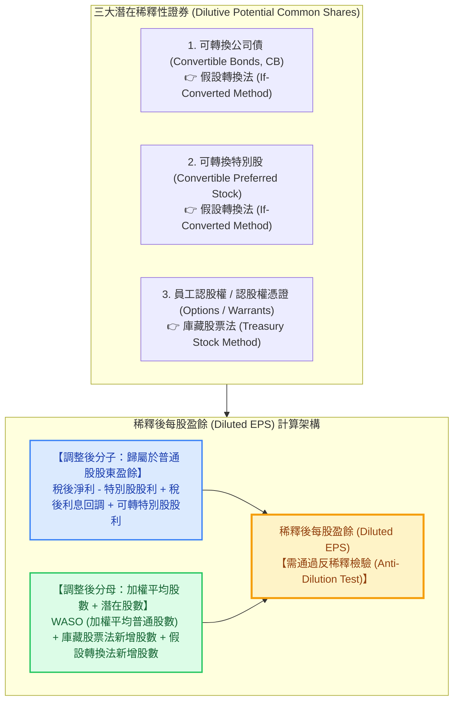

---
{"dg-publish":true,"permalink":"/98/diluted-eps/","tags":["商業概念","財務管理","財務報表分析","企業評價","證券分析","公司理財","PMBA"],"dg-note-properties":{"aliases":["Diluted EPS","稀釋後每股盈餘","稀釋每股盈餘","完全稀釋每股盈餘","Fully Diluted EPS","Diluted Earnings Per Share","dilution_稀釋每股盈餘","diluted-eps"],"tags":["商業概念","財務管理","財務報表分析","企業評價","證券分析","公司理財","PMBA"]}}
---

# 稀釋後每股盈餘 (Diluted Earnings Per Share, Diluted EPS)

> 💡 **導航與索引**：本篇為衡量股東權益獲利含金量與資本結構稀釋風險之核心指標，亦可參閱基礎指標 [[98_商業概念庫/earnings-per-share_每股盈餘\|每股盈餘 (Basic EPS)]]、市場評價指標 [[pe-ratio_本益比\|本益比 (P/E Ratio)]]、獲利拆解工具 [[98_商業概念庫/dupont-analysis_杜邦分析法\|杜邦分析法 (DuPont)]]、股權結構防線 [[98_商業概念庫/equity-dilution_股權稀釋\|股權稀釋]] 與 [[98_商業概念庫/anti-dilution_反稀釋條款\|反稀釋條款]]，以及公司理財基準 [[98_商業概念庫/wacc_加權平均資本成本\|加權平均資本成本 (WACC)]]。

## 一、 核心定義與財務學本質

- **稀釋後每股盈餘 (Diluted EPS)** 係依據國際會計準則（**IAS 33**）與美國財務會計準則（**ASC 260**），假定企業所有具稀釋效應之**潛在普通股（Potential Common Shares / Dilutive Securities）**於當期期初（或發行日）即已全數行使、履約或轉換為普通股時，所重新計算之每股獲利水平。
- **基本每股盈餘 (Basic EPS) vs. 稀釋後每股盈餘 (Diluted EPS) 的財務本質對比**：
  - **Basic EPS（歷史營運成果索償權）**：僅反映該會計期間「實質流通在外普通股股東」按權益份額享有的淨利。
  - **Diluted EPS（最保守情境下的獲利底線 / Worst-Case Baseline）**：假設市場上所有具轉股特權的利害關係人（如可轉債債權人、特別股股東、持有員工認股權的經理人與投資機構）均做出對現有普通股最不利但對其自身利益極大化的轉換行為時，現有股東權益可能遭受的**最大獲利稀釋幅度**。
- **盈餘含金量與資本結構複雜度指標**：
  $$\text{EPS 稀釋率} = \frac{\text{Basic EPS} - \text{Diluted EPS}}{\text{Basic EPS}} \times 100\%$$
  - 若 $\text{EPS 稀釋率} < 3\%$：代表企業資本結構單純（Simple Capital Structure），潛在股權擴張壓力微小。
  - 若 $\text{EPS 稀釋率} \ge 10\%$：代表企業資本結構高度複雜（Complex Capital Structure），存在龐大潛在普通股懸崖（Overhang）。此時若僅以 Basic EPS 計算本益比（P/E），將嚴重低估真實估值乘數，引發價值高估陷阱！

---

## 二、 總體計算架構與潛在稀釋性證券分類

### 1. 綜合標準計算公式
$$\text{Diluted EPS} = \frac{(\text{稅後淨利} - \text{不可轉換特別股股利}) + \text{可轉債稅後利息回調} + \text{可轉換特別股股利}}{\text{普通股加權平均股數 (WASO)} + \Delta S_{\text{庫藏股法}} + \Delta S_{\text{CB}} + \Delta S_{\text{特別股}}}$$

---

## 三、 兩大核心計量方法：會計準則規範與量化推導

### 1. 庫藏股票法 (Treasury Stock Method, TSM)
- **適用證券**：認股權（Options）、認股權憑證（Warrants）、員工認股權憑證（ESOP）。
- **核心假設機制**：
  1. 假定認股權人於期初（或發行日）即行使權利，公司按**行使價格（Exercise Price, $K$）**收受現金發行新股 $N$ 股，獲得現金流入：$$\text{現金流入} = N \times K$$
  2. 假定公司以當期**普通股市場平均價格（Average Market Price, $P_{\text{avg}}$）**將收到的現金全數於公開市場購回庫藏股票：$$\text{買回庫藏股數} = \frac{N \times K}{P_{\text{avg}}}$$
  3. **實質淨增股數（分母調整項）**：
     $$\Delta S_{\text{庫藏股法}} = N - \frac{N \times K}{P_{\text{avg}}} = N \times \left( 1 - \frac{K}{P_{\text{avg}}} \right)$$
- **關鍵會計邏輯**：
  - **分子不作任何調整**（行使期權不影響損益表的利息或淨利）。
  - **稀釋條件（價內，In-the-Money）**：當且僅當 $P_{\text{avg}} > K$ 時，公司買回之庫藏股小於發行新股數，$\Delta S > 0$，方具稀釋性；若 $P_{\text{avg}} \le K$（價外，Out-of-the-Money），行權不具經濟誘因，視為**反稀釋**，不予納入。

### 2. 假設轉換法 (If-Converted Method)
- **適用證券**：可轉換公司債（Convertible Bonds, CB）、可轉換特別股（Convertible Preferred Stock, CPS）。
- **核心假設機制**：
  假定可轉證券於期初（或發行日）即全數轉換為普通股，因此：
  1. **分子（淨利回調）**：
     - **可轉換公司債**：若已轉為股權，公司將不再支付債券利息。因此損益表中原先認列之稅後利息支出必須**加回淨利**（考慮利息稅盾效應）：
       $$\text{分子加回項} = \text{CB 利息費用} \times (1 - T_c)$$
       *其中 $T_c$ 為企業邊際所得稅率。*
     - **可轉換特別股**：若已轉為普通股，公司不再支付特別股股利，因此計算歸屬於普通股股東淨利時，**不需扣除該特別股股利**（即分子加回該特別股股利）。
  2. **分母（股數增加）**：
     - 加上可轉證券按轉換比例（Conversion Ratio）換算之新增普通股加權平均股數 $\Delta S$。

---

## 四、 關鍵防火牆：反稀釋檢驗原則 (Anti-Dilution Test)

### 1. 反稀釋的核心定義 (Anti-Dilutive Securities)
依據 IAS 33 與 ASC 260 準則，任何潛在普通股的加入，若會導致**「每股盈餘增加」**或**「每股虧損減少」**，該證券即被定義為**「反稀釋性證券（Anti-Dilutive）」**。
> 🚨 **會計剛性鐵律**：**反稀釋性證券一律禁止納入稀釋後每股盈餘計算！Diluted EPS 絕對不得高於 Basic EPS。**

### 2. 增額每股盈餘排序法 (Incremental EPS Ranking)
當公司同時發行多種潛在普通股時，必須透過「增額每股盈餘」逐步測試其稀釋性：
1. **計算各證券的增額每股盈餘**：
   $$\text{增額每股盈餘 (Incremental EPS)} = \frac{\Delta \text{分子 (盈餘增加額)}}{\Delta \text{分母 (股數增加額)}}$$
   - *註：庫藏股票法（期權）因分子變動為 0，其 $\text{Incremental EPS} = 0$，稀釋性最強，永遠最先納入。*
2. **依 Incremental EPS 由低至高排序**：
   $$\text{證券}_1 (0) \to \text{證券}_2 \to \text{證券}_3 \to \dots$$
3. **逐步遞歸納入檢驗**：
   - 將最低者併入原 Basic EPS 計算測試 EPS。
   - 若測試後 $\text{EPS}_{\text{new}} < \text{EPS}_{\text{previous}}$，則該證券具稀釋性，正式納入。
   - 一旦納入某證券使得 $\text{EPS}_{\text{new}} > \text{EPS}_{\text{previous}}$，該證券為**反稀釋**，立即停止！該證券及其後續所有證券全數剔除。

### 3. 特殊情境：虧損企業的稀釋防線 (Loss-Making Companies)
- 若企業當期為**淨虧損（Net Loss）**，Basic EPS 為負值。
- 此時若將潛在普通股納入，分母擴大將使得「每股虧損縮小」（例如每股虧損由 -3.0 元降至 -2.2 元），依準則定義此屬「反稀釋效果」。
- **結論**：**處於淨虧損狀態之企業，其 Diluted EPS 依法規強制恆等於 Basic EPS！** 財報揭露之稀釋後每股虧損不得進行股數灌水分母縮小。

---

## 五、 高階經理人與投資分析實戰三大維度

### 1. 本益比評價與估值倍數重錨 (P/E Multiple Distortion)
- **分析師常見致命盲點**：市場多習慣以 Basic EPS 計算靜態本益比：
  $$\text{Basic P/E} = \frac{\text{每股市價}}{\text{Basic EPS}}$$
- **科技與生技業之估值修正**：
  若某矽谷科技公司 Basic EPS 為 \$5.00，股價 \$100，帳面 P/E 為 20x；但公司大量給予管理層低履約價 ESOP，且發行巨額可轉換債券，完全稀釋後 Diluted EPS 僅為 \$3.80（稀釋率 24%）。
  $$\text{Real Diluted P/E} = \frac{\$100}{\$3.80} \approx 26.3\text{x}$$
  投資人若未察覺 Diluted EPS 斷崖，將誤以為以 20 倍合理價格買進，實質支付了高達 26.3 倍的昂貴估值！

### 2. 併購交易中「EPS 增厚假象」（EPS Accretion Illusion）
- 在發起企業併購（M&A）時，收購方經理人常對董事會宣稱「換股併購或發行低利可轉公司債支付對價，可使首年 Basic EPS 增厚 15%（Accretive）」。
- **財務照妖鏡**：
  此種增厚往往只是利用會計規則在換股未完全行權前的時滯假象。經理人與董事會必須以 **Pro-Forma Diluted EPS（備考完全稀釋每股盈餘）** 作為併購審查基準，檢驗長期股東真實權益是否被不可逆地稀釋侵蝕。

### 3. 新創融資股權結構表（Cap Table）與 SAFE 稀釋瀑布
- 在創業融資與創投（VC）決策中，新創企業廣泛使用 **SAFE（簡單未來股權協議）**、**可轉換本票（Convertible Notes）** 與 **員工期權池（Option Pool Shuffle）**。
- 創辦人若僅看資產負債表登記之已發行股份，常產生對控制權的過度自信。透過 **Fully Diluted Share Count（完全稀釋股數）** 建模，才能準確預判新一輪定價融資（Priced Round）時創始團隊持股比例的實質壓縮，預先佈局 [[98_商業概念庫/anti-dilution_反稀釋條款\|反稀釋條款]] 與治理防線。

---

## 六、 關聯主題與模組網絡

- 🧭 **課程核心模組對接**：
  - [[01_基礎先修/財務報表分析/Ch02_認識綜合損益表\|Ch02 認識綜合損益表]]（Basic EPS 與 Diluted EPS 之編制架構、潛在普通股揭露）
  - [[01_基礎先修/財務報表分析/Ch06_長期償債能力分析\|Ch06 長期償債能力分析]]（負債融資稅盾利益 vs. 股權融資 EPS 稀釋權衡）
  - [[01_基礎先修/財務報表分析/Ch07_獲利能力分析\|Ch07 獲利能力分析]]（獲利含金量指標、股權稀釋幅度敏感度分析）
  - [[02_核心必修/01_財務管理/L02_基本財務報表與分析I\|L02 基本財務報表與分析 I]]（P/E 本益比估值模型、市價與盈餘映射）
  - [[04_主題選修/10_創業與企業財務策略/02_模組筆記/Module_1_創新思維與商業模式/M1-2_白板決策鏈與財務價值三角\|M1-2 白板決策鏈與財務價值三角]]（股權稀釋路徑、創始團隊股權架構設計）
  - [[04_主題選修/10_創業與企業財務策略/01_創投總經與個案/cases_新創與企業融資案例庫\|新創與企業融資案例庫]]（新創融資可轉債轉換、SAFE 條款稀釋實戰）
- 🔗 **核心概念原子卡片**：
  - [[98_商業概念庫/earnings-per-share_每股盈餘\|每股盈餘 (Basic EPS)]]
  - [[pe-ratio_本益比\|本益比 (P/E Ratio)]]
  - [[98_商業概念庫/dupont-analysis_杜邦分析法\|杜邦分析法 (DuPont)]]
  - [[98_商業概念庫/equity-dilution_股權稀釋\|股權稀釋 (Equity Dilution)]]
  - [[98_商業概念庫/anti-dilution_反稀釋條款\|反稀釋條款 (Anti-Dilution)]]
  - [[98_商業概念庫/convertible-corporate-bonds_可轉換公司債\|可轉換公司債 (Convertible Bonds)]]
  - [[cap-table_股權結構表\|股權結構表 (Cap Table)]]
  - [[98_商業概念庫/sva_股東價值增加\|股東價值增加 (SVA)]]
  - [[98_商業概念庫/wacc_加權平均資本成本\|加權平均資本成本 (WACC)]]
