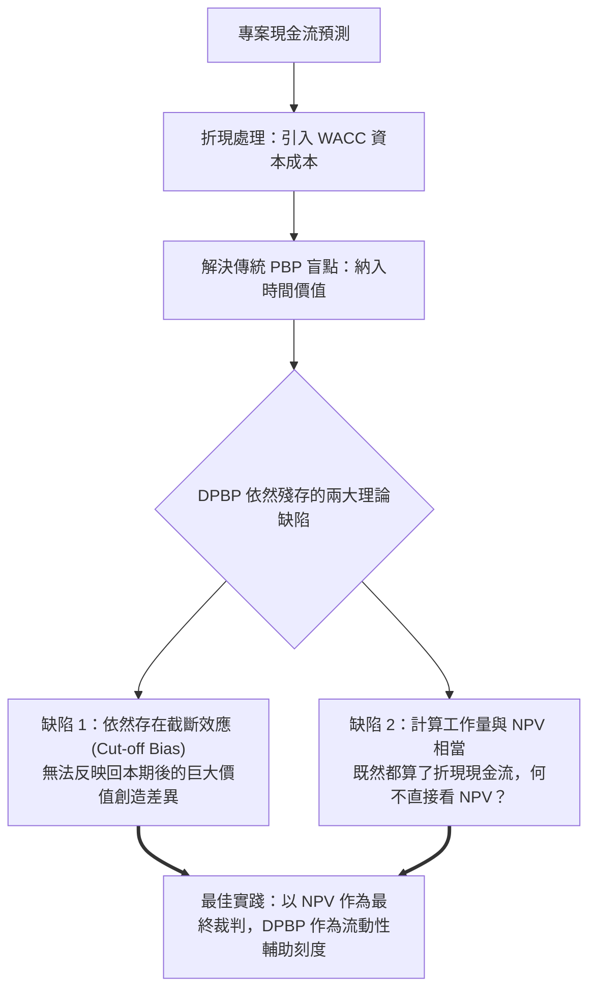

---
{"dg-publish":true,"permalink":"/98/discounted-payback-period/","tags":["商業概念","資本預算","財務管理","公司理財","PMBA"],"dg-note-properties":{"aliases":["折現回收期間法","Discounted Payback Period","動態投資回收期","DPBP"],"tags":["商業概念","資本預算","財務管理","公司理財","PMBA"]}}
---


# 折現回收期間法 (Discounted Payback Period, DPBP)

> **【核心決策摘要】**
> **折現回收期間法（Discounted Payback Period Method，簡稱 DPBP，又稱動態投資回收期）** 是針對傳統回收期間法「忽略貨幣時間價值」之致命缺陷所發展出的改進型決策工具。其衡量**投資專案各期產生的現金淨流入，經過企業加權平均資本成本（WACC）或指定要求回報率折現後的現值總和，剛好全額彌補期初初始投資現值所需的時間長度**。折現回收期在公司理財中確立了一條鐵律定理：**「凡是折現回收期短於或等於其經濟壽命的專案，其淨現值必然大於等於零（$\text{NPV} \ge 0$）」**。它兼顧了經理人對「資金回流速度（流動性風險）」的直觀要求與金融學對「資本成本時間價值」的嚴肅考量。

---

## 1. 概念核心定義與本質 (Executive Definition & Theoretical Essence)

### 1.1 核心定義與數理表達
折現回收期被定義為使**折現現金淨流入的累計現值（Cumulative Discounted Cash Flows）剛好等於期初投資額 $I_0$** 的臨界時點 $T_{\text{dpbp}}$：

$$\sum_{t=1}^{T_{\text{dpbp}}} \frac{\text{CF}_t}{(1 + k)^t} = I_0$$

其中 $k$ 為該專案所匹配的資本成本（折現率，通常採用專案風險調整後的 WACC），$\text{CF}_t$ 為第 $t$ 期增額現金淨流入。

```
【計算步驟：線性插值法 (Linear Interpolation)】
1. 計算各期折現現金流：PV_t = CF_t / (1 + k)^t
2. 計算累計折現現金流：Cumulative PV_t = sum(PV_1 ... PV_t)
3. 尋找臨界年份 A：Cumulative PV_A < I0，且 Cumulative PV_{A+1} >= I0
4. 線性插值求解：
   DPBP = A + [ (I0 - Cumulative PV_A) / PV_{A+1} ]
```

### 1.2 本質解析：DPBP 的幾何特徵與「NPV 聯動定理」
折現回收期在數學幾何上具有極為優雅的理論性質：
1. **永遠大於簡單回收期（$\text{DPBP} > \text{PBP}$）**：因為折現因子 $\frac{1}{(1+k)^t} < 1$，未來的每一元現金在現值刻度下都縮水了。若某專案名義簡單回收期為 3 年，在 10% 資本成本下，其折現回收期通常拉長至 3.8 至 4.5 年以上；若專案折現現金流總額甚至無法覆蓋 $I_0$，則該專案**在數學上根本不存在有限的折現回收期（$\text{DPBP} = \infty$）**。
2. **NPV 符號一致性定理（The NPV Linkage Theorem）**：
   $$\text{若 } \text{DPBP} \le T \iff \mathbf{\text{NPV} \ge 0} \quad (\text{專案創造股東價值})$$
   $$\text{若 } \text{DPBP} > T \text{ 或無解} \iff \mathbf{\text{NPV} < 0} \quad (\text{專案實質摧毀資本})$$
   （其中 $T$ 為專案的實際營運終止壽命）。這意味著 DPBP 徹底消除了傳統 PBP 可能核准「折現後實質虧損專案」的致命盲點。

---

## 2. 數理模型與 PBP vs. DPBP 深度量化對照 (Quantitative Comparison)

假設某半導體設備升級專案初始投資 $I_0 = \$1,000$ 萬元，專案預期壽命 $T = 5$ 年，企業資本成本 $k = 10\%$：

| 年度 $t$ | 名義現金流 $\text{CF}_t$ | 累計名義現金流 | 折現因子 $(1+0.1)^{-t}$ | 折現現金流 $\text{PV}_t$ | 累計折現現金流 |
| :---: | :---: | :---: | :---: | :---: | :---: |
| **0** | **-\$1,000 萬** | -\$1,000 萬 | 1.0000 | -\$1,000 萬 | -\$1,000 萬 |
| **1** | \$350 萬 | \$350 萬 | 0.9091 | \$318.2 萬 | \$318.2 萬 |
| **2** | \$350 萬 | \$700 萬 | 0.8264 | \$289.2 萬 | \$607.4 萬 |
| **3** | \$350 萬 | **\$1,050 萬** (已回本) | 0.7513 | \$263.0 萬 | \$870.4 萬 |
| **4** | \$350 萬 | \$1,400 萬 | 0.6830 | \$239.1 萬 | **\$1,109.5 萬** (已回本) |
| **5** | \$350 萬 | \$1,750 萬 | 0.6209 | \$217.3 萬 | \$1,326.8 萬 |

### 2.1 計算結果對照
- **傳統簡單回收期（PBP）**：
  $$\text{PBP} = 2 + \frac{1,000 - 700}{350} = \mathbf{2.86 \text{ 年}}$$
- **折現回收期（DPBP）**：
  $$\text{DPBP} = 3 + \frac{1,000 - 870.4}{239.1} = 3 + \frac{129.6}{239.1} \approx \mathbf{3.54 \text{ 年}}$$
- **專案總淨現值（NPV）**：
  $$\text{NPV} = \text{累計折現現金流至第 5 年} - I_0 = 1,326.8 - 1,000 = \mathbf{+\$326.8 \text{ 萬元}}$$

#### 經理人管理意涵：
名義上不到 2.9 年就宣稱回本的專案，實質上考慮了股東與債權人的融資成本後，需要 **3.54 年** 才能真正保本。若管理層原先設定了「3 年內必須保本」的嚴格門檻，以傳統 PBP 會盲目通過，而以 DPBP 則能揭示該專案在 3 年內並未真正收回資本成本的真相。

---

## 3. 戰略框架與殘存侷限性剖析 (Strategic Framework & Residual Flaws)

儘管 DPBP 成功治癒了「忽視時間價值」的毛病，但現代公司理財指出其仍非最完美的決策工具：



### 3.1 為什麼 DPBP 不能取代 NPV？
假設有兩個專案，資本成本均為 10%：
- **專案 X**：初始投資 1,000 萬，第 1~3 年每年折現現金流 400 萬，第 4~5 年為 0。
  $\implies \text{DPBP} = 2.5 \text{ 年}$，$\text{NPV} = +200 \text{ 萬}$。
- **專案 Y**：初始投資 1,000 萬，第 1~3 年每年折現現金流 300 萬，第 4~5 年每年折現現金流 800 萬。
  $\implies \text{DPBP} = 3.1 \text{ 年}$，$\text{NPV} = +1,500 \text{ 萬}$。
若管理層迷信「DPBP 越短越好」，將選擇回本僅 2.5 年但只賺 200 萬的專案 X，從而錯失創造 1,500 萬財富的專案 Y。

---

## 4. 產業標竿與實戰應用場景 (Industry Benchmarks & Applications)

| 應用領域 | 典型 DPBP 門檻 | 適用理由與治理價值 |
| :--- | :---: | :--- |
| **海外跨境基礎設施與能源 (BOT/PPP)** | **$8 \sim 12$ 年** | 政治週期與特許經營合約通常為 20~30 年，必須在合約前三分之一期間完成折現保本以防徵收風險 |
| **綠能轉型與儲能電站 (Battery Storage)** | **$5 \sim 7$ 年** | 鋰電池電芯存在每年的容量衰減率（Degradation Rate），折現回收期必須短於電池首次大修更換週期 |
| **大型商業地產物業收購** | **$7 \sim 10$ 年** | 租金收益率需覆蓋商業不動產抵押貸款利率，評估槓桿下的動態權益回本速度 |
| **企業核心 ERP / 數位轉型大專案** | **$3 \sim 4$ 年** | 軟體技術架構演進極快，若折現 4 年無法回本，系統即將面臨淘汰重構的沉沒風險 |

---

## 5. 經典企業個案深度剖析 (Deep Dive Case Studies)

### 5.1 成功典範：某全球晶圓代工大廠之綠色節能專案評估
- **決策背景**：廠區冰水主機與廢熱回收系統升級，初期投入 \$8,000 萬元。
- **指標博弈**：
  1. 節能專案名義節省電費約每年 \$1,800 萬，簡單回收期為 $8,000 / 1,800 \approx 4.4$ 年。
  2. 財務委員會指出：設備維護費用逐年上升，且公司 WACC 高達 8.5%。
  3. 導入 DPBP 重算：在考量電價調整與資本成本折現後，真實折現回本期拉長為 **5.9 年**。
- **策略決策**：由於冰水機組設計壽命長達 15 年，即使 DPBP 為 5.9 年，仍遠小於 15 年（$\text{NPV} > 0$ 且高達數千萬元）。管理層據此果斷通過投資，既滿足了 ESG 減碳指標，又確保了長期股東價值的扎實增長。

---

## 6. 高階經理人決策實戰工具箱 (Executive Action Playbook)

### 6.1 PBP 與 DPBP 決策矩陣判讀表

```
                    DPBP 表現 (考量資本成本與時間價值)
                    DPBP <= 專案壽命 T      │  DPBP > 專案壽命 T (或無解)
    ───────────────┼───────────────────────┼───────────────────────────
    PBP 表現       │ 【象限 I：雙重綠燈專案】│ 【象限 II：名義賺錢實質虧損】
    PBP <= 基準門檻 │ • 現金流速快且 NPV > 0 │ • 典型陷阱：名義上看似回本，
                   │ • 決策：優先核准推進  │   但考慮利息後根本未保本 (NPV < 0)
                   │                       │ • 決策：堅決否決！
    ───────────────┼───────────────────────┼───────────────────────────
    PBP > 基準門檻 │ 【象限 III：潛在大牛專案】│ 【象限 IV：雙重死局專案】
                   │ • 回本慢但後勁足，NPV > 0 │ • 現金流極慢且摧毀資本價值
                   │ • 決策：若資金充沛且無  │ • 決策：立即剔除
                   │   流動性危機，應予通過│
```

### 6.2 經理人使用折現回收期的三大實戰心法
- [ ] **心法 1：折現率的取值必須精準匹配專案風險**：（不可全公司統一採用單一 WACC；高風險研發專案應上浮折現率，低風險節能專案可下調折現率，參見 [[wacc_加權平均資本成本]]）。
- [ ] **心法 2：將 DPBP 作為「流動性安全閥」，將 NPV 作為「價值天花板」**：（只有兩者皆通過的專案才具備最高確定性）。
- [ ] **心法 3：警惕通貨膨脹對現金流折現的雙重侵蝕**：（名義現金流必須匹配名義折現率，實質現金流匹配實質折現率，切忌混淆）。

---

## 7. 關聯知識網絡與導航地圖 (Knowledge Network & Cross-References)

### 7.1 本主題核心三部曲
- **[[payback-period_回收期間法]]** · 初始投資流動性回本速度、四大理論缺陷與第一道初篩漏斗
- **[[discounted-payback-period_折現回收期間法]]** · 引入資本成本折現、NPV 連動定理與動態回本邊界（本篇）
- **[[zeng-e-cash-flow_增額現金流量]]** · 資本預算唯一度量標準、沉沒成本剔除、機會成本與自食效應

### 7.2 跨領域財務與策略鏈結
- [[NPV_淨現值法 _Net Present Value]] · DPBP 是否小於壽命之完全等價判定指標
- [[wacc_加權平均資本成本]] · 折現回收期間法計算中必備之資金成本折現率
- [[dcf_現金流量折現法]] · 現金流折現微觀金融數學原理
- [[capital-budgeting_資本預算]] · 資本預算決策工具全景圖譜
- [[capital-expenditure_資本支出]] · 資本支出項目之立項審核與生命週期監控

### 7.3 課程筆記與導航主頁
- [[M1-2_三大景氣循環與資本評價邏輯]] · 資本評價邏輯、設備循環與折現率設定
- [[_創業與企業財務策略 MOC]] · 企業財務策略與資本市場運作全景地圖
- [[home]] · 全球 PMBA 知識庫總導航主頁面