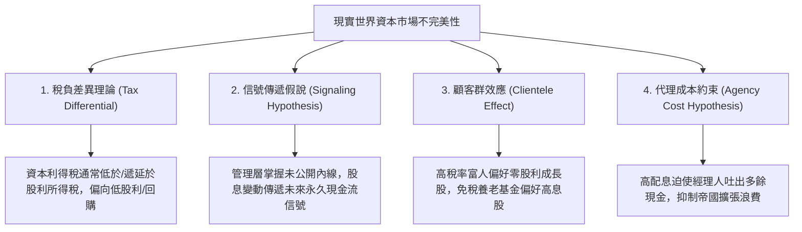

---
{"dg-publish":true,"permalink":"/98/dividend-irrelevance-theory/","tags":["商業概念","財務管理","公司理財","金融學","PMBA"],"dg-note-properties":{"aliases":["股利無關論","Dividend Irrelevance Theory","MM股利無關論","Modigliani-Miller Dividend Theorem","自製股利定理"],"tags":["商業概念","財務管理","公司理財","金融學","PMBA"]}}
---


# 股利無關論 (Modigliani-Miller Dividend Irrelevance Theorem)

> **【核心決策摘要】**
> **股利無關論（Dividend Irrelevance Theory）** 是諾貝爾經濟學獎得主佛朗哥·莫迪利安尼（Franco Modigliani）與默頓·米勒（Merton Miller）於 1961 年發表的金融學劃時代定理。該理論以嚴謹的微積分與無套利證明指出：**在完美的資本市場（Perfect Capital Markets：無摩擦稅負、無交易發行成本、投資政策給定且資訊完全對稱）環境下，企業的總市場價值與股票價格完全取決於其資產的「投資政策與本業獲利能力（Earning Power）」，而與其「股利分配政策（究竟是發放現金股利還是保留盈餘）」完全無關（Irrelevant）**。股東可以透過自行在市場上買賣股票（**自製股利 Homemade Dividends**），以零成本完美複製任何期望的現金流結構。MM 股利無關論的巨大理論貢獻，並非在於描述現實世界，而在於為分析**「市場不完美性（稅負差異、信號傳遞、交易成本與代理衝突）」** 確立了最純粹的基準坐標系。

---

## 1. 概念核心定義與四大完美市場假設 (Executive Definition & Theoretical Baseline)

### 1.1 核心定義
股利無關論主張：**在給定企業投資決策與資本預算的前提下，改變股利發放政策僅僅是改變了「股東報酬以現金股息形式實現、抑或以股票資本利得（Capital Gains）形式實現」的組合標籤，企業的總價值既不增加也不減少**。

```
                    ┌─────────────────────────────────────────┐
                    │      MM 股利無關論四大完美假設前提      │
                    └────────────────────┬────────────────────┘
                                         ▼
         ┌───────────────────────────────┴───────────────────────────────┐
         ▼                                                               ▼
【1. 無摩擦稅負 (Zero Taxes)】                                  【2. 零交易與發行成本 (Zero Friction)】
 • 資本利得稅率 = 股利所得稅率 = 0%                              • 投資人買賣股票無手續費、企業增發新股無承銷折價
【3. 投資政策固定 (Fixed Investment)】                          【4. 資訊完全對稱 (Symmetric Information)】
 • 企業未來的 CapEx 與正 NPV 專案完全給定，不因分紅而變更        • 外部投資人與內部管理層掌握完全相同資訊，股息無信號功能
```

---

## 2. 數理模型與自製股利證明 (Mathematical Proof & Homemade Dividends)

### 2.1 莫迪利安尼-米勒（1961）的嚴格代數證明

設企業在期初 $t=0$ 的股票總市值為 $V_0 = n_0 P_0$（$n_0$ 為流通股數，$P_0$ 為期初每股股價）。
在完美市場中，企業在 $t=0$ 的必要報酬率為 $k_e$。單一股份在期初的價值滿足：

$$P_0 = \frac{D_1 + P_1}{1 + k_e}$$

兩邊同乘以流通股數 $n_0$，得到全公司總股權價值：

$$V_0 = n_0 P_0 = \frac{n_0 D_1 + n_0 P_1}{1 + k_e}$$

假設企業在 $t=1$ 期決定將總股利發放額擴大至 $n_0 D_1$。若企業當期產生的淨利潤為 $X_1$，而計畫進行的資本支出為 $I_1$：
- 若內部留存盈餘不足以支付股利（即 $n_0 D_1 > X_1 - I_1$），企業必須向外部發行新股 $m$ 股以籌集不足的現金差額：
  $$m P_1 = I_1 - (X_1 - n_0 D_1)$$
- 移項得期末原股東持有的股份總值：
  $$n_0 P_1 = (n_0 + m) P_1 - m P_1 = V_1 - [I_1 - X_1 + n_0 D_1]$$
- 將 $n_0 P_1$ 代回期初總市值 $V_0$ 公式：
  $$V_0 = \frac{n_0 D_1 + V_1 - I_1 + X_1 - n_0 D_1}{1 + k_e} = \frac{X_1 - I_1 + V_1}{1 + k_e}$$

#### 震撼的數學結論：
**股利項 $n_0 D_1$ 在分子中被正負剛好完全抵消！**
企業期初總市值 $V_0$ 完全取決於期末企業基本面資產價值 $V_1$、淨利潤 $X_1$ 與投資支出 $I_1$，而與股利發放多寡**完全無關**。增發股利所帶來的現金流入，剛好被增發新股對原每股股價造成的稀釋效應完全抵消！

---

### 2.2 自製股利機制（Homemade Dividends Mechanics）

假設投資人持有某公司價值 \$100,000 的股票（1,000 股，每股 \$100）：

```
【情境一：公司發放 10% 現金股利 (每股配息 $10)】
• 股東收到現金：1,000 股 x $10 = $10,000 現金
• 除息後每股股價降至 $90
• 股東剩餘持股市值：1,000 股 x $90 = $90,000
• 股東總財富 = $10,000 (現金) + $90,000 (股票) = $100,000

【情境二：公司完全不分紅 ($0 股利)，將盈餘全額保留】
• 每股股價維持 $100，無現金配息
• 若股東此時需要 $10,000 現金消費：
  股東只需在公開市場自行賣出 100 股股票 (Homemade Dividend)
• 賣股換取現金：100 股 x $100 = $10,000 現金
• 股東剩餘持股市值：900 股 x $100 = $90,000
• 股東總財富 = $10,000 (現金) + $90,000 (股票) = $100,000
```

**結論**：股東無論如何都能自己創造所需要的現金流，根本不需要依賴董事會替其分紅！

---

## 3. 現實世界為何「股利相關」？四大市場不完美性修正 (Market Imperfections)

MM 股利無關論打破了傳統偏見，並精確指引出：**如果現實中股利政策能影響企業價值，必然是因為以下四項「市場不完美性」在發揮作用**：



1. **稅差理論（Tax-Preference Theory，Farrar & Selwyn, 1967；Litzenberger & Ramaswamy, 1979）**：在多數國家，現金股利直接計入個人綜合所得課徵高額累進稅率；而資本利得享有較低稅率，且只要「不賣出就不用繳稅（延期納稅福利）」。因此，高稅負投資人偏好低股利或庫藏股。
2. **信號傳遞假說（Dividend Signaling，Bhattacharya, 1979；John & Williams, 1985）**：外部投資人無法完全看清企業真實前景。調升股息是管理層以真金白銀發出的高昂承諾，宣示未來利潤強勁；削減股利則是經營惡化的求救信號。
3. **顧客群效應（Clientele Effect，Black & Scholes, 1974）**：不同類型的投資人群體因稅負與流動性需求不同，自發聚集於特定股利政策的企業（退休族偏好公用事業高息股，年輕創業投資人偏好不分紅科技股）。
4. **代理成本假說（Agency Cost Theory，Jensen, 1986）**：股利迫使經理人將自由現金流吐給股東，阻斷其揮霍在職消費的衝動（參見 [[agency-costs_代理成本]]）。

---

## 4. 經典企業個案深度剖析 (Deep Dive Case Studies)

### 5.1 成功典範：巴菲特（Warren Buffett）與波克夏的「自製股利」實踐
- **60 年神話**：自 1965 年巴菲特執掌波克夏以來，該公司除了在 1967 年象徵性發放過一次 10 美分股利外，**長達近 60 年未曾發放過一分錢現金股利**。
- **巴菲特致股東信的 MM 詮釋**：
  1. 波克夏保留的每一塊錢盈餘，巴菲特都能在資本市場透過超群的選股與收購，將其轉化為兩塊錢以上的股東市場價值（$\text{ROIC} \gg \text{WACC}$）。
  2. 若將現金分紅給股東，股東需立即被政府扣繳高達 30%~40% 的所得稅，殘餘資金只能存銀行或自行投資於低收益資產。
  3. **自製股利指引**：巴菲特公開告訴所有股東：如果你們每年需要 4% 的現金作為生活開銷，只要每年在市場上賣掉手頭 4% 的波克夏 A 股或 B 股即可！
- **成效**：波克夏市值突破 1 兆美元，股價從 19 美元飆升至超過 70 萬美元，成為全球貫徹「股利無關論與資本配置極致」的最偉大案例。

---

## 6. 高階經理人決策實戰工具箱 (Executive Action Playbook)

### 6.1 經理人股利配置決策邏輯清單
- [ ] **邏輯檢驗 1：公司當前的再投資報酬率（ROIC）是否顯著高於股東自行投資的機會成本？**（若是，應降低配息，保留盈餘投入本業！）。
- [ ] **邏輯檢驗 2：若考慮調升股利，該增幅是否能在未來 3~5 年景氣衰退期持續支付？**（切忌把暫時性的景氣週期暴利轉化為永久常規股息）。
- [ ] **邏輯檢驗 3：當前本公司股票在二級市場是否被嚴重低估？**（若市價遠低於內在價值，執行庫藏股回購的股東回報遠大於發放現金股利）。

---

## 7. 關聯知識網絡與導航地圖 (Knowledge Network & Cross-References)

### 7.1 本主題核心三部曲
- **[[dividend-policy_股利政策]]** · 資本配置四大實踐模式、林特納平滑模型與現金股利 vs. 庫藏股回購
- **[[dividend-irrelevance-theory_股利無關論]]** · 莫迪利安尼-米勒（MM）完美市場基準、自製股利定理與四重現實摩擦（本篇）
- **[[dividend-payout-ratio_股利發放率]]** · 配息率對永續成長率（SGR）之剛性約束、昂貴信號傳遞與股利驚喜

### 7.2 跨領域財務與策略鏈結
- [[homemade-dividends_自製股利]] · MM 股利無關論核心推導工具與股東現金流守恆
- [[sustainable-growth-rate_永續成長率]] · 保留盈餘率對企業自體增長極限之約束
- [[capital-structure_資本結構]] · MM 定理第一與第二命題（資本結構無關論與稅盾效應）
- [[agency-costs_代理成本]] · 詹森自由現金流假說對 MM 無摩擦假設的現實修正

### 7.3 課程筆記與導航主頁
- [[L09_資本結構理論與決策]] · 財務策略模組九：MM 理論體系、股利政策與公司理財決策
- [[_創業與企業財務策略 MOC]] · 企業財務策略與資本市場運作全景地圖
- [[home]] · 全球 PMBA 知識庫總導航主頁面