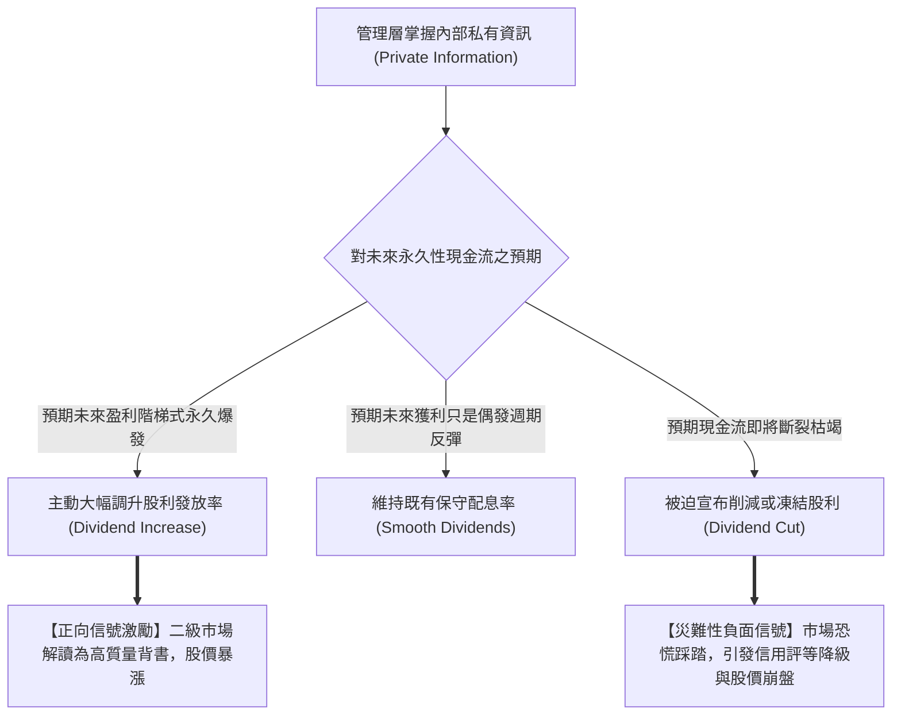

---
{"dg-publish":true,"permalink":"/98/dividend-payout-ratio/","tags":["商業概念","股利政策","財務分析","資本市場","PMBA"],"dg-note-properties":{"aliases":["股利發放率","Dividend Payout Ratio","配息率","股利支付率","股利信號理論","股利驚喜"],"tags":["商業概念","股利政策","財務分析","資本市場","PMBA"]}}
---


# 股利發放率與信號理論 (Dividend Payout Ratio & Signaling Dynamics)

> **【核心決策摘要】**
> **股利發放率（Dividend Payout Ratio，簡稱配息率）** 衡量企業在特定會計週期內**宣告發放的現金股利總額佔當期稅後淨利（Net Income）的百分比**。其互補項為**保留盈餘率（Retention Ratio / Plowback Ratio, $b = 1 - \text{Payout Ratio}$）**。股利發放率不僅是決定企業內部資本再投資能力的調節閥，更透過希金斯（Higgins）模型直接約束企業的**永續成長率（Sustainable Growth Rate, SGR）**。在資訊不對稱的現代資本市場中，股息變動是管理層向二級市場傳遞企業基本面品質與未來看法的**極度昂貴且具備高可信度的「信號發射器（Costly Signaling Device）」**；一場未被市場預期的「股利驚喜（Dividend Surprise）」往往能引發數十億美元市值的劇烈重估。

---

## 1. 概念核心定義與關鍵算式 (Executive Definition & Key Formulas)

### 1.1 核心定義與雙向表達

$$\text{股利發放率 (Dividend Payout Ratio, PR)} = \frac{\text{當期現金股利總額 (Total Dividends)}}{\text{當期會計淨利潤 (Net Income)}} = \frac{\text{每股現金股利 (DPS)}}{\text{每股盈餘 (EPS)}}$$

$$\text{保留盈餘率 (Retention Ratio / Plowback Ratio, } b) = 1 - \text{PR} = 1 - \frac{\text{DPS}}{\text{EPS}}$$

```
會計淨利潤 (Net Income, 100%)
  ├── 股利發放率 (Payout Ratio, PR) ────────► 以現金股息回饋股東 (即期現金消費)
  └── 保留盈餘率 (Retention Ratio, b) ──────► 轉入資產負債表保留盈餘 (未來擴產再投資)
```

### 1.2 股利發放率 vs. 股息殖利率（Dividend Yield）之本質差異
初學經理人常將兩者混淆：
- **股利發放率（Payout Ratio）**：以**會計淨利（EPS）** 為分母，衡量「企業賺到的利潤拿了多少比例分給股東」，反映企業的**內部資本配置決策**。
- **股息殖利率（Dividend Yield）**：以**股票市價（Stock Price）** 為分母（$\frac{\text{DPS}}{P}$），衡量「投資人以當前價格買入股票所獲得的年度現金回報率」，反映**二級市場的投資定價屬性**。

---

## 2. 數理模型：對永續成長率（SGR）的剛性約束 (Constraint on Sustainable Growth)

### 2.1 希金斯（Robert C. Higgins）永續成長率模型

企業在不發行新股稀釋股權、且維持目標財務結構與資產周轉率的前提下，完全依賴內部盈餘累積所能支撐的最大年營收成長率：

$$\text{SGR} = \text{ROE} \times b = \text{ROE} \times (1 - \text{Payout Ratio})$$

考慮期初權益基數的精確公式為：

$$\text{SGR} = \frac{\text{ROE} \times (1 - \text{PR})}{1 - \text{ROE} \times (1 - \text{PR})}$$

#### 經理人財務槓桿連動推論：
1. **配息率為 100%（$\text{PR} = 1.0$，$b = 0$）**：所有獲利被全數分光，保留盈餘增加額為零，企業內生永續成長率**直接歸零（$\text{SGR} = 0$）**。若企業強行追求營收增長，必須向外部大舉發債借錢或增資，否則將迅速陷入流動性斷流危機。
2. **配息率為 0%（$\text{PR} = 0$，$b = 1.0$）**：內生成長潛力達到極限（$\text{SGR} = \text{ROE}$）。高成長新創在擴張期通常選擇零配息，正是為了極大化 SGR。

---

## 3. 股利信號傳遞假說 (The Dividend Signaling Hypothesis)

在資訊不對稱環境中，內部管理層比外部股東更了解企業未來的訂單、良率與獲利能力。巴塔查亞（Bhattacharya, 1979）確立了股利信號模型：



### 3.1 為什麼現金股利是「最昂貴且不可偽造的信號」？
- **空談無益（Talk is Cheap）**：CEO 在法說會上吹噓未來看好成本為零，造假企業亦能言辭浮誇。
- **真金白銀的懲罰機制（Costly Signal）**：發放現金股息需要從銀行帳戶實時劃撥數億真金白銀。若一家虧損企業試圖透過借債「打腫臉充胖子」發放高股息以粉飾太平，其破產成本與債券違約風險將呈指數級飆升。因此，**資本市場認定只有具備持久現金流造血能力的企業才敢持續提高配息率**。

---

## 4. 產業標竿與實戰應用場景 (Industry Benchmarks & Applications)

| 產業類別 | 典型股利發放率 (PR) | 資本配置戰略動因 | 風險警訊指標 |
| :--- | :---: | :--- | :--- |
| **成熟公用事業與電信 (Utilities/Telecom)** | **65% ~ 85%** | 營運現金流極度穩定且可預測；重資產建設期已過，將多餘現金分紅吸引保守型長期資金 | 若配息率持續 $> 100\%$，表明開始借債分紅，資產負債表惡化 |
| **頂級晶圓製造 (TSMC)** | **40% ~ 50%** | 平衡每年 300~400 億美元先進製程 CapEx 與外資股東現金回報 | 兼顧每季股息絕對金額穩步增長 |
| **高科技雲端與 AI 獨角獸** | **0% ~ 15%** | 處於高速擴張與技術軍備競賽期，內部再投資收益率（ROIC）遠高於資本成本 | 盲目跟風分紅反而被市場質疑「失去成長動能」 |
| **高週期性大宗商品 (航運/鋼鐵/礦業)** | **隨景氣波動 (20%~80%)** | 景氣谷底維持微薄常態股息，景氣頂峰大額配息或回購 | 景氣高點誤判為永久常態而承諾固定高股息 |

---

## 5. 經典企業個案深度剖析 (Deep Dive Case Studies)

### 5.1 成功信號案例：台積電的「季季配息、只增不減」信用建立
- **制度創新**：2019 年起，台積電修改章程推行「按季配息（Quarterly Dividends）」，並向全球外資承諾：**每季現金股息「只增不減（Never Decreasing）」**。
- **強大信號效應**：
  1. 每季現金股利從 2 元、2.5 元、3 元逐步階梯調升至 4 元以上。
  2. 這一制度向全球機構投資人發送了震撼信號：即便面臨全球半導體庫存調整週期，台積電亦擁有絕對充沛的現金流抵禦風浪。
- **成效**：外資持股比例長期穩定在 72% 以上，大幅降低了股價波動率與權益資本成本。

### 5.2 災難信號案例：宏達電（HTC）2013 年首次宣布不配發股利引發股價跌停
- **歷史背景**：2011 年宏達電登頂全美智慧型手機龍頭，股價高達 1,300 元，每股配發現金股利高達 40 元，配息率達 55%。
- **信號崩潰連鎖反應**：
  1. 2013 年隨著蘋果與三星雙邊夾擊、專利戰失利，HTC 淨利急遽萎縮。
  2. 2013 年董事會正式宣布「**全年度不配發任何股利（配息率 0%）**」。
  3. 資本市場將此舉解讀為「管理層承認企業競爭優勢徹底瓦解、現金流見底」的終極絕望信號。
- **後果**：消息公布後股價連續無量跌停，外資機構瘋狂砍倉，市值自巔峰蒸發超過 90%。

---

## 6. 高階經理人決策實戰工具箱 (Executive Action Playbook)

### 6.1 股利發放率診斷四象限矩陣

```
                    高 ROIC (超額投資機會)
                            │
            【象限 II：低配息蓄力區】 │ 【象限 I：甜蜜矛盾區】
            • 特徵：成長型高科技、生物製藥│ • 特徵：極度罕見超強造血金牛
            • 策略：配息率控制於 0%~20% │ • 策略：維持 30%~50% 配息率，
              保留全部盈餘推動規模翻倍  │   同時進行大額庫藏股回購
    ───────────────┼───────────────
            【象限 III：高危陷阱區】│ 【象限 IV：現金牛回饋區】
            • 特徵：資本效率差且亂分紅  │ • 特徵：成熟傳產、公用事業
            • 策略：立即砍除高配息！  │ • 策略：配息率提升至 60%~80%，
              嚴防借債分紅引發破產爆雷  │   將剩餘現金還給股東自行配置
                            │
                    低 ROIC (缺乏正 NPV 專案)
    低配息率 (PR < 30%) ────────────────── 高配息率 (PR > 60%)
```

---

## 7. 關聯知識網絡與導航地圖 (Knowledge Network & Cross-References)

### 7.1 本主題核心三部曲
- **[[dividend-policy_股利政策]]** · 資本配置四大實踐模式、林特納平滑模型與現金股利 vs. 庫藏股回購
- **[[dividend-irrelevance-theory_股利無關論]]** · 莫迪利安尼-米勒（MM）完美市場基準、自製股利定理與四重現實摩擦
- **[[dividend-payout-ratio_股利發放率]]** · 配息率對永續成長率（SGR）之剛性約束、昂貴信號傳遞與股利驚喜（本篇）

### 7.2 跨領域財務與策略鏈結
- [[sustainable-growth-rate_永續成長率]] · 股利發放率（$PR$）對企業內生增長極限之微觀約束方程式
- [[equity-free-cash-flow_股權自由現金流量]] · 配息率可持續性之底層現金流檢驗標尺
- [[ROIC_投入資本報酬率 Return on Invested Capital]] · 決定保留盈餘再投資效率之核心指標
- [[dupont-analysis_杜邦分析法]] · 拆解 ROE 對永續成長率 SGR 的乘數傳導
- [[dividend-discount-model_股利折現模型]] · 股利發放預期對股票內在價值之折現定價

### 7.3 課程筆記與導航主頁
- [[L09_資本結構理論與決策]] · 財務策略模組九：資本結構、股利政策與公司理財決策
- [[_創業與企業財務策略 MOC]] · 企業財務策略與資本市場運作全景地圖
- [[home]] · 全球 PMBA 知識庫總導航主頁面