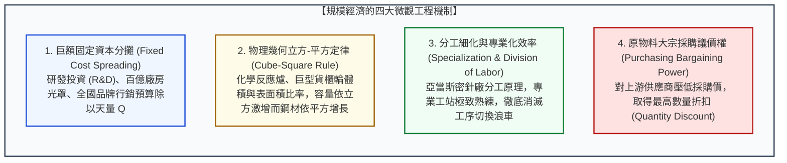

---
{"dg-publish":true,"permalink":"/98/economies-of-scale/","tags":["商業概念","策略管理","產業分析","成本領導","規模經濟","護城河","生產管理","PMBA"],"dg-note-properties":{"aliases":["規模經濟","生產規模經濟","規模效益","規模報酬遞增","Economies of Scale","Scale Economies","economies-of-scale","最小有效規模","規模優勢"],"tags":["商業概念","策略管理","產業分析","成本領導","規模經濟","護城河","生產管理","PMBA"],"類別":"商業概念庫"}}
---


# 規模經濟 (Economies of Scale / 規模效益與成本壁壘)

> **核心名言**：  
> 「在任何大批量製造業中，規模不是虛榮，而是生存的根本前提。規模經濟能讓固定成本攤平在龐大產量之上，迫使新進者如果無法迅速達到『最小有效規模』，就只能在長期的成本劣勢中慢性失血。」  
> —— 麥可·波特（Michael E. Porter, *Competitive Advantage*, 1985）  
>  
> 「我們不追求單純的產量膨脹，我們追求的是將龐大產量轉化為極致的良率、全球最低的晶圓單位製造成本，以及無可替代的資本支出循環。」  
> —— 張忠謀（Morris Chang, 台積電創辦人）

---

## 一、 核心定義與微觀經濟學數學模型

### 1.1 經典理論定義與經濟學本質
- **微觀經濟學標準定義**：
  **規模經濟（Economies of Scale）** 指在特定時間週期內，隨著單一產品或服務的**產出規模（Output Scale, $Q$）擴大，長期平均總成本（Long-Run Average Cost, LRAC）呈現持續下降的經濟現象**。
- **數學定義與成本彈性係數**：
  $$rac{d(	ext{LRAC})}{dQ} < 0, \quad 	ext{其中 } 	ext{LRAC}(Q) = rac{	ext{TC}(Q)}{Q} = rac{	ext{FC}}{Q} + 	ext{AVC}(Q)$$
  - **總成本（TC）**：固定成本（FC） ＋ 變動成本（VC）；
  - **成本產出彈性係數（Cost-Output Elasticity, $\epsilon_C$）**：
    $$\epsilon_C = rac{\% \Delta 	ext{TC}}{\% \Delta Q} = rac{d	ext{TC}}{dQ} \cdot rac{Q}{	ext{TC}} = rac{	ext{MC}}{	ext{AC}}$$
    - 若 $\epsilon_C < 1$（邊際成本小於平均成本）：處於**規模報酬遞增 / 規模經濟階段（Economies of Scale）**；
    - 若 $\epsilon_C = 1$（邊際成本等於平均成本）：處於**規模報酬不變階段（Constant Returns to Scale）**；
    - 若 $\epsilon_C > 1$（邊際成本大於平均成本）：處於**規模報酬遞減 / 規模不經濟階段（Diseconomies of Scale）**。

---

### 1.2 最小有效規模 (Minimum Efficient Scale, MES) 與產業結構決定論
- **最小有效規模（MES, $Q^*$）**：指長期平均成本曲線（LRAC）達到最低點時所對應的**最小產能水準**。

```text
【長期平均成本曲線 (LRAC) 與最小有效規模 (MES)】

  平均成本 (AC)
     ▲
     │  【規模經濟階段】             【最適規模平原】              【規模不經濟階段】
     │   (固定成本巨額分攤)            (規模報酬不變)               (官僚臃腫/協調摩擦)
     │   \                                                          /
     │    \                                                        /
     │     \                                                      /
     │      \                                                    /
  AC*├───────\──────────────────┌──────────────────────────────┐/
     │        \                 │  最低成本生產區間 (MES)      │
     │         \                │                              │
     └──────────\───────────────┴──────────────────────────────┴──────────────►
                0              Q*_MES                        Q_Max             產量 (Q)
```

- **MES 與市場集中度的決定性關聯（Bain, 1956）**：
  $$	ext{市場可容納之最大高效企業數} pprox rac{	ext{總體市場需求容量 (Market Demand, } D)}{	ext{最小有效規模 (MES)}}$$
  - 若一產業的 $rac{	ext{MES}}{D} > 0.25$（單一工廠必須供應全市場 25% 以上需求才能達到最低成本），該產業必然演化為**高度集中的寡占市場（Oligopoly）**（如晶圓代工、商用大型飛機、面板顯示器）；
  - 若 $rac{	ext{MES}}{D} < 0.01$，則市場結構呈現**高度分散的完全競爭**（如餐飲零售、理髮店）。

---

## 二、 規模經濟的四大微觀驅動機制 (The Four Drivers)

規模經濟的成本下降並非憑空發生，而是建立在四大客觀物理與工程機制之上：



1. **固定成本巨額分攤（Fixed Cost Spreading）**：
   - 現代高科技產品具備「高固定成本、極低邊際成本」特質（如微軟 Windows 作業系統、晶片架構設計）。一旦第一份產品研發完畢，每多複製一份的成本幾乎為零，平均成本隨銷量暴增而無限逼近邊際成本。
2. **幾何法則（Cube-Square Rule / 立方-平方定律）**：
   - 在石化、鋼鐵、海運等重工業領域，設備產能（容積 Volume）與設備尺寸呈**三次方（$r^3$）**增長，而建造設備所需的表面積（鋼材與保溫材料）僅呈**二次方（$r^2$）**增長。
   - *結果*：一艘 20,000 TEU 的超大型貨櫃船，其鋼材建造與燃油成本僅為兩艘 10,000 TEU 貨櫃船的 60% 左右。
3. **分工細化與專業化極致（Specialization & Division of Labor）**：
   - 亞當·斯密（Adam Smith）經典針廠案例：一人獨自製針每日難產 20 枚；20 人細分為 18 道工序分工，日產量躍升至 48,000 枚。大規模產能允許企業為每一個微小動作購置專用高速自動化夾具。
4. **採購規模議價特權（Purchasing Power）**：
   - 鴻海（Foxconn）每年採購數百億美元電子被動元件與機構件，能向供應商索取全產業最低的採購合約價與最長付款帳期，新進小廠在原物料進價上就已注定落敗。

---

## 三、 戰略關鍵辨析：規模經濟 vs. 範疇經濟 vs. 經驗曲線

在策略分析中，許多經理人常將三種截然不同的成本優勢混為一談，導致策略制定嚴重失準：

| 比較維度 | 規模經濟 (Economies of Scale) | 範疇經濟 (Economies of Scope) | 經驗曲線 (Learning Curve / Experience Curve) |
| :--- | :--- | :--- | :--- |
| **提出淵源** | 古典經濟學、產業組織學 | 鮑莫爾（Baumol, Panzar, Willig, 1981） | 波士頓顧問集團（BCG, 1968）布魯斯·亨德森 |
| **核心定義** | **單一產品**在特定時間內的**瞬時產出產能（$Q$）**擴大帶來的平均成本下降 | **多種產品**共用關鍵資源/通路所帶來的總成本節約：$C(Q_A, Q_B) < C(Q_A) + C(Q_B)$ | 歷經時間推移，**累積歷史總產量（$\sum Q$）**每翻一番，單位成本下降固定比例（通常 15%~30%） |
| **關鍵變數** | **產能速率（Rate of Output, $Q/t$）** | **產品線寬度與業務範疇（Breadth of Portfolio）** | **累積歷史總產量（Cumulative Output, $\sum Q$）** |
| **主要機制** | 固定資產折舊分攤、幾何法則、大宗採購 | 共用物流配送網、共用品牌聲譽、共用 R&D 核心技術 | 現場作業員動作熟練、製程瓶頸突破、隱性除錯經驗 |
| **典型代表** | 晶圓代工廠月產能 10 萬片 vs 1 萬片 | 統一超商同一個門市同時賣咖啡、便當與代收帳單 | 台積電每一代新製程良率從 30% 逐步爬坡至 95% |

---

## 四、 規模不經濟 (Diseconomies of Scale) 與擴張天花板

當企業產能超越最佳規模點（$Q_{	ext{Max}}$）時，繼續擴產反而會導致平均成本急劇攀升，主要源自三大官僚陷阱：

1. **內部溝通與協調摩擦成本激增（Coordination Friction）**：
   - 根據梅特卡夫定律，組織人數呈線性增長時，內部潛在溝通管道呈平方級（$N(N-1)/2$）暴增。層層簽呈、官僚內耗與部門本位主義使得決策極度遲緩。
2. **代理人問題與偷懶行為（Agency Costs & Shirking）**：
   - 當團隊規模過於龐大，個別員工的努力與產出難以精準歸因，產生普遍的搭便車（Free-riding）現象與士氣低落。
3. **局部要素瓶頸與排擠效應（Local Factor Bottlenecks）**：
   - 特定地理區域內的高階專門人才、水電配額或運輸碼頭承載力達到極限，企業被迫付出過高的加班費或溢價爭搶投入要素。

---

## 五、 經典旗艦實證案例深度剖析 (Flagship Case Studies)

### 5.1 案例一：台積電（TSMC）—— 資本與良率的「超級規模飛輪」
台積電是全球半導體史上將規模經濟發揮至物理極限的教科書典範：
1. **千億級資本支出巨額分攤**：台積電每年資本支出高達 300~400 億美元。若單一生產線月產能僅 1 萬片，每片晶圓分攤的廠房折舊將高達數千美元；而台積電「超大晶圓廠（GigaFab）」月產能超過 10 萬片，將極限先進製程的單位折舊稀釋至對手無法企及的水準。
2. **規模驅動經驗學習，反哺更高良率**：龐大的全球客戶訂單（蘋果、輝達、高通、超微）讓台積電機台維持 100% 滿載運轉。海量的晶圓吞吐量讓工程師獲得最豐富的晶圓缺陷數據，迅速優化參數爬坡良率；**高良率進一步壓低有效成本，吸引更多客戶下單，形成無人能破的「規模-良率-獲利飛輪」**。

### 5.2 案例二：鴻海精密（Foxconn）—— 全球電子製造 EMS 的極致規模壁壘
1. **採購議價與供應鏈指揮權**：鴻海年營收突破 6 兆台幣，每天消耗全球天量的鋁材、被動元件與晶片，其採購成本通常比二線代工廠低 5%~10%。在電子代工淨利率僅 3%~5% 的微利行業中，這 5% 的採購規模優勢就足以決定對手的生死。
2. **彈性產能峰值調度**：在 iPhone 秋季上市尖峰期，鴻海鄭州園區能在數週內召集並運作 30 萬名產線員工，這種規模化組織動員力構成了無可撼動的製造交付護城河。

---

## 六、 高階經理人決策工具箱：規模化戰略檢核表 (Executive Playbook)

```
┌────────────────────────────────────────────────────────────────────────────┐
│              高階經理人「規模經濟與產能決策」評估檢核表                      │
├────────────────────────────────────────────────────────────────────────────┤
│ ☐ 1. 測算產業 MES 門檻：本公司目前產能是否已跨越產業最小有效規模 (MES)？  │
│    • 若遠低於 MES，切忌在標準品市場與巨頭打價格戰，應迅速退守利基市場。   │
├────────────────────────────────────────────────────────────────────────────┤
│ ☐ 2. 審查固定成本與變動成本結構 (FC / VC Ratio)：                         │
│    • 固定成本佔比愈高（如高科技製造、SaaS、航空），追求規模經濟的槓桿愈大。│
├────────────────────────────────────────────────────────────────────────────┤
│ ☐ 3. 警惕規模不經濟拐點：公司是否出現內部簽核層級過多、人均產出停滯？     │
│    • 及時推行「阿米巴經營」或「事業部利潤中心制」，拆解官僚大企業病。     │
├────────────────────────────────────────────────────────────────────────────┤
│ ☐ 4. 探索範疇經濟與外部規模：若單一產品產能達到瓶頸，是否可透過共享通路、  │
│    物流或核心技術跨界複製（範疇經濟），或加入產業聚落享受外部規模經濟？    │
└────────────────────────────────────────────────────────────────────────────┘
```

---

## 七、 知識圖譜關聯與雙向鏈結 (Bidirectional Knowledge Links)

### 7.1 核心系列套裝導航（策略護城河三部曲）
- **[[barriers-to-entry_進入障礙]]** · 潛在進入者防線、結構性與行為性進入壁壘
- **[[switching-costs_轉換成本]]** · 顧客鎖定效應、六大轉換成本維度與定價溢價權
- **[[economies-of-scale_規模經濟]]** · 供給端規模效益、最小有效規模 (MES) 與固定成本分攤（本篇）

### 7.2 核心策略理論對接
- [[Porter's Five Forces Analysis_波特五力分析]] · 供給端規模經濟如何構成進入障礙首要來源
- [[Firm_Value_Chain_企業價值鏈]] · 生產作業與採購活動中之成本動因控制
- [[value-system_產業價值體系|Value_System_產業價值體系]] · 產業垂直分工網絡、五大連結條件與利潤池位移
- [[Porter's Diamond Model_波特鑽石模型]] · 本土生產要素規模化與世界級配套聚落
- [[value-chokepoint_價值咽喉]] · 規模經濟與極限制程良率鑄造之定價咽喉
- [[competitive-matrix_競爭矩陣]] · 成本領導型企業在競爭矩陣中之定位

### 7.3 課程筆記與主控台
- [[M1-5_波特五力分析與量化架構]] · 規模經濟對產業集中度（CR4/HHI）之決定性影響
- [[_產業分析與投資策略 MOC]] · 全課導航總地圖
- [[home]] · 全球 PMBA 知識庫總導航主頁面
