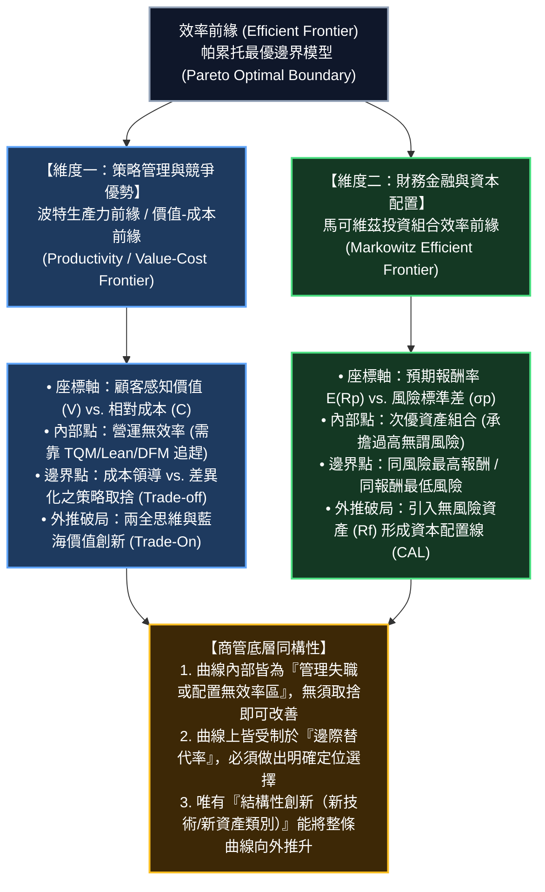
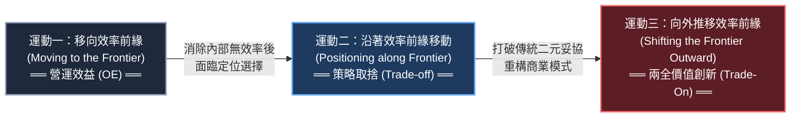
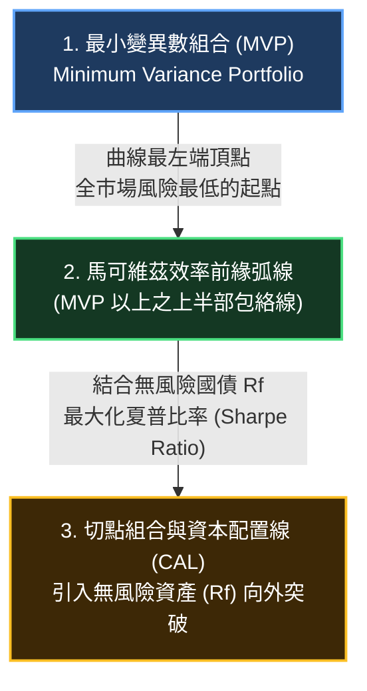

---
{"dg-publish":true,"permalink":"/98/efficient-frontier/","tags":["商業概念","策略管理","競爭策略","財務管理","投資組合","價值創新","兩全思維","PMBA"],"dg-note-properties":{"aliases":["效率前緣","生產力前緣","價值成本前緣","投資組合效率前緣","Efficient Frontier","Productivity Frontier","Value-Cost Frontier","Markowitz Efficient Frontier"],"tags":["商業概念","策略管理","競爭策略","財務管理","投資組合","價值創新","兩全思維","PMBA"]}}
---


# 效率前緣 (Efficient Frontier / 生產力與投資組合效率前緣)

> **商管核心價值**：  
> 「營運效益（Operational Effectiveness）是把對手也在做的事情做得比對手更好，那只是將企業推向現有的『生產力效率前緣』；但真正的策略，是在效率前緣上做出明確的定位取捨（Trade-off），或是透過活動體系與價值創新，將整條效率前緣向外推移突破。」——麥可·波特（Michael E. Porter）  
> 「多元化分散投資是金融市場中唯一免費的午餐；理性投資人只會在給定風險下追求最高報酬的『效率前緣』曲線上進行配置。」——哈利·馬可維茲（Harry Markowitz，1990 諾貝爾經濟學獎得主）  
> 
> 在 PMBA 商管決策體系中，**效率前緣（Efficient Frontier）** 是貫穿**「策略管理（價值 vs. 成本）」**與**「財務投資（報酬 vs. 風險）」**兩大領域的帕累托最優（Pareto Optimality）邊界模型。在策略上，它劃定了既有技術與商業模式下「最高顧客價值」與「最低相對成本」的極限包絡線，指引經理人辨析**營運改善**、**定位取捨（Trade-off）**與**兩全價值創新（Trade-On）**的本質分野；在財務上，它定義了資產配置中風險與預期報酬的最佳權衡軌跡。

---

## 一、 跨學科雙維度全景架構



---

## 二、 策略管理維度：生產力／價值-成本效率前緣 (Productivity Frontier)

### 2.1 理論奠基：麥可·波特《策略是什麼？》(What is Strategy?, 1996)
哈佛商學院策略大師麥可·波特提出**生產力前緣（Productivity Frontier，又稱價值-成本效率前緣 Value-Cost Frontier）**，用以終結企業界長年將「營運改善工具（如 TQM、精實生產、流程再造、標竿學習）」誤認為「策略」的致命盲點。

- **效率前緣的構成**：
  在任何特定時間點，一個產業內所有現存的最佳實務（Best Practices）、最先進技術、生產設備與管理手法的總和，共同構成了一條向外凸出的極限邊界曲線。
  - **縱軸（Y 軸）**：企業為買方創造的**非價格感知價值（Buyer Value Delivered, $V$）**（如品牌溢價、性能、服務體驗）。
  - **橫軸（X 軸）**：企業的**相對成本效率（Relative Cost Position）**（越往右代表單位成本 $C$ 越低、成本效率越高；越往左代表單位成本越高）。

```
  顧客感知價值 (Buyer Value, V)
       ▲
       │        【新效率前緣：價值創新 / 兩全思維 (Trade-On)】
       │         * 技術典範轉移 (S曲線) 或商業模式重構 (ERRC)
       │               . · ´ ¨ ` · . _
       │         ● A (差異化定位)       ` · . _
       │        /   高價值 / 高成本              ` · .
       │       /                                       ` · .
       │      │      【既有產業效率前緣 (Productivity Frontier)】
       │      │                 \
       │      │   ● X (內部落後者) ───► 靠營運效益 (OE) 逼近前緣
       │      │     管理粗放/浪費  \
       │      │                    ● B (成本領導定位)
       │      │                      基本價值 / 極致低成本
       └──────┴──────────────────────────────────────────────► 相對成本效率
           高成本 (High Cost)                        低成本 (Low Cost)
```

---

### 2.2 企業在價值-成本空間中的「三種戰略運動」



#### ① 運動一：移向效率前緣（營運效益 Operational Effectiveness, OE）
- **情境**：當企業處於曲線內部的 $X$ 點時，代表其存在嚴重的組織冗餘、不良率過高或供應鏈浪費。
- **行動**：導入 [[98_商業概念庫/dfm-design-for-manufacturability_可製造性設計\|DFM 可製造性設計]]、六標準差（Six Sigma）、ERP 數位化或精實生產（Lean），即可**在不犧牲品質的前提下降低成本，或在不增加成本下提升品質**，將位置從 $X$ 推向邊界。
- **波特的致命警告——「競爭合流（Competitive Convergence）」**：
  > 當所有同業都聘請相同的管顧公司、買相同的設備、學相同的最佳實務，大家最終會一起擠在同一條效率前緣的同一個點上。此時沒有人有差異化，只能展開慘烈的價格割喉戰（零和內捲）。**因此，「營運效益是必要的，但它絕不是策略！」**

#### ② 運動二：沿著效率前緣移動（策略定位與取捨 Strategic Trade-off）
- **情境**：當企業已經站上效率前緣曲線後，在既有技術與商業模式下，便會遭遇**物理與管理上的權衡取捨（Trade-off）**：想要提供頂級奢華服務（移往左上 $A$ 點，如四季酒店、Apple），就必須承擔高昂的用料與人力成本；想要達成極致低價（移往右下 $B$ 點，如 Costco、Ryanair），就必須精簡裝潢與附加服務。
- **夾在中間的詛咒（Stuck in the Middle）**：若企業在效率前緣上既不敢徹底走向高端差異化，又做不到極致低成本，企圖討好所有人，最終會因為活動體系互相衝突而喪失競爭優勢。

#### ③ 運動三：向外推移並突破效率前緣（價值創新與兩全思維 Value Innovation / Trade-On）
- **理論融合**：金偉燦與莫伯尼（W. Chan Kim & Renée Mauborgne）在《藍海策略》以及羅傑·馬丁（Roger Martin）在 **[[98_商業概念庫/trade-on-thinking_兩全思維\|兩全思維（Trade-On Thinking）]]** 中指出：最偉大的戰略不是在既有前緣上做二選一的痛苦妥協，而是**將整條效率前緣往外推（Shift the Frontier）**！
- **破局機制**：
  1. **技術典範轉移（Technology S-Curve Leap）**：如台積電以先進封裝 CoWoS 與 EUV 製程，同時推升晶片算力密度（高價值）並降低每電晶體運算能耗成本（低成本）。
  2. **商業模式重構（ERRC 四步動作架構）**：
     - **消除（Eliminate）** 與 **減少（Reduce）** 產業習以為常但顧客不在乎的昂貴要素（壓低成本 $C \downarrow$）；
     - **提升（Raise）** 與 **創造（Create）** 顧客真正渴望的全新體驗（推升願付價值 $V \uparrow$）。
  - **標竿實證**：
    - **西南航空（Southwest Airlines）**：消除頭等艙、機上餐飲與轉機樞紐（成本極致下降），同時創造「單一機型 737 快速周轉、高頻直飛、極高準點率」（價值超越傳統航空），打破高服務必高票價的舊前緣。
    - **特斯拉（Tesla 一體化壓鑄 Giga Press）**：將原本 70 多個沖壓焊接零件整合為 1 個巨型壓鑄件，車身剛性與安全性提升（$V \uparrow$），同時製造成本大降 40%（$C \downarrow$）。

---

## 三、 財務與投資維度：馬可維茲投資組合效率前緣 (Markowitz Efficient Frontier)

### 3.1 理論奠基：現代投資組合理論 (Modern Portfolio Theory, MPT, 1952)
1990 年諾貝爾經濟學獎得主 **哈利·馬可維茲（Harry Markowitz）** 於 1952 年發表《Portfolio Selection》，首次以嚴謹數理統計將「不要把所有雞蛋放在同一個籃子裡」形式化，創立了**風險-報酬效率前緣**。

```
  預期報酬率 E(Rp)
       ▲
       │                        【資本配置線 (CAL) / 資本市場線 (CML)】
       │                                     . · ´
       │                              . · ´
       │                ★ T (切點最優風險組合：夏普比率最大化)
       │               . · ´ ¨ ¨ ` · . _
       │          . · ´  【馬可維茲效率前緣 (Efficient Frontier)】
       │       . ´        (同風險下最高報酬之帕累托最優邊界)
       │     .´
       │    ● MVP (最小變異數投資組合 Minimum Variance Portfolio)
       │    │
       │    │   ● P_sub (內部次優組合：無效率區)
       │    `\
       │Rf ───`· . _ (下半部：無效率邊界 Inefficient Frontier)
       │ (無風險利率)
       └──────────────────────────────────────────────────────► 風險 / 波動率標準差 (σp)
```

---

### 3.2 核心數理公式與風險對沖機制

假設投資組合由 $N$ 種風險資產構成，各資產權重為 $w_i$（$\sum_{i=1}^N w_i = 1$）：

1. **投資組合預期報酬率（線性加權平均）**：
   $$E(R_p) = \sum_{i=1}^{N} w_i E(R_i)$$

2. **投資組合總風險（變異數 $\sigma_p^2$ 與標準差 $\sigma_p$）**：
   以雙資產（資產 $A$ 與資產 $B$）為例：
   $$\sigma_p = \sqrt{w_A^2 \sigma_A^2 + w_B^2 \sigma_B^2 + 2 w_A w_B \sigma_A \sigma_B \rho_{AB}}$$
   - 其中 $\rho_{AB} \in [-1, 1]$ 為兩資產報酬率的**相關係數（Correlation Coefficient）**。
   - **彎曲前緣的魔法（Diversification Effect）**：
     只要資產間並非完全正相關（即 **$\rho_{AB} < 1$**），組合標準差 $\sigma_p$ 就會嚴格小於個別資產風險的加權平均（$\sigma_p < w_A \sigma_A + w_B \sigma_B$）。相關係數越低（甚至為負相關，如股票與公債/黃金），雙曲線「馬可維茲子彈（Markowitz Bullet）」就越向左上方大幅彎曲，在不犧牲預期報酬下消弭非系統性風險（Unsystematic Risk）！

---

### 3.3 效率前緣上的三大關鍵錨點與外推突破



1. **最小變異數投資組合（Minimum Variance Portfolio, MVP）**：
   位於子彈雙曲線最左端的頂點。在 MVP 以下的下半部曲線，雖然也在邊界上，但承受相同風險卻只能獲得更低報酬，屬於「無效率前緣」；**真正的效率前緣僅指 MVP 右上方的上半部弧線**。
2. **夏普比率（Sharpe Ratio）與切點組合（Tangency Portfolio, $T$）**：
   當市場引入無風險資產（如美國國庫券 $R_f$，$\sigma_f = 0$），從縱軸 $R_f$ 向馬可維茲效率前緣畫出一條切線，即為**資本配置線（Capital Allocation Line, CAL）**。
   切點 $T$ 代表全市場風險調整後收益最高的黃金組合，其斜率即為**夏普比率**：
   $$\text{Sharpe Ratio} = \frac{E(R_p) - R_f}{\sigma_p}$$
3. **財務維度的「前緣外推」**：
   這條切線（CAL）位於原本馬可維茲風險資產曲線的**左上方外部**——這意味著透過「無風險資產 ＋ 切點風險組合」的線性搭配（或融資槓桿），投資人成功**突破了純風險資產的原有前緣限制**，在同等風險下創造出更高的預期回報！

---

## 四、 策略效率前緣 vs. 財務效率前緣：商管底層同構對照表

在 PMBA 跨領域整合視角下，策略大師波特與金融大師馬可維茲的模型在數學與哲學底層完全同構：

| 比較維度 | 策略管理：生產力／價值-成本前緣 (Porter) | 財務投資：投資組合效率前緣 (Markowitz) | 企業跨界整合啟示 (SBU 資本配置) |
| :--- | :--- | :--- | :--- |
| **提出學者與年代** | Michael E. Porter (1996) | Harry Markowitz (1952, 1990 諾獎) | 企業總部同時扮演策略長與投資組合經理 |
| **縱軸（追求最大化）** | **顧客感知價值（Buyer Value, $V$）** | **預期投資報酬率（Expected Return, $E(R_p)$）** | 提升事業群毛利率與 ROIC 回報 |
| **橫軸（追求極小化）** | **單位相對成本（Relative Cost, $C$）** | **組合波動風險（Standard Deviation, $\sigma_p$）** | 降低營運成本與現金流斷鏈波動風險 |
| **處於曲線內部（無效率區）** | **管理粗放與營運落後**<br>（需靠精實管理、TQM、DFM 消除浪費） | **次優資產配置**<br>（承擔了未被分散的非系統性個股風險） | 砍除無效行政費用，關閉高度重疊且低效的冗餘產品線 |
| **沿著曲線移動（Trade-off）** | **策略定位取捨**<br>（要高價值差異化，就得承受較高成本） | **風險偏好取捨**<br>（要追求高預期報酬，就得承受高波動風險） | 明確劃分「現金牛穩健事業」與「高風險高成長明星事業」比重 |
| **向外突破前緣（Shift Out）** | **兩全思維（Trade-On）與藍海價值創新**<br>（透過新技術/新商模同時達成高價值與低成本） | **引入負相關新資產類別或無風險槓桿**<br>（推升整體夏普比率，拓展報酬邊界） | 透過併購跨界互補技術或雙軌轉型（Dual Transformation），跳躍至新 S 曲線 |

---

## 五、 經理人實戰診斷工具：企業效率前緣定位審計表

高階經理人與創業家在檢視自身產品線或事業部（SBU）時，可依循以下五步檢核清單進行戰略定位診斷：

```markdown
### 📋 企業效率前緣戰略審計檢核表 (Efficient Frontier Audit Checklist)

- [ ] 1. 【內部無效率排查（我們是否還在曲線內部？）】：
         在不改變現有產品定位與商業模式的前提下，我們是否仍存在明顯的製造良率損失、採購浪費或流程繁瑣？
         （若 是 ➔ 當務之急是提升「營運效益 OE」與導入 DFM，先追上產業效率前緣，而非空談策略轉型）

- [ ] 2. 【競爭合流警報（我們是否正與同業在同一個點上肉搏？）】：
         我們與前三大競爭對手是否使用相同的供應商、相同的代工廠、訴求完全相同的產品賣點，且毛利率逐年下滑？
         （若 是 ➔ 已陷入波特所警告的「競爭合流」零和死胡同，必須立即重新界定差異化取捨）

- [ ] 3. 【夾在中間診斷（我們是否卡在效率前緣的平庸中段？）】：
         我們的成本既比不上極致低價對手（如拼多多、Costco），品牌與技術溢價又比不上頂級龍頭（如 Apple、TSMC）？
         （若 是 ➔ 處於最危險的「Stuck in the Middle」，必須果斷放棄中庸妥協，明確向兩端之一靠攏）

- [ ] 4. 【兩全破局探索（如何運用 ERRC 將效率前緣向外推？）】：
         產業中有哪些「大家都在花大錢做、但客戶根本不在乎」的慣例可以徹底【消除】或【減少】？有哪些跨界技術能讓我們同時實現 $V \uparrow$ 與 $C \downarrow$？

- [ ] 5. 【事業群投資組合相關性檢驗（SBU 風險是否過度集中？）】：
         公司旗下的多個事業部或研發專案，其景氣循環與技術成敗的相關係數（$\rho$）是否趨近於 1？是否配置了具備逆週期或高夏普比率的第二成長曲線？
```

---

## 六、 PMBA 模組講義與知識網絡鏈結

### 6.1 官方課程與模組雙向反向鏈結
- [[04_主題選修/10_創業與企業財務策略/02_模組筆記/Module_1_創新思維與商業模式/M1-4_創意思考工具與設計思考方法\|M1-4 創意思考工具與設計思考方法]]：
  - **「兩全思維（Trade-On Thinking）」核心理論對接**：破除傳統波特效率前緣上的二元對立取捨（Trade-off），透過設計思考與 TRIZ 消除矛盾，將價值-成本效率前緣向外推升。
- [[04_主題選修/10_創業與企業財務策略/02_模組筆記/Module_1_創新思維與商業模式/M1-9_商業模式畫布架構與價值主張設計\|M1-9 商業模式畫布架構與價值主張設計]]：
  - **價值曲線（Value Curve）與 VPC 架構**：透過價值主張重構，在拉高顧客感知價值 $V$ 的同時壓低營運成本 $C$，突破既有產業邊界。
- [[04_主題選修/12_產業分析與投資策略/02_模組筆記/Module_1_總論與架構/M1-3_產業獲利結構差異與十大經典理論\|M1-3 產業獲利結構差異與十大經典理論]]：
  - **標竿企業效率前緣定位實證**：台積電（佔據前緣左上端：極致技術差異化與高毛利定價權）vs. 鴻海（佔據前緣右下端：極致規模經濟、垂直整合與費用率控管）。
- [[04_主題選修/12_產業分析與投資策略/02_模組筆記/Module_1_總論與架構/M1-6_產業分析模式與九大分析工具矩陣\|M1-6 產業分析模式與九大分析工具矩陣]]：
  - 內部能耐與投資組合層（BCG / GE 矩陣）：多事業部（SBU）的資本配置效率前緣優化。

### 6.2 商業概念庫相關卡片
- [[98_商業概念庫/trade-on-thinking_兩全思維\|trade-on-thinking_兩全思維]]（羅傑·馬丁整合思維：向外突破傳統效率前緣的認知武器）
- [[98_商業概念庫/competitive-advantage_競爭優勢\|competitive-advantage_競爭優勢]]（營運效益 OE 與策略定位的本質分野，拉開 $V - C$ 價值楔子）
- [[98_商業概念庫/vpc-value-price-cost_價值價格成本分析\|vpc-value-price-cost_價值價格成本分析]]（衡量效率前緣突破幅度的量化公式）
- [[98_商業概念庫/value-curve_價值曲線\|value-curve_價值曲線]]（藍海策略 ERRC 四步動作重塑價值成本前緣）
- [[98_商業概念庫/dfm-design-for-manufacturability_可製造性設計\|dfm-design-for-manufacturability_可製造性設計]]（在研發源頭消除浪費、將企業推向生產力前緣的工程利器）
- [[tce-transaction-cost-economics_交易成本理論\|tce-transaction-cost-economics_交易成本理論]]（透過自製與外購邊界優化，壓低總成本以逼近效率前緣）
