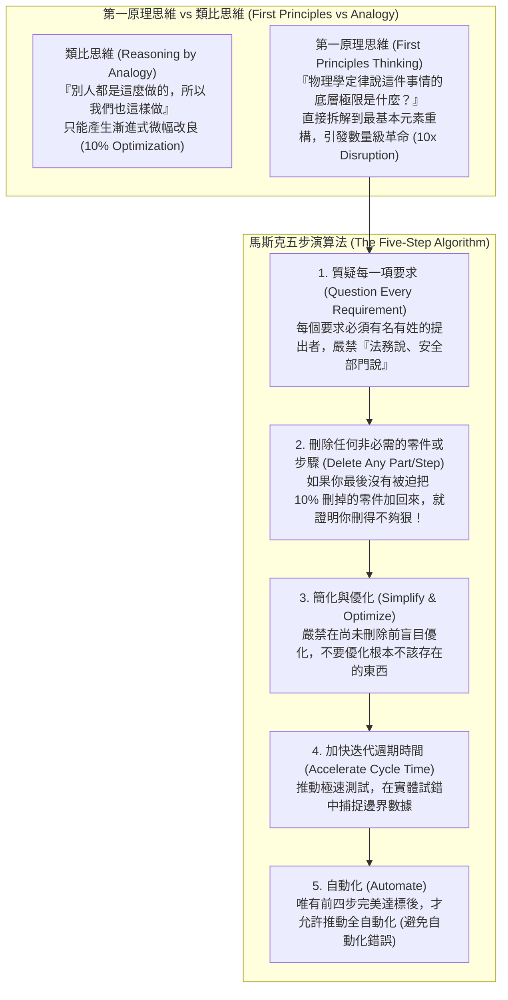

---
{"dg-publish":true,"permalink":"/98/elon-musk/","tags":["商業概念","企業領袖","第一原理","創新管理","破壞式創新","PMBA"],"dg-note-properties":{"aliases":["馬斯克","Elon Musk","伊隆·馬斯克","特斯拉創辦人","SpaceX創辦人"],"tags":["商業概念","企業領袖","第一原理","創新管理","破壞式創新","PMBA"]}}
---


# 馬斯克 (Elon Musk)

> [!NOTE]
> **核心概念精粹**：伊隆·馬斯克（Elon Musk, 1971–），特斯拉（Tesla）、SpaceX、xAI、Neuralink 與 The Boring Company 的創辦人兼首席工程師。他被譽為當代最具顛覆性的連續工程創業家與「矽谷鋼鐵人」。馬斯克的核心決策引擎是**「第一原理思維（First Principles Thinking）」**——拒絕平庸的類比思考，將一切工程與商業問題直接拆解至最物理層面的基本真理，並以此推導重構。他以極限的**「生產即地獄（Production Hell）」**現場領導力、瘋狂的非對稱風險承擔與多行星文明願景，同時改寫了航太、電動車、全球衛星網路與腦機介面產業的歷史。

---

## 一、 學理定位：第一原理思考與「馬斯克演算法」

馬斯克的工程領導力本質，是一套嚴格遵循物理定律的系統性去贅演算法（The Algorithm）：



---

## 二、 馬斯克顛覆兩大重工業的物理級第一原理拆解

| 重工業領域 | 傳統產業教科書教條（類比思維） | 馬斯克的第一原理物理拆解 | 顛覆成果 |
| :--- | :--- | :--- | :--- |
| **航太運載火箭<br>(SpaceX)** | 「製造火箭極端昂貴，向俄羅斯或波音採購一枚需 6,500 萬至 1 億美元，只能由國家財政負擔。」 | 拆解火箭物理成分：航太級鋁合金、鈦、碳纖維、液態氧與航空煤油；發現**原料期貨成本僅佔火箭報價的 2%**！核心瓶頸在於火箭「單次使用即丟棄」。 | 自主研發獵鷹九號（Falcon 9），實現**一級火箭垂直軟著陸與重複使用**，將發射成本暴砍 90%，壟斷全球 80% 以上入軌發射載荷。 |
| **電動車與電池<br>(Tesla)** | 「車用動力電池極其昂貴，每度電（kWh）成本高達 600 美元，電動車注定無法普及。」 | 拆解電池化學成分：碳、鎳、鋁、鋰與聚合物；在倫敦金屬交易所（LME）計算其原材料價值僅為 80 美元/kWh。其餘溢價全來自冗餘的封裝加工與中間商。 | 打造垂直整合巨型超級工廠（Gigafactory），引入一體化壓鑄技術（Gigacasting），將電池包成本降至 100 美元/kWh 以下，推動 Model 3/Y 成為全球乘用車銷量冠軍。 |

---

## 三、 經典企業實戰案例：特斯拉 Model 3 的「生產地獄」與 SpaceX 破產邊緣

```carousel

<!-- slide -->
### 1. 特斯拉 Model 3 的「生產地獄」（2017 ~ 2018 年）
- **危機降臨**：Model 3 遭遇嚴重的產能爬坡瓶頸，自動化裝配線頻繁卡死，每週產能不足目標的四分之一，特斯拉每個月狂燒數億美元，距破產清算僅剩不到一個月現金；
- **馬斯克的極限介入**：
  - 搬進加州弗里蒙特工廠，夜以繼日睡在工廠會議室地板；
  - 親自檢查每一道工序，果斷推翻過度複雜的機械臂自動化系統，在工廠空地上以驚人速度搭建「戶外巨型帳篷帳棚（Tent GA4）」作為第三條人工裝配線；
- **歷史逆轉**：最終突破每週 5,000 輛的關鍵平衡點，特斯拉市值隨後突破一兆美元，徹底粉碎全球華爾街空頭。
<!-- slide -->
### 2. 2008 年底的生死四十八小時
- **背景**：金融海嘯爆發，獵鷹一號前三次發射全數爆炸墜毀，特斯拉現金見底；
- **非對稱豪賭**：馬斯克動用最後一分錢推動第四次發射，在發射入軌成功後，於聖誕節前夕最後幾小時說服投資人完成過橋融資；
- **學理啟示**：展現了極致的[[risk-taking_風險承擔|風險承擔]]與[[Nothing to Lose|無物可失]]心態，將企業從滅頂懸崖邊緣拉回。
```

---

## 四、 經理人第一原理決策檢核表（Executive Decision Checklist）

在面對看似無法克服的成本瓶頸或技術高牆時，高階管理團隊應依序進行「第一原理審計」：

- [ ] **物理底層極限探詢（Physical Limit Audit）**：
  - 當團隊回報「這項成本不可能再降了」或「這個交期至少需要兩年」時，這項限制究竟是源於「不可違背的物理學或化學定律」，還是僅僅源於「供應商過去的傳統慣例與中間商暴利」？
- [ ] **流程減法殘酷審查（Deletions Check）**：
  - 這項內部審批流程或產品上的這個零組件，究竟是為了誰的要求而存在？如果我們今天大膽將其直接刪除，真實世界中是否真的會發生不可承受的災難？
- [ ] **親臨前線消除代理阻隔（Go to the Factory Floor）**：
  - 高管層在遭遇產能或品質瓶頸時，是坐在總部會議室看經過層層粉飾的 PowerPoint，還是親自穿上反光背心深入工廠現場、與第一線技術工人共同排查障礙？
- [ ] **宏大願景與不可思議期限（Impossible Timelines Alignment）**：
  - 我們所設定的專案死線，是否具備強烈的「緊迫感（Sense of Urgency）」？我們是否激發了團隊超越常規官僚節奏、為歷史性使命拼搏的崇高鬥志？

---

## 五、 關聯概念與知識網絡

* 核心領導人與當代巨擘：
  * [[steve-jobs_賈伯斯|賈伯斯 (Steve Jobs)]]：極致產品偏執與現實扭曲力場之精神先驅
  * [[jensen-huang_黃仁勳|黃仁勳 (Jensen Huang)]]：AI 算力時代與馬斯克 xAI / 特斯拉 FSD 深度綁定之戰略盟友
  * [[bill-gates_比爾蓋茲|比爾蓋茲 (Bill Gates)]]：在氣候變遷與能源問題上觀點激烈交鋒之當代巨頭
* 決策科學與工程管理：
  * [[risk-taking_風險承擔|風險承擔 (Entrepreneurial Risk-Taking)]]：多次賭上全部身家、駕馭奈特不確定性之極限範式
  * [[Nothing to Lose|無物可失 (Nothing to Lose)]]：在破產邊緣釋放極限創造力之背水一戰戰略
  * [[conceptual-skills_概念技能|概念技能 (Conceptual Skills)]]：以第一原理洞穿跨學科本質之頂級心智模型
  * [[great-idea_好創意|好創意 (Great Idea)]]：將看似瘋狂的科幻構想轉化為具備商業可行性之商業帝國
