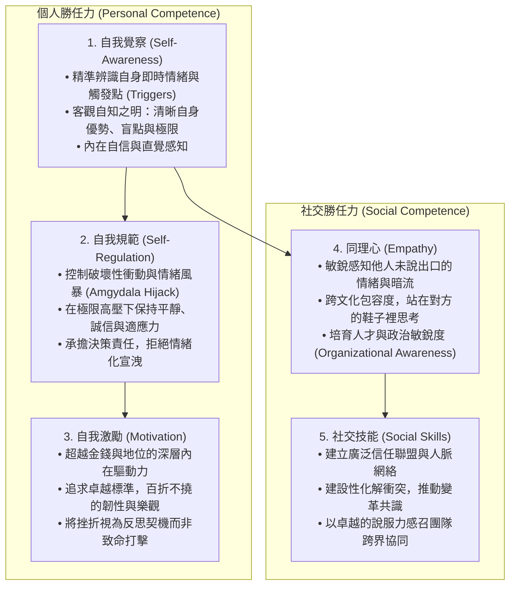
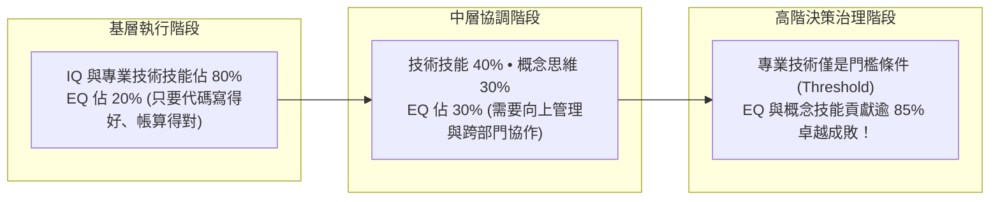

---
{"dg-publish":true,"permalink":"/98/emotional-intelligence/","tags":["商業概念","領導力","組織行為","心理學","PMBA"],"dg-note-properties":{"aliases":["情緒智商","情緒智力","Emotional Intelligence","EQ","EI","丹尼爾高曼情商理論"],"tags":["商業概念","領導力","組織行為","心理學","PMBA"]}}
---


# 情緒智商 (Emotional Intelligence, EI / EQ)

> [!NOTE]
> **核心概念精粹**：情緒智商（Emotional Intelligence, EI / EQ），是由彼得·薩洛維（Peter Salovey）與約翰·梅耶（John Mayer）提出，並由丹尼爾·高曼（Daniel Goleman）在《打造新領導人》中奠定為高階管理學核心理論。它指個體**識別、理解、管理自身情緒，並敏銳感知他人情緒，進而在高壓與複雜人際情境中做出理性決策與卓越引領的核心心智能力**。高曼研究證實：在決定高階領導者卓越績效的勝任特質中，EQ 的重要性高達智商（IQ）與技術技能（Technical Skills）的兩倍以上。

---

## 一、 學理奠基：丹尼爾·高曼的情緒智力五大維度架構

丹尼爾·高曼打破了傳統企業只看重認知智力（IQ）與學歷背景的陳舊偏見，建立了橫跨「個人勝任力」與「社交勝任力」的完整 EQ 矩陣：



---

## 二、 IQ、技術技能與 EQ 在不同職級中的貢獻權重演進

在 NTU PMBA 領導力發展體系中，個人的勝任力結構隨著晉升歷程呈現出本質性的典範躍遷：



### 低情商領導 vs 高情商卓越領導的行為特徵對比

| 行為情境 | 低情商領導者（Low EQ Executive） | 高情商卓越領導者（High EQ Leader） |
| :--- | :--- | :--- |
| **面對突發重大危機** | 杏仁核劫持（Amygdala Hijack）：暴怒咆哮、公開斥責下屬、推卸責任。 | 暫停冷靜（Emotional Pause）：深呼吸調控心率，穩定軍心，聚焦解決方案。 |
| **跨部門溝通與反饋** | 自說自話，聽不進批評，將反對意見視為對個人權威的挑釁。 | 深度傾聽（Active Listening）：接納負面情緒，復述確認對方觀點，尋求雙贏。 |
| **團隊績效低迷時期** | 採用恐懼管理（Fear-Based Management），威脅開除或扣減獎金。 | 激發心理安全感（Psychological Safety）：剖析系統瓶頸，給予輔導並重燃希望。 |
| **自我認知盲區** | 過度自信，自認無所不知（Know-it-all），身邊圍繞只敢報喜的弄臣。 | 保持謙遜，樂於承認「我不知道（Learn-it-all）」，主動尋求 360 度反饋。 |

---

## 三、 經典企業實戰案例：納德拉的「同理心重塑微軟」

```carousel

<!-- slide -->
### 1. 官僚撕裂與傲慢的黃昏
- **歷史病態**：2010 年代初的微軟，在史蒂夫·鮑爾默統治下充斥著咆哮與恐懼文化。各產品部門為了保衛既有預算與勢力範圍互相攻訐，漫畫諷刺微軟的組織架構是「內部各部門用槍互相指著對方的腦袋」。
<!-- slide -->
### 2. 納德拉以同理心啟動文化涅槃
- **核心哲學**：2014 年薩提亞·納德拉接任 CEO，他在自傳《刷新未來（Hit Refresh）》中寫道：「同理心並非軟弱，而是創新的核心泉源；如果無法同理顧客未被滿足的需求，就做不出偉大的產品；無法同理同儕的痛苦，就無法實現跨部門協同」；
- **實踐落地**：納德拉以極致的高情商示範傾聽與謙遜，廢除殘酷的內部堆疊排名考核，將文化引向開放包容；
- **成果**：微軟打破長年壁壘，在 iOS 與 Android 上全面推出 Office，雲端 Azure 與 OpenAI 投資全線引爆，市值重返全球巔峰。
```

---

## 四、 經理人情緒智商修煉檢核表（Executive Decision Checklist）

在面對極端商務談判、危機處分或重組裁員時，領導者應進行下列「情緒體檢」：

- [ ] **杏仁核劫持煞車機制（Stop the Hijack）**：
  - 當遭遇部屬重大失誤或客戶無理挑釁時，我是否能在做出任何回應前，強迫自己停頓「黃金 6 秒鐘」？避免大腦原始防禦機制引發毀滅性失控發言。
- [ ] **同理心深度傾聽檢驗（Empathic Resonance Test）**：
  - 在與反對陣營談判時，我能否在不帶偏見的前提下，用對方認可的語言完整復述對方的真正痛點與焦慮？
- [ ] **脆弱性展現與信任建立（Vulnerability as Strength）**：
  - 我是否敢於在核心團隊面前適度展現自身的困惑與脆弱，坦誠尋求協助？還是偽裝成冷酷無瑕的鋼鐵巨人？
- [ ] **跨部門政治暗流感知（Organizational Empathy）**：
  - 推動跨部門專案時，我是否洞察到了其他部門主管背負的 KPI 壓力和潛在利益損失？我們是否預先為他們設計了政治安全出口？

---

## 五、 關聯概念與知識網絡

* 核心管理技能與領導力：
  * [[interpersonal-skills_人際技能|人際技能 (Interpersonal Skills)]]：高情商在團隊溝通與衝突協調之實務體現
  * [[conceptual-skills_概念技能|概念技能 (Conceptual Skills)]]：情商自我覺察對宏觀系統思考之情感過濾
  * [[can-zhao-quan_參照權|參照權 (Referent Power)]]：同理心與高情商培育道德感召力之核心土壤
  * [[authentic-leadership_真誠領導|真誠領導 (Authentic Leadership)]]：自我規範與內在誠信驅動之領導典範
* 組織行為與心理學：
  * [[corporate-culture_企業文化|企業文化 (Corporate Culture)]]：同理心文化對打破部門牆之催化作用
  * [[Tolerance_of_Ambiguity_不確定性容忍度與控制感|不確定性容忍度與控制感 (Tolerance of Ambiguity)]]：高壓模糊情境下的自我調節能力
  * [[great-company_好公司|好公司 (Great Company)]]：第五級領導人「謙遜個性與鋼鐵意志」之情商極致
  * [[professional-competence_專業能力|專業能力 (Professional Competence)]]：專業技術資本與情商資本之雙輪驅動
