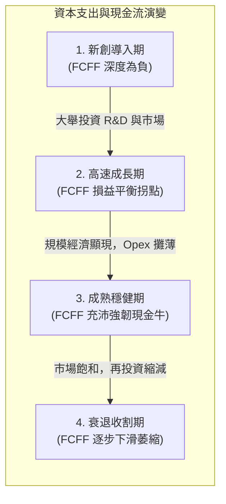

---
{"dg-publish":true,"permalink":"/98/enterprise-free-cash-flow-liang/","tags":["商業概念","財務管理","企業評價","資本市場","PMBA"],"dg-note-properties":{"aliases":["企業自由現金流量","Free Cash Flow to Firm","FCFF","無槓桿自由現金流","Unlevered Free Cash Flow","UFCF"],"tags":["商業概念","財務管理","企業評價","資本市場","PMBA"]}}
---


# 企業自由現金流量 (Free Cash Flow to Firm, FCFF)

> **【核心決策摘要】**
> **企業自由現金流量（Free Cash Flow to Firm, FCFF，又稱無槓桿自由現金流量 Unlevered FCF）** 代表企業在滿足了維持現有營運所需之營業支出、所得稅、營運資金追加（$\Delta\text{NWC}$）與必要資本支出（CapEx）後，**可供全體資本提供者（包括普通股股東、特別股股東及各級長短期債權人）自由分配的現金流總額**。FCFF 的最大優勢在於**獨立於資本結構之外（Capital Structure Neutral）**，直接衡量企業本業資產的純粹造血能力。在折現現金流量模型（DCF）中，FCFF 是計算「企業價值（Enterprise Value, EV）」的核心輸入變數，其對應的必要報酬折現率為**加權平均資本成本（WACC）**。

---

## 1. 概念核心定義與本質 (Executive Definition & Theoretical Essence)

### 1.1 核心定義
企業自由現金流量在現代公司理財與估值學中被嚴格定義為：**在不影響企業可持續經營與預期增長的前提下，企業資產組合在特定期間內所產生的營運現金毛流入，扣除再投資需求後，全體出資人所能提取的最大現金剩餘**。

```
                  ┌─────────────────────────────────────────┐
                  │ 企業自由現金流量 (FCFF) 核心分配圖譜     │
                  └────────────────────┬────────────────────┘
                                       ▼
       ┌───────────────────────────────┴───────────────────────────────┐
       ▼                                                               ▼
【債權人求償份額】                                             【股權持有人求償份額】
 • 支付契約利息 (稅後)                                          • 剩餘留存歸屬全體股東 (FCFE)
 • 償還到期借款本金淨額                                         • 現金股利發放 / 庫藏股買回
```

### 1.2 本質解析：超越會計利潤與 EBITDA 的三大真理
1. **現金為王，利潤只是意見（Cash is Fact, Profit is Opinion）**：損益表上的會計淨利（Net Income）深受權責發生制（Accrual Accounting）、折舊攤銷年限假設、存貨計價方法以及各項非現金科目的人為調整影響；FCFF 則是純粹不可偽造的硬現金流。
2. **剔除資本結構干擾**：兩家本業資產完全相同、營收一致的企業，若一家全靠股權融資、另一家負債高達 80%，其損益表淨利將因利息費用劇烈分化；但兩者的 FCFF 完全相同。FCFF 讓併購分析師能透視企業「未受債務結構扭曲前的原始獲利潛力」。
3. **EBITDA 致命陷阱的解毒劑**：投資大師華倫·巴菲特（Warren Buffett）曾尖銳質疑：「管理層難道認為是牙仙（Tooth Fairy）在出資支付資本支出嗎？」EBITDA 假定不需要再投資，而 FCFF 嚴格扣除了維繫競爭力不可或缺的**資本支出（CapEx）** 與 **營運資金追加（$\Delta\text{NWC}$）**。

---

## 2. 數理模型與三大推導路徑 (Mathematical Modeling & Dual Derivations)

在公司評價實務中，分析師可依據可獲取的財務報表數據，透過三條等價路徑精準推導 FCFF：

### 2.1 路徑一：自息稅前利潤（EBIT / NOPAT）推導（營運面自上而下法）

這是估值建模最常用、最直觀的標準公式：

$$\text{FCFF} = \text{EBIT} \times (1 - t) + \text{D\&A} - \text{CapEx} - \Delta\text{NWC}$$

其中：
- $\text{EBIT} \times (1 - t) = \text{NOPAT}$（Net Operating Profit After Tax，稅後淨營業利益）。
- $t$：企業邊際所得稅率（Marginal Corporate Tax Rate）。
- $\text{D\&A}$：折舊與攤銷（Depreciation & Amortization），屬於非現金支出，需加回。
- $\text{CapEx}$：固定資產與無形資產之資本支出（購置固定資產、建造廠房、軟體資本化）。
- $\Delta\text{NWC}$：非現金淨營運資金變動額（$\Delta\text{流動資產} - \Delta\text{無息流動負債}$，扣除現金與短期有息借款）。

### 2.2 路徑二：自營業活動現金流（CFO / OCF）推導（現金流量表面法）

由於現金流量表中的營業現金流（CFO）在 US GAAP 下通常已扣除了支付給債權人的利息費用，因此必須將「利息的稅後現金效應」加回，以還原全體出資人視角：

$$\text{FCFF} = \text{CFO} + \text{Interest Expense} \times (1 - t) - \text{CapEx}$$

若依 IFRS 準則且企業將利息支出列為「籌資活動現金流」，則無需加回稅後利息：
$$\text{FCFF} = \text{CFO}_{\text{IFRS}} - \text{CapEx}$$

### 2.3 路徑三：自會計淨利（Net Income）推導（底層利潤調節法）

$$\text{FCFF} = \text{Net Income} + \text{Non-Cash Charges} + \text{Interest Expense} \times (1 - t) - \text{CapEx} - \Delta\text{NWC}$$

### 2.4 DCF 企業價值（EV）與股權價值橋接

透過 FCFF 計算企業實體價值（Enterprise Value, EV）：

$$\text{EV} = \sum_{t=1}^{T} \frac{\text{FCFF}_t}{(1 + \text{WACC})^t} + \frac{\text{Terminal Value}_T}{(1 + \text{WACC})^T}$$

其中終值通常採高登成長模型（Gordon Growth Model）：
$$\text{Terminal Value}_T = \frac{\text{FCFF}_{T+1}}{\text{WACC} - g}$$

最後透過資產負債表調和導出股權價值（Equity Value）：
$$\text{Equity Value} = \text{EV} + \text{現金與約當現金} - \text{總有息負債} - \text{特別股} - \text{少數股東權益}$$

---

## 3. 戰略框架與企業生命週期演進 (Strategic Framework & Life Cycle)

### 3.1 企業生命週期中的 FCFF 軌跡



- **導入期與成長初期**：由於需要大規模建廠、採購伺服器與研發投入，CapEx 與 $\Delta\text{NWC}$ 遠超營運毛利，FCFF 長期為負，高度依賴股權融資輸血（參見 [[equity-financing_股權融資]]）。
- **成熟期現金牛**：產能建設完成，維持性資本支出佔比下降，龐大的折舊加回使得 FCFF 遠高於會計淨利，成為發放股利或跨界併購的戰略彈藥。

### 3.2 維持性 CapEx vs. 成長性 CapEx 的關鍵拆分
高階經理人評估真實自由現金流時，需對資本支出做深度解構：
- **維持性資本支出（Maintenance CapEx）**：僅為維持現有產能、更換磨損設備、保持競爭優勢不流失所需的底線支出（約等於或略高於當期 D&A）。
- **成長性資本支出（Growth CapEx）**：用於開闢新生產線、擴建海外廠房、研發下一代革命性產品的主動擴張支出。
- **真實核心可分配現金流**：若暫停成長性擴張，$\text{Normalized FCFF} = \text{NOPAT} + \text{D\&A} - \text{Maintenance CapEx} - \Delta\text{NWC}$，這往往是私募股權（PE）收購時評估槓桿償債能力的關鍵依據。

---

## 4. 產業標竿與實戰應用場景 (Industry Benchmarks & Applications)

| 產業屬性 | 典型代表 | CapEx / 營收比重 | $\Delta\text{NWC}$ 特徵 | FCFF 轉換率與管理重點 |
| :--- | :--- | :---: | :---: | :--- |
| **重資產先進製造** | 台積電 (TSMC)、三星電子 | 35% ~ 50%+ | 龐大昂貴的在製品與備品存貨 | 資本密集度極高；FCFF 受半導體景氣循環與極紫外光機台採購節奏強烈主導 |
| **輕資產軟體與平臺** | 微軟 (Microsoft)、Alphabet | 10% ~ 18% (多為資料中心) | 預收帳款（Unearned Revenue）充沛，NWC 往往為負 | FCFF 轉換率極高（EBITDA 轉 FCFF 常超 70%）；現金流極度充沛 |
| **全球消費零售巨擘** | 沃爾瑪 (Walmart)、Costco | 3% ~ 5% | 極致供應鏈擠壓，應付帳款覆蓋存貨（負 NWC） | 依靠極高資產周轉率與負營運資金創造長期穩定正向 FCFF |
| **資本密集型公用事業** | 電網、天然氣、電信基礎設施 | 15% ~ 25% | 應收帳款穩定但設備改造折舊龐大 | 營運現金流極度可預測，仰賴負債稅盾平衡 CapEx 支出 |

---

## 5. 經典企業個案深度剖析 (Deep Dive Case Studies)

### 5.1 成功典範：Apple 憑藉「負營運資金」與輕資產外包創造千億 FCFF 奇蹟
- **戰略架構**：蘋果將所有硬體製造外包給富士康、和碩等代工廠，自身專注於晶片設計、iOS 系統研發與品牌零售。
- **FCFF 極致放大引擎**：
  1. **超輕資產架構**：年營收近 4,000 億美元，但年度 CapEx 僅約 100 億美元（多為模具設備與資料中心），CapEx/營收比低於 3%。
  2. **供應鏈負現金週期**：憑藉對上游供應商的絕對議價地位，應付帳款天數（DPO）遠長於存貨周轉天數（DIO）與應收帳款天數（DSO），淨營運資金（NWC）長年維持巨額負值。
- **成效**：營運現金幾乎毫無損耗地 100% 轉化為 FCFF，年均自由現金流量超過 **\$1,000 億美元**，支撐了每年近千億美元的庫藏股回購與現金股利，推動市值突破 3 兆美元。

### 5.2 失敗警示：安隆（Enron）與破產企業的「紙上利潤與現金黑洞」
- **會計魔術**：安隆大量使用「盯市會計（Mark-to-Market Accounting）」，將長達 20 年的遠期天然氣合約的未實現未來預期利潤，在簽約首日即全額認列為當期帳面淨利潤。
- **FCFF 照妖鏡現形**：
  1. 儘管損益表年年呈現數十億美元的高速增長淨利，但其 FCFF 與營業現金流長年呈現巨額負值（業務根本收不回實質現金）。
  2. 為了彌補實質現金流黑洞以支付日常開銷，管理層不得不透過複雜的表外特殊目的實體（SPE）瘋狂借債。
- **崩潰下場**：當外部融資環境收緊、信用評等遭降級時，缺乏真實 FCFF 造血支撐的龐氏信用鏈瞬間斷裂，引爆世紀破產大案。

---

## 6. 高階經理人決策實戰工具箱 (Executive Action Playbook)

### 6.1 經理人資本配置瀑布流矩陣 (Capital Allocation Waterfall)

```
                       ┌────────────────────────────┐
                       │ 總體企業自由現金流 (FCFF)   │
                       └──────────────┬─────────────┘
                                      ▼
             【第一優先：維持本業競爭力】
              • 必要維持性 CapEx 與核心研發（保護護城河）
                                      ▼
             【第二優先：穩健資產負債表】
              • 償還高息債務，將財務槓桿控制於最優資本結構區間
                                      ▼
             【第三優先：價值創造擴張】
              • 投向預期內部報酬率（IRR > WACC）的策略性成長專案或併購
                                      ▼
             【第四優先：股東剩餘價值返還】
              • 剩餘現金以股權自由現金流 (FCFE) 形式發放股利或執行庫藏股回購
```

### 6.2 FCFF 財務健康度檢核表
- [ ] **檢核 1：FCFF / 淨利潤比率是否長期 $\ge 1.0$？**（若長期小於 0.8，表明大量利潤被應收帳款、存貨或無效資產虛耗）。
- [ ] **檢核 2：CapEx 中是否清晰區分了「維持性」與「成長性」支出？**
- [ ] **檢核 3：在評估大型資本支出專案時，是否以 FCFF 折現淨現值（NPV）為決策準則，而非僅看會計回收期？**
- [ ] **檢核 4：折現模型中的 WACC 是否準確反映了當前市場的無風險利率與企業信用利差？**

---

## 7. 關聯知識網絡與導航地圖 (Knowledge Network & Cross-References)

### 7.1 本主題核心三部曲
- **[[enterprise-free-cash-flow-liang_企業自由現金流量]]** · 全體出資人視角、無槓桿資產造血本質與 DCF 企業價值評估（本篇）
- **[[equity-free-cash-flow_股權自由現金流量]]** · 股東剩餘索償權、財務槓桿淨效應與股東分配上限
- **[[operating-cash-flow-statement_營業活動現金流量]]** · 本業營運現金造血能力、間接法調和與應計制盈餘品質檢驗

### 7.2 跨領域財務與策略鏈結
- [[dcf_現金流量折現法]] · 以 FCFF 與 FCFE 為核心輸入變數的絕對估值模型
- [[wacc_加權平均資本成本]] · FCFF 折現時必備之全企業加權平均資本成本
- [[free-cash-flow_自由現金流量]] · 自由現金流家族總覽與概念框架
- [[capital-structure_資本結構]] · 負債融資比例對 FCFF 到 FCFE 轉換之結構性槓桿影響
- [[enterprise-value_企業價值]] · FCFF 折現所導出之全企業價值

### 7.3 課程筆記與導航主頁
- [[L09_資本結構理論與決策]] · 財務策略模組九：資本結構與現金流分配決策
- [[_創業與企業財務策略 MOC]] · 企業財務策略與資本市場運作全景地圖
- [[home]] · 全球 PMBA 知識庫總導航主頁面