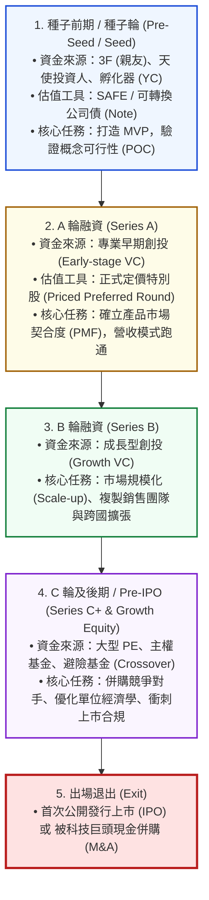

---
{"dg-publish":true,"permalink":"/98/equity-financing/","tags":["商業概念","創業財務","融資策略","創投運作","股權融資","資本結構","PMBA"],"dg-note-properties":{"aliases":["股權融資","權益融資","股權募資","創投融資","新創融資","冒險資本","Equity Financing","equity-financing","融資輪次","SAFE","可轉換公司債"],"tags":["商業概念","創業財務","融資策略","創投運作","股權融資","資本結構","PMBA"],"類別":"商業概念庫"}}
---


# 股權融資 (Equity Financing / 新創股權募資與資本對抗)

> **核心名言**：  
> 「在資訊不對稱與高度不確定的商業世界中，大企業遵循啄食順位：先用內部現金，次用銀行債務，最後才考慮發行股票。但對於負現金流、零抵押品、失敗率高達 80% 的早期新創而言，股權融資不是最後的退路，而是唯一的生存地基。」  
> —— 史都華·邁爾斯（Stewart Myers, 啄食理論創始人, 1984）  
>  
> 「創業者在融資時永遠在做一場交換：拿公司的所有權與控制權，交換跨越生死存亡之谷的時間與彈藥。」  
> —— 矽谷創投傳奇

---

## 一、 核心定義與新創股權融資的本質

### 1.1 經典理論定義與風險資本特性
- **股權融資（Equity Financing）** 指企業透過向外部投資人（天使投資人、創投機構 VC、私募股權 PE）發行並出售公司部分股份（普通股或特別股），以換取企業研發、營運擴張所需之長期資本的行為。
- **股權資本（Equity）vs. 債務資本（Debt）之本質對決**：

| 比較構面 | 股權融資 (Equity Financing) | 債權融資 (Debt Financing) |
| :--- | :--- | :--- |
| **資本性質** | **永久性權益資本 (Patient / Risk Capital)** | 借貸性負債資本（有具體到期日） |
| **償還義務** | **無固定還本付息義務**；投資人與公司共擔盈虧破產風險 | **具備剛性兌付要求**；無法還本付息將立即引發破產清算 |
| **上檔獲利潛力** | 享受公司未來價值爆發的**無限上檔收益 (Infinite Upside)** | 收益鎖定在**固定利息與本金**，公司再賺錢也無權額外分紅 |
| **所有權稀釋** | **永久稀釋創辦人持股比例**與未來每股分紅 | **完全不稀釋股權份額** |
| **公司控制權** | 投資人通常索取**董事會席位與重大決策一票否決權** | 債權人不參與日常經營決策（僅受財務限制性條款約束） |
| **稅務效應** | 股利由稅後淨利支付，無節稅效果 | **利息費用可在稅前扣除，享有稅盾 (Tax Shield) 利益** |

---

### 1.2 為什麼高科技新創無法依賴傳統銀行債務？
商業銀行的資金來源是廣大儲戶的存款，其獲利模式依靠極微薄的利差（Net Interest Margin，通常僅 1%~3%）。**這種極窄的收益空間，決定了銀行只能承受接近於零的違約率（< 1%）**。
- 早期高科技新創具備三大特質：
  1. 前期研發需要巨額固定開銷，營運現金流常年為**負數（Burn Rate 高企）**；
  2. 沒有土地、廠房等重資產可作為抵押品，核心資產全為無形代碼與專利；
  3. 創業失敗率高達 80%~90%。
- 若銀行貸款給新創：成功了只賺 3% 利息，失敗了 100% 本金泡湯，風險與報酬嚴重不對稱！
- **因此，新創企業必須尋找能承受極高失敗率、但追求 10~100 倍「冪次法則（Power Law）」超額回報的股權投資人（VC）**。

---

## 二、 新創階梯式融資輪次全景圖 (Startup Financing Lifecycle)

隨著新創企業跨越不同的驗證里程碑，其股權融資呈現階梯式演進：



### 2.1 早期極速融資工具：SAFE vs. 可轉換公司債 (Convertible Note)
在種子輪階段，由於公司剛起步、無具體營收，買賣雙方極難就「公司究竟值多少錢」達成定價共識。矽谷發明了兩大**「延遲定價」**的輕量化融資工具：

```text
【早期兩大可轉股工具核心要素】

  1. 可轉換公司債 (Convertible Note) ──【具有債務屬性】
     • 具備名義年利率 (Interest Rate，約 4%~8%)；
     • 具備法定到期日 (Maturity Date，通常 18~24 個月)；
     • 具備轉股折價率 (Discount Rate，通常 15%~20%)；
     • 具備轉股估值上限 (Valuation Cap)。

  2. SAFE 協議 (Simple Agreement for Future Equity) ──【YC 發明，非債務純權益】
     • 無利息累積、無到期日、無破產還錢壓力；
     • 投資人出資後，等待公司未來進行「正式 A 輪定價股權融資」時，直接以約定之
       【估值上限 (Valuation Cap)】或【折價率 (Discount)】自動轉化為 A 輪特別股。
```

---

## 三、 創投股權融資的兩大權利博弈：經濟條款 vs. 控制條款

當新創進入 A 輪具名定價融資（Priced Round）時，投資意向書（Term Sheet）的核心博弈聚焦於兩大主軸：

```text
【投資協議 Term Sheet 兩大核心架構】

           ┌───────────────────────────────────────────────┐
           │        創投股權投資協議 (Term Sheet)          │
           └───────┬───────────────────────────────┬───────┘
                   │                               │
                   ▼                               ▼
       【經濟條款 (Economics)】            【控制條款 (Control)】
  關乎「錢怎麼分、誰賺多少」          關乎「誰說了算、公司誰管」
  ───────────────────────────────     ───────────────────────────────
  • 投前估值 (Pre-Money)              • 董事會席位 (Board Seats)
  • 清算優先權 (Liquidation Pref)     • 否決權 (Protective Provisions)
  • 反稀釋條款 (Anti-dilution)        • 領售權與隨售權 (Drag/Tag)
  • 股利與贖回權 (Dividends/Redemption• 創辦人股權綁定 (Re-vesting)
```

1. **清算優先權（Liquidation Preference）**：
   - 確保公司在被廉價拋售或清算時，投資人能在普通股之前優先拿回本金（如 1x Non-participating Preferred）。
2. **保護性一票否決權（Protective Provisions）**：
   - 雖然投資人可能僅持股 15%~20%，但協議會明定：增減資本、公司併購出售、年度大額預算、任命/開除 CEO 等重大事項，**必須獲得該輪特別股過半數同意**，防範創辦人濫用資金。

---

## 四、 旗艦實證案例剖析 (Flagship Industrial Cases)

### 4.1 案例一：Gogoro 的多輪國際股權融資與資本豪賭
台灣電動機車龍頭 Gogoro 打造全球首創的都會電池交換網絡（GoStation），是標準的重資本技術密集型項目：
- **重資本挑戰**：建構覆蓋全台灣的數千座換電站與百萬顆電池，需要百億級台幣的前期資本沉沒；
- **股權融資組合拳**：陸續引進潤泰集團尹衍樑、宏達電王雪紅、日本住友商事、法國 Engie 能源巨頭、新加坡淡馬錫基金等多輪數億美元股權注資；
- **策略啟發**：若依賴銀行借貸，Gogoro 在前幾年巨額研發虧損期早已被利息壓垮；正是因為具備耐心資本特質的股權投資，才讓 Gogoro 得以跨越重資產投入的死亡之谷。

### 4.2 案例二：WeWork 股權融資過度膨脹的警世啟示
共享辦公空間巨頭 WeWork 在創辦人 Adam Neumann 帶領下，深諳股權融資估值催眠術：
- **瘋狂膨脹**：獲得日本軟銀（SoftBank）願景基金數百億美元股權注資，估值一度被推升至難以置信的 **470 億美元**；
- **控制權徹底失控**：Adam Neumann 享有 10 倍投票權的超級 AB 股，軟銀早期放棄了嚴格的董事會否決權，導致公司內部派系腐敗、豪擲公款、單位經濟學長期巨額虧損；
- **慘烈崩塌**：2019 年衝刺 IPO 時招股書揭露真實慘狀，估值在數週內暴跌 90%，最終聲請破產重組，成為商業史上資本無節制催熟的經典敗局。

---

## 五、 高階經理人決策工具箱：股權融資防雷檢核表 (Executive Playbook)

```
┌────────────────────────────────────────────────────────────────────────────┐
│              高階經理人「股權募資與創投談判」決策檢核表                      │
├────────────────────────────────────────────────────────────────────────────┤
│ ☐ 1. 精算現金燃燒率（Runway 跑道長度）：                                   │
│    • 確保手頭現金能支撐至少 12~18 個月，並在現金見底前 6 個月正式啟動融資。│
├────────────────────────────────────────────────────────────────────────────┤
│ ☐ 2. 評估「聰明錢 (Smart Money)」vs.「單純資金 (Dumb Capital)」：          │
│    • 投資人除了給錢，能否帶來下游大客戶訂單、供應鏈折讓或國際擴張背書？    │
├────────────────────────────────────────────────────────────────────────────┤
│ ☐ 3. 嚴防苛刻清算優先權條款：                                              │
│    • 堅持「1x 非參與清算優先權 (1x Non-participating)」，絕不接受「多倍參與」│
├────────────────────────────────────────────────────────────────────────────┤
│ ☐ 4. 股權與控制權的防火牆：                                                │
│    • 董事會總席位維持奇數（如 5 席），創始團隊力保 3 席多數，避免陷入僵局。  │
└────────────────────────────────────────────────────────────────────────────┘
```

---

## 六、 知識圖譜關聯與雙向鏈結 (Bidirectional Knowledge Links)

### 6.1 核心系列套裝導航（新創股權激勵與融資三部曲）
- **[[equity-dilution_股權稀釋]]** · 輪次股權稀釋模型、期權池移花接木與反稀釋防禦
- **[[equity-vesting_股權成熟機制]]** · 四年成熟一年懸崖、合夥人防退出與雙引爆點加速
- **[[equity-financing_股權融資]]** · 新創階梯式融資、SAFE可轉債與經濟控制權博弈（本篇）

### 6.2 策略與財務概念對接
- [[cap-table_股權結構表 Cap Table]] · 創始股權分配、期權池預留與股權成熟動態追蹤
- [[term-sheet_投資意向書 Term Sheet]] · 創投投資協議關鍵經濟與控制權條款深度解析
- [[capital-structure_資本結構]] · 企業資本結構理論、MM定理與槓桿最佳化
- [[anti-dilution_反稀釋條款]] · 完全棘輪與加權平均反稀釋條款深度法律解析
- [[cases_新創與企業融資案例庫]] · 國內外新創融資談判與資本博弈實戰案例庫

### 6.3 課程筆記與主控台
- [[L09_資本結構理論與決策]] · 財務策略課程模組九核心講義
- [[_創業與企業財務策略 MOC]] · 全課程創業財務地圖
- [[home]] · 全球 PMBA 知識庫總導航主頁面
