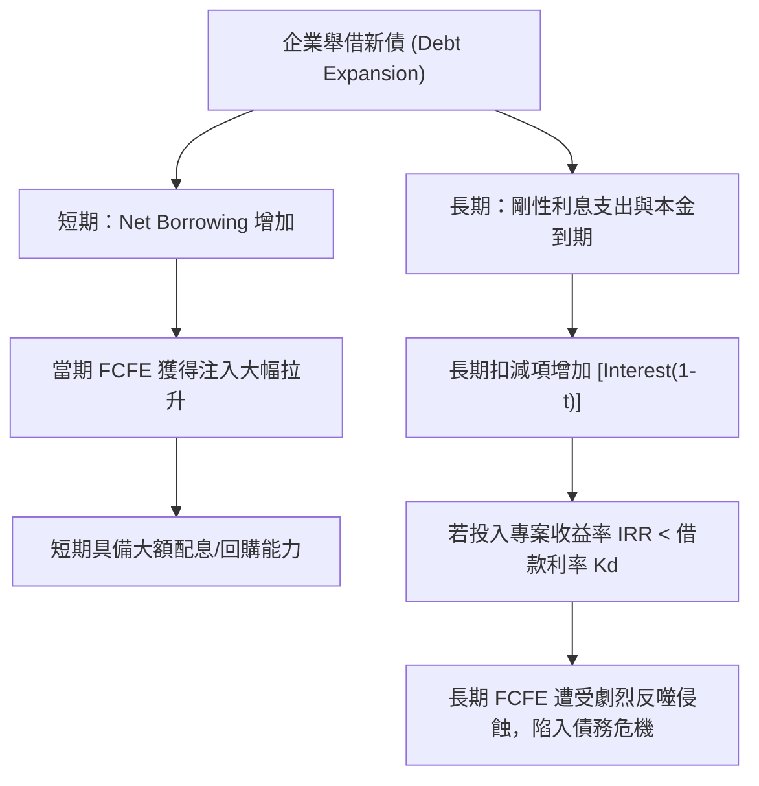

---
{"dg-publish":true,"permalink":"/98/equity-free-cash-flow/","tags":["商業概念","財務管理","企業評價","投資策略","PMBA"],"dg-note-properties":{"aliases":["股權自由現金流量","Free Cash Flow to Equity","FCFE","槓桿自由現金流","Levered Free Cash Flow","LFCF"],"tags":["商業概念","財務管理","企業評價","投資策略","PMBA"]}}
---


# 股權自由現金流量 (Free Cash Flow to Equity, FCFE)

> **【核心決策摘要】**
> **股權自由現金流量（Free Cash Flow to Equity, FCFE，又稱槓桿自由現金流量 Levered FCF）** 代表企業在履行了所有日常營運成本、繳納營利事業所得稅、追加營運資金（$\Delta\text{NWC}$）、滿足維持與成長所需的必要資本支出（CapEx），**並完全支付現有債權人之本金償還與利息費用，同時計入新增舉債淨額後，真正留存給普通股股東自由支配的剩餘現金流**。FCFE 是衡量企業「發放現金股利與執行庫藏股買回（Share Repurchase）的最大安全上限」。在股權折現估值模型中，FCFE 對應的折現率為**股權資本成本（Cost of Equity, $K_e$，通常透過 CAPM 模型計算）**。

---

## 1. 概念核心定義與本質 (Executive Definition & Theoretical Essence)

### 1.1 核心定義
股權自由現金流量（FCFE）在企業財務學中被定義為：**企業股東作為「剩餘索償權人（Residual Claimants）」，在企業履行所有法律、營運與債務契約性承諾之後，所能從企業抽離且不傷害現有營運生產力的淨現金總額**。

```
              ┌──────────────────────────────────────────────────┐
              │           企業自由現金流量 (FCFF)                │
              └────────────────────────┬─────────────────────────┘
                                       │ 扣除債權人現金索償：
                                       │ - 稅後利息費用 [Interest x (1-t)]
                                       │ + 淨借入本金 (新增債務 - 償還本金)
                                       ▼
              ┌──────────────────────────────────────────────────┐
              │           股權自由現金流量 (FCFE)                │
              └────────────────────────┬─────────────────────────┘
                                       │ 股東價值返還決策：
                    ┌──────────────────┴──────────────────┐
                    ▼                                     ▼
           【現金股利 (Dividends)】              【庫藏股回購 (Repurchase)】
           (直接返還現金給全體股東)              (增強每股 EPS，兼具稅務優勢)
```

### 1.2 本質解析：FCFE 與現金股利（Dividends）的關鍵剪刀差
許多投資人習慣以「現金股利折現模型（DDM）」對股票進行估值，但 DDM 存在重大盲點：**股利發放多寡取決於董事會的主觀政策，而非企業的真實分配能力**。
- **情境一：過度保守（FCFE > 股利）**：企業坐擁大量現金流，但董事會出於保守或代理人問題（Agency Problem）僅發放微薄股利，剩餘資金積累在帳上低效生息或進行帝國建造式亂併購。此時以 DDM 估值會嚴重低估企業股權價值，FCFE 才是股東潛在真實收益的標尺。
- **情境二：借債分紅（FCFE < 股利）**：部分傳統企業為了迎合市場對高股息的偏好，在自身現金流不足時「掏空老本」或依賴舉借新債來發放現金股利。此種分紅侵蝕股權本金，屬於不可持續的財務自殘行為。

---

## 2. 數理模型與三大推導路徑 (Mathematical Modeling & Bridges)

在財務建模中，FCFE 可透過以下三條等價途徑精確求得：

### 2.1 路徑一：自 FCFF 橋接推導（資本結構調整法）

這是最標準的橋接公式，清晰展示了槓桿對現金流的調整：

$$\text{FCFE} = \text{FCFF} - \text{Interest Expense} \times (1 - t) + \text{Net Debt Issued}$$

其中：
- $\text{Interest Expense} \times (1 - t)$：支付給債權人的稅後利息（還原稅盾扣除）。
- $\text{Net Debt Issued}$（舉債淨額）$= \text{新增發行借款與債券本金} - \text{償還既有借款本金}$。

### 2.2 路徑二：自會計淨利（Net Income）推導（底層出發法）

$$\text{FCFE} = \text{Net Income} + \text{D\&A} - \text{CapEx} - \Delta\text{NWC} + \text{Net Debt Issued}$$

此公式表明：**股權現金流等於淨利潤加上非現金折舊，扣除再投資需求，再加上外部債權人所注入的淨現金**。

### 2.3 路徑三：維持目標槓桿比率法（Target Debt Ratio Approach, Damodaran）

若企業維持長期穩定的資本結構，目標負債比率為 $\delta = \frac{\text{Debt}}{\text{Debt} + \text{Equity}}$。這意味著未來的每一筆淨資本支出（$\text{CapEx} - \text{D\&A}$）與營運資金追加（$\Delta\text{NWC}$），都將由負債融資按比例承擔 $\delta$，而由股東權益承擔 $(1 - \delta)$：

$$\text{FCFE} = \text{Net Income} - (1 - \delta)(\text{CapEx} - \text{D\&A}) - (1 - \delta)(\Delta\text{NWC})$$

此公式極具實戰價值，因其無需逐年預測具體的新債發行與償還排程，直接反映了在最優資本結構動態平衡下的股東現金流。

### 2.4 FCFE 股權折現估值模型

直接折現 FCFE 可精準計算企業的股權市場價值（Equity Value）：

$$\text{Equity Value} = \sum_{t=1}^{T} \frac{\text{FCFE}_t}{(1 + K_e)^t} + \frac{\text{Terminal Equity Value}_T}{(1 + K_e)^T}$$

- **關鍵防錯提醒**：折現 FCFE 時，**折現率必須使用股權資本成本 $K_e$（透過 CAPM 計算：$K_e = R_f + \beta_L (R_m - R_f)$）**，絕對不可混用全企業的 WACC！

---

## 3. 戰略框架與財務槓桿效應 (Strategic Framework & Leverage Dynamics)

### 3.1 財務槓桿對 FCFE 的雙刃劍效應



- **槓桿正效應**：當企業投資項目的資產報酬率高於借貸成本時，適度舉債能將股東自有資金釋放出來，推升 FCFE 與股東權益報酬率（ROE）。
- **槓桿負效應**：債務利息與還本是具備法律約束力的「剛性支出」，即使企業遭遇景氣寒冬，利息一分都不能少。高負債企業的 FCFE 波動率遠大於 FCFF，在下行週期極易跌入負值泥淖。

---

## 4. 產業標竿與實戰應用場景 (Industry Benchmarks & Applications)

| 產業維度 | 典型資本結構特徵 | FCFE 驅動特徵 | 股東回報首選工具 |
| :--- | :--- | :--- | :--- |
| **成熟高科技巨頭** (微軟、Alphabet) | 幾無長期有息負債，坐擁千億淨現金（$\text{Net Debt} \le 0$） | $\text{FCFE} \approx \text{FCFF}$；營運現金流充沛，幾乎無債務扣除 | 巨額股票回購（Share Repurchase）為主，輔以溫和配息 |
| **房地產開發與 REITs** | 高槓桿運作（負債比 60%~75%） | 依賴持續借新還舊（Refinancing）；FCFE 極度受央行利率政策波動主導 | 高比例現金分紅（法律規定 REITs 需將 90% 應稅收入分派） |
| **公用事業與電信業** | 穩定中高負債，現金流極具防禦性 | 資本支出龐大但舉債能力強；每年發行新債覆蓋部分 CapEx，維持穩定 FCFE | 高殖利率現金股利（Dividend Yield 4%~6%） |
| **初創獨角獸 (SaaS/生技)** | 純股權融資，早期缺乏負債融資能力 | FCFE 長期深度為負（研發與市場拓展燒錢）；外部現金流為負 | 不分紅、不回購；全力留存現金維持跑道 |

---

## 5. 經典企業個案深度剖析 (Deep Dive Case Studies)

### 5.1 成功典範：Microsoft 卓越的 FCFE 創造長期股東複利神話
- **財務架構**：微軟擁有全球極少數獲得 AAA 最高信用評等的穩健資產負債表。
- **FCFE 運作閉環**：
  1. 儘管近年斥資近千億美元投資雲端資料中心與收購動視暴雪（Activision Blizzard），微軟強勁的軟體利潤率使其每季產生逾 **\$200 億美元** 的淨利潤。
  2. 每年產生的龐大 FCFE 遠遠超過常規股利支出（股息發放率僅約 25%~30%）。
  3. 微軟將巨額剩餘 FCFE 用於持續買回自家股票，過去十年註銷了數億股流通股，使每股盈餘（EPS）與每股 FCFE 呈現驚人的複利擴張，驅動市值突破 3 兆美元。

### 5.2 失敗警示：玩具反斗城（Toys "R" Us）槓桿收購（LBO）後的 FCFE 絞殺
- **資本運作劫難**：2005 年，KKR、貝恩資本等私募機構以 66 億美元槓桿收購玩具反斗城，其中超過 **\$53 億美元** 為負債融資，將原本財務健康的企業推向極限負債。
- **FCFE 死亡螺旋**：
  1. 收購後，公司每年必須承擔高達 **\$4 億美元** 的剛性利息支出，幾乎將全部營業現金流榨乾。
  2. **再投資能力歸零**：由於沒有多餘 FCFE，玩具反斗城無法投入 CapEx 翻新實體門市體驗，更無力投資電商物流系統對抗 Amazon 的崛起。
  3. 當 2017 年一筆 4 億美元債務到期無法展期時，FCFE 深度虧空的玩具反斗城只能宣告破產清算，數萬名員工失業。

---

## 6. 高階經理人決策實戰工具箱 (Executive Action Playbook)

### 6.1 股東現金流分配健康度診斷矩陣

```
                    高 FCFE (造血充沛)
                            │
            【象限 II：資本積累/併購區】│ 【象限 I：全盛股東回報區】
            • 現象：FCFE 極高，但股利  │ • 現象：FCFE 極高且持續穩定
              支付率低（現金囤積）     │ • 策略：加大庫藏股回購力度，
            • 策略：物色戰略併購標的，│   優化股權結構推升 EPS
              或啟動特別現金股息       │
    ───────────────┼───────────────
            【象限 III：瀕死危機區】 │ 【象限 IV：不可持續虛胖區】
            • 現象：FCFE 為負，完全    │ • 現象：FCFE 為負或微弱，但
              依賴融資輸血（失血狀態）│   強行舉債維持高額配息
            • 策略：緊急收縮非核心支出，│ • 策略：立即削減或凍結股利！
              重新評估資本結構安全邊際│   防止資產負債表實質破產
                            │
                    低 FCFE (失血/赤字)
    低股利發放率 ────────────────────────── 高股利發放率
```

### 6.2 執行長 FCFE 決策實戰檢核清單
- [ ] **檢核 1：當前的現金股利總額是否被「真實 FCFE」充分覆蓋？（FCFE / Dividends > 1.2x）**
- [ ] **檢核 2：本期新增的借款淨額（Net Borrowing）是否被誤當作常態現金流？**（若扣除借款後 FCFE 為負，表明公司處於虛假繁榮）。
- [ ] **檢核 3：折現估值時，是否嚴格使用了股權資本成本 $K_e$，而非加權平均成本 WACC？**
- [ ] **檢核 4：股票回購的時機是否合理？**（若在股價嚴重高估時執行回購，實質上是在摧毀股東價值）。

---

## 7. 關聯知識網絡與導航地圖 (Knowledge Network & Cross-References)

### 7.1 本主題核心三部曲
- **[[enterprise-free-cash-flow-liang_企業自由現金流量]]** · 全體出資人視角、無槓桿資產造血本質與 DCF 企業價值評估
- **[[equity-free-cash-flow_股權自由現金流量]]** · 股東剩餘索償權、財務槓桿淨效應與股東分配上限（本篇）
- **[[operating-cash-flow-statement_營業活動現金流量]]** · 本業營運現金造血能力、間接法調和與應計制盈餘品質檢驗

### 7.2 跨領域財務與策略鏈結
- [[capital-structure_資本結構]] · 負債融資比例與利息負擔對 FCFE 的結構性調控
- [[dcf_現金流量折現法]] · FCFE 股權折現模型之數學架構
- [[wacc_加權平均資本成本]] · 區分股權成本 $K_e$ 與全公司 WACC 之定價邊界
- [[equity-financing_股權融資]] · 股權資本成本、稀釋效應與股東現金流分配
- [[company-value_公司內在價值]] · FCFE 折現推導出之股東內在權益價值

### 7.3 課程筆記與導航主頁
- [[L09_資本結構理論與決策]] · 財務策略模組九：資本結構、股利政策與公司理財決策
- [[_創業與企業財務策略 MOC]] · 企業財務策略與資本市場運作全景地圖
- [[home]] · 全球 PMBA 知識庫總導航主頁面