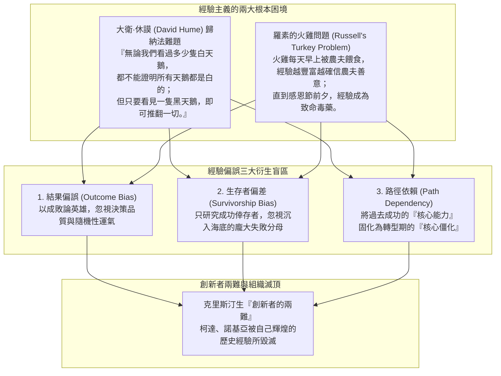

---
{"dg-publish":true,"permalink":"/98/experience/","tags":["商業概念","決策科學","行為經濟學","認知心理學","PMBA"],"dg-note-properties":{"aliases":["經驗偏誤","Experience Bias","經驗主義陷阱","結果偏誤","Outcome Bias"],"tags":["商業概念","決策科學","行為經濟學","認知心理學","PMBA"]}}
---


# 經驗偏誤 (Experience Bias)

> [!NOTE]
> **核心概念精粹**：經驗偏誤（Experience Bias / Outcome Bias）是指決策者過度依賴過去在特定時空環境下累積的個人經歷、歷史數據或成功記憶，並將其武斷地視為「普世客觀真理」或預測未來的單一依據，從而忽視樣本選擇偏差、隨機性干擾與外部環境結構性變遷的認知盲區。哲學家羅素的「火雞問題（Turkey Problem）」深刻揭示了其致命本質：累積了 1,000 天的餵食經驗，非但不能保證第 1,001 天的安全，反而在感恩節前夕將其推向毀滅。

---

## 一、 學理淵源：從休謨歸納法難題到火雞問題

經驗偏誤並非智力低下的表現，而是人類大腦在演化歷程中為了節省能量，過度依賴啟發式思維（Heuristics）所產生的系統性缺陷：



---

## 二、 經驗偏誤在企業管理中的四大典型表象

在成熟大企業中，資深經理人最常依賴「過去經驗」扼殺創新：

| 偏誤形態 | 典型口頭禪與思維定勢 | 認知盲區解構 | 歷史慘烈案例 |
| :--- | :--- | :--- | :--- |
| **火雞經驗陷阱<br>(Turkey Trap)** | 「我們這套模式已經穩定運行了 20 年，從來沒出過大問題！」 | 誤將「平穩期的暫時無事」當作「系統絕對安全」，在黑天鵝來臨時猝不及防。 | 2008 年華爾街投行在次貸危機爆發前堅信房價「歷史上永不全國性下跌」。 |
| **生存者經驗推論<br>(Survivorship Illusion)** | 「看賈伯斯、馬斯克大學輟學都能成功，所以學歷不重要！」 | 只看到倖存的億萬富翁，徹底無視數百萬輟學後淪為邊緣底層的失敗者。 | 盲目模仿少數獨角獸的激進擴張，導致大量新創因資金鏈斷裂夭折。 |
| **結果偏誤<br>(Outcome Bias)** | 「既然專案最終賺了錢，就證明當初賭博式的違規決策是英明的！」 | 把純粹的好運氣（Lucky Fool）誤當成高超的戰略能力，下次加倍下注時全盤皆輸。 | 交易員違規持倉因偶遇市場反彈賺錢，反而獲得高層提拔，最終爆發世紀巨虧。 |
| **能力陷阱與路徑依賴<br>(Competency Trap)** | 「我們的膠卷/功能機硬體技術全球第一，顧客絕不可能接受模糊的數位/觸控螢幕！」 | 將過去支撐成功的要素奉為不可侵犯的聖牛，拒絕承認技術 S 曲線已發生跳躍。 | 柯達（Kodak）壓制數位相機專利、諾基亞（Nokia）忽視 iOS/Android 生態。 |

---

## 三、 經典企業實戰案例：瓦爾德的裝甲裝配與柯達的經驗悲劇

```carousel

<!-- slide -->
### 1. 亞伯拉罕·瓦爾德（Abraham Wald）破除生存者經驗偏誤
- **歷史情境**：二戰期間，美軍軍方統計返航轟炸機上的彈孔分佈，發現機翼和機尾彈孔最多，引擎幾乎沒有彈孔；軍官們依據直覺「經驗」，提議加固彈孔最多的機翼；
- **瓦爾德的洞見**：統計學家瓦爾德力排眾議指出——引擎中彈的飛機根本無法返航，正是因為引擎沒有中彈，這些飛機才能活著飛回來！
- **成果**：美軍最終決定加固「完全沒有彈孔」的引擎部位，大幅降低了盟軍飛行員的陣亡率，成為破除經驗偏誤的傳世範例。
<!-- slide -->
### 2. 柯達（Kodak）被自己輝煌經驗毀滅的悲劇
- **歷史包袱**：柯達在 20 世紀長達百年是全球膠卷市場的絕對霸主，毛利率高達 70%~80%；
- **經驗障礙**：其實柯達工程師早在 1975 年就發明了全球第一台數位相機，但管理層依據過去數十年的「成功經驗」判定：顧客熱愛實體沖洗照片的溫潤質感，數位拍照畫質粗糙且缺乏耗材商業模式；
- **慘烈後果**：柯達被自己的「成功經驗」徹底鎖死，拒絕推動自我革命，最終在 2012 年黯然聲請破產。
```

---

## 四、 經理人反經驗偏誤審計檢核表（Executive Decision Checklist）

高階管理團隊在進行策略審批時，應建立反經驗偏誤的防火牆：

- [ ] **火雞問題逆向思考（The Turkey Test）**：
  - 我們所依賴的核心獲利支柱，究竟是具備難以撼動的[[core-competence_核心能力|核心能力護城河]]，還是只是像感恩節前的火雞一樣，剛好處於長達十年的外部順風週期？
- [ ] **決策過程 vs 結果分離評估（Process vs Outcome Audit）**：
  - 在評核團隊績效時，我們是否嚴格區分了「高水準決策但遭遇壞運氣」與「愚蠢冒險但僥倖撞大運」？我們是否在體制上獎勵了前者、懲戒了後者？
- [ ] **紅隊挑戰與異質視角（Red Team & Outside View）**：
  - 面對重大投資案，我們是否引入了毫無歷史利益包袱的外部獨立「紅隊（Red Team）」，專門負責推翻老將們的「直覺經驗」並尋找致命反例？
- [ ] **失敗分母復盤（Denominator Archaeology）**：
  - 當我們試圖複製某個標竿企業的成功經驗時，我們是否深入調查了採取完全相同策略卻最終慘烈倒閉的 99 家失敗公司？我們是否真正了解失敗的真正原因？

---

## 五、 關聯概念與知識網絡

* 認知科學與決策偏誤：
  * [[cognitive-bias_認知偏誤|認知偏誤 (Cognitive Bias)]]：人類大腦系統性思維缺陷架構
  * [[confirmation-bias_確認偏誤|確認偏誤 (Confirmation Bias)]]：只尋求支持既有經驗證據的心智過濾
  * [[fat-tail-theory_肥尾理論|肥尾理論 (Fat-Tail Theory)]]：歷史平穩經驗在極端黑天鵝面前的脆弱性
  * [[short-term_短期主義|短期主義 (Short-Termism)]]：依賴短期過往業績經驗所引發的戰略近視
* 組織與策略管理：
  * [[disruptive-innovation_破壞式創新|破壞式創新 (Disruptive Innovation)]]：新進者利用既有者經驗盲區發動顛覆
  * [[goodharts-law_古德哈特定律|古德哈特定律 (Goodhart's Law)]]：基於過去經驗設計之指標遭遇人性博弈而異化
  * [[conceptual-skills_概念技能|概念技能 (Conceptual Skills)]]：超越個人經驗局限之高階全局洞察
  * [[great-company_好公司|好公司 (Great Company)]]：直面殘酷現實並持續自我迭代之卓越組織
