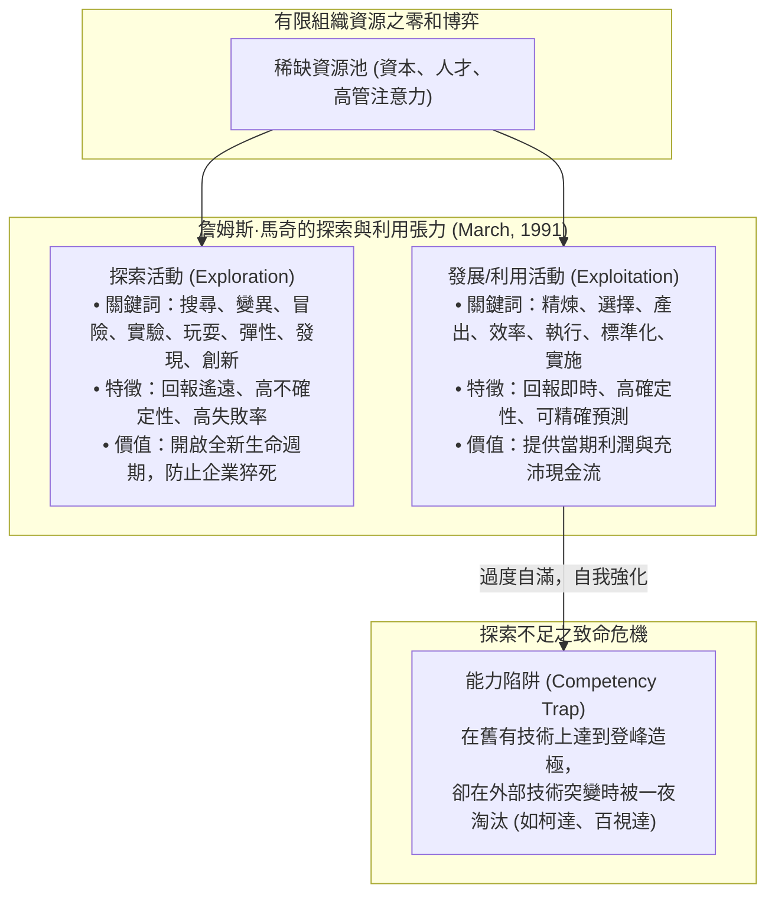

---
{"dg-publish":true,"permalink":"/98/exploration/","tags":["商業概念","組織學習","創新管理","策略管理","PMBA"],"dg-note-properties":{"aliases":["探索","Exploration","組織探索","探索性創新","遠程搜尋"],"tags":["商業概念","組織學習","創新管理","策略管理","PMBA"]}}
---


# 探索 (Exploration)

> [!NOTE]
> **核心概念精粹**：探索（Exploration），是史丹佛大學組織大師詹姆斯·馬奇（James G. March）在《組織學習中的探索與利用》中確立的經典概念。它指組織投入資源於**新知識、新技術、新商業模式的遠程搜尋、實驗、變異、冒險與非連續性突破**的策略行為。探索的回報具有長遠性、高不確定性與高失敗率，但它是打破組織路徑依賴、規避能力陷阱（Competency Trap），並開創企業第二成長曲線的唯一生命力泉源。

---

## 一、 學理淵源：詹姆斯·馬奇的組織學習雙元架構

詹姆斯·馬奇（James G. March, 1991）深刻指出：任何企業系統內部都存在著爭奪有限注意力與資本的兩大本質活動——**探索（Exploration）**與**[[98_商業概念庫/development_發展\|發展／利用（Exploitation）]]**。



---

## 二、 探索（Exploration）與利用（Exploitation）的核心特徵對比矩陣

理解探索活動的本質特質，是建立專屬組織孵化土壤的前提：

| 比較構面 | 探索活動（Exploration） | 發展／利用活動（Exploitation） |
| :--- | :--- | :--- |
| **目標本質** | 發現未知（Finding the New），開闢全新賽道。 | 優化已知（Improving the Old），極大化當期產能。 |
| **時間地平線** | 長期導向（3 ~ 10 年），甚至著眼下一個十年。 | 短期至中期導向（當季至 1 ~ 2 年）。 |
| **風險與報酬分佈** | **肥尾冪律分佈（Power Law）**：90% 的實驗失敗，極少數爆發千倍回報。 | **高斯常態分佈**：收益穩定，變異數極低。 |
| **考核指標 (KPI)** | 里程碑驗證、學習反饋速度、發現錯誤假設的數量。 | 每股盈餘（EPS）、資產報酬率（ROA）、缺陷率（PPM）。 |
| **組織架構文化** | 分權、扁平、容忍混亂、鼓勵「智能失敗（Intelligent Failure）」。 | 集權、嚴格層級制、追求六標準差零缺陷。 |
| **領導風格** | 願景型、僕人式、給予高度自主實驗空間。 | 指導型、交易型、嚴格監控進度節拍。 |

---

## 三、 經典企業實戰案例：貝佐斯的「探索實驗室」 vs 傳統零售

```carousel

<!-- slide -->
### 1. 亞馬遜（Amazon）將探索制度化為日常
- **核心哲學**：貝佐斯在致股東信中反覆強調：「如果你的失敗率沒有隨著公司規模擴大而等比例放大，就證明你根本沒有認真在探索；失敗與發明是不可分割的雙胞胎」；
- **慘烈探索**：亞馬遜曾投入數億美元研發智慧型手機 Fire Phone，遭遇慘敗全額提列庫存損失；
- **驚天回報**：但正是同一套探索土壤，孕育了當初看似與電商毫無關聯的 AWS 雲端運算、智慧音箱 Alexa 與 Prime 訂閱制；AWS 如今貢獻了亞馬遜 70% 以上的營業利潤。
<!-- slide -->
### 2. 字母表（Alphabet）的「月球探測專案（Moonshots）」
- **結構雙巧性**：Google 核心搜尋引擎業務專注於極致的「利用（Exploitation）」賺取海量現金；
- **探索特區**：設立獨立的 X 實驗室，專門探索自動駕駛（Waymo）、生命科學（Verily）、量子運算；
- **防禦成果**：即便多數專案中途關閉，但其探索積累的底層演算法與專利，成為阻絕微軟與 OpenAI 全面顛覆的戰略防禦縱深。
```

---

## 四、 經理人探索活動治理檢核表（Executive Decision Checklist）

在主導企業創新孵化時，高階管理團隊應建立防止探索被主業扼殺的防禦機制：

- [ ] **探索資源獨立預算池（Ring-Fenced Exploration Budget）**：
  - 探索專案的研發預算是否獨立劃撥？當成熟主業季度獲利下滑時，是否有明文規定嚴禁挪用探索專案資金去粉飾短期報表？
- [ ] **獨立於主業績效考核（Distinct Evaluation Metrics）**：
  - 我們是否愚蠢地拿主業的「利潤率、回收期」去考核處於嬰兒期的探索業務？探索團隊的 KPI 是否聚焦於「學習驗證速率與單元經濟探索」？
- [ ] **組織實體結構隔離（Structural Separation）**：
  - 探索團隊是否被隔離在官僚審批體系之外（如設立獨立創新特區、Skunk Works 或專屬[[CVC_企業創投 Corporate Venture Capital|企業創投 (CVC)]]）？避免被成熟事業部的流程教條同化。
- [ ] **失敗文化與心理安全感（Psychological Safety for Intelligent Failure）**：
  - 組織內部是否敢於「體面關閉」經過認真驗證但被證明不可行的探索專案？參與探索而失敗的骨幹工程師，是獲得升遷重用還是被發配邊疆？

---

## 五、 關聯概念與知識網絡

* 組織學習與雙元性：
  * [[development_發展|發展 (Exploitation)]]：探索與發展兩極對抗之互補維度
  * [[Organizational_Ambidexterity_組織雙巧性|組織雙巧性 (Organizational Ambidexterity)]]：左右開弓平衡探索與利用之大一統理論
  * [[dual-transformation-dual-transformation_雙軌轉型 Dual Transformation|雙軌轉型 (Dual Transformation)]]：A軌主業重塑與B軌未來探索之雙輪驅動
  * [[disruptive-innovation_破壞式創新|破壞式創新 (Disruptive Innovation)]]：邊緣探索顛覆既有成熟巨頭之底層邏輯
* 戰略投資與領導力：
  * [[CVC_企業創投 Corporate Venture Capital|企業創投 (CVC)]]：以股權投資槓桿外部新創探索之戰略工具
  * [[great-company_好公司|好公司 (Great Company)]]：跨週期持續孕育第二曲線之偉大組織
  * [[conceptual-skills_概念技能|概念技能 (Conceptual Skills)]]：高層領導在迷霧中洞察探索方向之核心勝任力
  * [[short-term_短期主義|短期主義 (Short-Termism)]]：扼殺探索活動之制度性毒瘤
