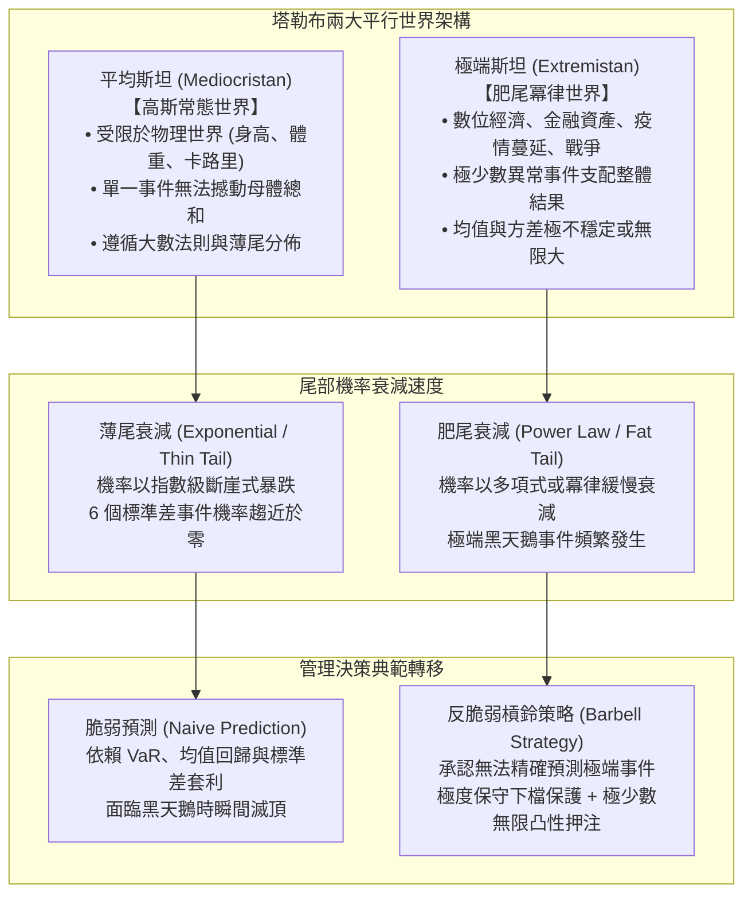

---
{"dg-publish":true,"permalink":"/98/fat-tail-theory/","tags":["商業概念","決策科學","風險管理","統計學","PMBA"],"dg-note-properties":{"aliases":["肥尾理論","Fat-Tail Theory","肥尾效應","厚尾分佈","冪律分佈","Heavy-Tailed Distribution"],"tags":["商業概念","決策科學","風險管理","統計學","PMBA"]}}
---


# 肥尾理論 (Fat-Tail Theory)

> [!NOTE]
> **核心概念精粹**：肥尾理論（Fat-Tail Theory）揭示了在真實商業世界與複雜金融體系中，極端異常事件（極端偏離均值的「黑天鵝事件」）的發生機率與毀滅性影響力，遠遠高於經典高斯常態分配所預測的模型。在肥尾分佈（如冪律分佈 Power Law）下，**極少數的極端離群值主導了整個系統的長期總和與最終命運**。忽視肥尾效應、盲目依賴常態鐘形曲線進行風險管理，是引發企業破產清算與全球金融崩潰的根本認知盲區。

---

## 一、 學理奠基：平均斯坦 vs 極端斯坦的世紀對決

哲學家與風險量化專家納西姆·尼古拉斯·塔勒布（Nassim Nicholas Taleb）在《黑天鵝》與《肥尾效應》中，構建了顛覆傳統計量經濟學的世界觀模型：



### 肥尾的數學本質：冪律分佈（Power Law）
在肥尾環境中，隨機變數大於某一臨界值 $x$ 的尾部機率遵循冪律衰減：

$$P(X > x) \sim x^{-\alpha} \quad (\text{其中 } \alpha \text{ 為尾部指數 Tail Index})$$

- 當 $\alpha \le 2$ 時，理論母體變異數（Variance）為無窮大；
- 當 $\alpha \le 1$ 時，理論母體期望值（Mean）甚至不存在！
- **實務啟示**：傳統統計學依賴的「樣本平均數（Sample Mean）」與「標準差（Standard Deviation）」在肥尾世界中徹底失去代表性，歷史數據無法有效預測未來極端破壞力。

---

## 二、 薄尾常態 vs 肥尾真實世界的核心維度深度對比

| 比較維度 | 平均斯坦薄尾世界（Mediocristan） | 極端斯坦肥尾世界（Extremistan） |
| :--- | :--- | :--- |
| **典型代表變數** | 人類的身高、成年人體重、工廠零件尺寸公差。 | 金融市場單日崩跌幅、書籍銷售量、疫情傳播人數、創投投資回報。 |
| **單一事件影響力** | 即使世界上最高的人走進房間，對全場平均身高的影響微乎其微。 | 比爾·蓋茲或馬斯克走進房間，全場平均淨資產瞬間暴增數萬倍。 |
| **極端事件機率** | 6 個標準差（$6\sigma$）事件機率約為 10 億分之 2，千萬年難遇。 | 極端事件規律性反覆出現，每隔數年即爆發一次「百年一遇」危機。 |
| **傳統工具失靈點** | [[normal-distribution_常態分配|常態分配]]、回歸分析、資本資產定價模型（CAPM）有效。 | 在險價值（VaR）、夏普比率（Sharpe Ratio）、Black-Scholes 模型全面崩壞。 |
| **企業生存法則** | 精益優化（Lean）、消除冗餘、零庫存極致效率。 | **反脆弱性（Antifragility）**、戰略儲備、保留充裕現金緩衝、槓鈴配置。 |

---

## 三、 經典企業實戰案例：忽視肥尾的毀滅 vs 槓鈴策略的暴利

```carousel

<!-- slide -->
### 1. 忽視肥尾的世紀慘案：長期資本管理公司（LTCM）的覆滅
- **背景**：1994 年成立的 LTCM 匯聚了諾基亞獎得主斯科爾斯（Myron Scholes）與莫頓（Robert Merton），依託高斯常態分配模型進行極高槓桿（高達 30~50 倍）的跨市場利差套利。
- **肥尾反噬**：1998 年俄羅斯爆發債券違約與貨幣崩跌。在常態分配模型中，此類事件的發生機率低於「宇宙誕生以來的總秒數（大於 8 個標準差）」，被模型判定為「絕對不可能發生」；
- **後果**：肥尾黑天鵝瞬間撕碎模型，LTCM 在數週內虧損 40 億美元瀕臨清算，迫使聯準會緊急組織華爾街救市。
<!-- slide -->
### 2. 駕馭肥尾的槓鈴實踐：Universa 避險基金的超額回報
- **策略理念**：塔勒布與馬克·斯皮茲納格爾（Mark Spitznagel）創立的 Universa Investments 完全放棄預測市場走勢。
- **槓鈴架構**：將 97%~98% 的資產配置於極度安全之短期美國國債（鎖死下檔風險）；僅將 2%~3% 的微量資本持續買入「深度價外看跌期權（Far Out-of-the-Money Puts）」。
- **暴利爆發**：在平靜年代，這 2% 的期權費被視為微不足道的火險保費；但當 2008 年金融海嘯與 2020 年新冠崩盤爆發時，肥尾極端波動率引爆非對稱凸性回報，基金在單月斬獲超過 4,000% 的驚人淨回報。
```

---

## 四、 經理人肥尾風險防禦檢核表（Executive Decision Checklist）

高階管理層與風險委員會必須打破「常態分配幻覺」，建立反脆弱防禦體系：

- [ ] **常態分配假設排毒（Normal Distribution Detox）**：
  - 公司的財務預測、供應鏈斷鏈評估或資本預算模型中，是否假定營收波動與原料價格遵循鐘形常態曲線？如果我們將極端情境（如營收腰斬 50%、融資利率飆升三倍）納入考量，公司是否會立即破產？
- [ ] **消除毀滅性單點故障（Zero Ruin Tolerance）**：
  - 組織體系中是否存在「一旦發生就直接導致公司清算」的致命風險點？（例如：單一供應商佔比超過 80%、單一客戶佔比超過 50%、極高短期流動性負債）。
- [ ] **反脆弱戰略儲備（Strategic Redundancy & Slack）**：
  - 為了追求日常經營效率，我們是否把公司的安全庫存與現金緩衝壓得過低？我們是否保留了至少能支撐 18~24 個月零營收的「安全邊際現金」？
- [ ] **非對稱凸性業務佈局（Convexity Upside Bet）**：
  - 我們是否建立了類似創投（VC）的探索性機制？用極小且可承受的研發預算，廣泛押注具有「潛在無限爆發力」的全新前沿技術（如生成式 AI）？

---

## 五、 關聯概念與知識網絡

* 核心統計與風險理論：
  * [[normal-distribution_常態分配|常態分配 (Normal Distribution)]]：高斯鐘形曲線與肥尾破滅的基石對比
  * [[monte-carlo-simulation_蒙地卡羅模擬|蒙地卡羅模擬 (Monte Carlo Simulation)]]：在非線性複雜系統中的機率敏感度測試
  * [[analysis_情境分析|情境分析 (Scenario Analysis)]]：跳脫單點預測之極端情境壓力測試
  * [[contingency-planning_應變計畫|應變計畫 (Contingency Planning)]]：黑天鵝事件爆發時的業務持續架構
* 策略與心智模型：
  * [[risk-taking_風險承擔|風險承擔 (Entrepreneurial Risk-Taking)]]：計算過的風險與可承受損失原則
  * [[Prospect_Theory_Executive_Risk_展望理論與高管風險決策|展望理論與高管風險決策 (Prospect Theory)]]：極端情境下高管之風險偏好轉化
  * [[experience_經驗偏誤|經驗偏誤 (Experience Bias)]]：沉迷於歷史平穩經驗的火雞問題
  * [[sound-investment_好投資|好投資 (Sound Investment)]]：價值投資之安全邊際防護哲學
