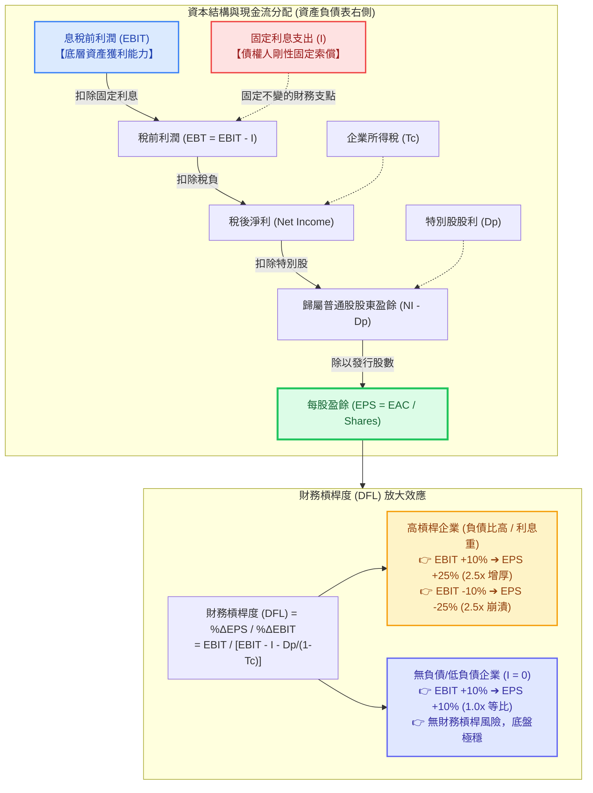

---
{"dg-publish":true,"permalink":"/98/financial-leverage/","tags":["商業概念","財務管理","公司理財","資本結構","融資決策","財務風險","PMBA"],"dg-note-properties":{"aliases":["財務槓桿","財務槓桿度","DFL","DFL_財務槓桿","Degree of Financial Leverage","Financial Leverage","financial-leverage","financial-leverage_財務槓桿","權益乘數槓桿","負債槓桿"],"tags":["商業概念","財務管理","公司理財","資本結構","融資決策","財務風險","PMBA"]}}
---


# 財務槓桿 (Financial Leverage) 與 財務槓桿度 (DFL)

> 💡 **導航與索引**：本篇為解析融資結構、固定利息負擔與股東回報放大效應之核心指標，亦可參閱本業結構雙刃劍 [[98_商業概念庫/DOL_營運槓桿\|營運槓桿度 (DOL)]]、資本折現標準 [[98_商業概念庫/wacc_加權平均資本成本\|加權平均資本成本 (WACC)]]、股東權益拆解工具 [[98_商業概念庫/dupont-analysis_杜邦分析法\|杜邦分析法 (DuPont)]]、損益兩平界限 [[98_商業概念庫/BEP_三大損益兩平點分析 Breakeven Analysis\|三大損益兩平點 (BEP)]]、估值共振效應 [[98_商業概念庫/davis-double-whammy_戴維斯雙殺效應\|戴維斯雙殺與雙擊效應]]，以及獲利底線指標 [[98_商業概念庫/_待改寫草稿庫/earnings-per-share_每股盈餘\|每股盈餘 (EPS)]] 與 [[98_商業概念庫/diluted-eps_稀釋後每股盈餘\|稀釋後每股盈餘 (Diluted EPS)]]。

## 一、 核心定義與財務學本質

- **財務槓桿 (Financial Leverage)** 係指企業在資本結構中利用**成本固定的融資來源（有息負債 Debt、特別股 Preferred Stock）**，藉以放大營業利益（EBIT）變動對普通股每股盈餘（EPS）與股東權益報酬率（ROE）之財務手段與運作機制。
- **資產端 vs. 資本端的對稱性（左側決定大餅大小，右側決定分潤與風險）**：
  - **左側（資產端，資本預算與營運決策）**：決定企業底層資產能創造多大的營業現金流與息稅前利潤（EBIT），承擔本業固有的**經營風險（Business Risk）**，以固定營運成本形成 [[98_商業概念庫/DOL_營運槓桿\|營運槓桿 (DOL)]]。
  - **右側（資本端，資本結構與融資決策）**：決定企業產生的現金流如何在債權人與股東之間切割。引入剛性固定利息支出（$I$），產生額外的**財務風險（Financial Risk）**，以固定財務成本形成**財務槓桿度 (DFL)**。
- **雙刃劍機制（Two-Sided Sword）**：
  - **🚀 順風正向增厚（$	ext{ROA} > r_d$，超額回報歸股東）**：
    若底層資產創造的總資產報酬率（ROA）高於債務融資成本（借款利率 $r_d$），資產扣除固定利息後的「超額利差」將全數歸屬於普通股股東，帶動每股盈餘（EPS）與股東權益報酬率（ROE）呈倍數爆發。
  - **💥 逆風負向反噬（$	ext{ROA} < r_d$，剛性利息引發財務危機）**：
    若底層資產獲利低於借貸利率，不足以支付固定利息的缺口將剛性侵蝕股東權益，導致 ROE 與 EPS 崩跌式滑落；一旦營業利益擊穿利息負擔，企業將迅速陷入財務困境成本（Financial Distress Costs），引發債務違約與破產清算。

---

## 二、 數理公式推導：靜態比率 vs. 動態彈性 (DFL)



### 1. 靜態槓桿指標（結構性槓桿 / 存量指標）
- **負債比率 (Debt Ratio)**：$$	ext{負債比率} = rac{	ext{總負債 (Total Debt)}}{	ext{總資產 (Total Assets)}}$$
- **負債權益比 (Debt-to-Equity Ratio, D/E)**：$$	ext{D/E 比率} = rac{	ext{有息負債 } D}{	ext{股東權益 } E}$$
- **權益乘數 (Equity Multiplier, EM)**：
  $$	ext{權益乘數 (EM)} = rac{	ext{總資產 } A}{	ext{股東權益 } E} = 1 + rac{D}{E}$$
  在[[dupont-analysis_杜邦分析法|杜邦分析法]]中，$	ext{ROE} = 	ext{淨利率} 	imes 	ext{總資產週轉率} 	imes 	ext{權益乘數}$，權益乘數直接反映了資產負債表右側的靜態槓桿倍數。

### 2. 動態彈性指標：財務槓桿度 (Degree of Financial Leverage, DFL)
- **彈性定義式（變動率視角）**：
  $$	ext{DFL} = rac{\% \Delta 	ext{EPS}}{\% \Delta 	ext{EBIT}} = rac{\Delta 	ext{EPS} / 	ext{EPS}}{\Delta 	ext{EBIT} / 	ext{EBIT}}$$
- **點位公式推導（含所得稅率 $T_c$ 與特別股股利 $D_p$）**：
  設普通股發行在外股數為 $S$，固定利息費用為 $I$，特別股股利為 $D_p$：
  $$	ext{EPS} = rac{(	ext{EBIT} - I)(1 - T_c) - D_p}{S}$$
  $$\Delta 	ext{EPS} = rac{\Delta 	ext{EBIT}(1 - T_c)}{S}$$
  代入定義式推導可得：
  $$	ext{DFL} = rac{rac{\Delta 	ext{EBIT}(1 - T_c)}{S}}{rac{(	ext{EBIT} - I)(1 - T_c) - D_p}{S}} \div rac{\Delta 	ext{EBIT}}{	ext{EBIT}}$$
  $$	ext{DFL} = rac{	ext{EBIT}}{	ext{EBIT} - I - rac{D_p}{1 - T_c}}$$
  - **無特別股情境之標準簡化式**：
    $$	ext{DFL} = rac{	ext{EBIT}}{	ext{EBIT} - I} = rac{	ext{息稅前利潤}}{	ext{稅前利潤 (EBT)}} = 1 + rac{I}{	ext{EBT}}$$
  - **數理核心定理**：
    1. 若企業為純權益無負債經營（$I = 0$ 且 $D_p = 0$），則 **$	ext{DFL} = 1$**。EBIT 增長 10%，EPS 嚴格等比例增長 10%，無財務槓桿。
    2. 只要承擔固定利息支出（$I > 0$）且獲利足以付息（$	ext{EBIT} > I$），必有 **$	ext{DFL} > 1$**。
    3. **利息負擔 $I$ 佔比越高（或 EBIT 越接近 $I$），$	ext{DFL} 	o \infty$**，財務脆弱度達到極限。

### 3. 雙槓桿聯立：總槓桿度 ([[degree-of-total-leverage-dtl_總槓桿|DTL / DCL]])
結合 [[DOL_營運槓桿|營運槓桿 (DOL)]] 與財務槓桿 (DFL)：
$$	ext{總槓桿度 (DCL)} = 	ext{DOL} 	imes 	ext{DFL} = rac{\% \Delta 	ext{EBIT}}{\% \Delta Q} 	imes rac{\% \Delta 	ext{EPS}}{\% \Delta 	ext{EBIT}} = rac{\% \Delta 	ext{EPS}}{\% \Delta Q}$$
$$	ext{DCL} = rac{Q(P - V)}{Q(P - V) - FC - I - rac{D_p}{1 - T_c}} = rac{	ext{邊際貢獻 (CM)}}{	ext{稅前利潤 (EBT)}}$$

---

## 三、 EBIT-EPS 無差異點（融資損益平衡點）分析

經理人在評估新一輪融資是採用「發債（Debt）」還是「發行新股（Equity）」時，最核心的量化工具即為 **EBIT-EPS 無差異點（Indifference Point, $	ext{EBIT}^*$）**：

### 1. 數理平衡模型
設方案一為純普通股增資（利息 $I_1 = 0$，股數 $S_U$），方案二為舉債融資（新增年利息 $I$，股數維持 $S_L$）：
$$rac{(	ext{EBIT}^* - I_1)(1 - T_c)}{S_U} = rac{(	ext{EBIT}^* - I_2)(1 - T_c)}{S_L}$$
消去所得稅項 $(1 - T_c)$ 並交叉相乘推導：
$$	ext{EBIT}^* \cdot S_L = (	ext{EBIT}^* - I) \cdot S_U$$
$$	ext{EBIT}^* (S_U - S_L) = I \cdot S_U$$
$$	ext{EBIT}^* = rac{I \cdot S_U}{S_U - S_L}$$

### 2. 經理人決策矩陣與準則

```text
       每股盈餘 EPS
          ▲
          │                          / 舉債方案 (方案 L，斜率陡峭：DFL > 1)
          │                         /
          │                        / 
 EPS* ────┼───────────────────────★ (無差異平衡點 EBIT*)
          │                      / 
          │                     / / 普通股方案 (方案 U，斜率平緩：DFL = 1)
          │                    / /
          │                   / /
          │                  / /
        0 ┼─────────────────/─/────────────────────────► EBIT
          │                I  
          │               /
          ▼              /
```

| 預期獲利區間 | 兩融資方案 EPS 比較 | 財務槓桿作用方向 | 經理人最佳融資決策建議 |
| :--- | :---: | :--- | :--- |
| **$	ext{EBIT} > 	ext{EBIT}^*$** | $	ext{EPS}_L > 	ext{EPS}_U$ | **正面增厚效應**：營業利益足夠覆蓋利息，超額利差放大每股獲利。 | **偏向債務融資 (Debt Financing)**<br>保留股權不稀釋，拉高 ROE。 |
| **$	ext{EBIT} = 	ext{EBIT}^*$** | $	ext{EPS}_L = 	ext{EPS}_U$ | **中立均衡點**：兩方案每股盈餘完全相等。 | 依資本結構目標比率與評級彈性決定。 |
| **$	ext{EBIT} < 	ext{EBIT}^*$** | $	ext{EPS}_L < 	ext{EPS}_U$ | **負面侵蝕效應**：底層獲利不足，固定利息嚴重稀釋每股盈餘。 | **偏向股權融資 (Equity Financing)**<br>避免剛性付息壓力，保障存續彈性。 |

---

## 四、 資本結構經典理論演進脈絡

財務槓桿如何影響企業總體價值？金融學界經歷了半個世紀的理論深化：

### 1. 莫迪利安尼-米勒定理（MM 定理，1958 無稅環境）
- **MM 第一命題（資本結構無關論）**：在無交易成本、無稅收、借貸利率一致的完美資本市場中，企業總市值由左側實體資產的獲利能力（EBIT）決定，與右側資本結構融資比例無關：
  $$V_L = V_U$$
- **自製槓桿機制（Homemade Leverage）**：個人投資人可透過個人借貸融通複製或消除企業的槓桿，無套利均衡使企業無法藉由調整資本結構創造額外價值。
- **MM 第二命題（權益成本代價）**：舉債雖然看似便宜（$r_d < r_e$），但舉債增加的財務風險會導致股東要求的股權報酬率 $r_e$ 線性上升：
  $$r_e = r_0 + rac{D}{E}(r_0 - r_d)$$
  股權成本上升的幅度，恰好 $100\%$ 抵消低息負債的成本優勢，使得加權平均資本成本 [[wacc_加權平均資本成本|WACC]] 保持恆定不變。

### 2. MM 修正定理（1963 引入公司所得稅）
- **利息稅盾效應 (Interest Tax Shield)**：負債利息可在計算所得稅前全額扣除，政府實質對負債融資提供了租稅補貼。企業總價值隨負債增加而單調遞增：
  $$V_L = V_U + T_c D$$
  $$	ext{WACC} = r_0 \left[ 1 - T_c rac{D}{V} 
ight]$$
- **極端理論推論**：在僅考慮公司所得稅下，企業應 100% 舉債營運以最大化企業價值。

### 3. 靜態權衡理論 (Trade-Off Theory)
- **引入破產與財務困境成本**：負債過高將推升破產清算風險、訴訟費用、客戶流失與高階人才離職等間接財務困境成本。
  $$	ext{企業價值 } V_L = V_U + 	ext{PV}(	ext{利息稅盾}) - 	ext{PV}(	ext{財務困境成本})$$
- **U 型 WACC 曲線與最佳資本結構**：
  - 低負債時：稅盾利益主導，WACC 隨負債上升而下降；
  - 超過最適臨界點：破產風險貼水激增壓倒稅盾利益，WACC 急速反彈。
  - **U 型曲線之谷底最低點，即為企業的 [[wacc_加權平均資本成本|最佳資本結構]]（$\min 	ext{WACC} \iff \max V$）**。

### 4. 啄食理論 (Pecking Order Theory, Myers & Majluf, 1984)
- 由於管理層與外部市場存在資訊不對稱（Information Asymmetry），新股發行常被市場解讀為「股票被高估」的負面訊號。
- **經理人融資順位鐵律**：
  **1. 內部留存盈餘**（最優先，零訊號摩擦） ➔ **2. 低風險債權融資** ➔ **3. 混合型證券（可轉換公司債）** ➔ **4. 發行普通股新股**（最後手段）。

---

## 五、 高階經理人實戰決策三大軍規

### 1. 利息保障倍數（TIE）之硬約束與防禦底線
- **利息保障倍數 (Times Interest Earned, TIE)**：
  $$	ext{TIE} = rac{	ext{息稅前利潤 (EBIT)}}{	ext{利息費用 (Interest)}} = rac{1}{1 - rac{1}{	ext{DFL}}}$$
- **決策安全邊際**：經理人絕不可將財務槓桿推至極限（當 $	ext{TIE} 	o 1.0$ 時，$	ext{DFL} 	o \infty$）。健康運營之企業應將 TIE 維持在 **$3.0 \sim 5.0$ 倍以上**；景氣循環型產業更需保留更高緩衝，以防景氣寒冬 EBIT 驟降時違約暴雷。

### 2. 與營運槓桿 (DOL) 的風險對沖配對原則
- **總槓桿平衡法則**：企業總風險取決於 $	ext{DCL} = 	ext{DOL} 	imes 	ext{DFL}$。
- **台積電典範（高 DOL + 極低 DFL）**：晶圓製造廠房機台折舊龐大、營運槓桿極高（高 DOL），台積電長年奉行極端穩健的低負債政策（負債比維持約 25%~30%，淨現金充足），以極低 DFL 對沖高 DOL，確保景氣下滑時絕不發生債務危機。
- **爆雷自殺組合（高 DOL + 高 DFL）**：前期資本支出龐大、獲利尚未穩定的企業（如算力租賃商 CoreWeave 發行高息長債、高槓桿房企），若同時背負高固定折舊與高額利息，一旦需求稍有放緩，營業利潤崩潰將與剛性利息產生乘數共振，直接觸發[[davis-double-whammy_戴維斯雙殺效應|戴維斯雙殺]]與債務違約。

### 3. 債務期限結構匹配（防範天期錯配 Duration Mismatch）
- **資產與負債天期對稱原則**：短期營運資金缺口（應收帳款、存貨）應以短期流動負債支應；長期資本支出（新廠擴建、研發併購）必須以長期資本（長期借款、公司債、股東權益）融通。
- **嚴禁「以短支長」**：若為追求低利率而大量依賴 1~2 年期短期商業本票（CP）支撐 5~7 年期重資產投資，一旦遭遇央行激進升息或金融市場流動性凍結，短債無法展期（Roll-over Failure），將瞬間引爆「黑字倒閉」危機。

---

## 六、 關聯主題與模組網絡

- 🧭 **課程核心模組對接**：
  - [[02_核心必修/01_財務管理/L08_資本結構理論與決策|L08 資本結構理論與決策]]（無稅 MM 定理推導、EBIT-EPS 無差異點分析、自製槓桿原理）
  - [[02_核心必修/01_財務管理/L09_資本結構理論與決策|L09 資本結構理論與決策]]（有稅 MM 稅盾效益、權衡理論 U 型曲線與 WACC 極小化）
  - [[02_核心必修/01_財務管理/L01_財務管理導論|L01 財務管理導論]]（資產端與資本端對稱架構、經營風險 vs 財務風險）
  - [[02_核心必修/01_財務管理/L02_基本財務報表與分析I|L02 基本財務報表與分析 I]]（權益乘數、資產負債率、利息保障倍數償債能力）
  - [[04_主題選修/10_創業與企業財務策略/02_模組筆記/Module_1_創新思維與商業模式/M1-2_白板決策鏈與財務價值三角|M1-2 白板決策鏈與財務價值三角]]（杜邦三因子拆解、DOL 與 DFL 雙槓桿乘數 DCL 課堂白板推導）
  - [[01_基礎先修/01_財務報表分析/Ch06_長期償債能力分析|Ch06 長期償債能力分析]]（負債比率、利息保障倍數、財務槓桿指數評估）
  - [[01_基礎先修/01_財務報表分析/Ch07_獲利能力分析|Ch07 獲利能力分析]]（財務槓桿對 ROE 擴張效應與獲利含金量檢驗）
- 🔗 **核心概念原子卡片**：
  - [[DOL_營運槓桿|營運槓桿度 (DOL)]] ｜ [[degree-of-total-leverage-dtl_總槓桿|總槓桿度 (DTL / DCL)]]
  - [[wacc_加權平均資本成本|加權平均資本成本 (WACC)]]
  - [[dupont-analysis_杜邦分析法|杜邦分析法 (DuPont Analysis)]]
  - [[BEP_三大損益兩平點分析 Breakeven Analysis|三大損益兩平點分析 (BEP)]]
  - [[davis-double-whammy_戴維斯雙殺效應|戴維斯雙殺與雙擊效應 (Davis Double Whammy)]]
  - [[earnings-per-share_每股盈餘|每股盈餘 (Basic EPS)]]
  - [[diluted-eps_稀釋後每股盈餘|稀釋後每股盈餘 (Diluted EPS)]]
  - [[leverage_自製槓桿|自製槓桿 (Homemade Leverage)]]
  - [[financial-structure_財務結構|財務結構 (Financial Structure)]]
