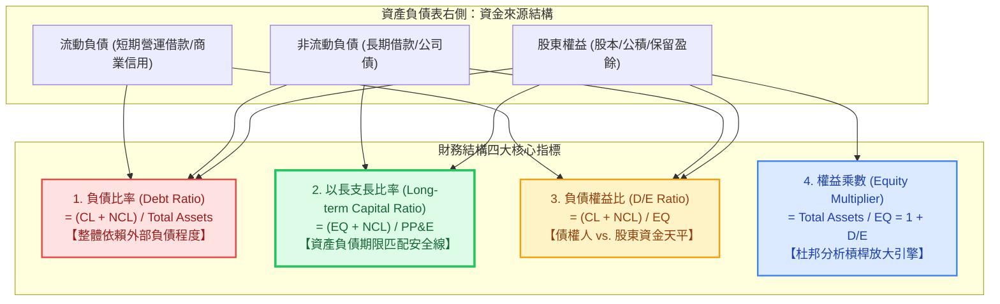

---
{"dg-publish":true,"permalink":"/98/financial-structure/","tags":["商業概念","財務管理","財務報表分析","公司理財","資本結構","償債能力","PMBA"],"dg-note-properties":{"aliases":["財務結構","財務結構分析","Financial Structure","financial-structure","財務結構比率","財務健全度"],"tags":["商業概念","財務管理","財務報表分析","公司理財","資本結構","償債能力","PMBA"]}}
---


# 財務結構 (Financial Structure)

> 💡 **導航與索引**：本篇為評估企業整體資金來源配置與長期清算安全底盤之核心概念，亦可參閱長期融資專題 [[98_商業概念庫/capital-structure_資本結構\|資本結構 (Capital Structure)]]、固定利息放大效應 [[98_商業概念庫/financial-leverage_財務槓桿\|財務槓桿 (Financial Leverage / DFL)]]、產銷營運敏感度 [[98_商業概念庫/DOL_營運槓桿\|營運槓桿度 (DOL)]]、總體風險複合指標 [[DTL_總槓桿\|總槓桿度 (DTL)]]、股東權益拆解工具 [[98_商業概念庫/dupont-analysis_杜邦分析法\|杜邦分析法 (DuPont)]]、損益兩平防線 [[98_商業概念庫/BEP_三大損益兩平點分析 Breakeven Analysis\|三大損益兩平點 (BEP)]]，以及加權折現基準 [[98_商業概念庫/wacc_加權平均資本成本\|加權平均資本成本 (WACC)]]。

## 一、 核心定義與「財務結構 vs. 資本結構」本質辨析

- **財務結構 (Financial Structure)** 係指企業**資產負債表右側全部資金來源的組合與比例關係**。它全面揭示了企業所擁有的總資產中，究竟是由**流動負債（短期商業信用與短期融通）**、**非流動負債（長期借款與應付公司債）**以及**股東權益（自有資本）**各以何種比重共同支持。
- **資產端與資本端的整體平衡**：
  $$\text{資產總額 (Total Assets)} = \text{負債總額 (Total Liabilities)} + \text{股東權益 (Stockholders' Equity)}$$
  $$\text{資產總額} = \underbrace{\text{流動負債} + \text{非流動負債}}_{\text{外來借貸資本 (財務結構上半部)}} + \underbrace{\text{股本} + \text{資本公積} + \text{保留盈餘}}_{\text{股東自有資本 (財務結構下半部)}}$$
- **財務結構 (Financial Structure) vs. 資本結構 (Capital Structure) 的深度辨析**：

```text
【資產負債表右側：財務結構 vs. 資本結構範圍對照】

  ┌─────────────────────────────────────────────────────────┐
  │                 【財務結構 (Financial Structure)】        │
  │                 涵蓋右側所有負債與權益項目 (全集)          │
  │  ┌───────────────────────────────────────────────────┐  │
  │  │ 流動負債 (Current Liabilities)                     │  │ ◄── 僅屬財務結構
  │  │ (應付帳款、短期借款、應付費用等短期營業與金融負債) │  │     (營運資本管理範疇)
  │  ├───────────────────────────────────────────────────┤  │
  │  │              【資本結構 (Capital Structure)】      │  │
  │  │              特指永久性長期資金來源 (子集)         │  │ ◄── 同時屬於
  │  │  • 非流動負債 (長期借款、應付公司債)               │  │     財務結構與資本結構
  │  │  • 特別股股本                                      │  │     (公司理財核心範疇)
  │  │  • 普通股權益 (股本、資本公積、保留盈餘)           │  │
  │  └───────────────────────────────────────────────────┘  │
  └─────────────────────────────────────────────────────────┘
```

| 比較維度 | 財務結構 (Financial Structure) | 資本結構 (Capital Structure) |
| :--- | :--- | :--- |
| **涵蓋範圍** | **全部資金來源**（流動負債 ＋ 非流動負債 ＋ 股東權益） | **僅限長期資金**（長期負債 ＋ 特別股 ＋ 普通股權益） |
| **核心管理視角** | 財務報表分析、信貸評等、長期償債安全、資產期限匹配 | 公司理財（Corporate Finance）、資金成本估算、融資政策 |
| **核心決策目標** | **保障企業財務健全度**、防範流動性危機與抽銀根風險 | **極小化加權平均資本成本（$\min \text{WACC}$）**、極大化企業價值（$\max V$） |
| **指標重心** | 負債比率、長期資金佔固定資產比率（以長支長） | 負債權益比（D/E）、權益成本（CAPM）、MM 理論稅盾與破產成本權衡 |

---

## 二、 財務結構四大核心量化指標體系

在財務報表分析與信用評等中，評估財務結構健全度的核心存量指標包括：



### 1. 負債比率 (Debt Ratio / 負債佔資產比率)
$$\text{負債比率} = \frac{\text{負債總額 (Total Debt)}}{\text{資產總額 (Total Assets)}} \times 100\%$$
- **經濟意涵**：企業總資產中，由債權人提供資金之比率。
- **安全準則**：
  - **一般實體製造與科技業**：通常以 **$\le 50\%$** 作為穩健分水嶺。若負債比率突破 $60\% \sim 70\%$，代表自有資本緩衝薄弱，清算受償安全性降低。
  - **特種金融與資產租賃業**：銀行、中租等因扮演資金中介，負債比率常年達 $85\% \sim 90\%$，需配合資本適足率（BIS）與呆帳覆蓋率綜合審查。

### 2. 長期資金佔不動產、廠房及設備比率 (以長支長比率)
$$\text{長期資金佔不動產、廠房及設備比率} = \frac{\text{股東權益總額} + \text{非流動負債總額}}{\text{不動產、廠房及設備淨額 (PP\&E)}} \times 100\%$$
- **剛性安全鐵律（必須嚴格 $> 100\%$）**：
  - 不動產、廠房及設備（PP&E）屬於多年期產能資產，透過長期折舊攤銷與產銷運作回收現金，變現週期極長。
  - **以長支長（Healthy Matching）**：長期資金（無到期日之權益 ＋ 數年期長債）必須 $100\%$ 覆蓋固定資產，甚至具備餘裕支持部分永久性營運資金。
  - **以短支長破產陷阱（Maturity Mismatch，$< 100\%$）**：若該比率低於 $100\%$，代表企業動用 3~6 個月短期銀行借款去購買機台或建造廠房。一旦遭遇總經升息或銀行收緊額度抽銀根，短債到期無法展期，企業將被迫賤賣生產設備停業破產。

### 3. 負債權益比 (Debt-to-Equity Ratio, D/E / 產權比率)
$$\text{負債權益比} = \frac{\text{負債總額}}{\text{股東權益總額}} \times 100\%$$
- **經濟意涵**：股東每出 1 元自有資金，向外部債權人借入多少元。
- **判讀門檻**：若 $\text{D/E} > 100\%$（$1.0$），代表債權人投入資本超越全體股東，股東角色相對弱化，企業財務結構偏向激進。

### 4. 權益乘數 (Equity Multiplier, EM)
$$\text{權益乘數} = \frac{\text{資產總額}}{\text{股東權益總額}} = 1 + \text{負債權益比} = \frac{1}{1 - \text{負債比率}}$$
- **杜邦分析聯立**：在[[98_商業概念庫/dupont-analysis_杜邦分析法\|杜邦分析法]]中，$\text{ROE} = \text{純益率} \times \text{總資產週轉率} \times \text{權益乘數}$。權益乘數直接反映財務結構對股東回報的槓桿放大倍數。

---

## 三、 資產負債期限匹配策略三維光譜

企業經理人在規劃財務結構時，面對資產端（波動性流動資產、永久性流動資產、長期固定資產）與負債端（短期負債、長期負債、股東權益），存在三種經典融資策略：

```text
【資產負債期限配置三大策略光譜】

  策略類型         資產配置特徵                     負債融通搭配                   財務風險與資金成本
 ──────────────────────────────────────────────────────────────────────────────────
 1. 配合型策略   長期資產 + 永久性流動資產   ──► 由長期資金 (權益+長債) 支應     風險與成本均衡
    (Hedging)     波動性臨時流動資產         ──► 由短期負債 (流動負債) 支應     完美期限匹配 (Zero Mismatch)

 2. 保守型策略   長期資產 + 永久流動資產     ──► 全額由長期資金支應              最低財務風險 / 抽銀根免疫
    (Conservative)波動性流動資產的大部分     ──► 亦由長期資金支應 (充沛淨營運資金)最高資金成本 / 犧牲 ROE

 3. 激進型策略   長期資產的一大部分         ──► 竟動用「短期負債」支應 (以短支長) 極高破產違約與再融資風險
    (Aggressive) 永久性與波動性流動資產     ──► 全由短期借款支應               短期借款成本最低，但極脆弱
```

---

## 四、 財務結構產業基因矩陣對標

不同產業因營運資產型態與商業模式差異，天生具備截然不同的財務結構基因：

| 產業類型 | 資本密集度 | 典型負債比率 | 以長支長比率 | 代表企業與財務特徵 |
| :--- | :---: | :---: | :---: | :--- |
| **先進半導體製造** | **極高** (重機台折舊) | **$25\% \sim 35\%$** (極低) | **$150\% \sim 180\%$** (極高) | **台積電 (2330)**：雖然資本支出龐大，但堅持以充沛獲利保留盈餘與超低負債支持擴產，底盤堅若磐石。 |
| **航空 / 航運重資產** | **高** (飛機/船舶長週期) | **$60\% \sim 75\%$** (中高) | **$105\% \sim 115\%$** (緊繃) | **長榮、陽明、華航**：需運用巨額租賃負債與抵押借款購置長年期資產，景氣低谷時承受沉重還本付息壓力。 |
| **零售通路與餐飲** | **中低** (租賃門市/高翻桌) | **$55\% \sim 65\%$** (中等) | **$120\% \sim 140\%$** (充裕) | **統一超 (2912)、全家**：無息應付帳款佔比高，善用供應商商業信用形成負營運資本（Negative NWC）。 |
| **軟體 SaaS 與生技研發** | **極低** (輕實體資產) | **$10\% \sim 25\%$** (極低) | **$300\%+$** (無實體廠房) | **微軟、SaaS 新創**：幾乎無廠房設備，全以股權融資與保留盈餘支撐研發，幾無破產清算風險。 |

---

## 五、 高階經理人實戰決策三大軍規

### 1. 嚴守「以長支長」，杜絕天期錯配（Duration Mismatch）
- 經理人審批任何重大資本支出專案（如新廠建設、先進封裝產線、併購案）時，**資金排程必須確認長期聯貸案或股權增資款項已實質到位**，嚴禁存有「先借短期銀行商業本票先行墊付、日後再行置換長債」的投機心態。一旦外部流動性緊縮，天期錯配將演變成致命的黑字倒閉。

### 2. 景氣週期頂峰的主動「除槓桿」（De-leveraging）
- 在朱格拉資本支出週期或產業景氣頂峰（營收滿載、毛利率創高）時，經理人不可被當期充沛的現金流沖昏頭腦而擴大借貸。聰明的 CFO 應利用繁榮期加速清償高息債務，降低負債比率，增厚自有資本儲備，為即將到來的產業寒冬備足過冬糧草。

### 3. 債務限制條款（Debt Covenants）的動態預警防線
- 企業與金融機構簽訂聯貸合約時，銀行往往會對財務結構設定嚴格的合約限制條款：
  - **負債比率上限**（如不得高於 $60\%$）；
  - **流動比率下限**（如不得低於 $100\%$）；
  - **有形淨值最低水準**（Tangible Net Worth）。
- 經理人必須建立財務指標敏感度模型，確保在各類景氣壓力測試下，各項財務結構指標與限制條款之間隨時保有 **$15\% \sim 20\%$ 以上的防禦安全邊際**，杜絕觸發提前還款條款引發的擠兌危機。

---

## 六、 關聯主題與模組網絡

- 🧭 **課程核心模組對接**：
  - [[01_基礎先修/01_財務報表分析/Ch06_長期償債能力分析\|Ch06 長期償債能力分析]]（財務結構五大比率、以長支長原則、財務槓桿指數 FLI）
  - [[01_基礎先修/01_財務報表分析/Ch03_認識資產負債表與權益變動表\|Ch03 認識資產負債表與權益變動表]]（資產負債表平衡原理、資本結構與營運資本）
  - [[02_核心必修/01_財務管理/L08_資本結構理論與決策\|L08 資本結構理論與決策]]（無稅 MM 定理推導、EBIT-EPS 無差異點與財務槓桿風險）
  - [[02_核心必修/01_財務管理/L09_資本結構理論與決策\|L09 資本結構理論與決策]]（有稅 MM 稅盾效益、權衡理論 U 型曲線與 WACC 極小化）
  - [[02_核心必修/01_財務管理/L01_財務管理導論\|L01 財務管理導論]]（資產負債表左右對稱架構、經營風險 vs 財務風險）
  - [[04_主題選修/10_創業與企業財務策略/02_模組筆記/Module_1_創新思維與商業模式/M1-2_白板決策鏈與財務價值三角\|M1-2 白板決策鏈與財務價值三角]]（杜邦三因子拆解、企業生命週期投融資矩陣）
- 🔗 **核心概念原子卡片**：
  - [[98_商業概念庫/capital-structure_資本結構\|資本結構 (Capital Structure)]]
  - [[98_商業概念庫/financial-leverage_財務槓桿\|財務槓桿度 (DFL)]]
  - [[98_商業概念庫/DOL_營運槓桿\|營運槓桿度 (DOL)]]
  - [[DTL_總槓桿\|總槓桿度 (DTL)]]
  - [[98_商業概念庫/dupont-analysis_杜邦分析法\|杜邦分析法 (DuPont Analysis)]]
  - [[98_商業概念庫/BEP_三大損益兩平點分析 Breakeven Analysis\|三大損益兩平點分析 (BEP)]]
  - [[98_商業概念庫/wacc_加權平均資本成本\|加權平均資本成本 (WACC)]]
  - [[98_商業概念庫/davis-double-whammy_戴維斯雙殺效應\|戴維斯雙殺與雙擊效應 (Davis Double Whammy)]]
